# 第1章 集合与逻辑 教材题库

原图保留题目、公式和图形。OCR文字仅供检索，未经人工逐字校对。例题及思考保留教材原解或紧邻说明。

## XJ-B1-C01-TH-P002-Y0577 p.2 思考（含紧邻说明）

教材位置：第1章 / 1.1 集合 / 印刷页 p.2、3 / PDF 第9、10页。

类型：思考；原题号：未编号题组。

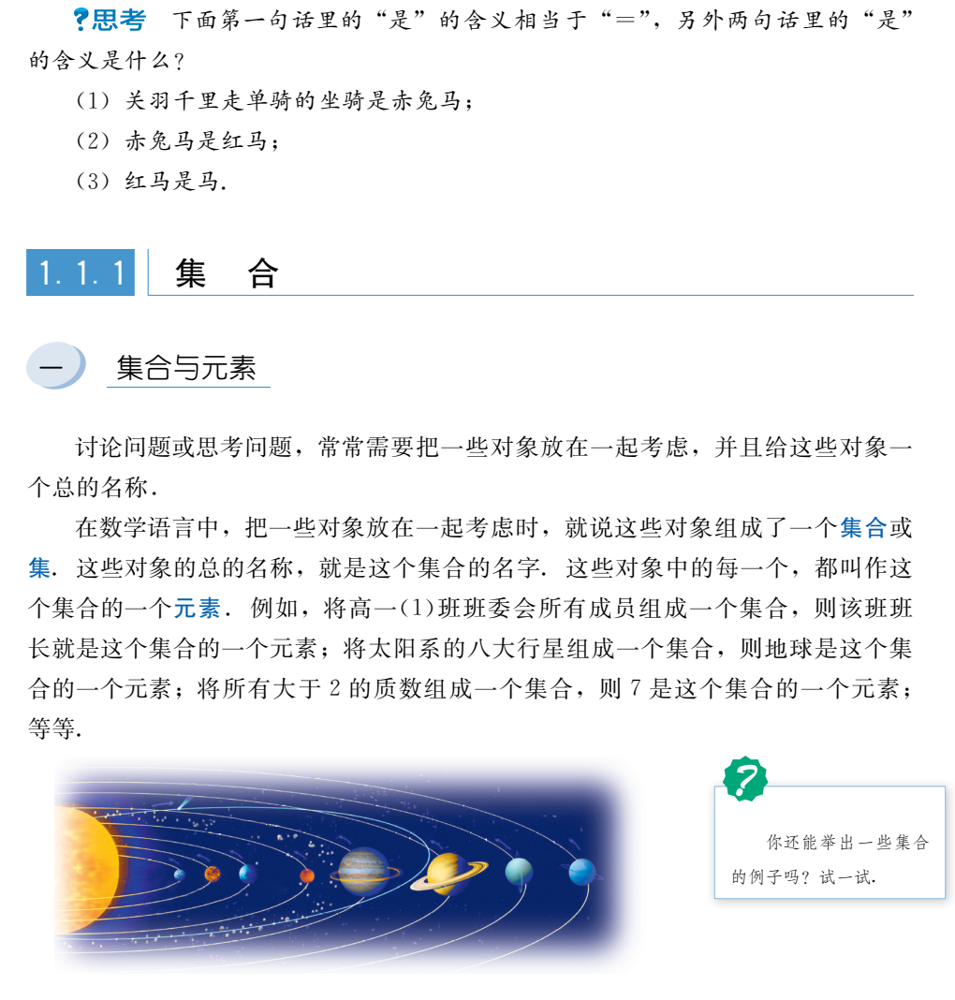
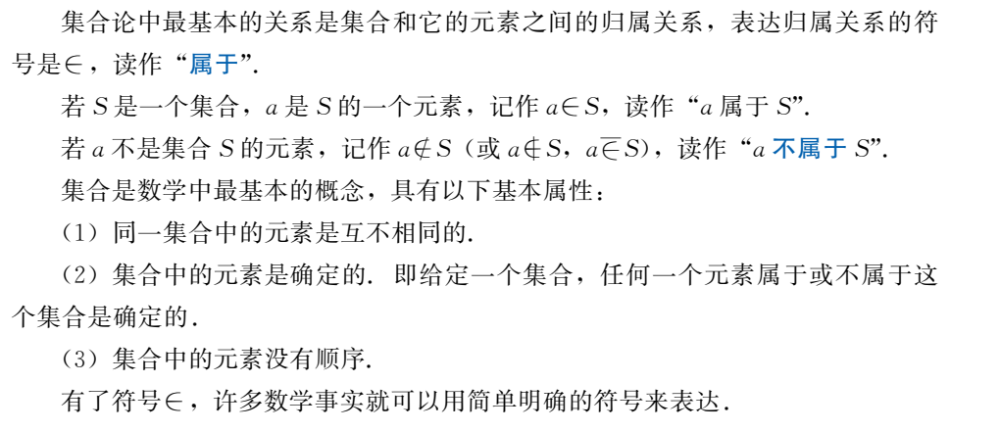

原页上下文：[PDF第9页](../原页上下文/PDF009-教材p002.webp)；[PDF第10页](../原页上下文/PDF010-教材p003.webp)

## XJ-B1-C01-EX-P003-Y0620 1.1 例题 例题1

教材位置：第1章 / 1.1 集合 / 印刷页 p.3 / PDF 第10页。

类型：例题；原题号：例题1。

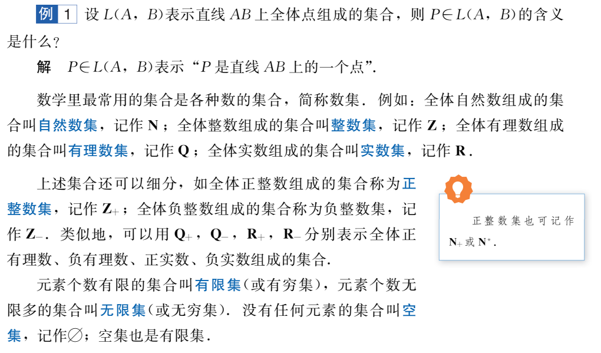

原页上下文：[PDF第10页](../原页上下文/PDF010-教材p003.webp)

## XJ-B1-C01-EX-P003-Y1223 1.1 例题 例题2

教材位置：第1章 / 1.1 集合 / 印刷页 p.3 / PDF 第10页。

类型：例题；原题号：例题2。

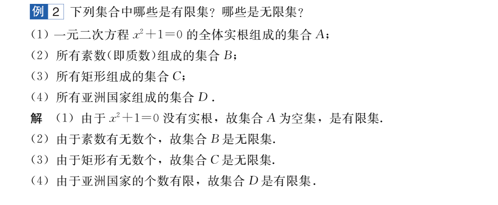

原页上下文：[PDF第10页](../原页上下文/PDF010-教材p003.webp)

## XJ-B1-C01-PR-P004-Y0218 p.4 练习 第1题

教材位置：第1章 / 1.1 集合 / 印刷页 p.4 / PDF 第11页。

类型：练习；原题号：第1题。

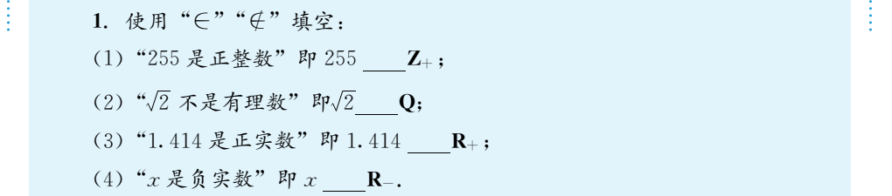

原页上下文：[PDF第11页](../原页上下文/PDF011-教材p004.webp)

## XJ-B1-C01-PR-P004-Y0443 p.4 练习 第2题

教材位置：第1章 / 1.1 集合 / 印刷页 p.4 / PDF 第11页。

类型：练习；原题号：第2题。

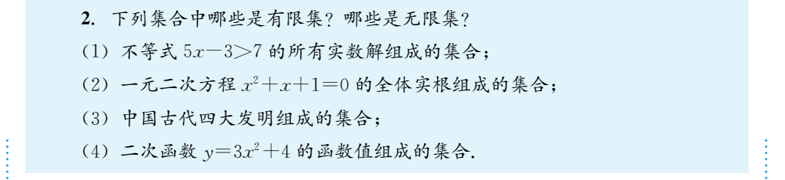

原页上下文：[PDF第11页](../原页上下文/PDF011-教材p004.webp)

## XJ-B1-C01-EX-P004-Y1108 1.1 例题 例题3

教材位置：第1章 / 1.1 集合 / 印刷页 p.4、5 / PDF 第11、12页。

类型：例题；原题号：例题3。

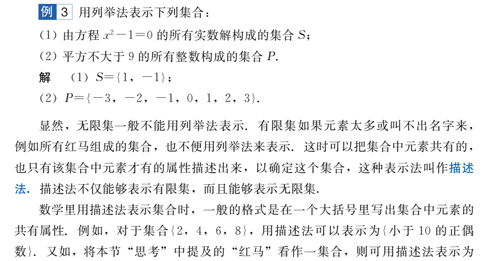
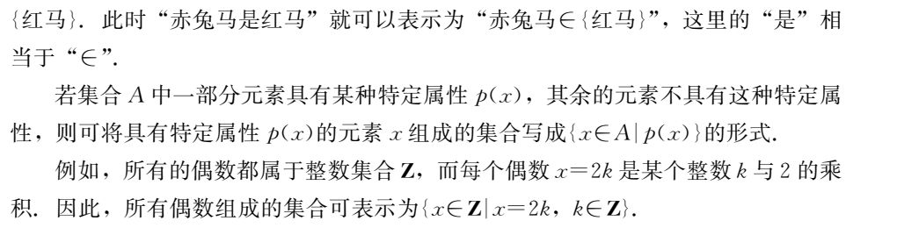

原页上下文：[PDF第11页](../原页上下文/PDF011-教材p004.webp)；[PDF第12页](../原页上下文/PDF012-教材p005.webp)

## XJ-B1-C01-EX-P005-Y0448 1.1 例题 例题4

教材位置：第1章 / 1.1 集合 / 印刷页 p.5 / PDF 第12页。

类型：例题；原题号：例题4。

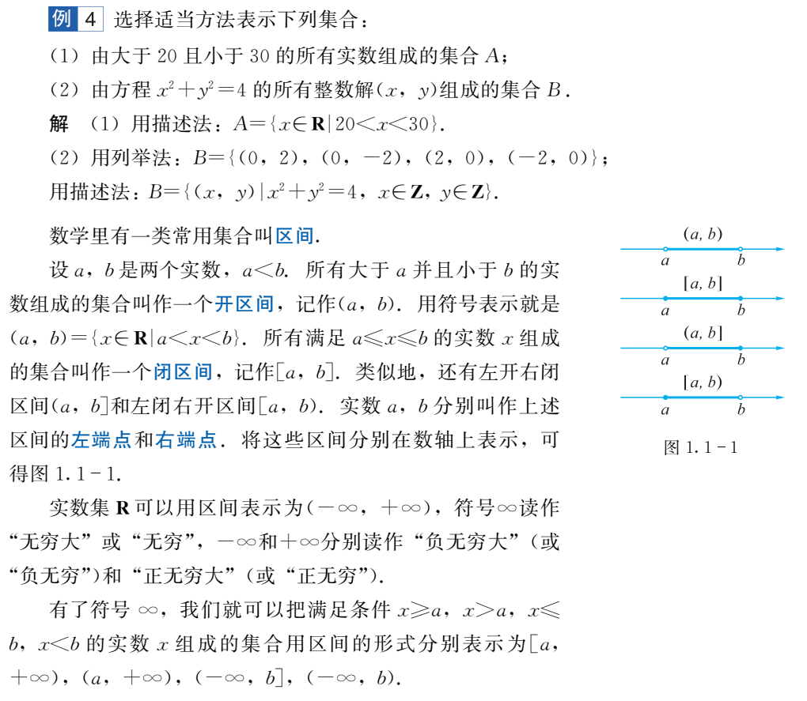

原页上下文：[PDF第12页](../原页上下文/PDF012-教材p005.webp)

## XJ-B1-C01-EX-P005-Y1339 1.1 例题 例题5

教材位置：第1章 / 1.1 集合 / 印刷页 p.5 / PDF 第12页。

类型：例题；原题号：例题5。

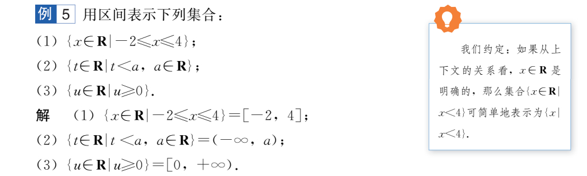

原页上下文：[PDF第12页](../原页上下文/PDF012-教材p005.webp)

## XJ-B1-C01-PR-P006-Y0217 p.6 练习 第1题

教材位置：第1章 / 1.1 集合 / 印刷页 p.6 / PDF 第13页。

类型：练习；原题号：第1题。

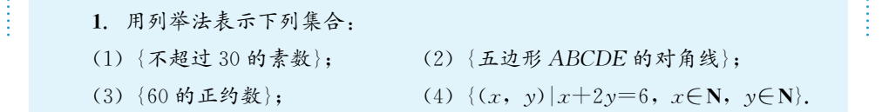

原页上下文：[PDF第13页](../原页上下文/PDF013-教材p006.webp)

## XJ-B1-C01-PR-P006-Y0346 p.6 练习 第2题

教材位置：第1章 / 1.1 集合 / 印刷页 p.6 / PDF 第13页。

类型：练习；原题号：第2题。

原页上下文：[PDF第13页](../原页上下文/PDF013-教材p006.webp)

## XJ-B1-C01-PR-P006-Y0475 p.6 练习 第3题

教材位置：第1章 / 1.1 集合 / 印刷页 p.6 / PDF 第13页。

类型：练习；原题号：第3题。

原页上下文：[PDF第13页](../原页上下文/PDF013-教材p006.webp)

## XJ-B1-C01-TH-P006-Y0849 p.6 思考（含紧邻说明）

教材位置：第1章 / 1.1 集合 / 印刷页 p.6、7 / PDF 第13、14页。

类型：思考；原题号：未编号题组。

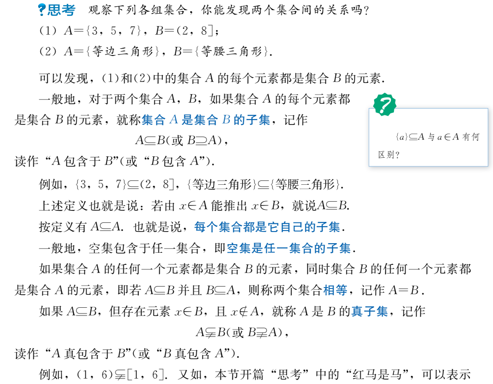
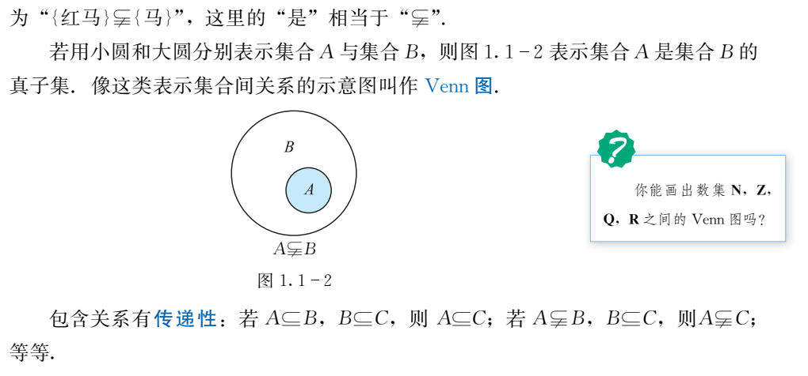

原页上下文：[PDF第13页](../原页上下文/PDF013-教材p006.webp)；[PDF第14页](../原页上下文/PDF014-教材p007.webp)

## XJ-B1-C01-EX-P007-Y0656 1.1 例题 例题6

教材位置：第1章 / 1.1 集合 / 印刷页 p.7 / PDF 第14页。

类型：例题；原题号：例题6。

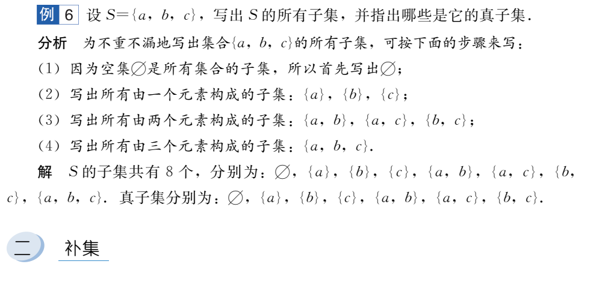

原页上下文：[PDF第14页](../原页上下文/PDF014-教材p007.webp)

## XJ-B1-C01-TH-P007-Y1130 p.7 思考（含紧邻说明）

教材位置：第1章 / 1.1 集合 / 印刷页 p.7、8 / PDF 第14、15页。

类型：思考；原题号：未编号题组。

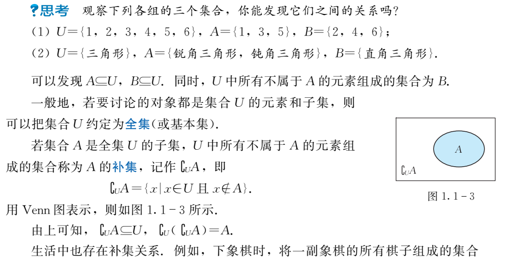
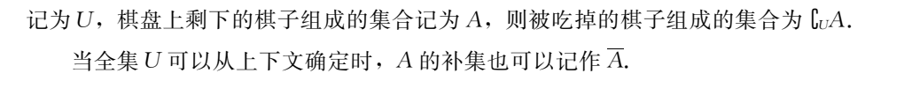

原页上下文：[PDF第14页](../原页上下文/PDF014-教材p007.webp)；[PDF第15页](../原页上下文/PDF015-教材p008.webp)

## XJ-B1-C01-EX-P008-Y0280 1.1 例题 例题7

教材位置：第1章 / 1.1 集合 / 印刷页 p.8 / PDF 第15页。

类型：例题；原题号：例题7。

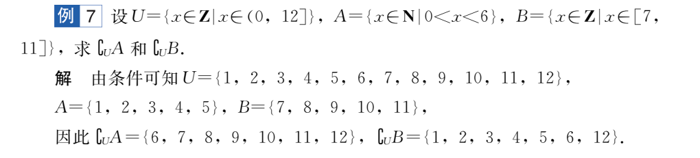

原页上下文：[PDF第15页](../原页上下文/PDF015-教材p008.webp)

## XJ-B1-C01-EX-P008-Y0515 1.1 例题 例题8

教材位置：第1章 / 1.1 集合 / 印刷页 p.8 / PDF 第15页。

类型：例题；原题号：例题8。

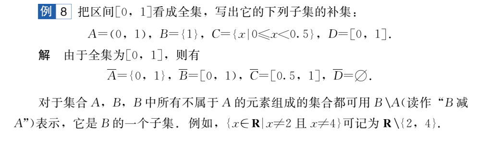

原页上下文：[PDF第15页](../原页上下文/PDF015-教材p008.webp)

## XJ-B1-C01-PR-P008-Y0877 p.8 练习 第1题

教材位置：第1章 / 1.1 集合 / 印刷页 p.8 / PDF 第15页。

类型：练习；原题号：第1题。

原页上下文：[PDF第15页](../原页上下文/PDF015-教材p008.webp)

## XJ-B1-C01-PR-P008-Y0920 p.8 练习 第2题

教材位置：第1章 / 1.1 集合 / 印刷页 p.8 / PDF 第15页。

类型：练习；原题号：第2题。

原页上下文：[PDF第15页](../原页上下文/PDF015-教材p008.webp)

## XJ-B1-C01-PR-P008-Y1092 p.8 练习 第3题

教材位置：第1章 / 1.1 集合 / 印刷页 p.8 / PDF 第15页。

类型：练习；原题号：第3题。

原页上下文：[PDF第15页](../原页上下文/PDF015-教材p008.webp)

## XJ-B1-C01-PR-P008-Y1178 p.8 练习 第4题

教材位置：第1章 / 1.1 集合 / 印刷页 p.8 / PDF 第15页。

类型：练习；原题号：第4题。

原页上下文：[PDF第15页](../原页上下文/PDF015-教材p008.webp)

## XJ-B1-C01-TH-P009-Y0951 p.9 思考（含紧邻说明）

教材位置：第1章 / 1.1 集合 / 印刷页 p.9、10 / PDF 第16、17页。

类型：思考；原题号：未编号题组。

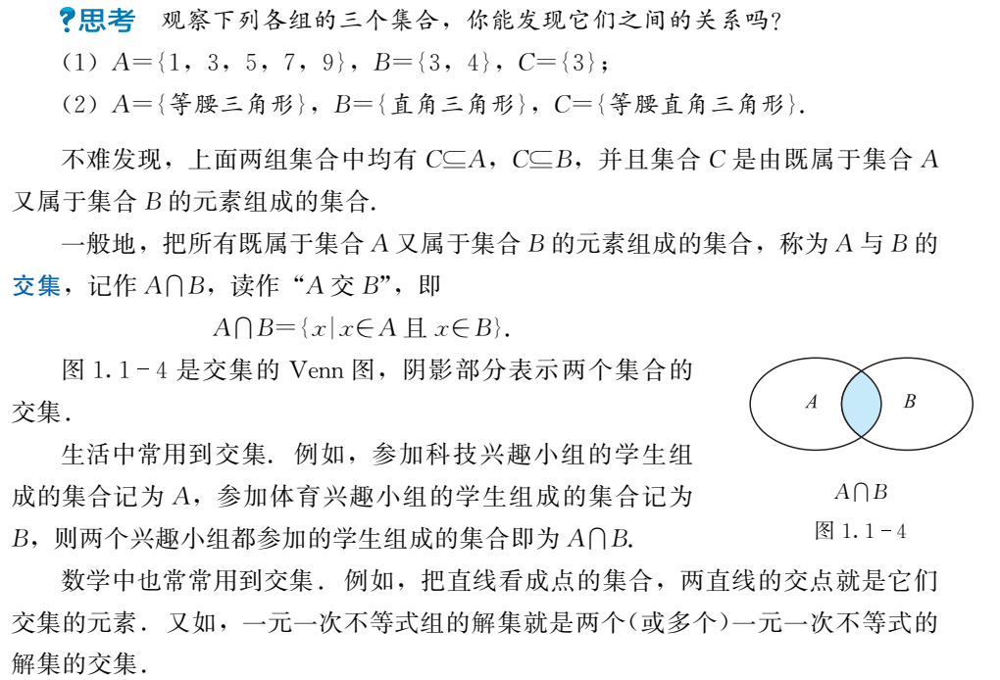

原页上下文：[PDF第16页](../原页上下文/PDF016-教材p009.webp)；[PDF第17页](../原页上下文/PDF017-教材p010.webp)

## XJ-B1-C01-EX-P010-Y0276 1.1 例题 例题9

教材位置：第1章 / 1.1 集合 / 印刷页 p.10 / PDF 第17页。

类型：例题；原题号：例题9。

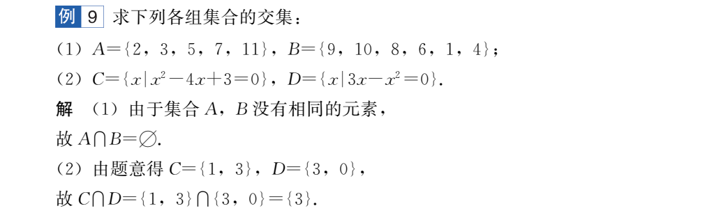

原页上下文：[PDF第17页](../原页上下文/PDF017-教材p010.webp)

## XJ-B1-C01-EX-P010-Y0596 1.1 例题 例题10

教材位置：第1章 / 1.1 集合 / 印刷页 p.10 / PDF 第17页。

类型：例题；原题号：例题10。

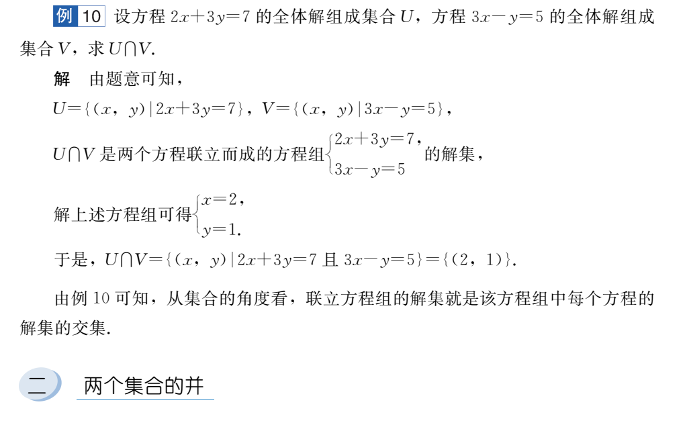

原页上下文：[PDF第17页](../原页上下文/PDF017-教材p010.webp)

## XJ-B1-C01-TH-P010-Y1233 p.10 思考（含紧邻说明）

教材位置：第1章 / 1.1 集合 / 印刷页 p.10、11 / PDF 第17、18页。

类型：思考；原题号：未编号题组。

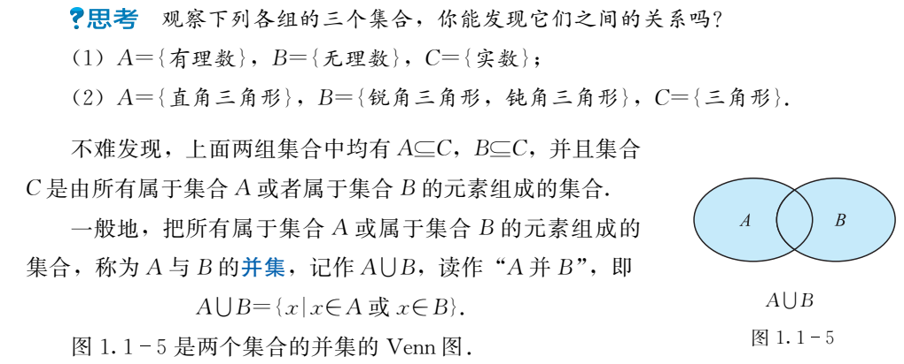
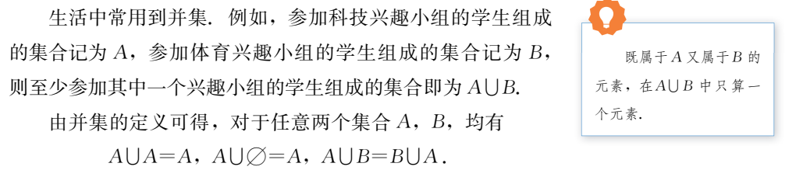

原页上下文：[PDF第17页](../原页上下文/PDF017-教材p010.webp)；[PDF第18页](../原页上下文/PDF018-教材p011.webp)

## XJ-B1-C01-EX-P011-Y0417 1.1 例题 例题11

教材位置：第1章 / 1.1 集合 / 印刷页 p.11 / PDF 第18页。

类型：例题；原题号：例题11。

原页上下文：[PDF第18页](../原页上下文/PDF018-教材p011.webp)

## XJ-B1-C01-EX-P011-Y0583 1.1 例题 例题12

教材位置：第1章 / 1.1 集合 / 印刷页 p.11 / PDF 第18页。

类型：例题；原题号：例题12。

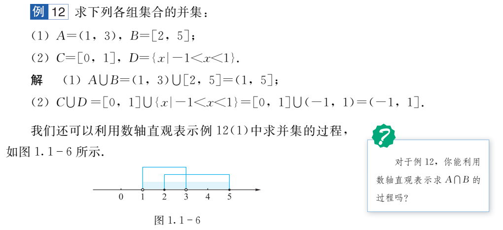

原页上下文：[PDF第18页](../原页上下文/PDF018-教材p011.webp)

## XJ-B1-C01-TH-P011-Y1054 p.11 思考（含紧邻说明）

教材位置：第1章 / 1.1 集合 / 印刷页 p.11 / PDF 第18页。

类型：思考；原题号：未编号题组。

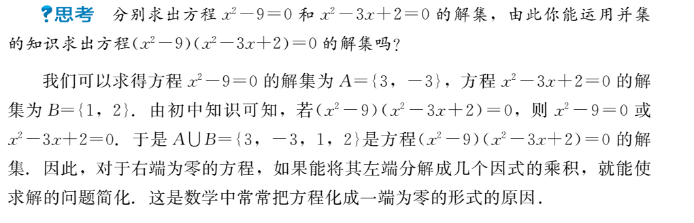

原页上下文：[PDF第18页](../原页上下文/PDF018-教材p011.webp)

## XJ-B1-C01-PR-P011-Y1439 p.11 练习 第1题

教材位置：第1章 / 1.1 集合 / 印刷页 p.11 / PDF 第18页。

类型：练习；原题号：第1题。

原页上下文：[PDF第18页](../原页上下文/PDF018-教材p011.webp)

## XJ-B1-C01-PR-P011-Y1484 p.11 练习 第2题

教材位置：第1章 / 1.1 集合 / 印刷页 p.11 / PDF 第18页。

类型：练习；原题号：第2题。

原页上下文：[PDF第18页](../原页上下文/PDF018-教材p011.webp)

## XJ-B1-C01-PR-P011-Y1526 p.11 练习 第3题

教材位置：第1章 / 1.1 集合 / 印刷页 p.11 / PDF 第18页。

类型：练习；原题号：第3题。

原页上下文：[PDF第18页](../原页上下文/PDF018-教材p011.webp)

## XJ-B1-C01-PR-P011-Y1570 p.11 练习 第4题

教材位置：第1章 / 1.1 集合 / 印刷页 p.11 / PDF 第18页。

类型：练习；原题号：第4题。

原页上下文：[PDF第18页](../原页上下文/PDF018-教材p011.webp)

## XJ-B1-C01-HW-P012-Y0440 习题1.1 第1题

教材位置：第1章 / 1.1 集合 / 印刷页 p.12 / PDF 第19页。

类型：习题；原题号：第1题。

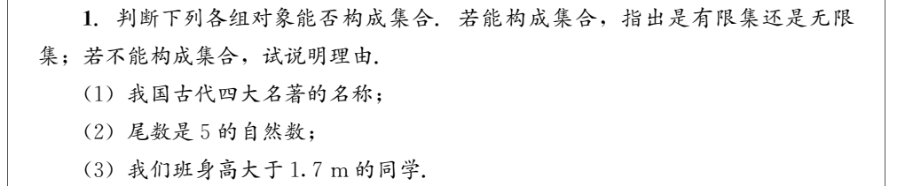

原页上下文：[PDF第19页](../原页上下文/PDF019-教材p012.webp)

## XJ-B1-C01-HW-P012-Y0651 习题1.1 第2题

教材位置：第1章 / 1.1 集合 / 印刷页 p.12 / PDF 第19页。

类型：习题；原题号：第2题。

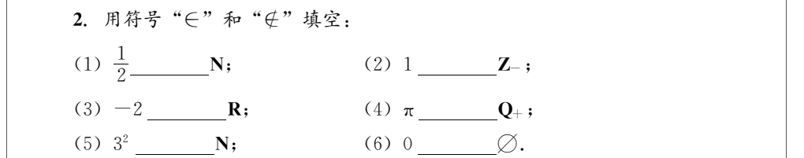

原页上下文：[PDF第19页](../原页上下文/PDF019-教材p012.webp)

## XJ-B1-C01-HW-P012-Y0852 习题1.1 第3题

教材位置：第1章 / 1.1 集合 / 印刷页 p.12 / PDF 第19页。

类型：习题；原题号：第3题。

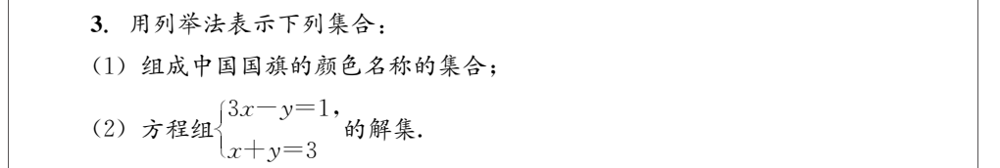

原页上下文：[PDF第19页](../原页上下文/PDF019-教材p012.webp)

## XJ-B1-C01-HW-P012-Y1024 习题1.1 第4题

教材位置：第1章 / 1.1 集合 / 印刷页 p.12 / PDF 第19页。

类型：习题；原题号：第4题。

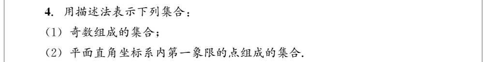

原页上下文：[PDF第19页](../原页上下文/PDF019-教材p012.webp)

## XJ-B1-C01-HW-P012-Y1154 习题1.1 第5题

教材位置：第1章 / 1.1 集合 / 印刷页 p.12 / PDF 第19页。

类型：习题；原题号：第5题。

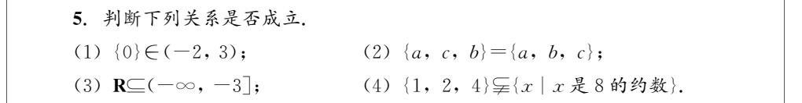

原页上下文：[PDF第19页](../原页上下文/PDF019-教材p012.webp)

## XJ-B1-C01-HW-P012-Y1286 习题1.1 第6题

教材位置：第1章 / 1.1 集合 / 印刷页 p.12 / PDF 第19页。

类型：习题；原题号：第6题。

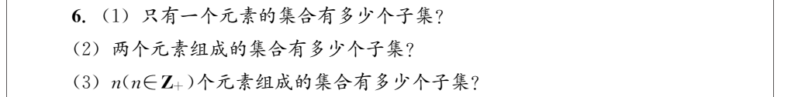

原页上下文：[PDF第19页](../原页上下文/PDF019-教材p012.webp)

## XJ-B1-C01-HW-P012-Y1412 习题1.1 第7题

教材位置：第1章 / 1.1 集合 / 印刷页 p.12、13 / PDF 第19、20页。

类型：习题；原题号：第7题。

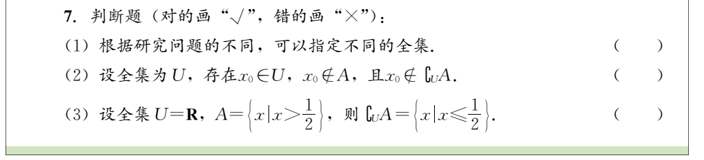
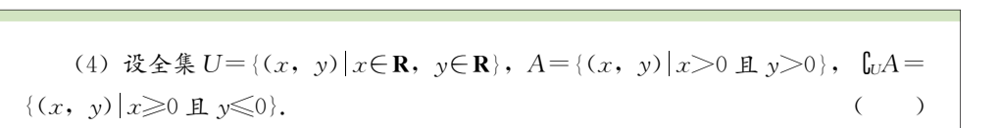

原页上下文：[PDF第19页](../原页上下文/PDF019-教材p012.webp)；[PDF第20页](../原页上下文/PDF020-教材p013.webp)

## XJ-B1-C01-HW-P013-Y0307 习题1.1 第8题

教材位置：第1章 / 1.1 集合 / 印刷页 p.13 / PDF 第20页。

类型：习题；原题号：第8题。

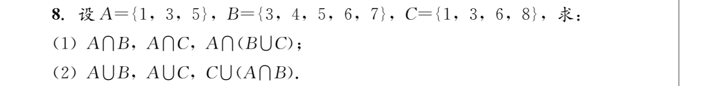

原页上下文：[PDF第20页](../原页上下文/PDF020-教材p013.webp)

## XJ-B1-C01-HW-P013-Y0433 习题1.1 第9题

教材位置：第1章 / 1.1 集合 / 印刷页 p.13 / PDF 第20页。

类型：习题；原题号：第9题。

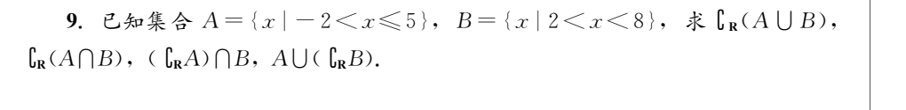

原页上下文：[PDF第20页](../原页上下文/PDF020-教材p013.webp)

## XJ-B1-C01-HW-P013-Y0665 习题1.1 第10题

教材位置：第1章 / 1.1 集合 / 印刷页 p.13 / PDF 第20页。

类型：习题；原题号：第10题。

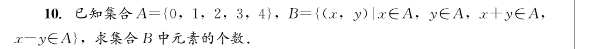

原页上下文：[PDF第20页](../原页上下文/PDF020-教材p013.webp)

## XJ-B1-C01-HW-P013-Y0750 习题1.1 第11题

教材位置：第1章 / 1.1 集合 / 印刷页 p.13 / PDF 第20页。

类型：习题；原题号：第11题。

原页上下文：[PDF第20页](../原页上下文/PDF020-教材p013.webp)

## XJ-B1-C01-HW-P013-Y0794 习题1.1 第12题

教材位置：第1章 / 1.1 集合 / 印刷页 p.13 / PDF 第20页。

类型：习题；原题号：第12题。

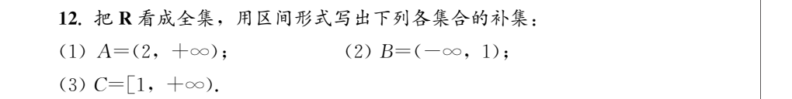

原页上下文：[PDF第20页](../原页上下文/PDF020-教材p013.webp)

## XJ-B1-C01-HW-P013-Y0922 习题1.1 第13题

教材位置：第1章 / 1.1 集合 / 印刷页 p.13 / PDF 第20页。

类型：习题；原题号：第13题。

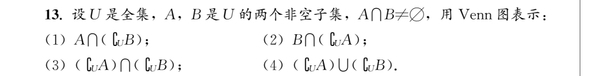

原页上下文：[PDF第20页](../原页上下文/PDF020-教材p013.webp)

## XJ-B1-C01-HW-P013-Y1051 习题1.1 第14题

教材位置：第1章 / 1.1 集合 / 印刷页 p.13 / PDF 第20页。

类型：习题；原题号：第14题。

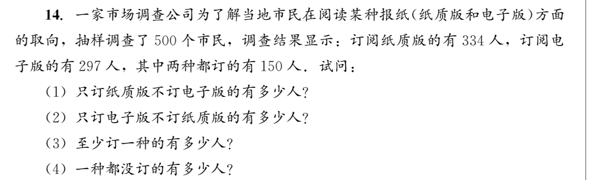

原页上下文：[PDF第20页](../原页上下文/PDF020-教材p013.webp)

## XJ-B1-C01-HW-P013-Y1352 习题1.1 第15题

教材位置：第1章 / 1.1 集合 / 印刷页 p.13 / PDF 第20页。

类型：习题；原题号：第15题。

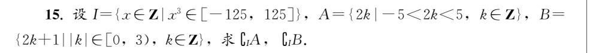

原页上下文：[PDF第20页](../原页上下文/PDF020-教材p013.webp)

## XJ-B1-C01-HW-P013-Y1442 习题1.1 第16题

教材位置：第1章 / 1.1 集合 / 印刷页 p.13 / PDF 第20页。

类型：习题；原题号：第16题。

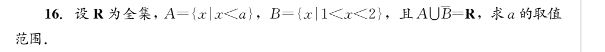

原页上下文：[PDF第20页](../原页上下文/PDF020-教材p013.webp)

## XJ-B1-C01-HW-P013-Y1531 习题1.1 第17题

教材位置：第1章 / 1.1 集合 / 印刷页 p.13 / PDF 第20页。

类型：习题；原题号：第17题。

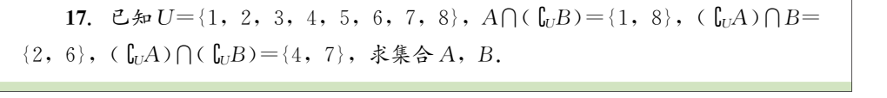

原页上下文：[PDF第20页](../原页上下文/PDF020-教材p013.webp)

## XJ-B1-C01-TH-P014-Y1066 p.14 思考（含紧邻说明）

教材位置：第1章 / 1.2 常用逻辑用语 / 印刷页 p.14 / PDF 第21页。

类型：思考；原题号：未编号题组。

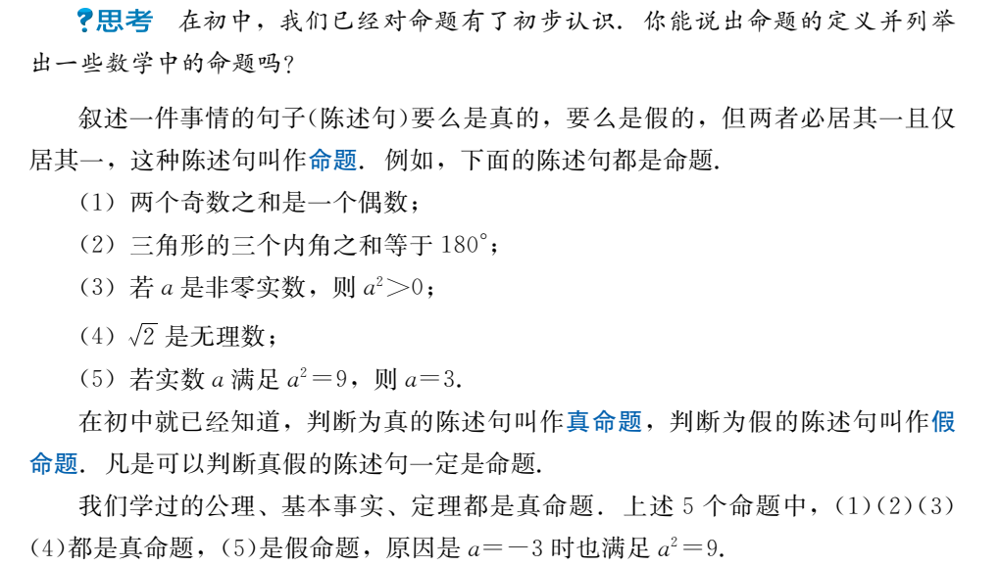

原页上下文：[PDF第21页](../原页上下文/PDF021-教材p014.webp)

## XJ-B1-C01-EX-P015-Y0177 1.2 例题 例题1

教材位置：第1章 / 1.2 常用逻辑用语 / 印刷页 p.15 / PDF 第22页。

类型：例题；原题号：例题1。

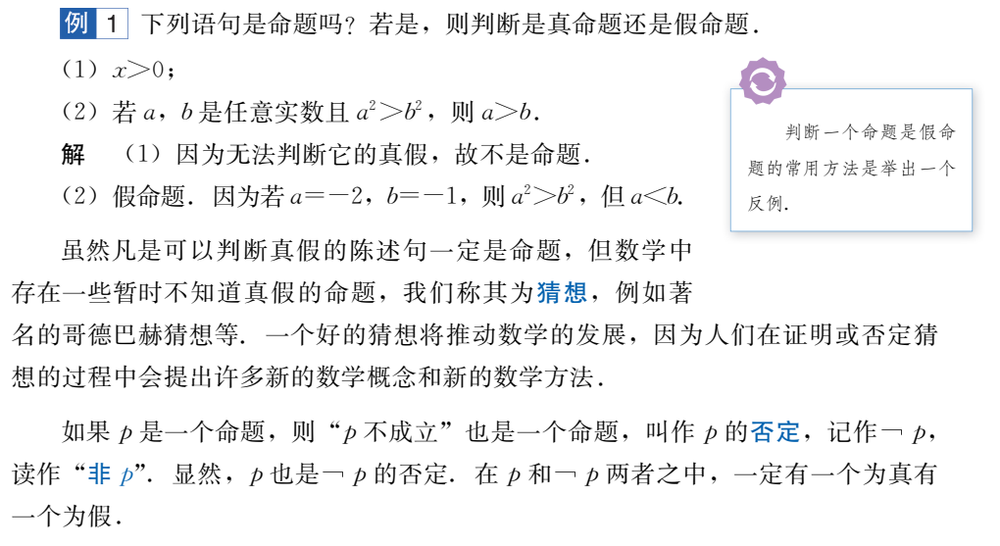

原页上下文：[PDF第22页](../原页上下文/PDF022-教材p015.webp)

## XJ-B1-C01-EX-P015-Y0738 1.2 例题 例题2

教材位置：第1章 / 1.2 常用逻辑用语 / 印刷页 p.15 / PDF 第22页。

类型：例题；原题号：例题2。

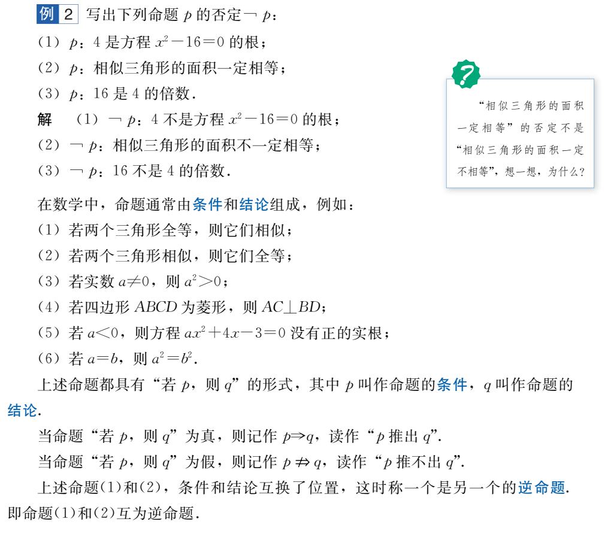

原页上下文：[PDF第22页](../原页上下文/PDF022-教材p015.webp)

## XJ-B1-C01-PR-P016-Y0217 p.16 练习 第1题

教材位置：第1章 / 1.2 常用逻辑用语 / 印刷页 p.16 / PDF 第23页。

类型：练习；原题号：第1题。

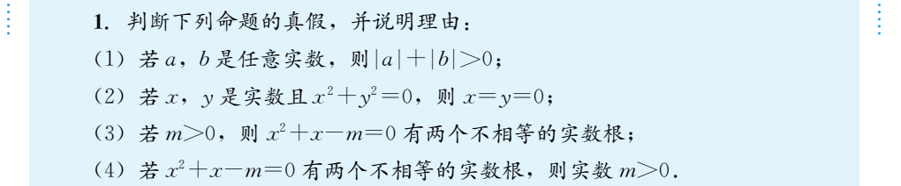

原页上下文：[PDF第23页](../原页上下文/PDF023-教材p016.webp)

## XJ-B1-C01-PR-P016-Y0429 p.16 练习 第2题

教材位置：第1章 / 1.2 常用逻辑用语 / 印刷页 p.16 / PDF 第23页。

类型：练习；原题号：第2题。

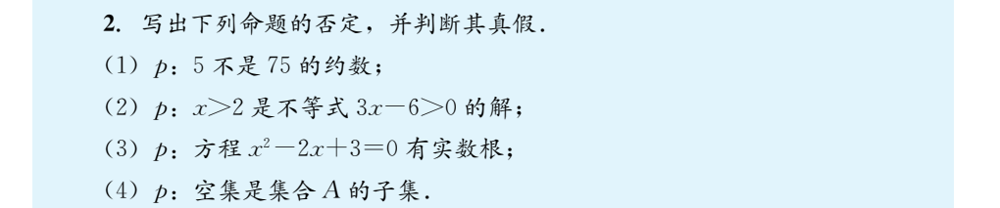

原页上下文：[PDF第23页](../原页上下文/PDF023-教材p016.webp)

## XJ-B1-C01-PR-P016-Y0642 p.16 练习 第3题

教材位置：第1章 / 1.2 常用逻辑用语 / 印刷页 p.16 / PDF 第23页。

类型：练习；原题号：第3题。

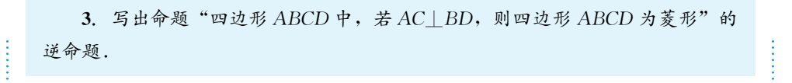

原页上下文：[PDF第23页](../原页上下文/PDF023-教材p016.webp)

## XJ-B1-C01-TH-P016-Y0927 p.16 思考（含紧邻说明）

教材位置：第1章 / 1.2 常用逻辑用语 / 印刷页 p.16、17 / PDF 第23、24页。

类型：思考；原题号：未编号题组。

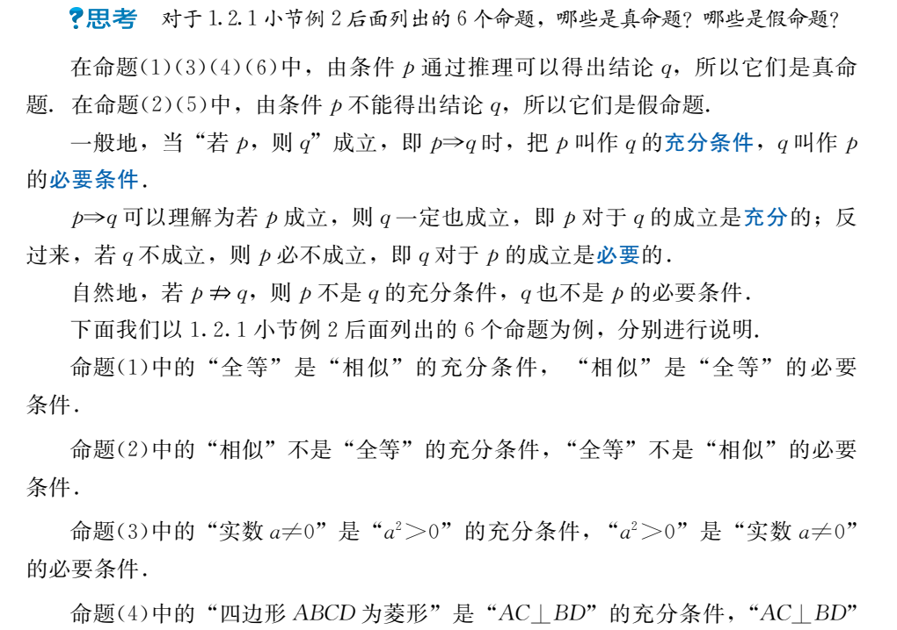
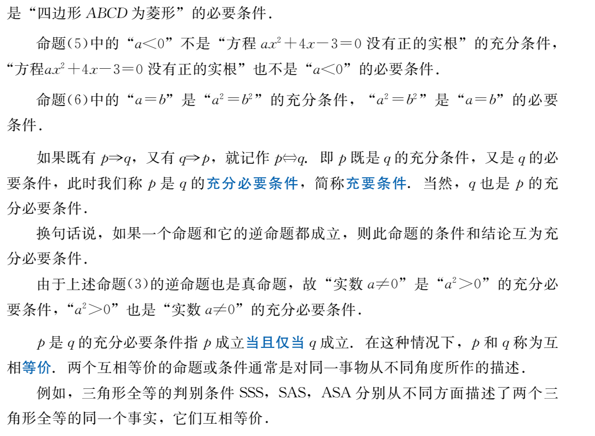

原页上下文：[PDF第23页](../原页上下文/PDF023-教材p016.webp)；[PDF第24页](../原页上下文/PDF024-教材p017.webp)

## XJ-B1-C01-EX-P017-Y0928 1.2 例题 例题3

教材位置：第1章 / 1.2 常用逻辑用语 / 印刷页 p.17 / PDF 第24页。

类型：例题；原题号：例题3。

原页上下文：[PDF第24页](../原页上下文/PDF024-教材p017.webp)

## XJ-B1-C01-EX-P017-Y1338 1.2 例题 例题4

教材位置：第1章 / 1.2 常用逻辑用语 / 印刷页 p.17、18 / PDF 第24、25页。

类型：例题；原题号：例题4。

原页上下文：[PDF第24页](../原页上下文/PDF024-教材p017.webp)；[PDF第25页](../原页上下文/PDF025-教材p018.webp)

## XJ-B1-C01-EX-P018-Y0491 1.2 例题 例题5

教材位置：第1章 / 1.2 常用逻辑用语 / 印刷页 p.18 / PDF 第25页。

类型：例题；原题号：例题5。

原页上下文：[PDF第25页](../原页上下文/PDF025-教材p018.webp)

## XJ-B1-C01-PR-P019-Y0218 p.19 练习 第1题

教材位置：第1章 / 1.2 常用逻辑用语 / 印刷页 p.19 / PDF 第26页。

类型：练习；原题号：第1题。

原页上下文：[PDF第26页](../原页上下文/PDF026-教材p019.webp)

## XJ-B1-C01-PR-P019-Y0389 p.19 练习 第2题

教材位置：第1章 / 1.2 常用逻辑用语 / 印刷页 p.19 / PDF 第26页。

类型：练习；原题号：第2题。

原页上下文：[PDF第26页](../原页上下文/PDF026-教材p019.webp)

## XJ-B1-C01-PR-P019-Y0648 p.19 练习 第3题

教材位置：第1章 / 1.2 常用逻辑用语 / 印刷页 p.19 / PDF 第26页。

类型：练习；原题号：第3题。

原页上下文：[PDF第26页](../原页上下文/PDF026-教材p019.webp)

## XJ-B1-C01-TH-P019-Y1033 p.19 思考（含紧邻说明）

教材位置：第1章 / 1.2 常用逻辑用语 / 印刷页 p.19、20 / PDF 第26、27页。

类型：思考；原题号：未编号题组。

原页上下文：[PDF第26页](../原页上下文/PDF026-教材p019.webp)；[PDF第27页](../原页上下文/PDF027-教材p020.webp)

## XJ-B1-C01-EX-P020-Y0562 1.2 例题 例题6

教材位置：第1章 / 1.2 常用逻辑用语 / 印刷页 p.20 / PDF 第27页。

类型：例题；原题号：例题6。

原页上下文：[PDF第27页](../原页上下文/PDF027-教材p020.webp)

## XJ-B1-C01-TH-P020-Y0942 p.20 思考（含紧邻说明）

教材位置：第1章 / 1.2 常用逻辑用语 / 印刷页 p.20 / PDF 第27页。

类型：思考；原题号：未编号题组。

原页上下文：[PDF第27页](../原页上下文/PDF027-教材p020.webp)

## XJ-B1-C01-EX-P020-Y1143 1.2 例题 例题7

教材位置：第1章 / 1.2 常用逻辑用语 / 印刷页 p.20 / PDF 第27页。

类型：例题；原题号：例题7。

原页上下文：[PDF第27页](../原页上下文/PDF027-教材p020.webp)

## XJ-B1-C01-EX-P021-Y0177 1.2 例题 例题8

教材位置：第1章 / 1.2 常用逻辑用语 / 印刷页 p.21 / PDF 第28页。

类型：例题；原题号：例题8。

原页上下文：[PDF第28页](../原页上下文/PDF028-教材p021.webp)

## XJ-B1-C01-PR-P021-Y0793 p.21 练习 第1题

教材位置：第1章 / 1.2 常用逻辑用语 / 印刷页 p.21 / PDF 第28页。

类型：练习；原题号：第1题。

原页上下文：[PDF第28页](../原页上下文/PDF028-教材p021.webp)

## XJ-B1-C01-PR-P021-Y1067 p.21 练习 第2题

教材位置：第1章 / 1.2 常用逻辑用语 / 印刷页 p.21 / PDF 第28页。

类型：练习；原题号：第2题。

原页上下文：[PDF第28页](../原页上下文/PDF028-教材p021.webp)

## XJ-B1-C01-TH-P021-Y1462 p.21 思考（含紧邻说明）

教材位置：第1章 / 1.2 常用逻辑用语 / 印刷页 p.21、22 / PDF 第28、29页。

类型：思考；原题号：未编号题组。

原页上下文：[PDF第28页](../原页上下文/PDF028-教材p021.webp)；[PDF第29页](../原页上下文/PDF029-教材p022.webp)

## XJ-B1-C01-EX-P022-Y0891 1.2 例题 例题9

教材位置：第1章 / 1.2 常用逻辑用语 / 印刷页 p.22 / PDF 第29页。

类型：例题；原题号：例题9。

原页上下文：[PDF第29页](../原页上下文/PDF029-教材p022.webp)

## XJ-B1-C01-EX-P022-Y1296 1.2 例题 例题10

教材位置：第1章 / 1.2 常用逻辑用语 / 印刷页 p.22 / PDF 第29页。

类型：例题；原题号：例题10。

原页上下文：[PDF第29页](../原页上下文/PDF029-教材p022.webp)

## XJ-B1-C01-PR-P023-Y0176 p.23 练习 未编号题组

教材位置：第1章 / 1.2 常用逻辑用语 / 印刷页 p.23 / PDF 第30页。

类型：练习；原题号：未编号题组。

原页上下文：[PDF第30页](../原页上下文/PDF030-教材p023.webp)

## XJ-B1-C01-HW-P023-Y0778 习题1.2 第1题

教材位置：第1章 / 1.2 常用逻辑用语 / 印刷页 p.23 / PDF 第30页。

类型：习题；原题号：第1题。

原页上下文：[PDF第30页](../原页上下文/PDF030-教材p023.webp)

## XJ-B1-C01-HW-P023-Y0993 习题1.2 第2题

教材位置：第1章 / 1.2 常用逻辑用语 / 印刷页 p.23 / PDF 第30页。

类型：习题；原题号：第2题。

原页上下文：[PDF第30页](../原页上下文/PDF030-教材p023.webp)

## XJ-B1-C01-HW-P023-Y1165 习题1.2 第3题

教材位置：第1章 / 1.2 常用逻辑用语 / 印刷页 p.23 / PDF 第30页。

类型：习题；原题号：第3题。

原页上下文：[PDF第30页](../原页上下文/PDF030-教材p023.webp)

## XJ-B1-C01-HW-P023-Y1381 习题1.2 第4题

教材位置：第1章 / 1.2 常用逻辑用语 / 印刷页 p.23、24 / PDF 第30、31页。

类型：习题；原题号：第4题。

原页上下文：[PDF第30页](../原页上下文/PDF030-教材p023.webp)；[PDF第31页](../原页上下文/PDF031-教材p024.webp)

## XJ-B1-C01-HW-P024-Y0260 习题1.2 第5题

教材位置：第1章 / 1.2 常用逻辑用语 / 印刷页 p.24 / PDF 第31页。

类型：习题；原题号：第5题。

原页上下文：[PDF第31页](../原页上下文/PDF031-教材p024.webp)

## XJ-B1-C01-HW-P024-Y0518 习题1.2 第6题

教材位置：第1章 / 1.2 常用逻辑用语 / 印刷页 p.24 / PDF 第31页。

类型：习题；原题号：第6题。

原页上下文：[PDF第31页](../原页上下文/PDF031-教材p024.webp)

## XJ-B1-C01-HW-P024-Y0897 习题1.2 第7题

教材位置：第1章 / 1.2 常用逻辑用语 / 印刷页 p.24 / PDF 第31页。

类型：习题；原题号：第7题。

原页上下文：[PDF第31页](../原页上下文/PDF031-教材p024.webp)

## XJ-B1-C01-HW-P024-Y1155 习题1.2 第8题

教材位置：第1章 / 1.2 常用逻辑用语 / 印刷页 p.24 / PDF 第31页。

类型：习题；原题号：第8题。

原页上下文：[PDF第31页](../原页上下文/PDF031-教材p024.webp)

## XJ-B1-C01-HW-P024-Y1370 习题1.2 第9题

教材位置：第1章 / 1.2 常用逻辑用语 / 印刷页 p.24 / PDF 第31页。

类型：习题；原题号：第9题。

原页上下文：[PDF第31页](../原页上下文/PDF031-教材p024.webp)

## XJ-B1-C01-HW-P024-Y1527 习题1.2 第10题

教材位置：第1章 / 1.2 常用逻辑用语 / 印刷页 p.24 / PDF 第31页。

类型：习题；原题号：第10题。

原页上下文：[PDF第31页](../原页上下文/PDF031-教材p024.webp)

## XJ-B1-C01-SU-P028-Y0974 第1章 小结与复习 第1题

教材位置：第1章 / 小结与复习 小结与复习 / 印刷页 p.28 / PDF 第35页。

类型：小结与复习；原题号：第1题。

原页上下文：[PDF第35页](../原页上下文/PDF035-教材p028.webp)

## XJ-B1-C01-SU-P028-Y1103 第1章 小结与复习 第2题

教材位置：第1章 / 小结与复习 小结与复习 / 印刷页 p.28 / PDF 第35页。

类型：小结与复习；原题号：第2题。

原页上下文：[PDF第35页](../原页上下文/PDF035-教材p028.webp)

## XJ-B1-C01-SU-P028-Y1232 第1章 小结与复习 第3题

教材位置：第1章 / 小结与复习 小结与复习 / 印刷页 p.28 / PDF 第35页。

类型：小结与复习；原题号：第3题。

原页上下文：[PDF第35页](../原页上下文/PDF035-教材p028.webp)

## XJ-B1-C01-SU-P028-Y1361 第1章 小结与复习 第4题

教材位置：第1章 / 小结与复习 小结与复习 / 印刷页 p.28 / PDF 第35页。

类型：小结与复习；原题号：第4题。

原页上下文：[PDF第35页](../原页上下文/PDF035-教材p028.webp)

## XJ-B1-C01-SU-P028-Y1404 第1章 小结与复习 第5题

教材位置：第1章 / 小结与复习 小结与复习 / 印刷页 p.28 / PDF 第35页。

类型：小结与复习；原题号：第5题。

原页上下文：[PDF第35页](../原页上下文/PDF035-教材p028.webp)

## XJ-B1-C01-SU-P028-Y1490 第1章 小结与复习 第6题

教材位置：第1章 / 小结与复习 小结与复习 / 印刷页 p.28 / PDF 第35页。

类型：小结与复习；原题号：第6题。

原页上下文：[PDF第35页](../原页上下文/PDF035-教材p028.webp)

## XJ-B1-C01-RV-P029-Y0406 复习题一 第1题

教材位置：第1章 / 章末复习 复习题一 / 印刷页 p.29 / PDF 第36页。

类型：复习题；原题号：第1题。

原页上下文：[PDF第36页](../原页上下文/PDF036-教材p029.webp)

## XJ-B1-C01-RV-P029-Y0634 复习题一 第2题

教材位置：第1章 / 章末复习 复习题一 / 印刷页 p.29 / PDF 第36页。

类型：复习题；原题号：第2题。

原页上下文：[PDF第36页](../原页上下文/PDF036-教材p029.webp)

## XJ-B1-C01-RV-P029-Y0779 复习题一 第3题

教材位置：第1章 / 章末复习 复习题一 / 印刷页 p.29 / PDF 第36页。

类型：复习题；原题号：第3题。

原页上下文：[PDF第36页](../原页上下文/PDF036-教材p029.webp)

## XJ-B1-C01-RV-P029-Y0908 复习题一 第4题

教材位置：第1章 / 章末复习 复习题一 / 印刷页 p.29 / PDF 第36页。

类型：复习题；原题号：第4题。

原页上下文：[PDF第36页](../原页上下文/PDF036-教材p029.webp)

## XJ-B1-C01-RV-P029-Y0994 复习题一 第5题

教材位置：第1章 / 章末复习 复习题一 / 印刷页 p.29 / PDF 第36页。

类型：复习题；原题号：第5题。

原页上下文：[PDF第36页](../原页上下文/PDF036-教材p029.webp)

## XJ-B1-C01-RV-P029-Y1080 复习题一 第6题

教材位置：第1章 / 章末复习 复习题一 / 印刷页 p.29 / PDF 第36页。

类型：复习题；原题号：第6题。

原页上下文：[PDF第36页](../原页上下文/PDF036-教材p029.webp)

## XJ-B1-C01-RV-P029-Y1165 复习题一 第7题

教材位置：第1章 / 章末复习 复习题一 / 印刷页 p.29 / PDF 第36页。

类型：复习题；原题号：第7题。

原页上下文：[PDF第36页](../原页上下文/PDF036-教材p029.webp)

## XJ-B1-C01-RV-P029-Y1294 复习题一 第8题

教材位置：第1章 / 章末复习 复习题一 / 印刷页 p.29 / PDF 第36页。

类型：复习题；原题号：第8题。

原页上下文：[PDF第36页](../原页上下文/PDF036-教材p029.webp)

## XJ-B1-C01-RV-P029-Y1552 复习题一 第9题

教材位置：第1章 / 章末复习 复习题一 / 印刷页 p.29、30 / PDF 第36、37页。

类型：复习题；原题号：第9题。

原页上下文：[PDF第36页](../原页上下文/PDF036-教材p029.webp)；[PDF第37页](../原页上下文/PDF037-教材p030.webp)

## XJ-B1-C01-RV-P030-Y0307 复习题一 第10题

教材位置：第1章 / 章末复习 复习题一 / 印刷页 p.30 / PDF 第37页。

类型：复习题；原题号：第10题。

原页上下文：[PDF第37页](../原页上下文/PDF037-教材p030.webp)

## XJ-B1-C01-RV-P030-Y0393 复习题一 第11题

教材位置：第1章 / 章末复习 复习题一 / 印刷页 p.30 / PDF 第37页。

类型：复习题；原题号：第11题。

原页上下文：[PDF第37页](../原页上下文/PDF037-教材p030.webp)

## XJ-B1-C01-RV-P030-Y0711 复习题一 第12题

教材位置：第1章 / 章末复习 复习题一 / 印刷页 p.30 / PDF 第37页。

类型：复习题；原题号：第12题。

原页上下文：[PDF第37页](../原页上下文/PDF037-教材p030.webp)

## XJ-B1-C01-RV-P030-Y0753 复习题一 第13题

教材位置：第1章 / 章末复习 复习题一 / 印刷页 p.30 / PDF 第37页。

类型：复习题；原题号：第13题。

原页上下文：[PDF第37页](../原页上下文/PDF037-教材p030.webp)

## XJ-B1-C01-RV-P030-Y0836 复习题一 第14题

教材位置：第1章 / 章末复习 复习题一 / 印刷页 p.30 / PDF 第37页。

类型：复习题；原题号：第14题。

原页上下文：[PDF第37页](../原页上下文/PDF037-教材p030.webp)

## XJ-B1-C01-RV-P030-Y0883 复习题一 第15题

教材位置：第1章 / 章末复习 复习题一 / 印刷页 p.30 / PDF 第37页。

类型：复习题；原题号：第15题。

原页上下文：[PDF第37页](../原页上下文/PDF037-教材p030.webp)

## XJ-B1-C01-RV-P030-Y1051 复习题一 第16题

教材位置：第1章 / 章末复习 复习题一 / 印刷页 p.30 / PDF 第37页。

类型：复习题；原题号：第16题。

原页上下文：[PDF第37页](../原页上下文/PDF037-教材p030.webp)

## XJ-B1-C01-RV-P030-Y1286 复习题一 第17题

教材位置：第1章 / 章末复习 复习题一 / 印刷页 p.30 / PDF 第37页。

类型：复习题；原题号：第17题。

原页上下文：[PDF第37页](../原页上下文/PDF037-教材p030.webp)

## XJ-B1-C01-RV-P030-Y1329 复习题一 第18题

教材位置：第1章 / 章末复习 复习题一 / 印刷页 p.30 / PDF 第37页。

类型：复习题；原题号：第18题。

原页上下文：[PDF第37页](../原页上下文/PDF037-教材p030.webp)

## XJ-B1-C01-RV-P030-Y1372 复习题一 第19题

教材位置：第1章 / 章末复习 复习题一 / 印刷页 p.30 / PDF 第37页。

类型：复习题；原题号：第19题。

原页上下文：[PDF第37页](../原页上下文/PDF037-教材p030.webp)
