# 第2章 一元二次函数、方程和不等式 教材题库

原图保留题目、公式和图形。OCR文字仅供检索，未经人工逐字校对。例题及思考保留教材原解或紧邻说明。

## XJ-B1-C02-TH-P032-Y0904 p.32 思考（含紧邻说明）

教材位置：第2章 / 2.1 相等关系与不等关系 / 印刷页 p.32、33 / PDF 第39、40页。

类型：思考；原题号：未编号题组。

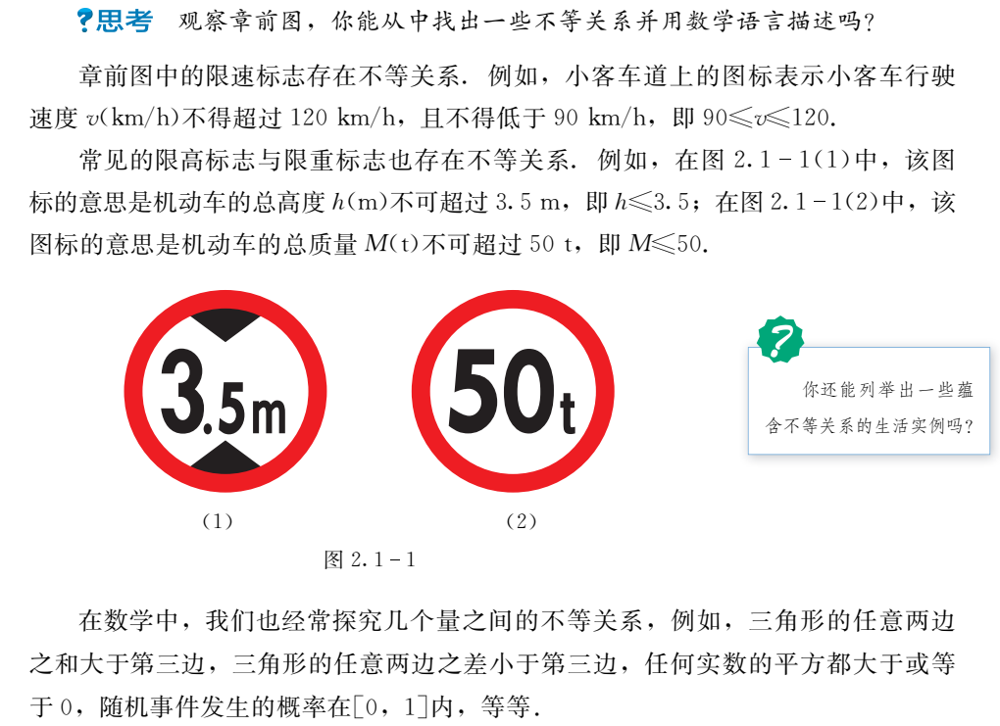

原页上下文：[PDF第39页](../原页上下文/PDF039-教材p032.webp)；[PDF第40页](../原页上下文/PDF040-教材p033.webp)

## XJ-B1-C02-CA-P033-Y0234 2.1 案例 案例1

教材位置：第2章 / 2.1 相等关系与不等关系 / 印刷页 p.33 / PDF 第40页。

类型：案例；原题号：案例1。

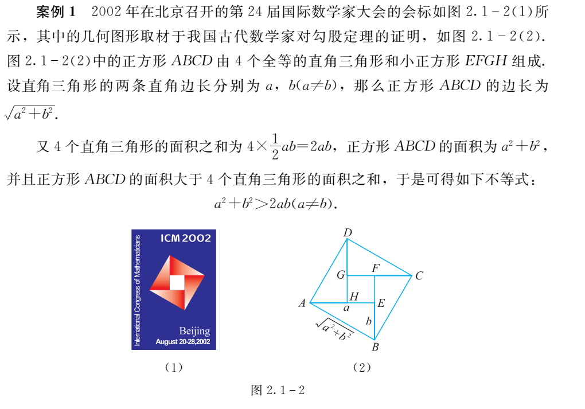

原页上下文：[PDF第40页](../原页上下文/PDF040-教材p033.webp)

## XJ-B1-C02-CA-P033-Y0951 2.1 案例 案例2

教材位置：第2章 / 2.1 相等关系与不等关系 / 印刷页 p.33、34 / PDF 第40、41页。

类型：案例；原题号：案例2。

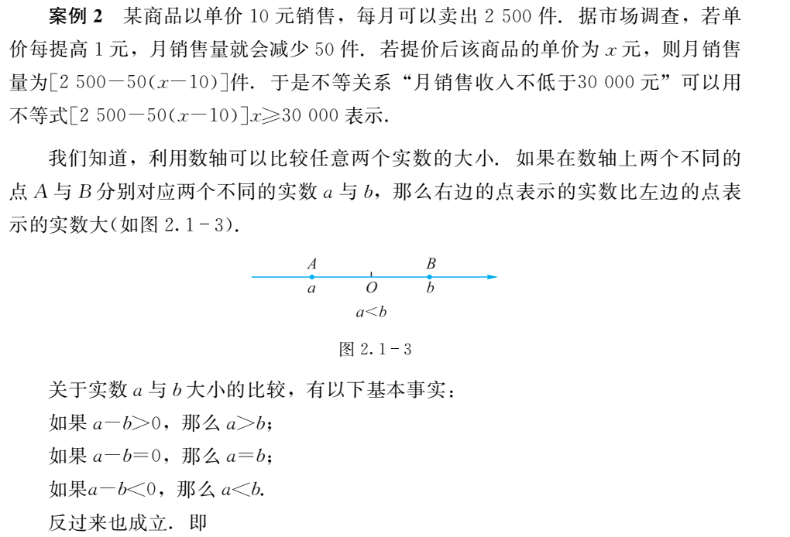
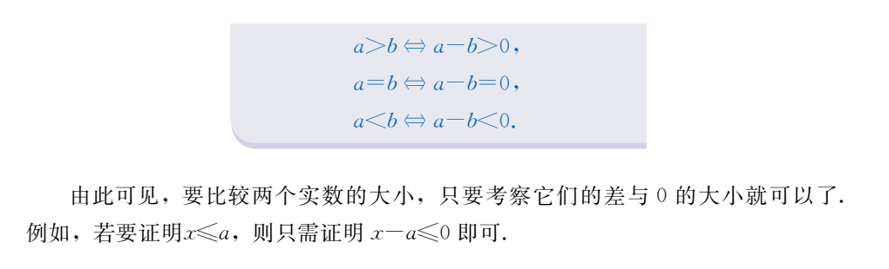

原页上下文：[PDF第40页](../原页上下文/PDF040-教材p033.webp)；[PDF第41页](../原页上下文/PDF041-教材p034.webp)

## XJ-B1-C02-EX-P034-Y0478 2.1 例题 例题1

教材位置：第2章 / 2.1 相等关系与不等关系 / 印刷页 p.34 / PDF 第41页。

类型：例题；原题号：例题1。

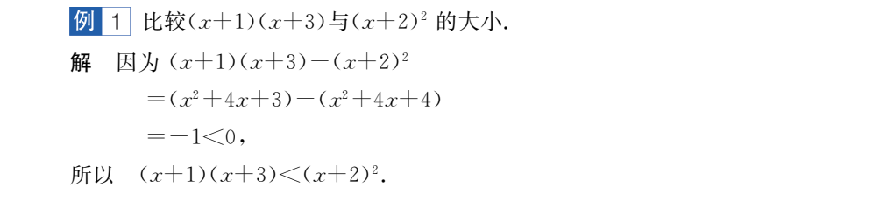

原页上下文：[PDF第41页](../原页上下文/PDF041-教材p034.webp)

## XJ-B1-C02-EX-P034-Y0712 2.1 例题 例题2

教材位置：第2章 / 2.1 相等关系与不等关系 / 印刷页 p.34 / PDF 第41页。

类型：例题；原题号：例题2。

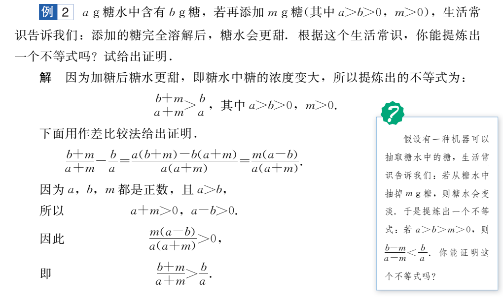

原页上下文：[PDF第41页](../原页上下文/PDF041-教材p034.webp)

## XJ-B1-C02-PR-P034-Y1377 p.34 练习 第1题

教材位置：第2章 / 2.1 相等关系与不等关系 / 印刷页 p.34 / PDF 第41页。

类型：练习；原题号：第1题。

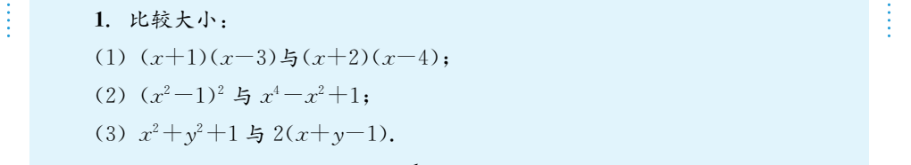

原页上下文：[PDF第41页](../原页上下文/PDF041-教材p034.webp)

## XJ-B1-C02-PR-P034-Y1563 p.34 练习 第2题

教材位置：第2章 / 2.1 相等关系与不等关系 / 印刷页 p.34 / PDF 第41页。

类型：练习；原题号：第2题。

原页上下文：[PDF第41页](../原页上下文/PDF041-教材p034.webp)

## XJ-B1-C02-TH-P035-Y0319 p.35 思考（含紧邻说明）

教材位置：第2章 / 2.1 相等关系与不等关系 / 印刷页 p.35 / PDF 第42页。

类型：思考；原题号：未编号题组。

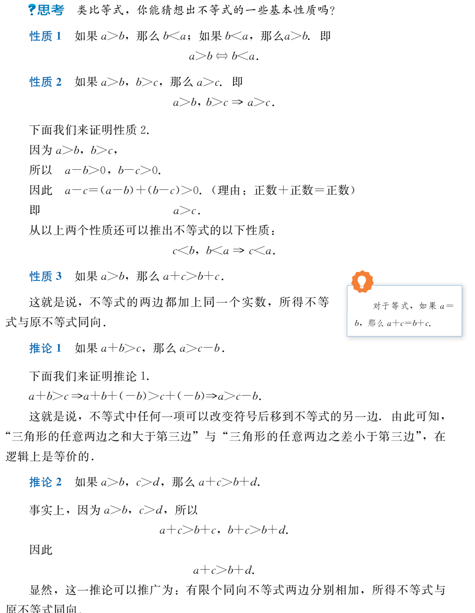

原页上下文：[PDF第42页](../原页上下文/PDF042-教材p035.webp)

## XJ-B1-C02-EX-P037-Y0431 2.1 例题 例题3

教材位置：第2章 / 2.1 相等关系与不等关系 / 印刷页 p.37 / PDF 第44页。

类型：例题；原题号：例题3。

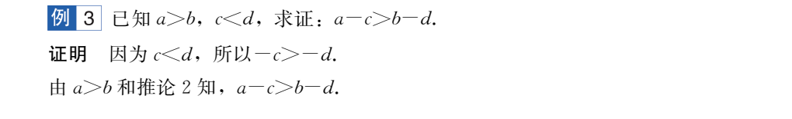

原页上下文：[PDF第44页](../原页上下文/PDF044-教材p037.webp)

## XJ-B1-C02-EX-P037-Y0590 2.1 例题 例题4

教材位置：第2章 / 2.1 相等关系与不等关系 / 印刷页 p.37 / PDF 第44页。

类型：例题；原题号：例题4。

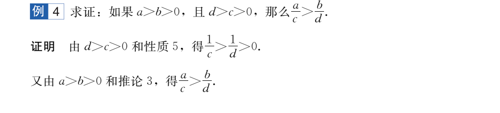

原页上下文：[PDF第44页](../原页上下文/PDF044-教材p037.webp)

## XJ-B1-C02-PR-P037-Y0875 p.37 练习 第1题

教材位置：第2章 / 2.1 相等关系与不等关系 / 印刷页 p.37 / PDF 第44页。

类型：练习；原题号：第1题。

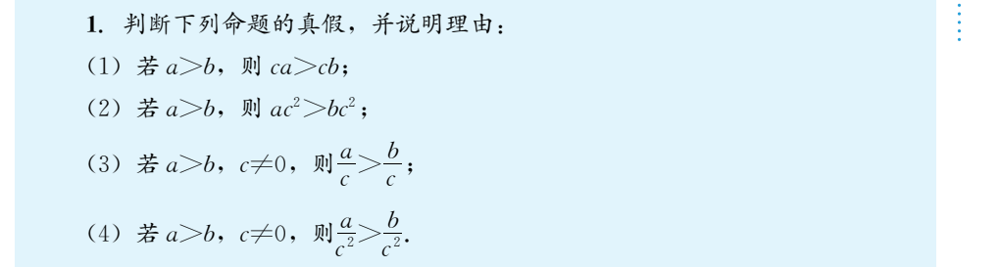

原页上下文：[PDF第44页](../原页上下文/PDF044-教材p037.webp)

## XJ-B1-C02-PR-P037-Y1148 p.37 练习 第2题

教材位置：第2章 / 2.1 相等关系与不等关系 / 印刷页 p.37 / PDF 第44页。

类型：练习；原题号：第2题。

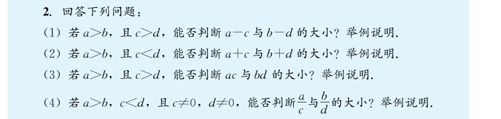

原页上下文：[PDF第44页](../原页上下文/PDF044-教材p037.webp)

## XJ-B1-C02-PR-P037-Y1391 p.37 练习 第3题

教材位置：第2章 / 2.1 相等关系与不等关系 / 印刷页 p.37 / PDF 第44页。

类型：练习；原题号：第3题。

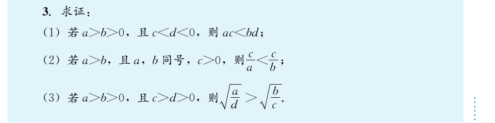

原页上下文：[PDF第44页](../原页上下文/PDF044-教材p037.webp)

## XJ-B1-C02-EX-P039-Y0303 2.1 例题 例题5

教材位置：第2章 / 2.1 相等关系与不等关系 / 印刷页 p.39 / PDF 第46页。

类型：例题；原题号：例题5。

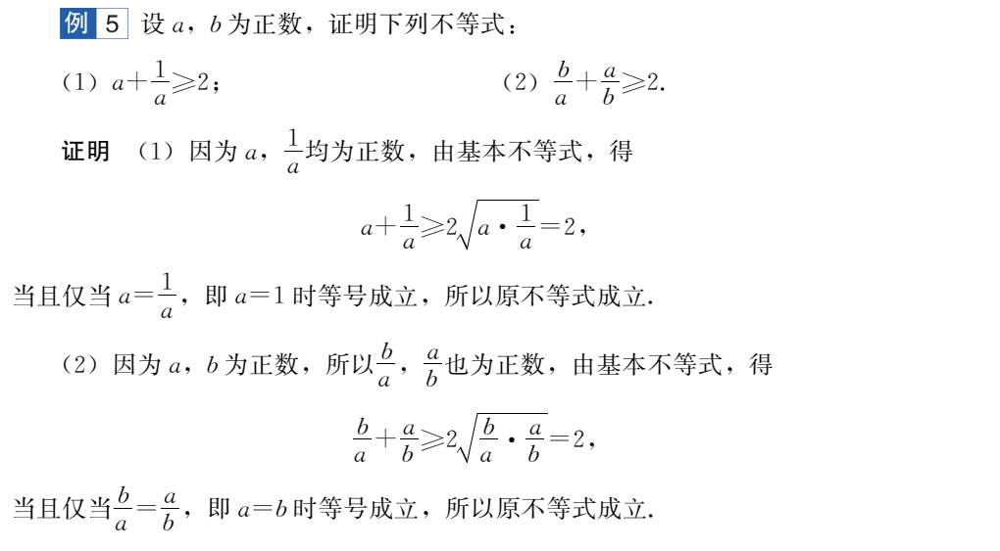

原页上下文：[PDF第46页](../原页上下文/PDF046-教材p039.webp)

## XJ-B1-C02-EX-P039-Y0870 2.1 例题 例题6

教材位置：第2章 / 2.1 相等关系与不等关系 / 印刷页 p.39 / PDF 第46页。

类型：例题；原题号：例题6。

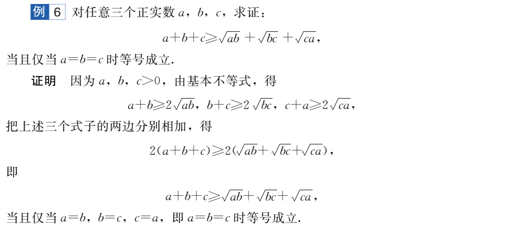

原页上下文：[PDF第46页](../原页上下文/PDF046-教材p039.webp)

## XJ-B1-C02-EX-P039-Y1344 2.1 例题 例题7

教材位置：第2章 / 2.1 相等关系与不等关系 / 印刷页 p.39 / PDF 第46页。

类型：例题；原题号：例题7。

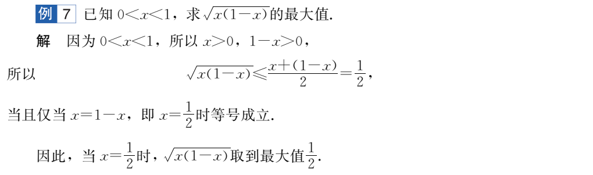

原页上下文：[PDF第46页](../原页上下文/PDF046-教材p039.webp)

## XJ-B1-C02-PR-P040-Y0217 p.40 练习 第1题

教材位置：第2章 / 2.1 相等关系与不等关系 / 印刷页 p.40 / PDF 第47页。

类型：练习；原题号：第1题。

原页上下文：[PDF第47页](../原页上下文/PDF047-教材p040.webp)

## XJ-B1-C02-PR-P040-Y0349 p.40 练习 第2题

教材位置：第2章 / 2.1 相等关系与不等关系 / 印刷页 p.40 / PDF 第47页。

类型：练习；原题号：第2题。

原页上下文：[PDF第47页](../原页上下文/PDF047-教材p040.webp)

## XJ-B1-C02-PR-P040-Y0406 p.40 练习 第3题

教材位置：第2章 / 2.1 相等关系与不等关系 / 印刷页 p.40 / PDF 第47页。

类型：练习；原题号：第3题。

原页上下文：[PDF第47页](../原页上下文/PDF047-教材p040.webp)

## XJ-B1-C02-PR-P040-Y0461 p.40 练习 第4题

教材位置：第2章 / 2.1 相等关系与不等关系 / 印刷页 p.40 / PDF 第47页。

类型：练习；原题号：第4题。

原页上下文：[PDF第47页](../原页上下文/PDF047-教材p040.webp)

## XJ-B1-C02-TH-P040-Y0846 p.40 思考（含紧邻说明）

教材位置：第2章 / 2.1 相等关系与不等关系 / 印刷页 p.40、41 / PDF 第47、48页。

类型：思考；原题号：未编号题组。

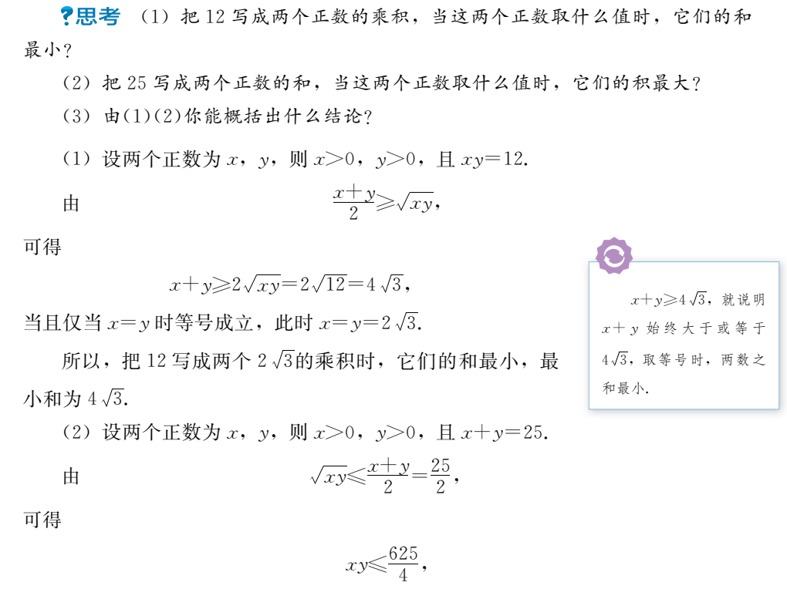
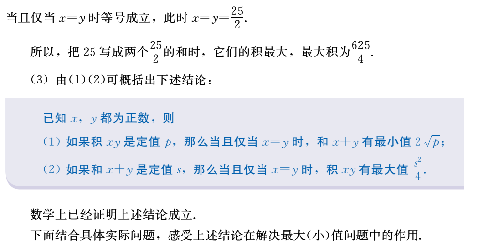

原页上下文：[PDF第47页](../原页上下文/PDF047-教材p040.webp)；[PDF第48页](../原页上下文/PDF048-教材p041.webp)

## XJ-B1-C02-EX-P041-Y0698 2.1 例题 例题8

教材位置：第2章 / 2.1 相等关系与不等关系 / 印刷页 p.41 / PDF 第48页。

类型：例题；原题号：例题8。

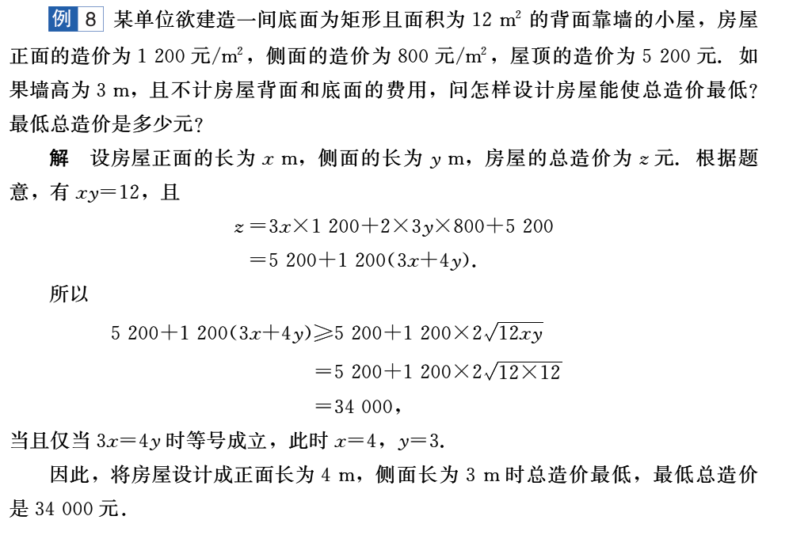

原页上下文：[PDF第48页](../原页上下文/PDF048-教材p041.webp)

## XJ-B1-C02-EX-P041-Y1378 2.1 例题 例题9

教材位置：第2章 / 2.1 相等关系与不等关系 / 印刷页 p.41、42 / PDF 第48、49页。

类型：例题；原题号：例题9。

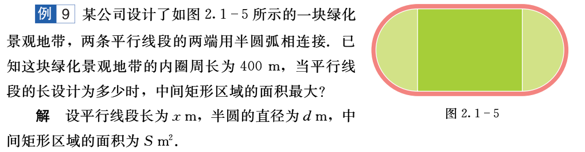
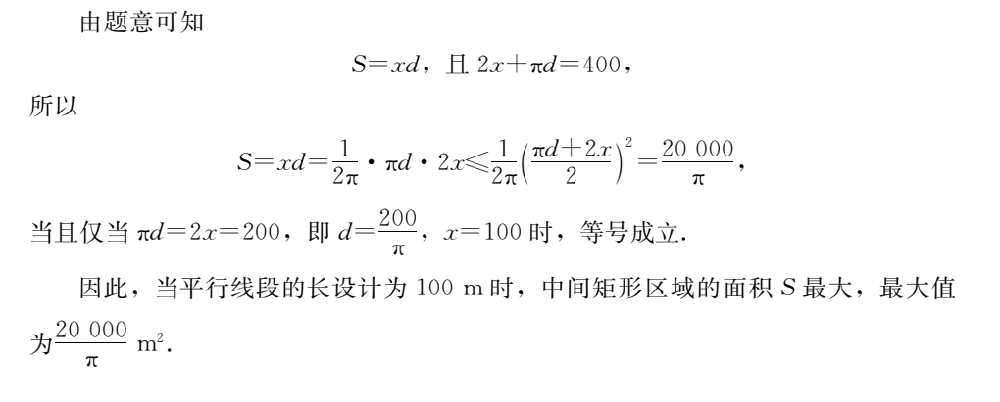

原页上下文：[PDF第48页](../原页上下文/PDF048-教材p041.webp)；[PDF第49页](../原页上下文/PDF049-教材p042.webp)

## XJ-B1-C02-PR-P042-Y0646 p.42 练习 第1题

教材位置：第2章 / 2.1 相等关系与不等关系 / 印刷页 p.42 / PDF 第49页。

类型：练习；原题号：第1题。

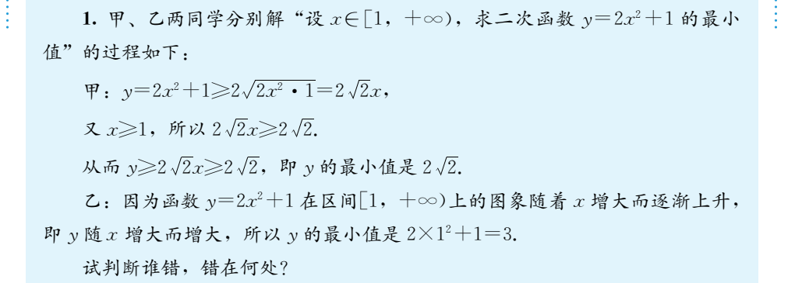

原页上下文：[PDF第49页](../原页上下文/PDF049-教材p042.webp)

## XJ-B1-C02-PR-P042-Y1011 p.42 练习 第2题

教材位置：第2章 / 2.1 相等关系与不等关系 / 印刷页 p.42 / PDF 第49页。

类型：练习；原题号：第2题。

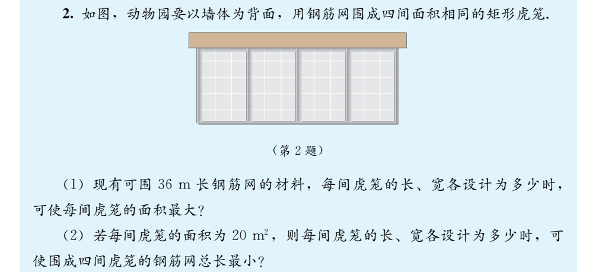

原页上下文：[PDF第49页](../原页上下文/PDF049-教材p042.webp)

## XJ-B1-C02-PR-P042-Y1470 p.42 练习 第3题

教材位置：第2章 / 2.1 相等关系与不等关系 / 印刷页 p.42 / PDF 第49页。

类型：练习；原题号：第3题。

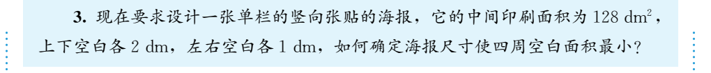

原页上下文：[PDF第49页](../原页上下文/PDF049-教材p042.webp)

## XJ-B1-C02-HW-P043-Y0450 习题2.1 第1题

教材位置：第2章 / 2.1 相等关系与不等关系 / 印刷页 p.43 / PDF 第50页。

类型：习题；原题号：第1题。

原页上下文：[PDF第50页](../原页上下文/PDF050-教材p043.webp)

## XJ-B1-C02-HW-P043-Y0493 习题2.1 第2题

教材位置：第2章 / 2.1 相等关系与不等关系 / 印刷页 p.43 / PDF 第50页。

类型：习题；原题号：第2题。

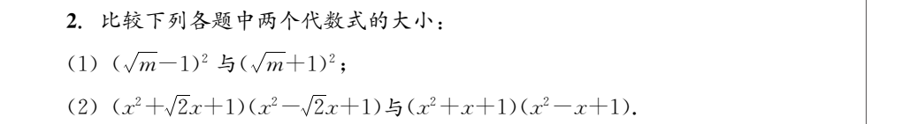

原页上下文：[PDF第50页](../原页上下文/PDF050-教材p043.webp)

## XJ-B1-C02-HW-P043-Y0634 习题2.1 第3题

教材位置：第2章 / 2.1 相等关系与不等关系 / 印刷页 p.43 / PDF 第50页。

类型：习题；原题号：第3题。

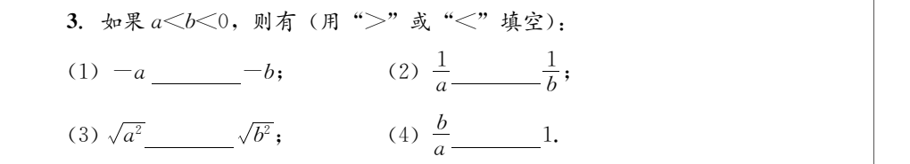

原页上下文：[PDF第50页](../原页上下文/PDF050-教材p043.webp)

## XJ-B1-C02-HW-P043-Y0819 习题2.1 第4题

教材位置：第2章 / 2.1 相等关系与不等关系 / 印刷页 p.43 / PDF 第50页。

类型：习题；原题号：第4题。

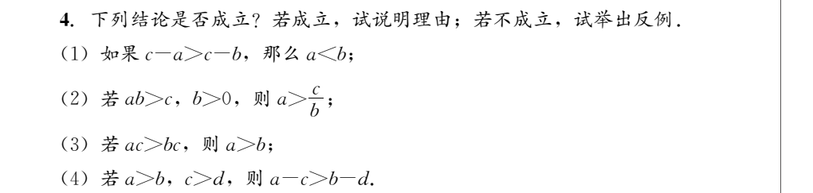

原页上下文：[PDF第50页](../原页上下文/PDF050-教材p043.webp)

## XJ-B1-C02-HW-P043-Y1062 习题2.1 第5题

教材位置：第2章 / 2.1 相等关系与不等关系 / 印刷页 p.43 / PDF 第50页。

类型：习题；原题号：第5题。

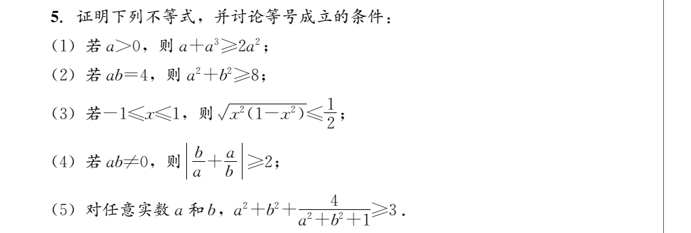

原页上下文：[PDF第50页](../原页上下文/PDF050-教材p043.webp)

## XJ-B1-C02-HW-P043-Y1406 习题2.1 第6题

教材位置：第2章 / 2.1 相等关系与不等关系 / 印刷页 p.43 / PDF 第50页。

类型：习题；原题号：第6题。

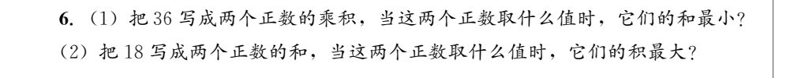

原页上下文：[PDF第50页](../原页上下文/PDF050-教材p043.webp)

## XJ-B1-C02-HW-P043-Y1506 习题2.1 第7题

教材位置：第2章 / 2.1 相等关系与不等关系 / 印刷页 p.43、44 / PDF 第50、51页。

类型：习题；原题号：第7题。

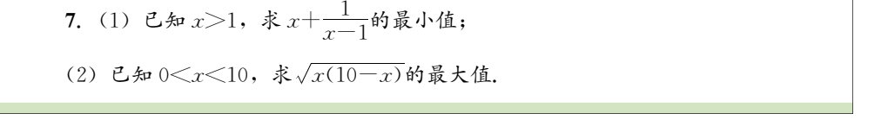

原页上下文：[PDF第50页](../原页上下文/PDF050-教材p043.webp)；[PDF第51页](../原页上下文/PDF051-教材p044.webp)

## XJ-B1-C02-HW-P044-Y0220 习题2.1 第8题

教材位置：第2章 / 2.1 相等关系与不等关系 / 印刷页 p.44 / PDF 第51页。

类型：习题；原题号：第8题。

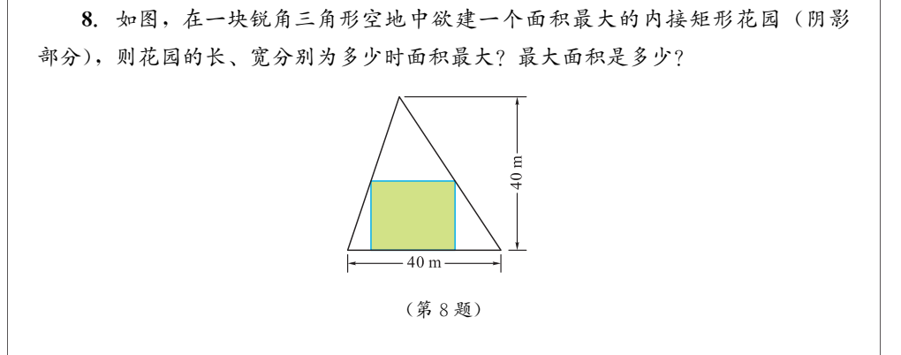

原页上下文：[PDF第51页](../原页上下文/PDF051-教材p044.webp)

## XJ-B1-C02-HW-P044-Y0732 习题2.1 第9题

教材位置：第2章 / 2.1 相等关系与不等关系 / 印刷页 p.44 / PDF 第51页。

类型：习题；原题号：第9题。

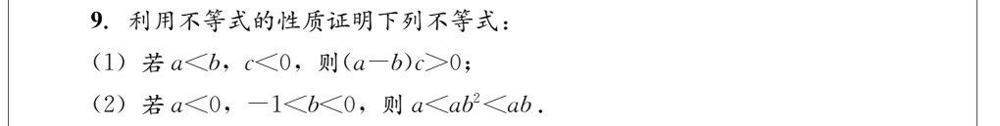

原页上下文：[PDF第51页](../原页上下文/PDF051-教材p044.webp)

## XJ-B1-C02-HW-P044-Y0861 习题2.1 第10题

教材位置：第2章 / 2.1 相等关系与不等关系 / 印刷页 p.44 / PDF 第51页。

类型：习题；原题号：第10题。

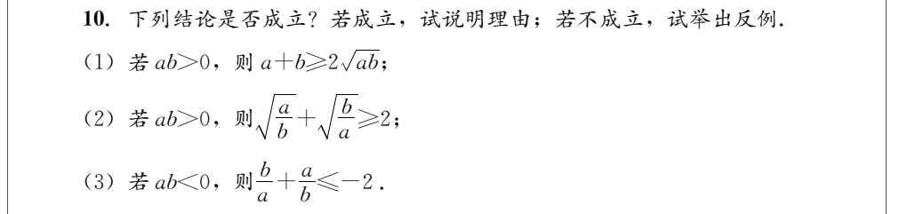

原页上下文：[PDF第51页](../原页上下文/PDF051-教材p044.webp)

## XJ-B1-C02-HW-P044-Y1102 习题2.1 第11题

教材位置：第2章 / 2.1 相等关系与不等关系 / 印刷页 p.44 / PDF 第51页。

类型：习题；原题号：第11题。

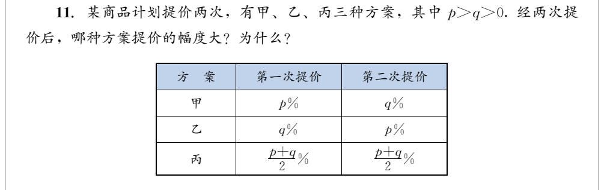

原页上下文：[PDF第51页](../原页上下文/PDF051-教材p044.webp)

## XJ-B1-C02-HW-P044-Y1420 习题2.1 第12题

教材位置：第2章 / 2.1 相等关系与不等关系 / 印刷页 p.44 / PDF 第51页。

类型：习题；原题号：第12题。

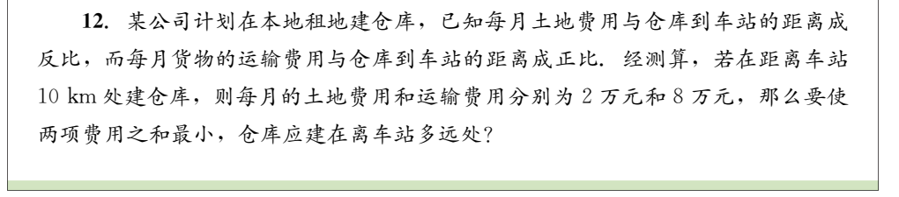

原页上下文：[PDF第51页](../原页上下文/PDF051-教材p044.webp)

## XJ-B1-C02-TH-P045-Y0479 p.45 思考（含紧邻说明）

教材位置：第2章 / 2.2 从函数观点看一元二次方程 / 印刷页 p.45、46 / PDF 第52、53页。

类型：思考；原题号：未编号题组。

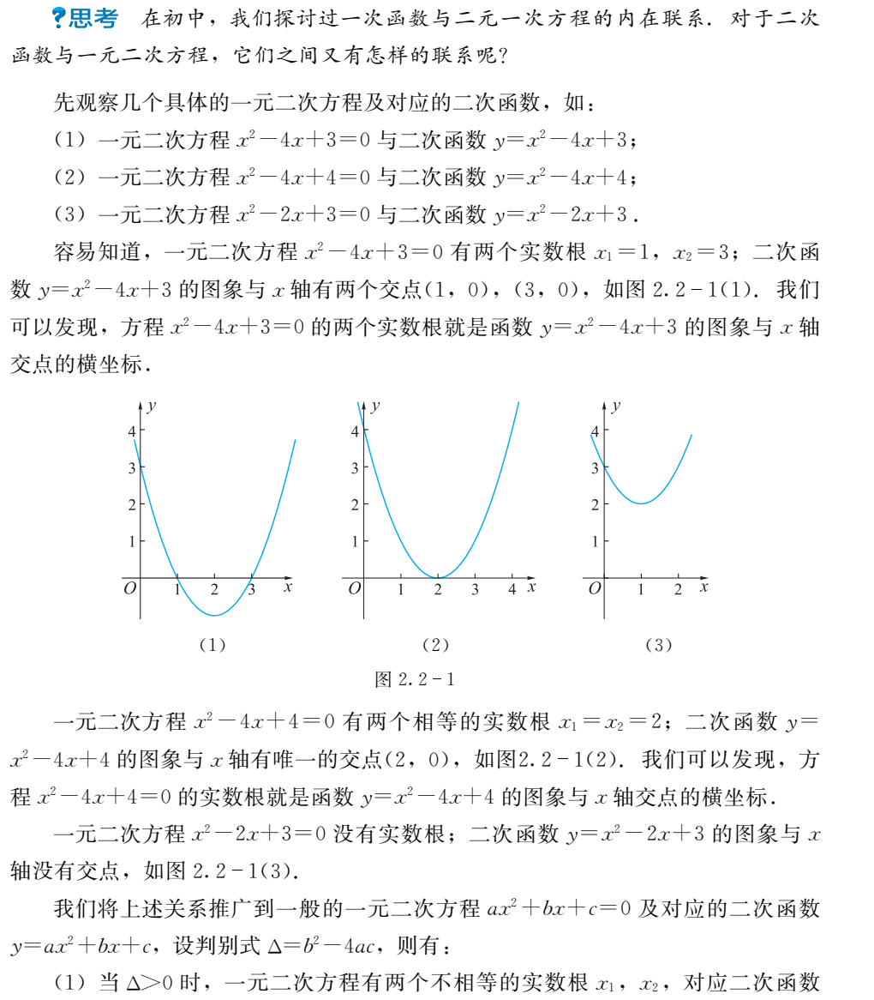
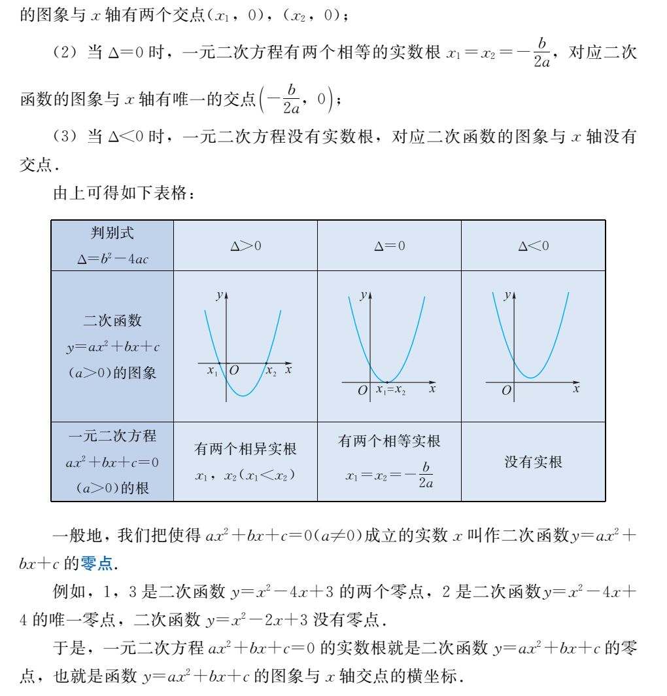

原页上下文：[PDF第52页](../原页上下文/PDF052-教材p045.webp)；[PDF第53页](../原页上下文/PDF053-教材p046.webp)

## XJ-B1-C02-EX-P046-Y1243 2.2 例题 例题1

教材位置：第2章 / 2.2 从函数观点看一元二次方程 / 印刷页 p.46、47 / PDF 第53、54页。

类型：例题；原题号：例题1。

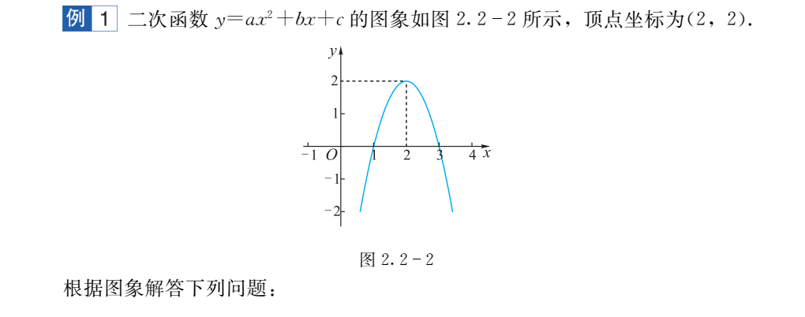
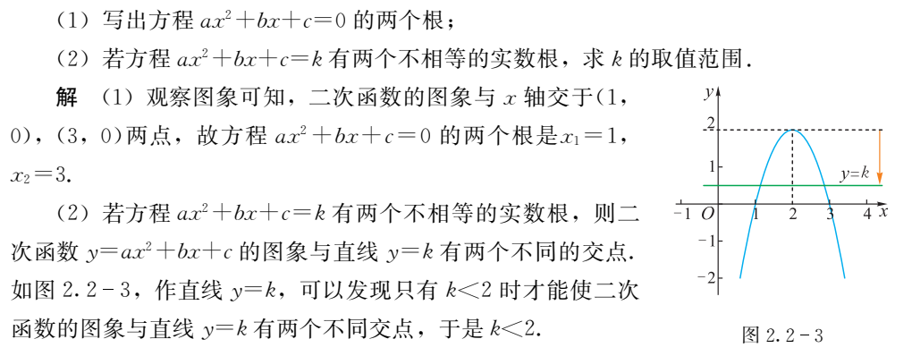

原页上下文：[PDF第53页](../原页上下文/PDF053-教材p046.webp)；[PDF第54页](../原页上下文/PDF054-教材p047.webp)

## XJ-B1-C02-EX-P047-Y0578 2.2 例题 例题2

教材位置：第2章 / 2.2 从函数观点看一元二次方程 / 印刷页 p.47 / PDF 第54页。

类型：例题；原题号：例题2。

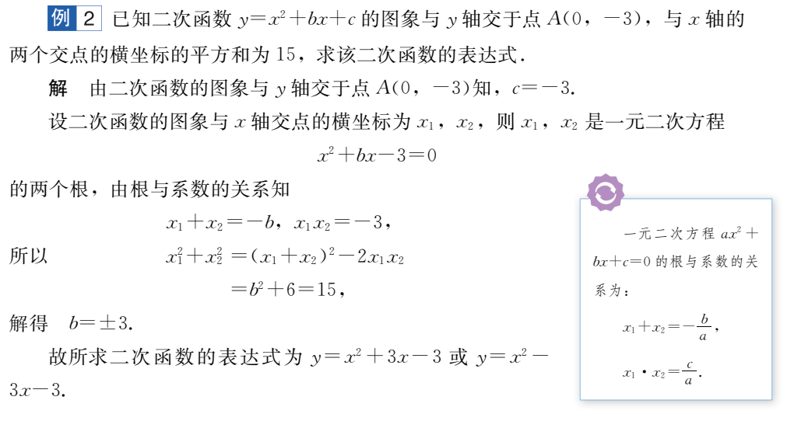

原页上下文：[PDF第54页](../原页上下文/PDF054-教材p047.webp)

## XJ-B1-C02-PR-P047-Y1177 p.47 练习 第1题

教材位置：第2章 / 2.2 从函数观点看一元二次方程 / 印刷页 p.47 / PDF 第54页。

类型：练习；原题号：第1题。

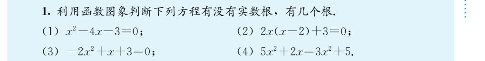

原页上下文：[PDF第54页](../原页上下文/PDF054-教材p047.webp)

## XJ-B1-C02-PR-P047-Y1307 p.47 练习 第2题

教材位置：第2章 / 2.2 从函数观点看一元二次方程 / 印刷页 p.47 / PDF 第54页。

类型：练习；原题号：第2题。

原页上下文：[PDF第54页](../原页上下文/PDF054-教材p047.webp)

## XJ-B1-C02-PR-P047-Y1435 p.47 练习 第3题

教材位置：第2章 / 2.2 从函数观点看一元二次方程 / 印刷页 p.47 / PDF 第54页。

类型：练习；原题号：第3题。

原页上下文：[PDF第54页](../原页上下文/PDF054-教材p047.webp)

## XJ-B1-C02-PR-P047-Y1521 p.47 练习 第4题

教材位置：第2章 / 2.2 从函数观点看一元二次方程 / 印刷页 p.47 / PDF 第54页。

类型：练习；原题号：第4题。

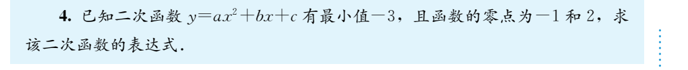

原页上下文：[PDF第54页](../原页上下文/PDF054-教材p047.webp)

## XJ-B1-C02-HW-P049-Y0449 习题2.2 第1题

教材位置：第2章 / 2.2 从函数观点看一元二次方程 / 印刷页 p.49 / PDF 第56页。

类型：习题；原题号：第1题。

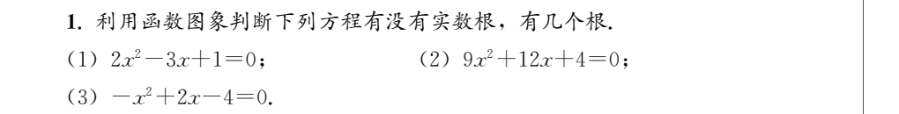

原页上下文：[PDF第56页](../原页上下文/PDF056-教材p049.webp)

## XJ-B1-C02-HW-P049-Y0579 习题2.2 第2题

教材位置：第2章 / 2.2 从函数观点看一元二次方程 / 印刷页 p.49 / PDF 第56页。

类型：习题；原题号：第2题。

原页上下文：[PDF第56页](../原页上下文/PDF056-教材p049.webp)

## XJ-B1-C02-HW-P049-Y0622 习题2.2 第3题

教材位置：第2章 / 2.2 从函数观点看一元二次方程 / 印刷页 p.49 / PDF 第56页。

类型：习题；原题号：第3题。

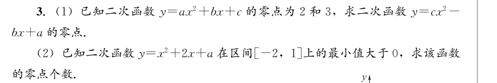

原页上下文：[PDF第56页](../原页上下文/PDF056-教材p049.webp)

## XJ-B1-C02-HW-P049-Y0793 习题2.2 第4题

教材位置：第2章 / 2.2 从函数观点看一元二次方程 / 印刷页 p.49 / PDF 第56页。

类型：习题；原题号：第4题。

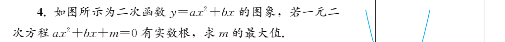

原页上下文：[PDF第56页](../原页上下文/PDF056-教材p049.webp)

## XJ-B1-C02-HW-P049-Y0879 习题2.2 第5题

教材位置：第2章 / 2.2 从函数观点看一元二次方程 / 印刷页 p.49 / PDF 第56页。

类型：习题；原题号：第5题。

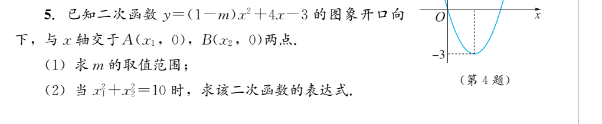

原页上下文：[PDF第56页](../原页上下文/PDF056-教材p049.webp)

## XJ-B1-C02-HW-P049-Y1197 习题2.2 第6题

教材位置：第2章 / 2.2 从函数观点看一元二次方程 / 印刷页 p.49 / PDF 第56页。

类型：习题；原题号：第6题。

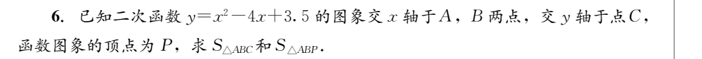

原页上下文：[PDF第56页](../原页上下文/PDF056-教材p049.webp)

## XJ-B1-C02-HW-P049-Y1284 习题2.2 第7题

教材位置：第2章 / 2.2 从函数观点看一元二次方程 / 印刷页 p.49 / PDF 第56页。

类型：习题；原题号：第7题。

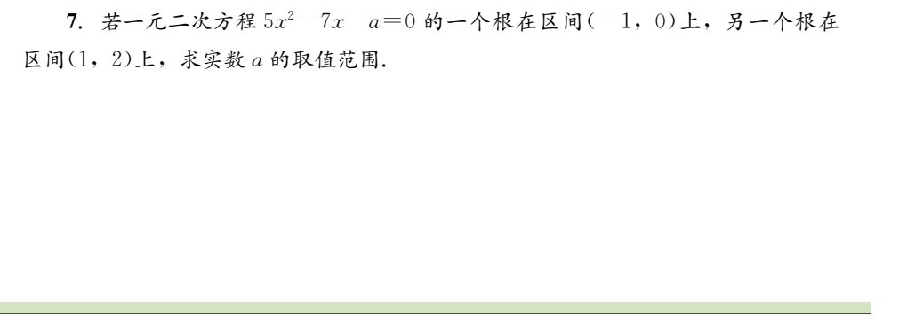

原页上下文：[PDF第56页](../原页上下文/PDF056-教材p049.webp)

## XJ-B1-C02-TH-P050-Y1033 p.50 思考（含紧邻说明）

教材位置：第2章 / 2.3 一元二次不等式 / 印刷页 p.50 / PDF 第57页。

类型：思考；原题号：未编号题组。

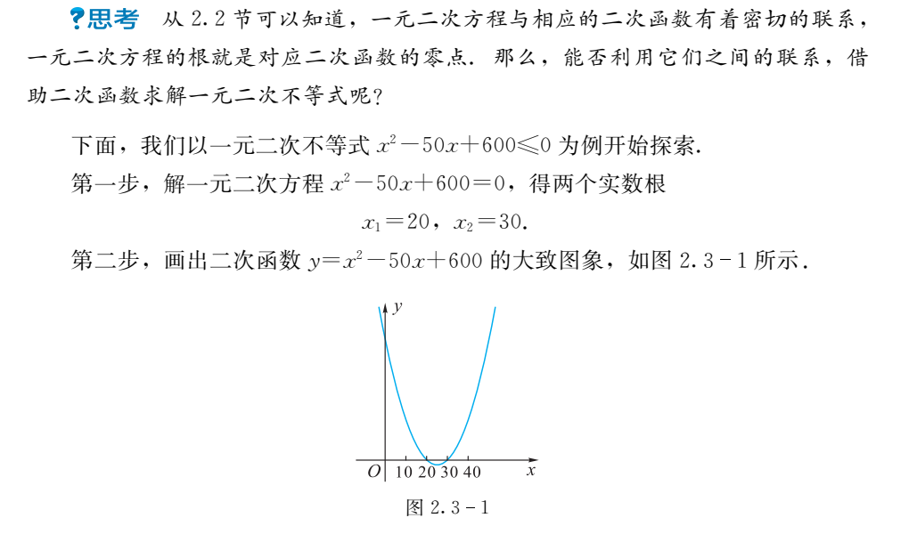

原页上下文：[PDF第57页](../原页上下文/PDF057-教材p050.webp)

## XJ-B1-C02-EX-P052-Y0592 2.3 例题 例题1

教材位置：第2章 / 2.3 一元二次不等式 / 印刷页 p.52 / PDF 第59页。

类型：例题；原题号：例题1。

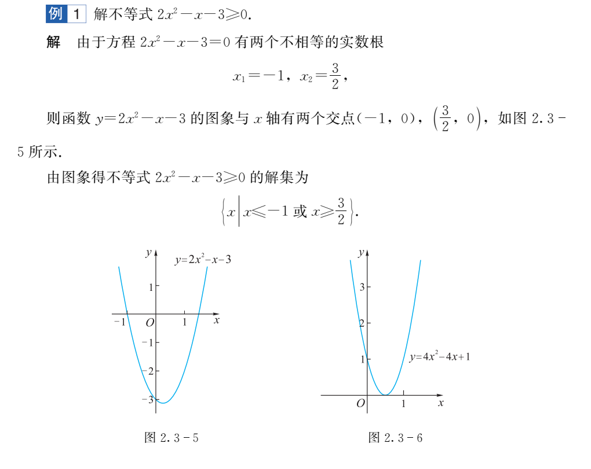

原页上下文：[PDF第59页](../原页上下文/PDF059-教材p052.webp)

## XJ-B1-C02-EX-P052-Y1407 2.3 例题 例题2

教材位置：第2章 / 2.3 一元二次不等式 / 印刷页 p.52、53 / PDF 第59、60页。

类型：例题；原题号：例题2。

原页上下文：[PDF第59页](../原页上下文/PDF059-教材p052.webp)；[PDF第60页](../原页上下文/PDF060-教材p053.webp)

## XJ-B1-C02-EX-P053-Y0304 2.3 例题 例题3

教材位置：第2章 / 2.3 一元二次不等式 / 印刷页 p.53 / PDF 第60页。

类型：例题；原题号：例题3。

原页上下文：[PDF第60页](../原页上下文/PDF060-教材p053.webp)

## XJ-B1-C02-PR-P053-Y1221 p.53 练习 第1题

教材位置：第2章 / 2.3 一元二次不等式 / 印刷页 p.53 / PDF 第60页。

类型：练习；原题号：第1题。

原页上下文：[PDF第60页](../原页上下文/PDF060-教材p053.webp)

## XJ-B1-C02-PR-P053-Y1335 p.53 练习 第2题

教材位置：第2章 / 2.3 一元二次不等式 / 印刷页 p.53 / PDF 第60页。

类型：练习；原题号：第2题。

原页上下文：[PDF第60页](../原页上下文/PDF060-教材p053.webp)

## XJ-B1-C02-EX-P054-Y1398 2.3 例题 例题4

教材位置：第2章 / 2.3 一元二次不等式 / 印刷页 p.54 / PDF 第61页。

类型：例题；原题号：例题4。

原页上下文：[PDF第61页](../原页上下文/PDF061-教材p054.webp)

## XJ-B1-C02-EX-P055-Y0177 2.3 例题 例题5

教材位置：第2章 / 2.3 一元二次不等式 / 印刷页 p.55 / PDF 第62页。

类型：例题；原题号：例题5。

原页上下文：[PDF第62页](../原页上下文/PDF062-教材p055.webp)

## XJ-B1-C02-EX-P055-Y0626 2.3 例题 例题6

教材位置：第2章 / 2.3 一元二次不等式 / 印刷页 p.55 / PDF 第62页。

类型：例题；原题号：例题6。

原页上下文：[PDF第62页](../原页上下文/PDF062-教材p055.webp)

## XJ-B1-C02-PR-P055-Y1064 p.55 练习 第1题

教材位置：第2章 / 2.3 一元二次不等式 / 印刷页 p.55 / PDF 第62页。

类型：练习；原题号：第1题。

原页上下文：[PDF第62页](../原页上下文/PDF062-教材p055.webp)

## XJ-B1-C02-PR-P055-Y1178 p.55 练习 第2题

教材位置：第2章 / 2.3 一元二次不等式 / 印刷页 p.55 / PDF 第62页。

类型：练习；原题号：第2题。

原页上下文：[PDF第62页](../原页上下文/PDF062-教材p055.webp)

## XJ-B1-C02-PR-P055-Y1260 p.55 练习 第3题

教材位置：第2章 / 2.3 一元二次不等式 / 印刷页 p.55 / PDF 第62页。

类型：练习；原题号：第3题。

原页上下文：[PDF第62页](../原页上下文/PDF062-教材p055.webp)

## XJ-B1-C02-PR-P055-Y1345 p.55 练习 第4题

教材位置：第2章 / 2.3 一元二次不等式 / 印刷页 p.55 / PDF 第62页。

类型：练习；原题号：第4题。

原页上下文：[PDF第62页](../原页上下文/PDF062-教材p055.webp)

## XJ-B1-C02-EX-P056-Y0386 2.3 例题 例题7

教材位置：第2章 / 2.3 一元二次不等式 / 印刷页 p.56 / PDF 第63页。

类型：例题；原题号：例题7。

原页上下文：[PDF第63页](../原页上下文/PDF063-教材p056.webp)

## XJ-B1-C02-EX-P056-Y1002 2.3 例题 例题8

教材位置：第2章 / 2.3 一元二次不等式 / 印刷页 p.56、57 / PDF 第63、64页。

类型：例题；原题号：例题8。

原页上下文：[PDF第63页](../原页上下文/PDF063-教材p056.webp)；[PDF第64页](../原页上下文/PDF064-教材p057.webp)

## XJ-B1-C02-EX-P057-Y0534 2.3 例题 例题9

教材位置：第2章 / 2.3 一元二次不等式 / 印刷页 p.57 / PDF 第64页。

类型：例题；原题号：例题9。

原页上下文：[PDF第64页](../原页上下文/PDF064-教材p057.webp)

## XJ-B1-C02-PR-P058-Y0217 p.58 练习 第1题

教材位置：第2章 / 2.3 一元二次不等式 / 印刷页 p.58 / PDF 第65页。

类型：练习；原题号：第1题。

原页上下文：[PDF第65页](../原页上下文/PDF065-教材p058.webp)

## XJ-B1-C02-PR-P058-Y0432 p.58 练习 第2题

教材位置：第2章 / 2.3 一元二次不等式 / 印刷页 p.58 / PDF 第65页。

类型：练习；原题号：第2题。

原页上下文：[PDF第65页](../原页上下文/PDF065-教材p058.webp)

## XJ-B1-C02-HW-P058-Y1137 习题2.3 第1题

教材位置：第2章 / 2.3 一元二次不等式 / 印刷页 p.58 / PDF 第65页。

类型：习题；原题号：第1题。

原页上下文：[PDF第65页](../原页上下文/PDF065-教材p058.webp)

## XJ-B1-C02-HW-P058-Y1265 习题2.3 第2题

教材位置：第2章 / 2.3 一元二次不等式 / 印刷页 p.58 / PDF 第65页。

类型：习题；原题号：第2题。

原页上下文：[PDF第65页](../原页上下文/PDF065-教材p058.webp)

## XJ-B1-C02-HW-P058-Y1395 习题2.3 第3题

教材位置：第2章 / 2.3 一元二次不等式 / 印刷页 p.58、59 / PDF 第65、66页。

类型：习题；原题号：第3题。

原页上下文：[PDF第65页](../原页上下文/PDF065-教材p058.webp)；[PDF第66页](../原页上下文/PDF066-教材p059.webp)

## XJ-B1-C02-HW-P059-Y0221 习题2.3 第4题

教材位置：第2章 / 2.3 一元二次不等式 / 印刷页 p.59 / PDF 第66页。

类型：习题；原题号：第4题。

原页上下文：[PDF第66页](../原页上下文/PDF066-教材p059.webp)

## XJ-B1-C02-HW-P059-Y0410 习题2.3 第5题

教材位置：第2章 / 2.3 一元二次不等式 / 印刷页 p.59 / PDF 第66页。

类型：习题；原题号：第5题。

原页上下文：[PDF第66页](../原页上下文/PDF066-教材p059.webp)

## XJ-B1-C02-HW-P059-Y0467 习题2.3 第6题

教材位置：第2章 / 2.3 一元二次不等式 / 印刷页 p.59 / PDF 第66页。

类型：习题；原题号：第6题。

原页上下文：[PDF第66页](../原页上下文/PDF066-教材p059.webp)

## XJ-B1-C02-HW-P059-Y0788 习题2.3 第7题

教材位置：第2章 / 2.3 一元二次不等式 / 印刷页 p.59 / PDF 第66页。

类型：习题；原题号：第7题。

原页上下文：[PDF第66页](../原页上下文/PDF066-教材p059.webp)

## XJ-B1-C02-HW-P059-Y0874 习题2.3 第8题

教材位置：第2章 / 2.3 一元二次不等式 / 印刷页 p.59 / PDF 第66页。

类型：习题；原题号：第8题。

原页上下文：[PDF第66页](../原页上下文/PDF066-教材p059.webp)

## XJ-B1-C02-HW-P059-Y0917 习题2.3 第9题

教材位置：第2章 / 2.3 一元二次不等式 / 印刷页 p.59 / PDF 第66页。

类型：习题；原题号：第9题。

原页上下文：[PDF第66页](../原页上下文/PDF066-教材p059.webp)

## XJ-B1-C02-HW-P059-Y1115 习题2.3 第10题

教材位置：第2章 / 2.3 一元二次不等式 / 印刷页 p.59 / PDF 第66页。

类型：习题；原题号：第10题。

原页上下文：[PDF第66页](../原页上下文/PDF066-教材p059.webp)

## XJ-B1-C02-HW-P059-Y1199 习题2.3 第11题

教材位置：第2章 / 2.3 一元二次不等式 / 印刷页 p.59 / PDF 第66页。

类型：习题；原题号：第11题。

原页上下文：[PDF第66页](../原页上下文/PDF066-教材p059.webp)

## XJ-B1-C02-HW-P059-Y1286 习题2.3 第12题

教材位置：第2章 / 2.3 一元二次不等式 / 印刷页 p.59 / PDF 第66页。

类型：习题；原题号：第12题。

原页上下文：[PDF第66页](../原页上下文/PDF066-教材p059.webp)

## XJ-B1-C02-SU-P060-Y0997 第2章 小结与复习 第1题

教材位置：第2章 / 小结与复习 小结与复习 / 印刷页 p.60 / PDF 第67页。

类型：小结与复习；原题号：第1题。

原页上下文：[PDF第67页](../原页上下文/PDF067-教材p060.webp)

## XJ-B1-C02-SU-P060-Y1083 第2章 小结与复习 第2题

教材位置：第2章 / 小结与复习 小结与复习 / 印刷页 p.60 / PDF 第67页。

类型：小结与复习；原题号：第2题。

原页上下文：[PDF第67页](../原页上下文/PDF067-教材p060.webp)

## XJ-B1-C02-SU-P060-Y1169 第2章 小结与复习 第3题

教材位置：第2章 / 小结与复习 小结与复习 / 印刷页 p.60 / PDF 第67页。

类型：小结与复习；原题号：第3题。

原页上下文：[PDF第67页](../原页上下文/PDF067-教材p060.webp)

## XJ-B1-C02-SU-P060-Y1255 第2章 小结与复习 第4题

教材位置：第2章 / 小结与复习 小结与复习 / 印刷页 p.60 / PDF 第67页。

类型：小结与复习；原题号：第4题。

原页上下文：[PDF第67页](../原页上下文/PDF067-教材p060.webp)

## XJ-B1-C02-SU-P060-Y1427 第2章 小结与复习 第5题

教材位置：第2章 / 小结与复习 小结与复习 / 印刷页 p.60 / PDF 第67页。

类型：小结与复习；原题号：第5题。

原页上下文：[PDF第67页](../原页上下文/PDF067-教材p060.webp)

## XJ-B1-C02-RV-P061-Y0406 复习题二 第1题

教材位置：第2章 / 章末复习 复习题二 / 印刷页 p.61 / PDF 第68页。

类型：复习题；原题号：第1题。

原页上下文：[PDF第68页](../原页上下文/PDF068-教材p061.webp)

## XJ-B1-C02-RV-P061-Y0650 复习题二 第2题

教材位置：第2章 / 章末复习 复习题二 / 印刷页 p.61 / PDF 第68页。

类型：复习题；原题号：第2题。

原页上下文：[PDF第68页](../原页上下文/PDF068-教材p061.webp)

## XJ-B1-C02-RV-P061-Y0779 复习题二 第3题

教材位置：第2章 / 章末复习 复习题二 / 印刷页 p.61 / PDF 第68页。

类型：复习题；原题号：第3题。

原页上下文：[PDF第68页](../原页上下文/PDF068-教材p061.webp)

## XJ-B1-C02-RV-P061-Y1157 复习题二 第4题

教材位置：第2章 / 章末复习 复习题二 / 印刷页 p.61 / PDF 第68页。

类型：复习题；原题号：第4题。

原页上下文：[PDF第68页](../原页上下文/PDF068-教材p061.webp)

## XJ-B1-C02-RV-P061-Y1244 复习题二 第5题

教材位置：第2章 / 章末复习 复习题二 / 印刷页 p.61 / PDF 第68页。

类型：复习题；原题号：第5题。

原页上下文：[PDF第68页](../原页上下文/PDF068-教材p061.webp)

## XJ-B1-C02-RV-P061-Y1386 复习题二 第6题

教材位置：第2章 / 章末复习 复习题二 / 印刷页 p.61 / PDF 第68页。

类型：复习题；原题号：第6题。

原页上下文：[PDF第68页](../原页上下文/PDF068-教材p061.webp)

## XJ-B1-C02-RV-P061-Y1530 复习题二 第7题

教材位置：第2章 / 章末复习 复习题二 / 印刷页 p.61、62 / PDF 第68、69页。

类型：复习题；原题号：第7题。

原页上下文：[PDF第68页](../原页上下文/PDF068-教材p061.webp)；[PDF第69页](../原页上下文/PDF069-教材p062.webp)

## XJ-B1-C02-RV-P062-Y0430 复习题二 第8题

教材位置：第2章 / 章末复习 复习题二 / 印刷页 p.62 / PDF 第69页。

类型：复习题；原题号：第8题。

原页上下文：[PDF第69页](../原页上下文/PDF069-教材p062.webp)

## XJ-B1-C02-RV-P062-Y0642 复习题二 第9题

教材位置：第2章 / 章末复习 复习题二 / 印刷页 p.62 / PDF 第69页。

类型：复习题；原题号：第9题。

原页上下文：[PDF第69页](../原页上下文/PDF069-教材p062.webp)

## XJ-B1-C02-RV-P062-Y0684 复习题二 第10题

教材位置：第2章 / 章末复习 复习题二 / 印刷页 p.62 / PDF 第69页。

类型：复习题；原题号：第10题。

原页上下文：[PDF第69页](../原页上下文/PDF069-教材p062.webp)

## XJ-B1-C02-RV-P062-Y0894 复习题二 第11题

教材位置：第2章 / 章末复习 复习题二 / 印刷页 p.62 / PDF 第69页。

类型：复习题；原题号：第11题。

原页上下文：[PDF第69页](../原页上下文/PDF069-教材p062.webp)

## XJ-B1-C02-RV-P062-Y0994 复习题二 第12题

教材位置：第2章 / 章末复习 复习题二 / 印刷页 p.62 / PDF 第69页。

类型：复习题；原题号：第12题。

原页上下文：[PDF第69页](../原页上下文/PDF069-教材p062.webp)

## XJ-B1-C02-RV-P062-Y1179 复习题二 第13题

教材位置：第2章 / 章末复习 复习题二 / 印刷页 p.62 / PDF 第69页。

类型：复习题；原题号：第13题。

原页上下文：[PDF第69页](../原页上下文/PDF069-教材p062.webp)

## XJ-B1-C02-RV-P062-Y1398 复习题二 第14题

教材位置：第2章 / 章末复习 复习题二 / 印刷页 p.62、63 / PDF 第69、70页。

类型：复习题；原题号：第14题。

原页上下文：[PDF第69页](../原页上下文/PDF069-教材p062.webp)；[PDF第70页](../原页上下文/PDF070-教材p063.webp)

## XJ-B1-C02-RV-P063-Y0289 复习题二 第15题

教材位置：第2章 / 章末复习 复习题二 / 印刷页 p.63 / PDF 第70页。

类型：复习题；原题号：第15题。

原页上下文：[PDF第70页](../原页上下文/PDF070-教材p063.webp)

## XJ-B1-C02-RV-P063-Y0863 复习题二 第16题

教材位置：第2章 / 章末复习 复习题二 / 印刷页 p.63 / PDF 第70页。

类型：复习题；原题号：第16题。

原页上下文：[PDF第70页](../原页上下文/PDF070-教材p063.webp)

## XJ-B1-C02-RV-P063-Y1035 复习题二 第17题

教材位置：第2章 / 章末复习 复习题二 / 印刷页 p.63 / PDF 第70页。

类型：复习题；原题号：第17题。

原页上下文：[PDF第70页](../原页上下文/PDF070-教材p063.webp)
