# 第3章 函数的概念与性质 教材题库

原图保留题目、公式和图形。OCR文字仅供检索，未经人工逐字校对。例题及思考保留教材原解或紧邻说明。

## XJ-B1-C03-TH-P065-Y0594 p.65 思考（含紧邻说明）

教材位置：第3章 / 3.1 函数 / 印刷页 p.65 / PDF 第72页。

类型：思考；原题号：未编号题组。

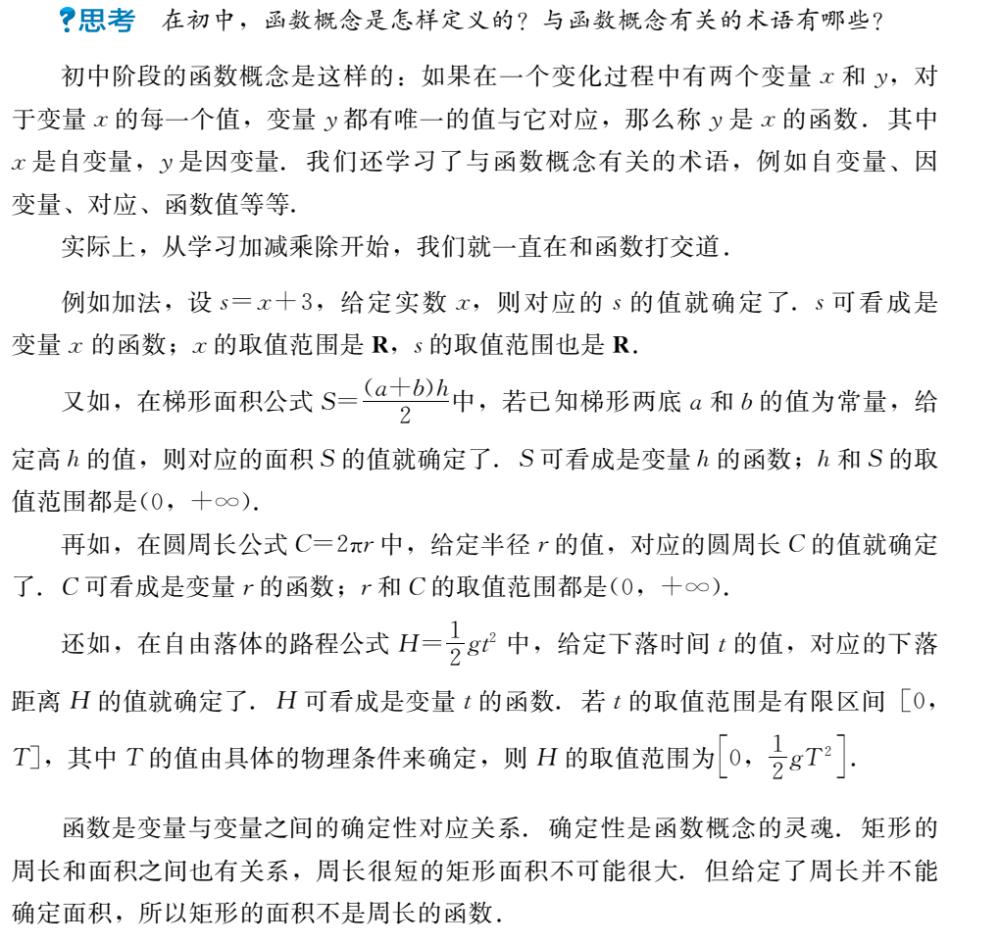

原页上下文：[PDF第72页](../原页上下文/PDF072-教材p065.webp)

## XJ-B1-C03-TH-P065-Y1561 p.65 思考（含紧邻说明）

教材位置：第3章 / 3.1 函数 / 印刷页 p.65、66 / PDF 第72、73页。

类型：思考；原题号：未编号题组。

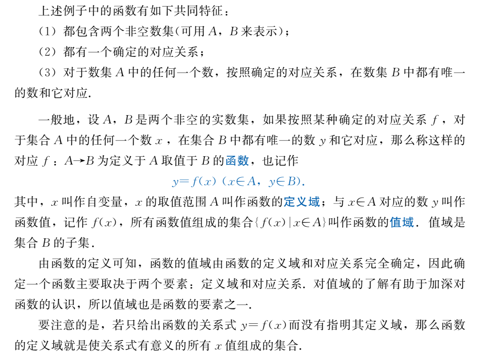

原页上下文：[PDF第72页](../原页上下文/PDF072-教材p065.webp)；[PDF第73页](../原页上下文/PDF073-教材p066.webp)

## XJ-B1-C03-EX-P066-Y0934 3.1 例题 例题1

教材位置：第3章 / 3.1 函数 / 印刷页 p.66 / PDF 第73页。

类型：例题；原题号：例题1。

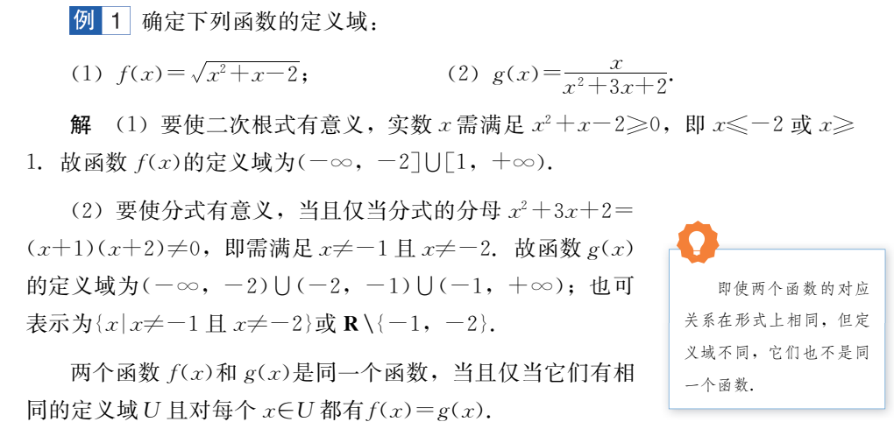

原页上下文：[PDF第73页](../原页上下文/PDF073-教材p066.webp)

## XJ-B1-C03-EX-P066-Y1436 3.1 例题 例题2

教材位置：第3章 / 3.1 函数 / 印刷页 p.66、67 / PDF 第73、74页。

类型：例题；原题号：例题2。

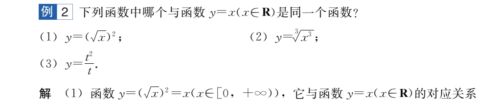
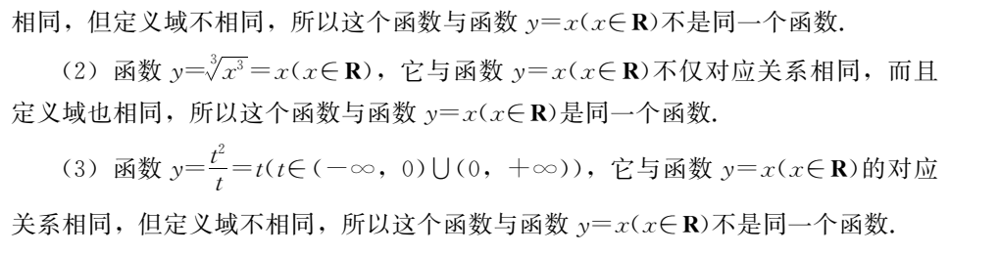

原页上下文：[PDF第73页](../原页上下文/PDF073-教材p066.webp)；[PDF第74页](../原页上下文/PDF074-教材p067.webp)

## XJ-B1-C03-EX-P067-Y0440 3.1 例题 例题3

教材位置：第3章 / 3.1 函数 / 印刷页 p.67 / PDF 第74页。

类型：例题；原题号：例题3。

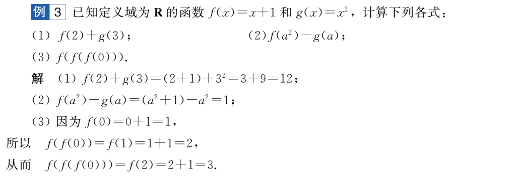

原页上下文：[PDF第74页](../原页上下文/PDF074-教材p067.webp)

## XJ-B1-C03-PR-P067-Y0874 p.67 练习 第1题

教材位置：第3章 / 3.1 函数 / 印刷页 p.67 / PDF 第74页。

类型：练习；原题号：第1题。

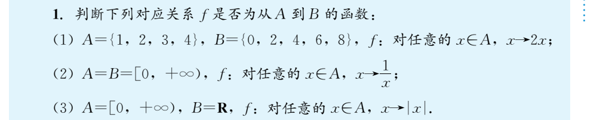

原页上下文：[PDF第74页](../原页上下文/PDF074-教材p067.webp)

## XJ-B1-C03-PR-P067-Y1075 p.67 练习 第2题

教材位置：第3章 / 3.1 函数 / 印刷页 p.67 / PDF 第74页。

类型：练习；原题号：第2题。

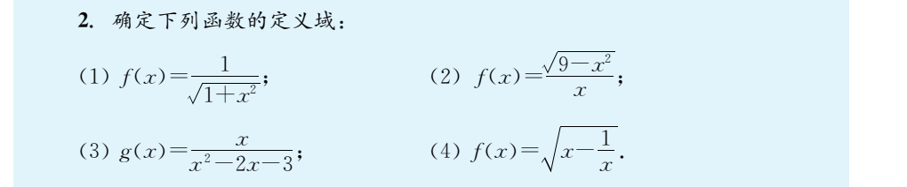

原页上下文：[PDF第74页](../原页上下文/PDF074-教材p067.webp)

## XJ-B1-C03-PR-P067-Y1287 p.67 练习 第3题

教材位置：第3章 / 3.1 函数 / 印刷页 p.67 / PDF 第74页。

类型：练习；原题号：第3题。

原页上下文：[PDF第74页](../原页上下文/PDF074-教材p067.webp)

## XJ-B1-C03-PR-P067-Y1404 p.67 练习 第4题

教材位置：第3章 / 3.1 函数 / 印刷页 p.67 / PDF 第74页。

类型：练习；原题号：第4题。

原页上下文：[PDF第74页](../原页上下文/PDF074-教材p067.webp)

## XJ-B1-C03-PR-P067-Y1533 p.67 练习 第5题

教材位置：第3章 / 3.1 函数 / 印刷页 p.67 / PDF 第74页。

类型：练习；原题号：第5题。

原页上下文：[PDF第74页](../原页上下文/PDF074-教材p067.webp)

## XJ-B1-C03-EX-P069-Y0904 3.1 例题 例题4

教材位置：第3章 / 3.1 函数 / 印刷页 p.69、70、71 / PDF 第76、77、78页。

类型：例题；原题号：例题4。

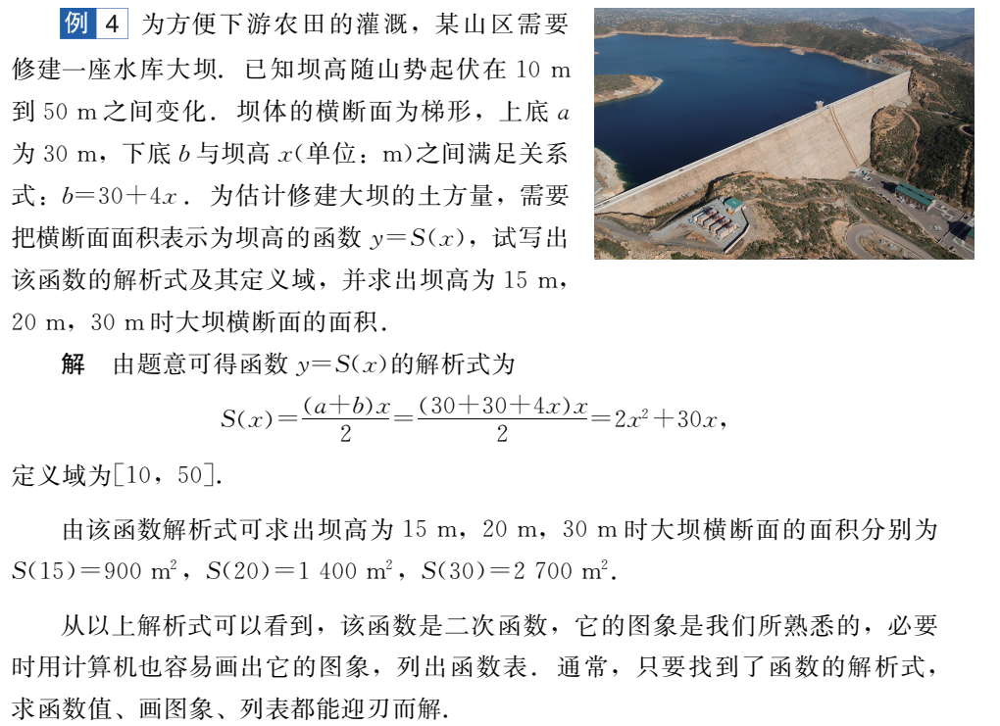
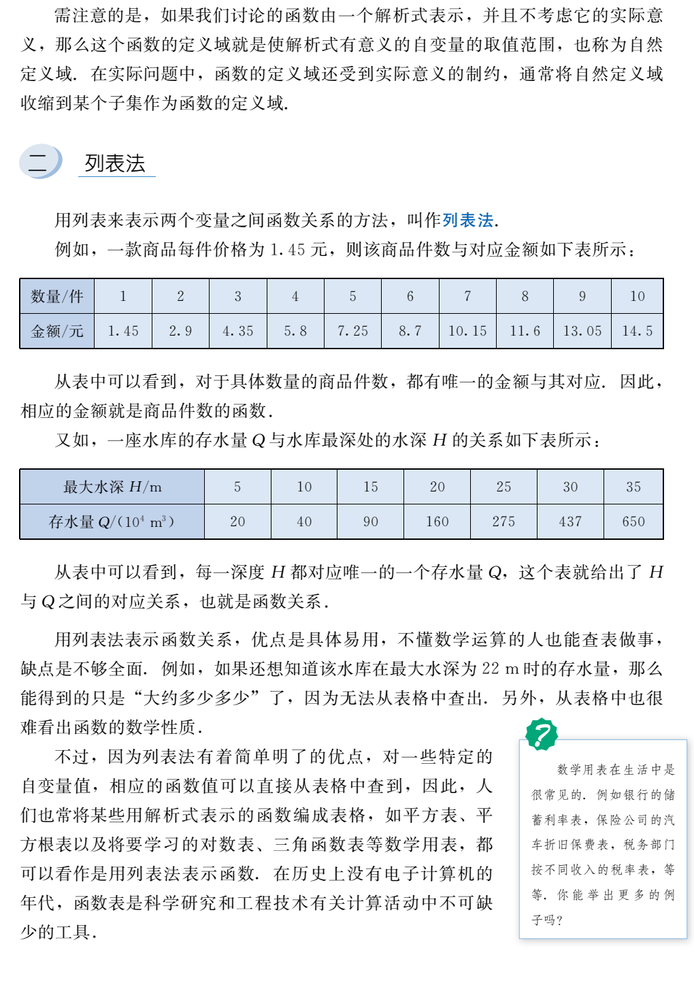
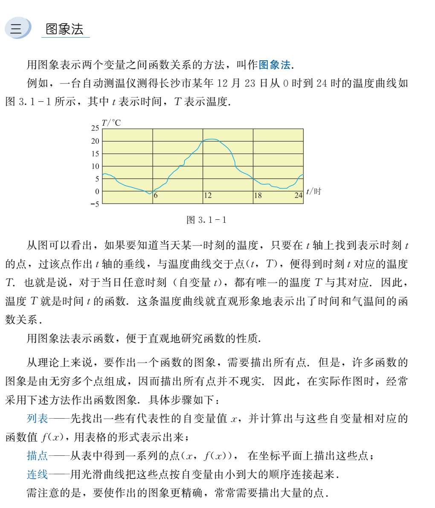

原页上下文：[PDF第76页](../原页上下文/PDF076-教材p069.webp)；[PDF第77页](../原页上下文/PDF077-教材p070.webp)；[PDF第78页](../原页上下文/PDF078-教材p071.webp)

## XJ-B1-C03-EX-P071-Y1368 3.1 例题 例题5

教材位置：第3章 / 3.1 函数 / 印刷页 p.71、72 / PDF 第78、79页。

类型：例题；原题号：例题5。

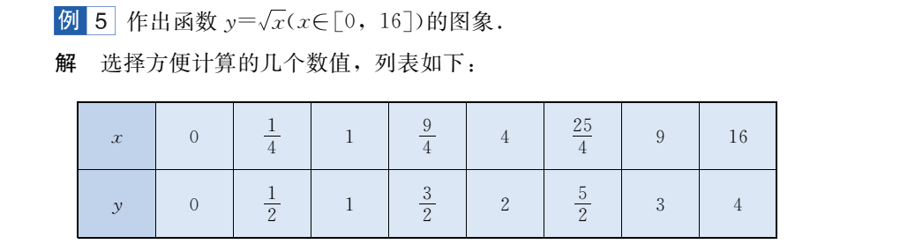
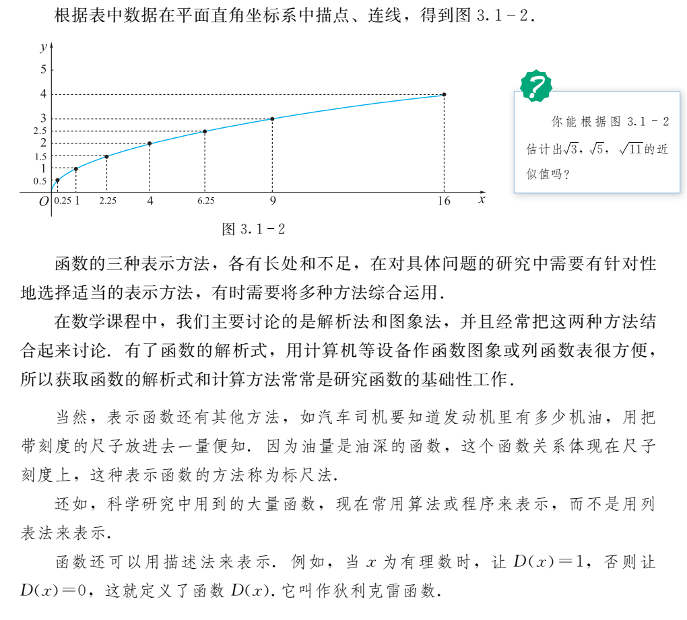

原页上下文：[PDF第78页](../原页上下文/PDF078-教材p071.webp)；[PDF第79页](../原页上下文/PDF079-教材p072.webp)

## XJ-B1-C03-PR-P072-Y1158 p.72 练习 第1题

教材位置：第3章 / 3.1 函数 / 印刷页 p.72 / PDF 第79页。

类型：练习；原题号：第1题。

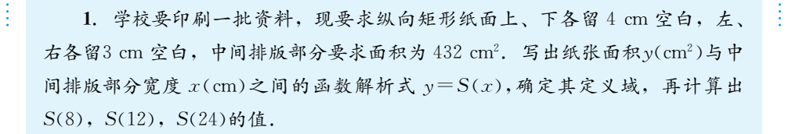

原页上下文：[PDF第79页](../原页上下文/PDF079-教材p072.webp)

## XJ-B1-C03-PR-P072-Y1330 p.72 练习 第2题

教材位置：第3章 / 3.1 函数 / 印刷页 p.72 / PDF 第79页。

类型：练习；原题号：第2题。

原页上下文：[PDF第79页](../原页上下文/PDF079-教材p072.webp)

## XJ-B1-C03-PR-P072-Y1416 p.72 练习 第3题

教材位置：第3章 / 3.1 函数 / 印刷页 p.72 / PDF 第79页。

类型：练习；原题号：第3题。

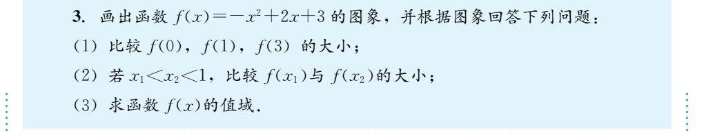

原页上下文：[PDF第79页](../原页上下文/PDF079-教材p072.webp)

## XJ-B1-C03-LAB-P073-Y0145 用计算机作函数图象和列函数表

教材位置：第3章 / 3.1 函数 / 印刷页 p.73 / PDF 第80页。

类型：数学实验；原题号：完整实验任务。

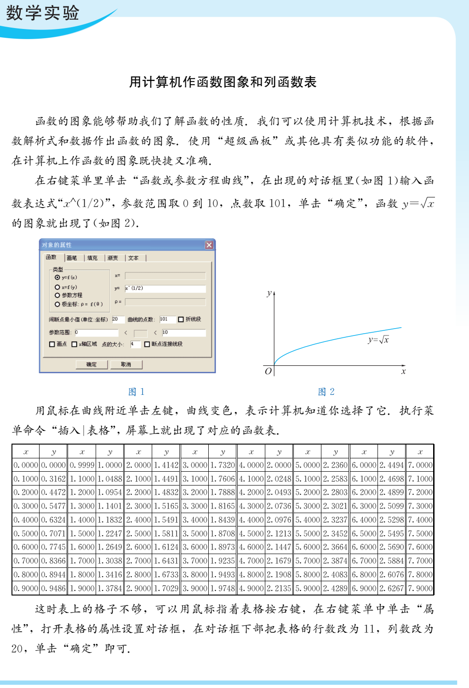

原页上下文：[PDF第80页](../原页上下文/PDF080-教材p073.webp)

## XJ-B1-C03-EX-P074-Y0394 3.1 例题 例题6

教材位置：第3章 / 3.1 函数 / 印刷页 p.74 / PDF 第81页。

类型：例题；原题号：例题6。

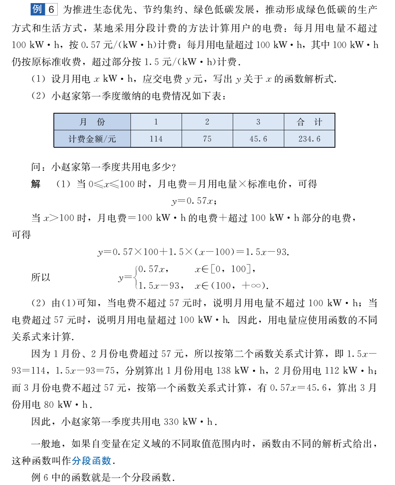

原页上下文：[PDF第81页](../原页上下文/PDF081-教材p074.webp)

## XJ-B1-C03-EX-P075-Y0177 3.1 例题 例题7

教材位置：第3章 / 3.1 函数 / 印刷页 p.75 / PDF 第82页。

类型：例题；原题号：例题7。

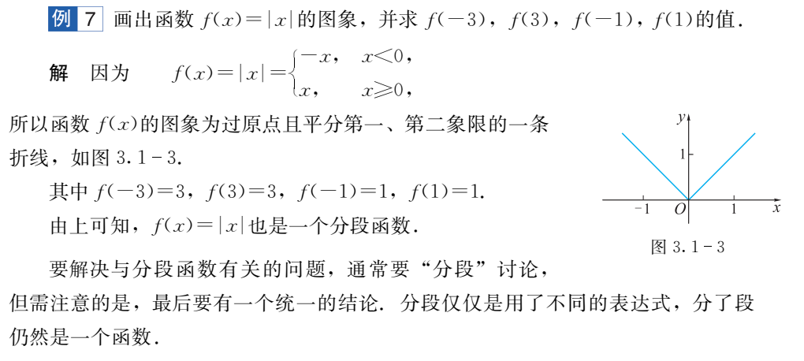

原页上下文：[PDF第82页](../原页上下文/PDF082-教材p075.webp)

## XJ-B1-C03-EX-P075-Y0639 3.1 例题 例题8

教材位置：第3章 / 3.1 函数 / 印刷页 p.75 / PDF 第82页。

类型：例题；原题号：例题8。

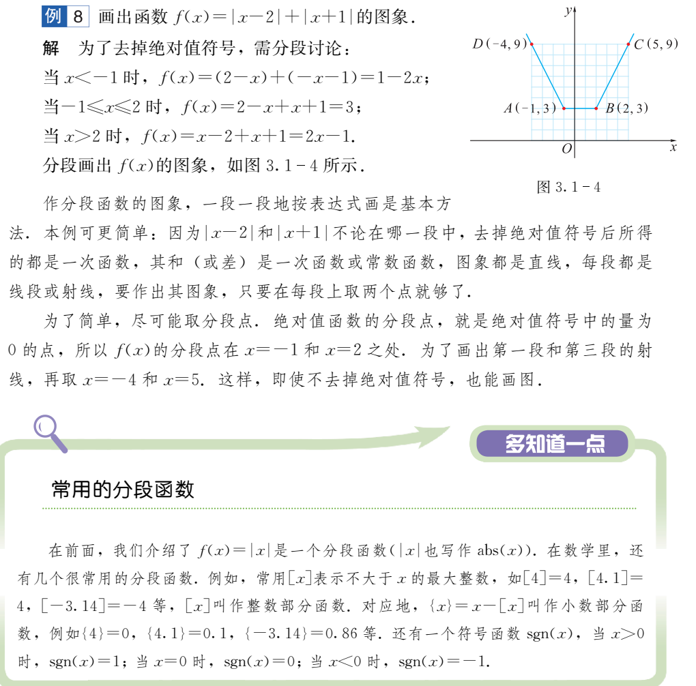

原页上下文：[PDF第82页](../原页上下文/PDF082-教材p075.webp)

## XJ-B1-C03-PR-P076-Y0217 p.76 练习 第1题

教材位置：第3章 / 3.1 函数 / 印刷页 p.76 / PDF 第83页。

类型：练习；原题号：第1题。

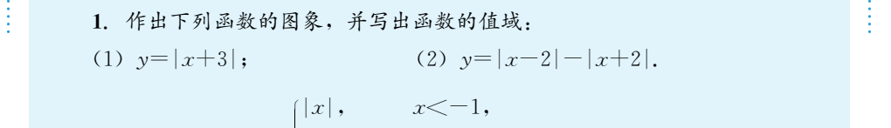

原页上下文：[PDF第83页](../原页上下文/PDF083-教材p076.webp)

## XJ-B1-C03-PR-P076-Y0364 p.76 练习 第2题

教材位置：第3章 / 3.1 函数 / 印刷页 p.76 / PDF 第83页。

类型：练习；原题号：第2题。

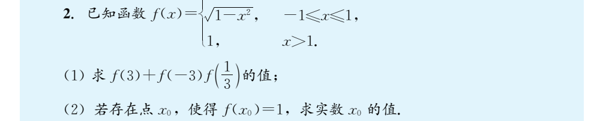

原页上下文：[PDF第83页](../原页上下文/PDF083-教材p076.webp)

## XJ-B1-C03-PR-P076-Y0567 p.76 练习 第3题

教材位置：第3章 / 3.1 函数 / 印刷页 p.76 / PDF 第83页。

类型：练习；原题号：第3题。

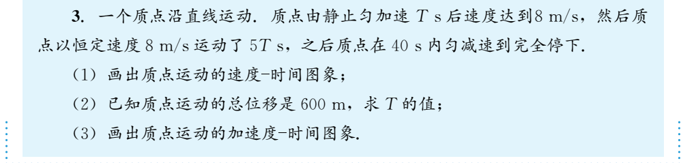

原页上下文：[PDF第83页](../原页上下文/PDF083-教材p076.webp)

## XJ-B1-C03-HW-P076-Y1136 习题3.1 第1题

教材位置：第3章 / 3.1 函数 / 印刷页 p.76 / PDF 第83页。

类型：习题；原题号：第1题。

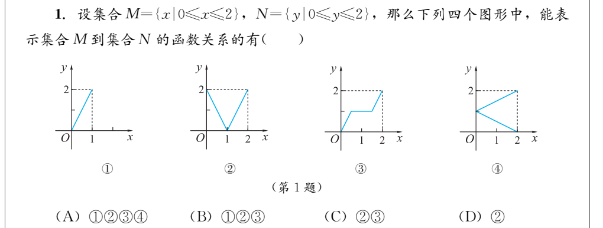

原页上下文：[PDF第83页](../原页上下文/PDF083-教材p076.webp)

## XJ-B1-C03-HW-P076-Y1523 习题3.1 第2题

教材位置：第3章 / 3.1 函数 / 印刷页 p.76、77 / PDF 第83、84页。

类型：习题；原题号：第2题。

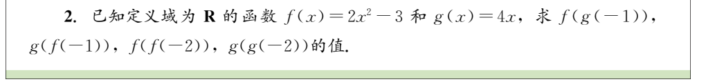

原页上下文：[PDF第83页](../原页上下文/PDF083-教材p076.webp)；[PDF第84页](../原页上下文/PDF084-教材p077.webp)

## XJ-B1-C03-HW-P077-Y0228 习题3.1 第3题

教材位置：第3章 / 3.1 函数 / 印刷页 p.77 / PDF 第84页。

类型：习题；原题号：第3题。

原页上下文：[PDF第84页](../原页上下文/PDF084-教材p077.webp)

## XJ-B1-C03-HW-P077-Y0286 习题3.1 第4题

教材位置：第3章 / 3.1 函数 / 印刷页 p.77 / PDF 第84页。

类型：习题；原题号：第4题。

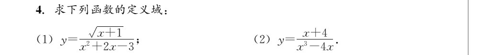

原页上下文：[PDF第84页](../原页上下文/PDF084-教材p077.webp)

## XJ-B1-C03-HW-P077-Y0403 习题3.1 第5题

教材位置：第3章 / 3.1 函数 / 印刷页 p.77 / PDF 第84页。

类型：习题；原题号：第5题。

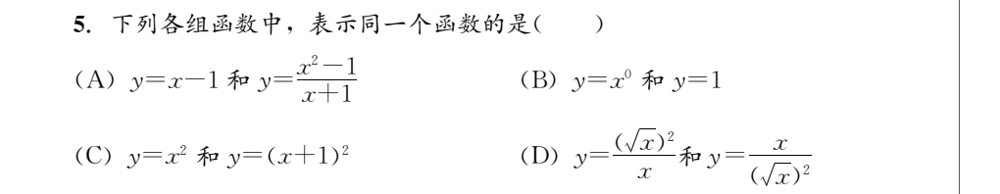

原页上下文：[PDF第84页](../原页上下文/PDF084-教材p077.webp)

## XJ-B1-C03-HW-P077-Y0601 习题3.1 第6题

教材位置：第3章 / 3.1 函数 / 印刷页 p.77 / PDF 第84页。

类型：习题；原题号：第6题。

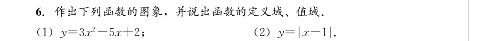

原页上下文：[PDF第84页](../原页上下文/PDF084-教材p077.webp)

## XJ-B1-C03-HW-P077-Y0687 习题3.1 第7题

教材位置：第3章 / 3.1 函数 / 印刷页 p.77 / PDF 第84页。

类型：习题；原题号：第7题。

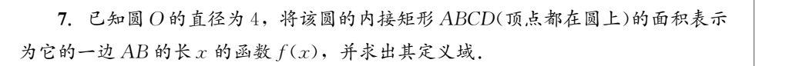

原页上下文：[PDF第84页](../原页上下文/PDF084-教材p077.webp)

## XJ-B1-C03-HW-P077-Y0773 习题3.1 第8题

教材位置：第3章 / 3.1 函数 / 印刷页 p.77 / PDF 第84页。

类型：习题；原题号：第8题。

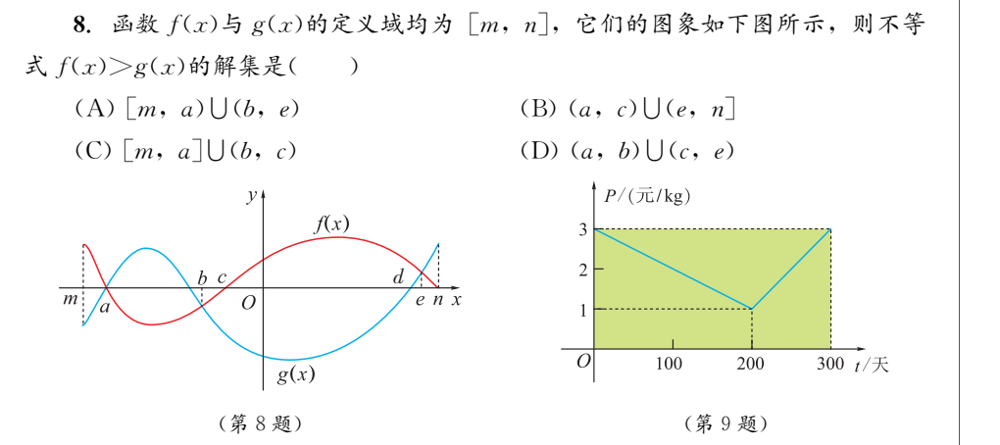

原页上下文：[PDF第84页](../原页上下文/PDF084-教材p077.webp)

## XJ-B1-C03-HW-P077-Y1227 习题3.1 第9题

教材位置：第3章 / 3.1 函数 / 印刷页 p.77 / PDF 第84页。

类型：习题；原题号：第9题。

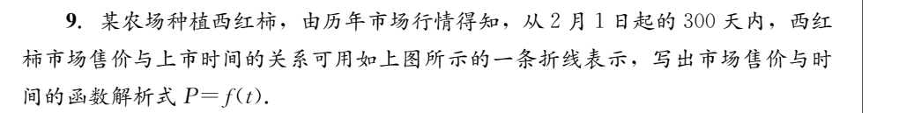

原页上下文：[PDF第84页](../原页上下文/PDF084-教材p077.webp)

## XJ-B1-C03-HW-P077-Y1356 习题3.1 第10题

教材位置：第3章 / 3.1 函数 / 印刷页 p.77、78 / PDF 第84、85页。

类型：习题；原题号：第10题。

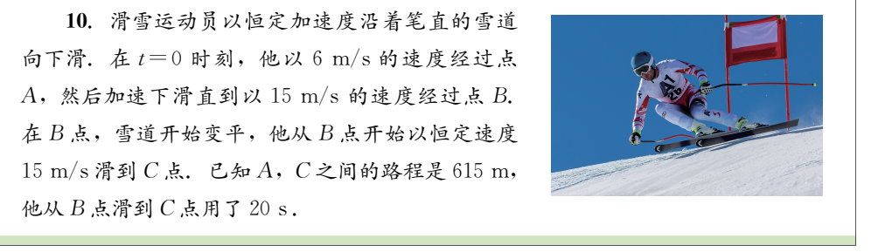
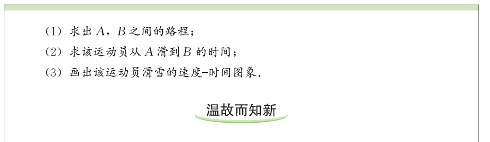

原页上下文：[PDF第84页](../原页上下文/PDF084-教材p077.webp)；[PDF第85页](../原页上下文/PDF085-教材p078.webp)

## XJ-B1-C03-HW-P078-Y0473 习题3.1 第11题

教材位置：第3章 / 3.1 函数 / 印刷页 p.78 / PDF 第85页。

类型：习题；原题号：第11题。

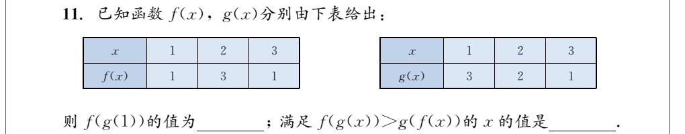

原页上下文：[PDF第85页](../原页上下文/PDF085-教材p078.webp)

## XJ-B1-C03-HW-P078-Y0673 习题3.1 第12题

教材位置：第3章 / 3.1 函数 / 印刷页 p.78 / PDF 第85页。

类型：习题；原题号：第12题。

原页上下文：[PDF第85页](../原页上下文/PDF085-教材p078.webp)

## XJ-B1-C03-HW-P078-Y0717 习题3.1 第13题

教材位置：第3章 / 3.1 函数 / 印刷页 p.78 / PDF 第85页。

类型：习题；原题号：第13题。

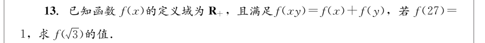

原页上下文：[PDF第85页](../原页上下文/PDF085-教材p078.webp)

## XJ-B1-C03-HW-P078-Y0808 习题3.1 第14题

教材位置：第3章 / 3.1 函数 / 印刷页 p.78 / PDF 第85页。

类型：习题；原题号：第14题。

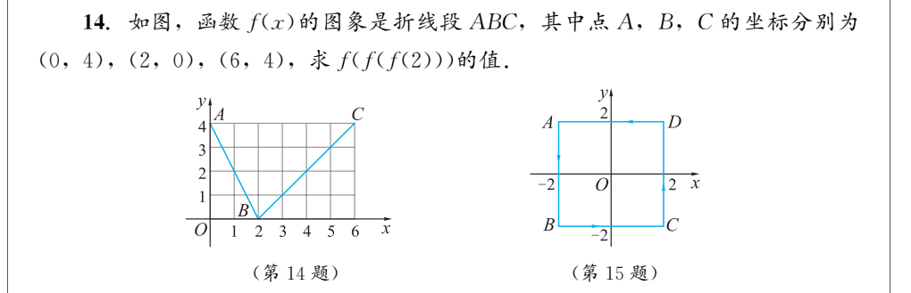

原页上下文：[PDF第85页](../原页上下文/PDF085-教材p078.webp)

## XJ-B1-C03-HW-P078-Y1137 习题3.1 第15题

教材位置：第3章 / 3.1 函数 / 印刷页 p.78 / PDF 第85页。

类型：习题；原题号：第15题。

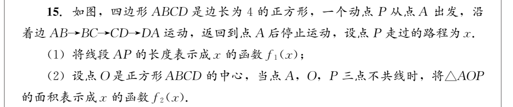

原页上下文：[PDF第85页](../原页上下文/PDF085-教材p078.webp)

## XJ-B1-C03-HW-P078-Y1352 习题3.1 第16题

教材位置：第3章 / 3.1 函数 / 印刷页 p.78 / PDF 第85页。

类型：习题；原题号：第16题。

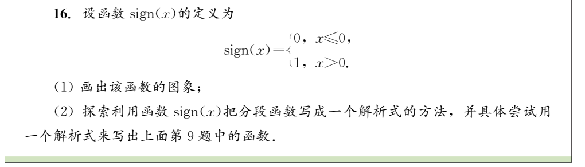

原页上下文：[PDF第85页](../原页上下文/PDF085-教材p078.webp)

## XJ-B1-C03-TH-P079-Y0868 p.79 思考（含紧邻说明）

教材位置：第3章 / 3.2 函数的基本性质 / 印刷页 p.79 / PDF 第86页。

类型：思考；原题号：未编号题组。

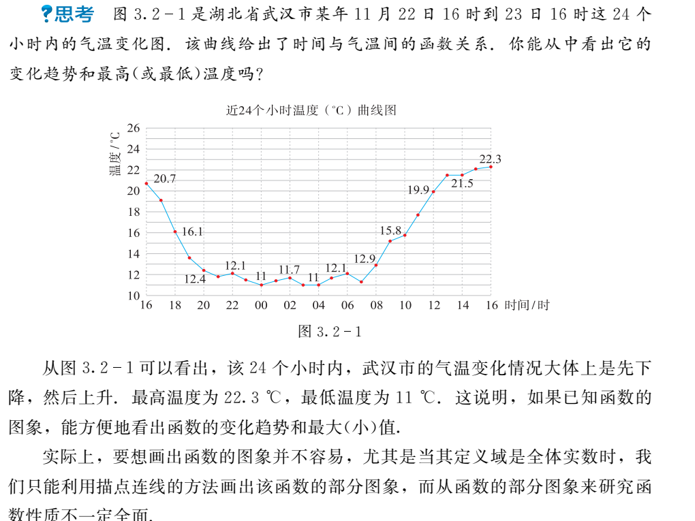

原页上下文：[PDF第86页](../原页上下文/PDF086-教材p079.webp)

## XJ-B1-C03-TH-P081-Y0178 p.81 思考（含紧邻说明）

教材位置：第3章 / 3.2 函数的基本性质 / 印刷页 p.81 / PDF 第88页。

类型：思考；原题号：未编号题组。

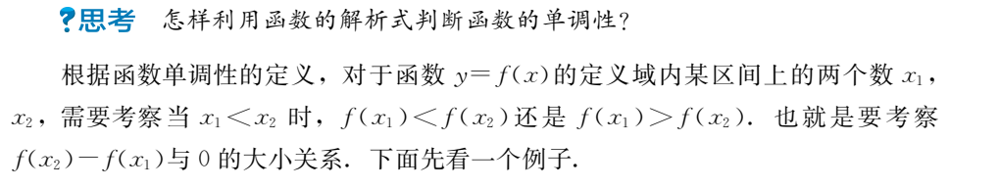

原页上下文：[PDF第88页](../原页上下文/PDF088-教材p081.webp)

## XJ-B1-C03-EX-P081-Y0375 3.2 例题 例题1

教材位置：第3章 / 3.2 函数的基本性质 / 印刷页 p.81 / PDF 第88页。

类型：例题；原题号：例题1。

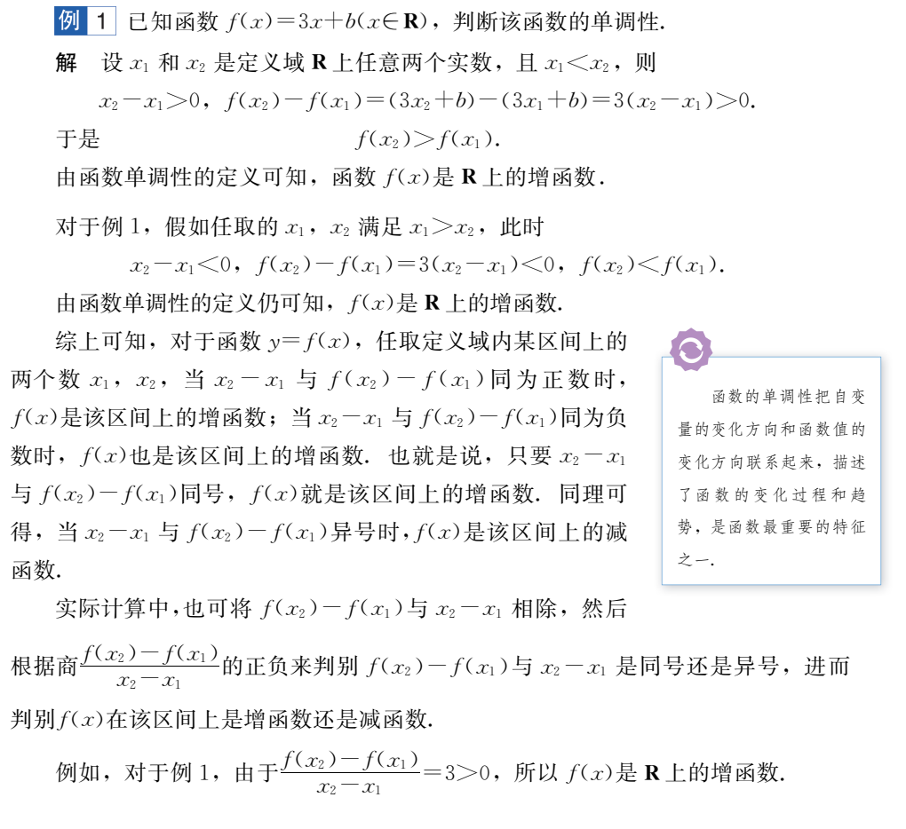

原页上下文：[PDF第88页](../原页上下文/PDF088-教材p081.webp)

## XJ-B1-C03-EX-P081-Y1313 3.2 例题 例题2

教材位置：第3章 / 3.2 函数的基本性质 / 印刷页 p.81、82 / PDF 第88、89页。

类型：例题；原题号：例题2。

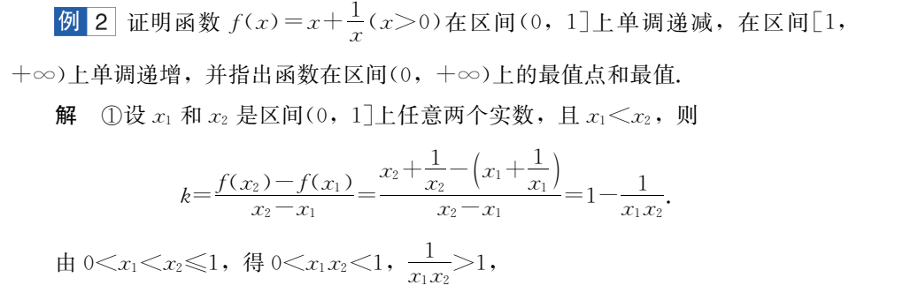
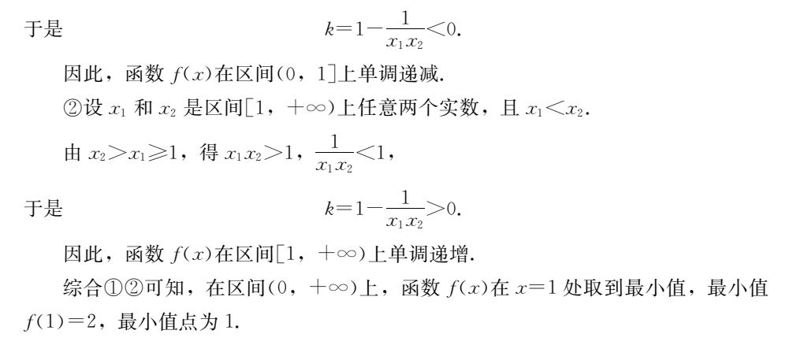

原页上下文：[PDF第88页](../原页上下文/PDF088-教材p081.webp)；[PDF第89页](../原页上下文/PDF089-教材p082.webp)

## XJ-B1-C03-EX-P082-Y0618 3.2 例题 例题3

教材位置：第3章 / 3.2 函数的基本性质 / 印刷页 p.82 / PDF 第89页。

类型：例题；原题号：例题3。

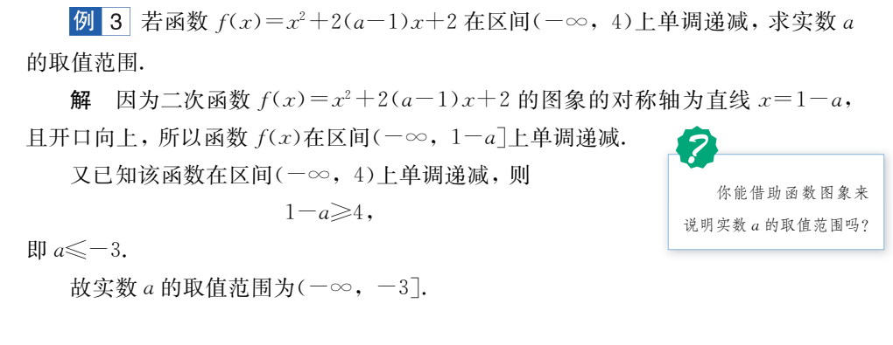

原页上下文：[PDF第89页](../原页上下文/PDF089-教材p082.webp)

## XJ-B1-C03-PR-P082-Y1064 p.82 练习 第1题

教材位置：第3章 / 3.2 函数的基本性质 / 印刷页 p.82 / PDF 第89页。

类型：练习；原题号：第1题。

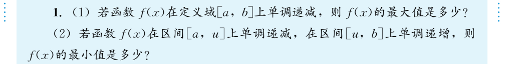

原页上下文：[PDF第89页](../原页上下文/PDF089-教材p082.webp)

## XJ-B1-C03-PR-P082-Y1193 p.82 练习 第2题

教材位置：第3章 / 3.2 函数的基本性质 / 印刷页 p.82 / PDF 第89页。

类型：练习；原题号：第2题。

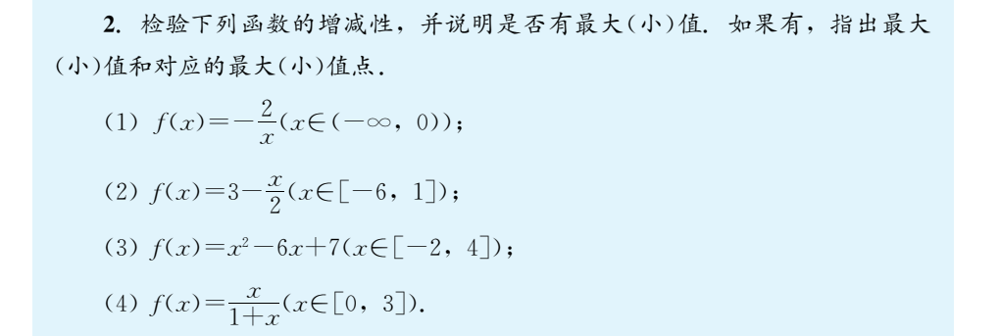

原页上下文：[PDF第89页](../原页上下文/PDF089-教材p082.webp)

## XJ-B1-C03-PR-P082-Y1536 p.82 练习 第3题

教材位置：第3章 / 3.2 函数的基本性质 / 印刷页 p.82 / PDF 第89页。

类型：练习；原题号：第3题。

原页上下文：[PDF第89页](../原页上下文/PDF089-教材p082.webp)

## XJ-B1-C03-TH-P083-Y0277 p.83 思考（含紧邻说明）

教材位置：第3章 / 3.2 函数的基本性质 / 印刷页 p.83 / PDF 第90页。

类型：思考；原题号：未编号题组。

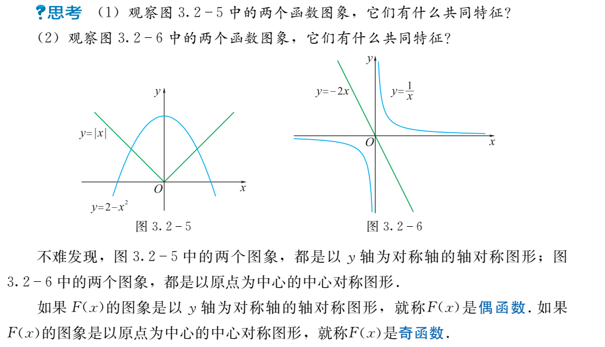

原页上下文：[PDF第90页](../原页上下文/PDF090-教材p083.webp)

## XJ-B1-C03-TH-P083-Y0867 p.83 思考（含紧邻说明）

教材位置：第3章 / 3.2 函数的基本性质 / 印刷页 p.83 / PDF 第90页。

类型：思考；原题号：未编号题组。

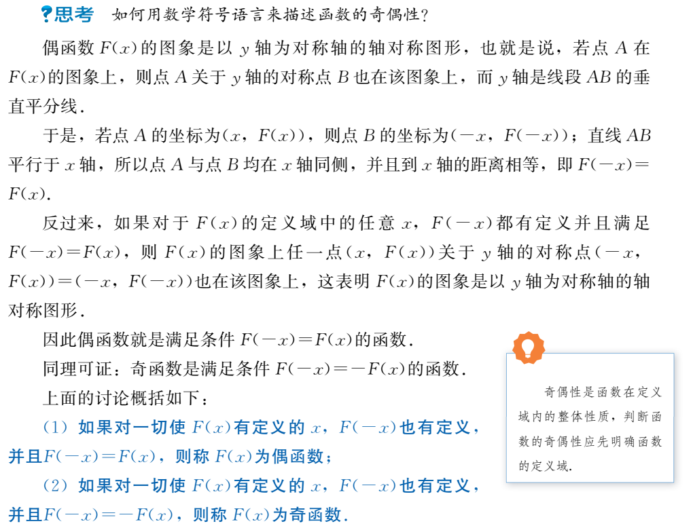

原页上下文：[PDF第90页](../原页上下文/PDF090-教材p083.webp)

## XJ-B1-C03-EX-P084-Y0177 3.2 例题 例题4

教材位置：第3章 / 3.2 函数的基本性质 / 印刷页 p.84 / PDF 第91页。

类型：例题；原题号：例题4。

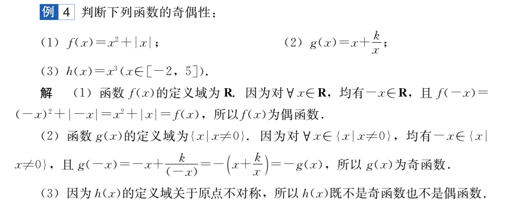

原页上下文：[PDF第91页](../原页上下文/PDF091-教材p084.webp)

## XJ-B1-C03-EX-P084-Y0592 3.2 例题 例题5

教材位置：第3章 / 3.2 函数的基本性质 / 印刷页 p.84 / PDF 第91页。

类型：例题；原题号：例题5。

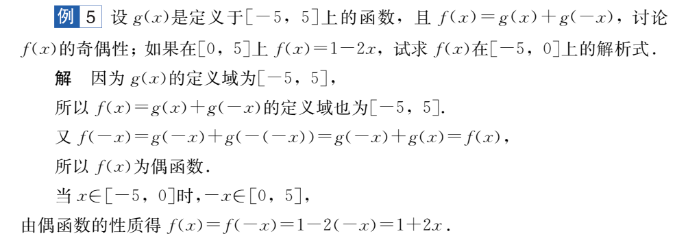

原页上下文：[PDF第91页](../原页上下文/PDF091-教材p084.webp)

## XJ-B1-C03-PR-P084-Y1009 p.84 练习 第1题

教材位置：第3章 / 3.2 函数的基本性质 / 印刷页 p.84 / PDF 第91页。

类型：练习；原题号：第1题。

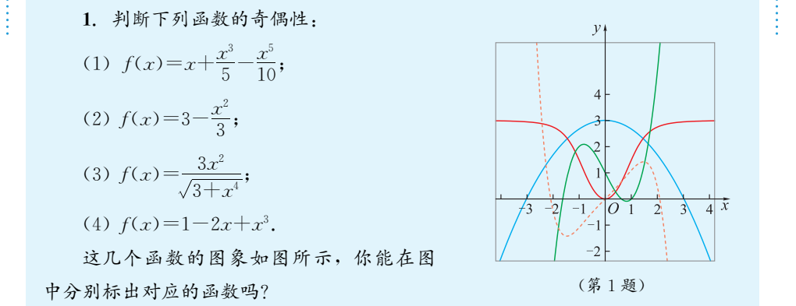

原页上下文：[PDF第91页](../原页上下文/PDF091-教材p084.webp)

## XJ-B1-C03-PR-P084-Y1402 p.84 练习 第2题

教材位置：第3章 / 3.2 函数的基本性质 / 印刷页 p.84 / PDF 第91页。

类型：练习；原题号：第2题。

原页上下文：[PDF第91页](../原页上下文/PDF091-教材p084.webp)

## XJ-B1-C03-PR-P084-Y1488 p.84 练习 第3题

教材位置：第3章 / 3.2 函数的基本性质 / 印刷页 p.84 / PDF 第91页。

类型：练习；原题号：第3题。

原页上下文：[PDF第91页](../原页上下文/PDF091-教材p084.webp)

## XJ-B1-C03-PR-P084-Y1532 p.84 练习 第4题

教材位置：第3章 / 3.2 函数的基本性质 / 印刷页 p.84 / PDF 第91页。

类型：练习；原题号：第4题。

原页上下文：[PDF第91页](../原页上下文/PDF091-教材p084.webp)

## XJ-B1-C03-HW-P085-Y0449 习题3.2 第1题

教材位置：第3章 / 3.2 函数的基本性质 / 印刷页 p.85 / PDF 第92页。

类型：习题；原题号：第1题。

原页上下文：[PDF第92页](../原页上下文/PDF092-教材p085.webp)

## XJ-B1-C03-HW-P085-Y0836 习题3.2 第2题

教材位置：第3章 / 3.2 函数的基本性质 / 印刷页 p.85 / PDF 第92页。

类型：习题；原题号：第2题。

原页上下文：[PDF第92页](../原页上下文/PDF092-教材p085.webp)

## XJ-B1-C03-HW-P085-Y1036 习题3.2 第3题

教材位置：第3章 / 3.2 函数的基本性质 / 印刷页 p.85 / PDF 第92页。

类型：习题；原题号：第3题。

原页上下文：[PDF第92页](../原页上下文/PDF092-教材p085.webp)

## XJ-B1-C03-HW-P085-Y1122 习题3.2 第4题

教材位置：第3章 / 3.2 函数的基本性质 / 印刷页 p.85 / PDF 第92页。

类型：习题；原题号：第4题。

原页上下文：[PDF第92页](../原页上下文/PDF092-教材p085.webp)

## XJ-B1-C03-HW-P085-Y1280 习题3.2 第5题

教材位置：第3章 / 3.2 函数的基本性质 / 印刷页 p.85、86 / PDF 第92、93页。

类型：习题；原题号：第5题。

原页上下文：[PDF第92页](../原页上下文/PDF092-教材p085.webp)；[PDF第93页](../原页上下文/PDF093-教材p086.webp)

## XJ-B1-C03-HW-P086-Y0231 习题3.2 第6题

教材位置：第3章 / 3.2 函数的基本性质 / 印刷页 p.86 / PDF 第93页。

类型：习题；原题号：第6题。

原页上下文：[PDF第93页](../原页上下文/PDF093-教材p086.webp)

## XJ-B1-C03-HW-P086-Y0288 习题3.2 第7题

教材位置：第3章 / 3.2 函数的基本性质 / 印刷页 p.86 / PDF 第93页。

类型：习题；原题号：第7题。

原页上下文：[PDF第93页](../原页上下文/PDF093-教材p086.webp)

## XJ-B1-C03-HW-P086-Y0520 习题3.2 第8题

教材位置：第3章 / 3.2 函数的基本性质 / 印刷页 p.86 / PDF 第93页。

类型：习题；原题号：第8题。

原页上下文：[PDF第93页](../原页上下文/PDF093-教材p086.webp)

## XJ-B1-C03-HW-P086-Y0708 习题3.2 第9题

教材位置：第3章 / 3.2 函数的基本性质 / 印刷页 p.86 / PDF 第93页。

类型：习题；原题号：第9题。

原页上下文：[PDF第93页](../原页上下文/PDF093-教材p086.webp)

## XJ-B1-C03-HW-P086-Y0853 习题3.2 第10题

教材位置：第3章 / 3.2 函数的基本性质 / 印刷页 p.86 / PDF 第93页。

类型：习题；原题号：第10题。

原页上下文：[PDF第93页](../原页上下文/PDF093-教材p086.webp)

## XJ-B1-C03-HW-P086-Y1034 习题3.2 第11题

教材位置：第3章 / 3.2 函数的基本性质 / 印刷页 p.86 / PDF 第93页。

类型：习题；原题号：第11题。

原页上下文：[PDF第93页](../原页上下文/PDF093-教材p086.webp)

## XJ-B1-C03-HW-P086-Y1121 习题3.2 第12题

教材位置：第3章 / 3.2 函数的基本性质 / 印刷页 p.86 / PDF 第93页。

类型：习题；原题号：第12题。

原页上下文：[PDF第93页](../原页上下文/PDF093-教材p086.webp)

## XJ-B1-C03-HW-P086-Y1208 习题3.2 第13题

教材位置：第3章 / 3.2 函数的基本性质 / 印刷页 p.86 / PDF 第93页。

类型：习题；原题号：第13题。

原页上下文：[PDF第93页](../原页上下文/PDF093-教材p086.webp)

## XJ-B1-C03-SU-P089-Y0854 第3章 小结与复习 第1题

教材位置：第3章 / 小结与复习 小结与复习 / 印刷页 p.89 / PDF 第96页。

类型：小结与复习；原题号：第1题。

原页上下文：[PDF第96页](../原页上下文/PDF096-教材p089.webp)

## XJ-B1-C03-SU-P089-Y1026 第3章 小结与复习 第2题

教材位置：第3章 / 小结与复习 小结与复习 / 印刷页 p.89 / PDF 第96页。

类型：小结与复习；原题号：第2题。

原页上下文：[PDF第96页](../原页上下文/PDF096-教材p089.webp)

## XJ-B1-C03-SU-P089-Y1112 第3章 小结与复习 第3题

教材位置：第3章 / 小结与复习 小结与复习 / 印刷页 p.89 / PDF 第96页。

类型：小结与复习；原题号：第3题。

原页上下文：[PDF第96页](../原页上下文/PDF096-教材p089.webp)

## XJ-B1-C03-SU-P089-Y1284 第3章 小结与复习 第4题

教材位置：第3章 / 小结与复习 小结与复习 / 印刷页 p.89 / PDF 第96页。

类型：小结与复习；原题号：第4题。

原页上下文：[PDF第96页](../原页上下文/PDF096-教材p089.webp)

## XJ-B1-C03-SU-P089-Y1370 第3章 小结与复习 第5题

教材位置：第3章 / 小结与复习 小结与复习 / 印刷页 p.89 / PDF 第96页。

类型：小结与复习；原题号：第5题。

原页上下文：[PDF第96页](../原页上下文/PDF096-教材p089.webp)

## XJ-B1-C03-RV-P090-Y0407 复习题三 第1题

教材位置：第3章 / 章末复习 复习题三 / 印刷页 p.90 / PDF 第97页。

类型：复习题；原题号：第1题。

原页上下文：[PDF第97页](../原页上下文/PDF097-教材p090.webp)

## XJ-B1-C03-RV-P090-Y0635 复习题三 第2题

教材位置：第3章 / 章末复习 复习题三 / 印刷页 p.90 / PDF 第97页。

类型：复习题；原题号：第2题。

原页上下文：[PDF第97页](../原页上下文/PDF097-教材p090.webp)

## XJ-B1-C03-RV-P090-Y0678 复习题三 第3题

教材位置：第3章 / 章末复习 复习题三 / 印刷页 p.90 / PDF 第97页。

类型：复习题；原题号：第3题。

原页上下文：[PDF第97页](../原页上下文/PDF097-教材p090.webp)

## XJ-B1-C03-RV-P090-Y0720 复习题三 第4题

教材位置：第3章 / 章末复习 复习题三 / 印刷页 p.90 / PDF 第97页。

类型：复习题；原题号：第4题。

原页上下文：[PDF第97页](../原页上下文/PDF097-教材p090.webp)

## XJ-B1-C03-RV-P090-Y1103 复习题三 第5题

教材位置：第3章 / 章末复习 复习题三 / 印刷页 p.90 / PDF 第97页。

类型：复习题；原题号：第5题。

原页上下文：[PDF第97页](../原页上下文/PDF097-教材p090.webp)

## XJ-B1-C03-RV-P090-Y1174 复习题三 第6题

教材位置：第3章 / 章末复习 复习题三 / 印刷页 p.90 / PDF 第97页。

类型：复习题；原题号：第6题。

原页上下文：[PDF第97页](../原页上下文/PDF097-教材p090.webp)

## XJ-B1-C03-RV-P090-Y1256 复习题三 第7题

教材位置：第3章 / 章末复习 复习题三 / 印刷页 p.90 / PDF 第97页。

类型：复习题；原题号：第7题。

原页上下文：[PDF第97页](../原页上下文/PDF097-教材p090.webp)

## XJ-B1-C03-RV-P090-Y1299 复习题三 第8题

教材位置：第3章 / 章末复习 复习题三 / 印刷页 p.90 / PDF 第97页。

类型：复习题；原题号：第8题。

原页上下文：[PDF第97页](../原页上下文/PDF097-教材p090.webp)

## XJ-B1-C03-RV-P090-Y1401 复习题三 第9题

教材位置：第3章 / 章末复习 复习题三 / 印刷页 p.90 / PDF 第97页。

类型：复习题；原题号：第9题。

原页上下文：[PDF第97页](../原页上下文/PDF097-教材p090.webp)

## XJ-B1-C03-RV-P090-Y1501 复习题三 第10题

教材位置：第3章 / 章末复习 复习题三 / 印刷页 p.90 / PDF 第97页。

类型：复习题；原题号：第10题。

原页上下文：[PDF第97页](../原页上下文/PDF097-教材p090.webp)

## XJ-B1-C03-RV-P090-Y1543 复习题三 第11题

教材位置：第3章 / 章末复习 复习题三 / 印刷页 p.90、91 / PDF 第97、98页。

类型：复习题；原题号：第11题。

原页上下文：[PDF第97页](../原页上下文/PDF097-教材p090.webp)；[PDF第98页](../原页上下文/PDF098-教材p091.webp)

## XJ-B1-C03-RV-P091-Y0650 复习题三 第12题

教材位置：第3章 / 章末复习 复习题三 / 印刷页 p.91 / PDF 第98页。

类型：复习题；原题号：第12题。

原页上下文：[PDF第98页](../原页上下文/PDF098-教材p091.webp)

## XJ-B1-C03-RV-P091-Y0785 复习题三 第13题

教材位置：第3章 / 章末复习 复习题三 / 印刷页 p.91 / PDF 第98页。

类型：复习题；原题号：第13题。

原页上下文：[PDF第98页](../原页上下文/PDF098-教材p091.webp)

## XJ-B1-C03-RV-P091-Y1267 复习题三 第14题

教材位置：第3章 / 章末复习 复习题三 / 印刷页 p.91 / PDF 第98页。

类型：复习题；原题号：第14题。

原页上下文：[PDF第98页](../原页上下文/PDF098-教材p091.webp)

## XJ-B1-C03-RV-P091-Y1481 复习题三 第15题

教材位置：第3章 / 章末复习 复习题三 / 印刷页 p.91、92 / PDF 第98、99页。

类型：复习题；原题号：第15题。

原页上下文：[PDF第98页](../原页上下文/PDF098-教材p091.webp)；[PDF第99页](../原页上下文/PDF099-教材p092.webp)

## XJ-B1-C03-RV-P092-Y0231 复习题三 第16题

教材位置：第3章 / 章末复习 复习题三 / 印刷页 p.92 / PDF 第99页。

类型：复习题；原题号：第16题。

原页上下文：[PDF第99页](../原页上下文/PDF099-教材p092.webp)

## XJ-B1-C03-RV-P092-Y0288 复习题三 第17题

教材位置：第3章 / 章末复习 复习题三 / 印刷页 p.92 / PDF 第99页。

类型：复习题；原题号：第17题。

原页上下文：[PDF第99页](../原页上下文/PDF099-教材p092.webp)

## XJ-B1-C03-RV-P092-Y0375 复习题三 第18题

教材位置：第3章 / 章末复习 复习题三 / 印刷页 p.92 / PDF 第99页。

类型：复习题；原题号：第18题。

原页上下文：[PDF第99页](../原页上下文/PDF099-教材p092.webp)

## XJ-B1-C03-RV-P092-Y1067 复习题三 第19题

教材位置：第3章 / 章末复习 复习题三 / 印刷页 p.92 / PDF 第99页。

类型：复习题；原题号：第19题。

原页上下文：[PDF第99页](../原页上下文/PDF099-教材p092.webp)

## XJ-B1-C03-RV-P092-Y1491 复习题三 第20题

教材位置：第3章 / 章末复习 复习题三 / 印刷页 p.92 / PDF 第99页。

类型：复习题；原题号：第20题。

原页上下文：[PDF第99页](../原页上下文/PDF099-教材p092.webp)
