# 第4章 幂函数、指数函数和对数函数 教材题库

原图保留题目、公式和图形。OCR文字仅供检索，未经人工逐字校对。例题及思考保留教材原解或紧邻说明。

## XJ-B1-C04-EX-P095-Y0782 4.1 例题 例题1

教材位置：第4章 / 4.1 实数指数幂和幂函数 / 印刷页 p.95、96 / PDF 第102、103页。

类型：例题；原题号：例题1。

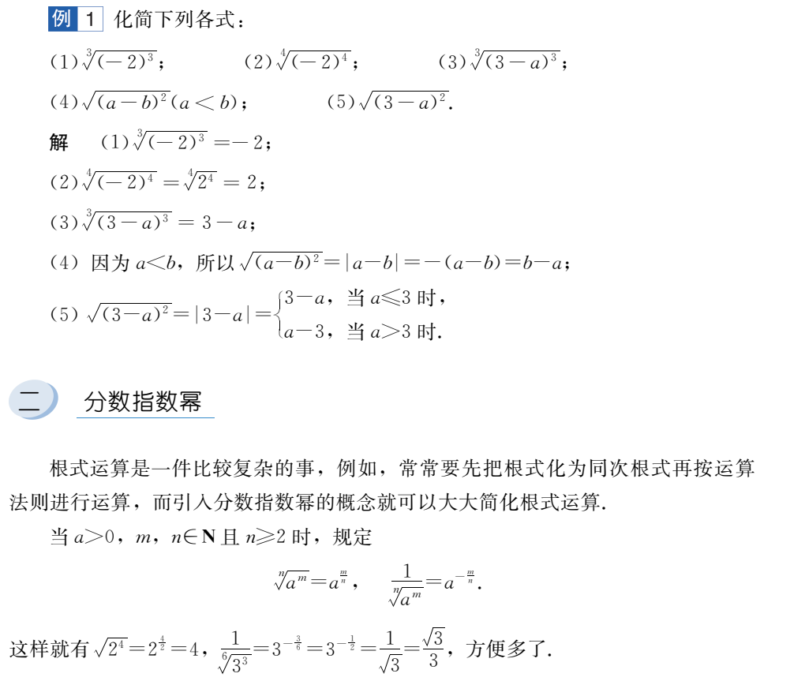
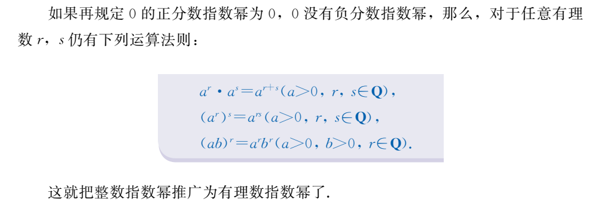

原页上下文：[PDF第102页](../原页上下文/PDF102-教材p095.webp)；[PDF第103页](../原页上下文/PDF103-教材p096.webp)

## XJ-B1-C04-EX-P096-Y0533 4.1 例题 例题2

教材位置：第4章 / 4.1 实数指数幂和幂函数 / 印刷页 p.96 / PDF 第103页。

类型：例题；原题号：例题2。

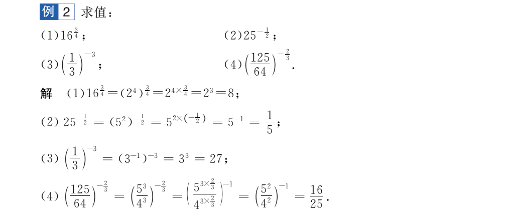

原页上下文：[PDF第103页](../原页上下文/PDF103-教材p096.webp)

## XJ-B1-C04-EX-P096-Y0978 4.1 例题 例题3

教材位置：第4章 / 4.1 实数指数幂和幂函数 / 印刷页 p.96 / PDF 第103页。

类型：例题；原题号：例题3。

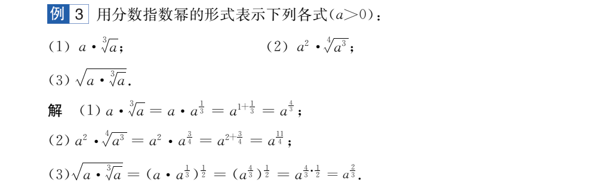

原页上下文：[PDF第103页](../原页上下文/PDF103-教材p096.webp)

## XJ-B1-C04-EX-P096-Y1306 4.1 例题 例题4

教材位置：第4章 / 4.1 实数指数幂和幂函数 / 印刷页 p.96、97 / PDF 第103、104页。

类型：例题；原题号：例题4。

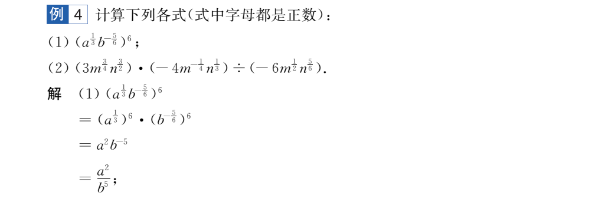
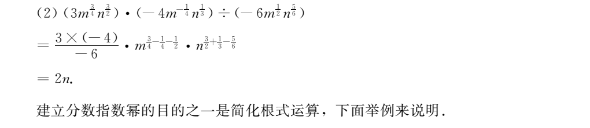

原页上下文：[PDF第103页](../原页上下文/PDF103-教材p096.webp)；[PDF第104页](../原页上下文/PDF104-教材p097.webp)

## XJ-B1-C04-EX-P097-Y0403 4.1 例题 例题5

教材位置：第4章 / 4.1 实数指数幂和幂函数 / 印刷页 p.97 / PDF 第104页。

类型：例题；原题号：例题5。

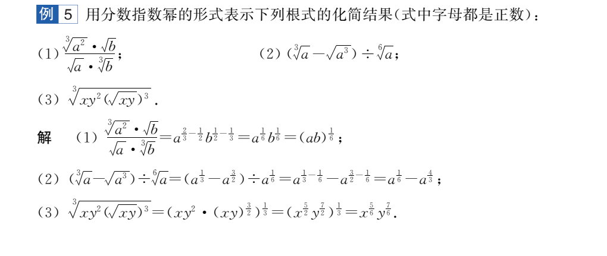

原页上下文：[PDF第104页](../原页上下文/PDF104-教材p097.webp)

## XJ-B1-C04-PR-P097-Y0891 p.97 练习 第1题

教材位置：第4章 / 4.1 实数指数幂和幂函数 / 印刷页 p.97 / PDF 第104页。

类型：练习；原题号：第1题。

原页上下文：[PDF第104页](../原页上下文/PDF104-教材p097.webp)

## XJ-B1-C04-PR-P097-Y1020 p.97 练习 第2题

教材位置：第4章 / 4.1 实数指数幂和幂函数 / 印刷页 p.97 / PDF 第104页。

类型：练习；原题号：第2题。

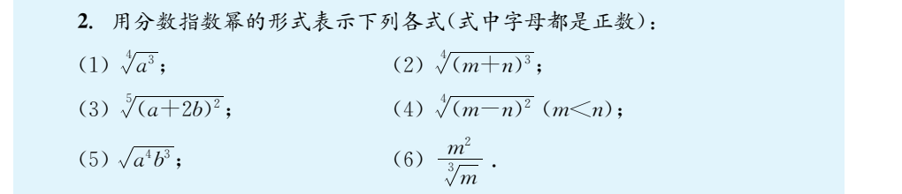

原页上下文：[PDF第104页](../原页上下文/PDF104-教材p097.webp)

## XJ-B1-C04-PR-P097-Y1240 p.97 练习 第3题

教材位置：第4章 / 4.1 实数指数幂和幂函数 / 印刷页 p.97 / PDF 第104页。

类型：练习；原题号：第3题。

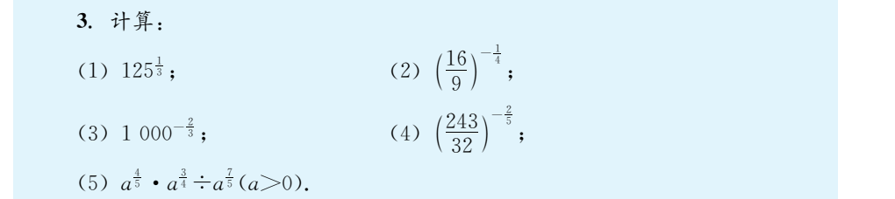

原页上下文：[PDF第104页](../原页上下文/PDF104-教材p097.webp)

## XJ-B1-C04-PR-P097-Y1468 p.97 练习 第4题

教材位置：第4章 / 4.1 实数指数幂和幂函数 / 印刷页 p.97 / PDF 第104页。

类型：练习；原题号：第4题。

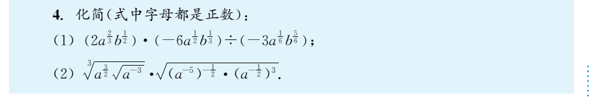

原页上下文：[PDF第104页](../原页上下文/PDF104-教材p097.webp)

## XJ-B1-C04-TH-P098-Y0419 p.98 思考（含紧邻说明）

教材位置：第4章 / 4.1 实数指数幂和幂函数 / 印刷页 p.98 / PDF 第105页。

类型：思考；原题号：未编号题组。

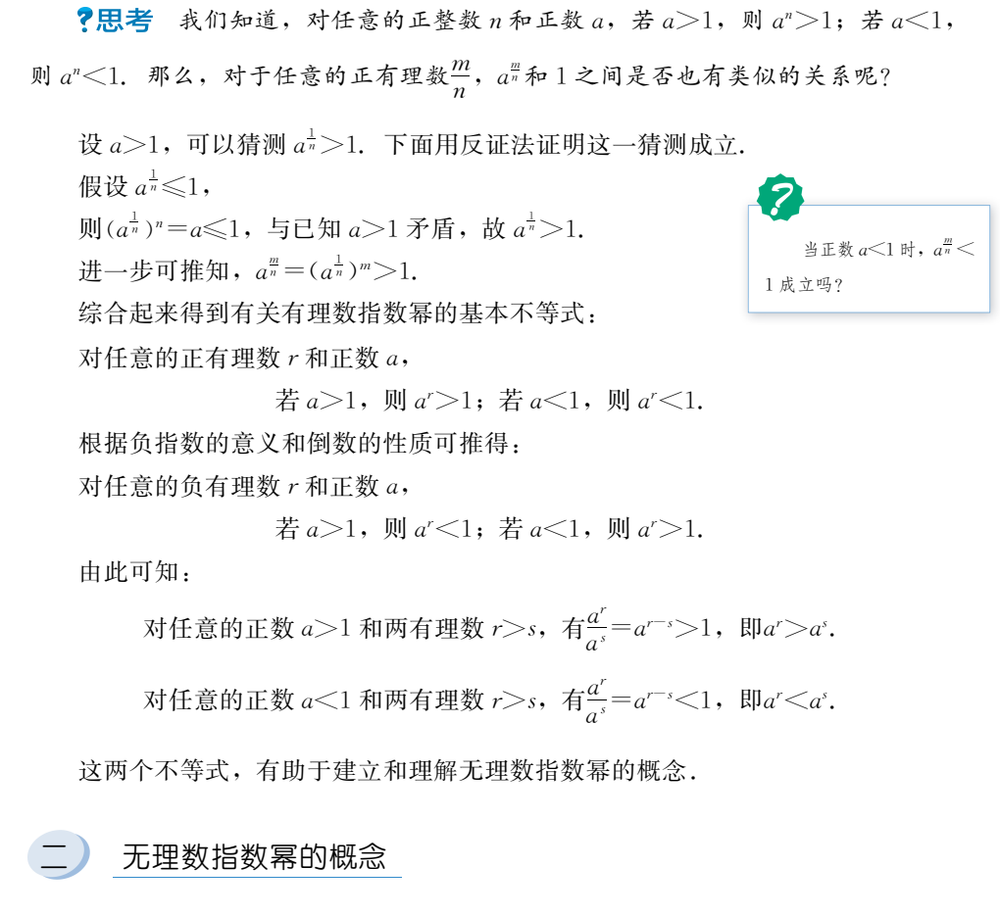

原页上下文：[PDF第105页](../原页上下文/PDF105-教材p098.webp)

## XJ-B1-C04-TH-P098-Y1358 p.98 思考（含紧邻说明）

教材位置：第4章 / 4.1 实数指数幂和幂函数 / 印刷页 p.98、99 / PDF 第105、106页。

类型：思考；原题号：未编号题组。

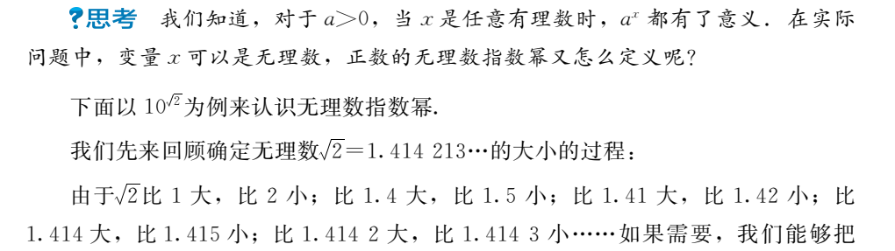
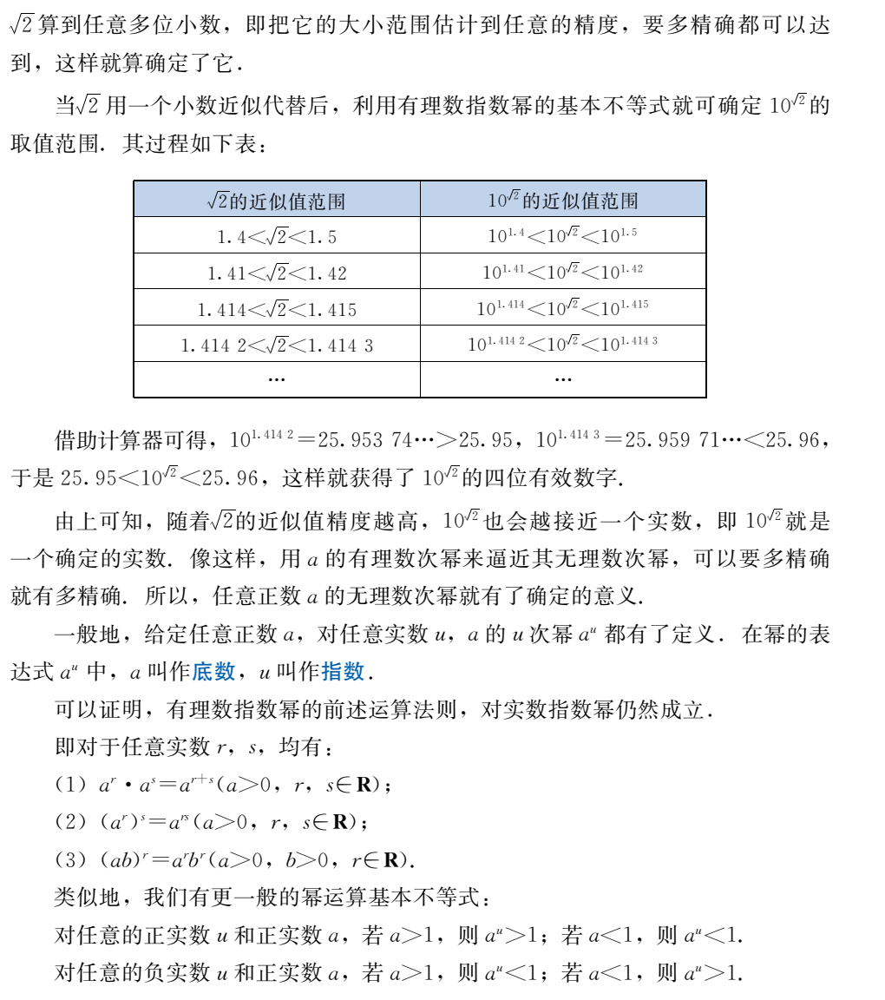

原页上下文：[PDF第105页](../原页上下文/PDF105-教材p098.webp)；[PDF第106页](../原页上下文/PDF106-教材p099.webp)

## XJ-B1-C04-EX-P099-Y1332 4.1 例题 例题6

教材位置：第4章 / 4.1 实数指数幂和幂函数 / 印刷页 p.99 / PDF 第106页。

类型：例题；原题号：例题6。

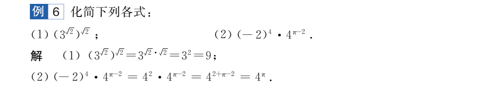

原页上下文：[PDF第106页](../原页上下文/PDF106-教材p099.webp)

## XJ-B1-C04-EX-P099-Y1526 4.1 例题 例题7

教材位置：第4章 / 4.1 实数指数幂和幂函数 / 印刷页 p.99、100 / PDF 第106、107页。

类型：例题；原题号：例题7。

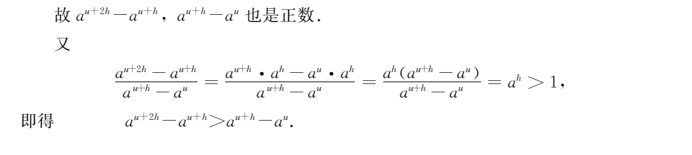

原页上下文：[PDF第106页](../原页上下文/PDF106-教材p099.webp)；[PDF第107页](../原页上下文/PDF107-教材p100.webp)

## XJ-B1-C04-PR-P100-Y0459 p.100 练习 第1题

教材位置：第4章 / 4.1 实数指数幂和幂函数 / 印刷页 p.100 / PDF 第107页。

类型：练习；原题号：第1题。

原页上下文：[PDF第107页](../原页上下文/PDF107-教材p100.webp)

## XJ-B1-C04-PR-P100-Y0574 p.100 练习 第2题

教材位置：第4章 / 4.1 实数指数幂和幂函数 / 印刷页 p.100 / PDF 第107页。

类型：练习；原题号：第2题。

原页上下文：[PDF第107页](../原页上下文/PDF107-教材p100.webp)

## XJ-B1-C04-PR-P100-Y0660 p.100 练习 第3题

教材位置：第4章 / 4.1 实数指数幂和幂函数 / 印刷页 p.100 / PDF 第107页。

类型：练习；原题号：第3题。

原页上下文：[PDF第107页](../原页上下文/PDF107-教材p100.webp)

## XJ-B1-C04-EX-P102-Y0177 4.1 例题 例题8

教材位置：第4章 / 4.1 实数指数幂和幂函数 / 印刷页 p.102 / PDF 第109页。

类型：例题；原题号：例题8。

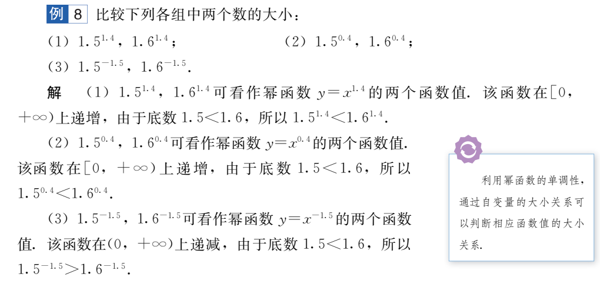

原页上下文：[PDF第109页](../原页上下文/PDF109-教材p102.webp)

## XJ-B1-C04-EX-P102-Y0669 4.1 例题 例题9

教材位置：第4章 / 4.1 实数指数幂和幂函数 / 印刷页 p.102、103 / PDF 第109、110页。

类型：例题；原题号：例题9。

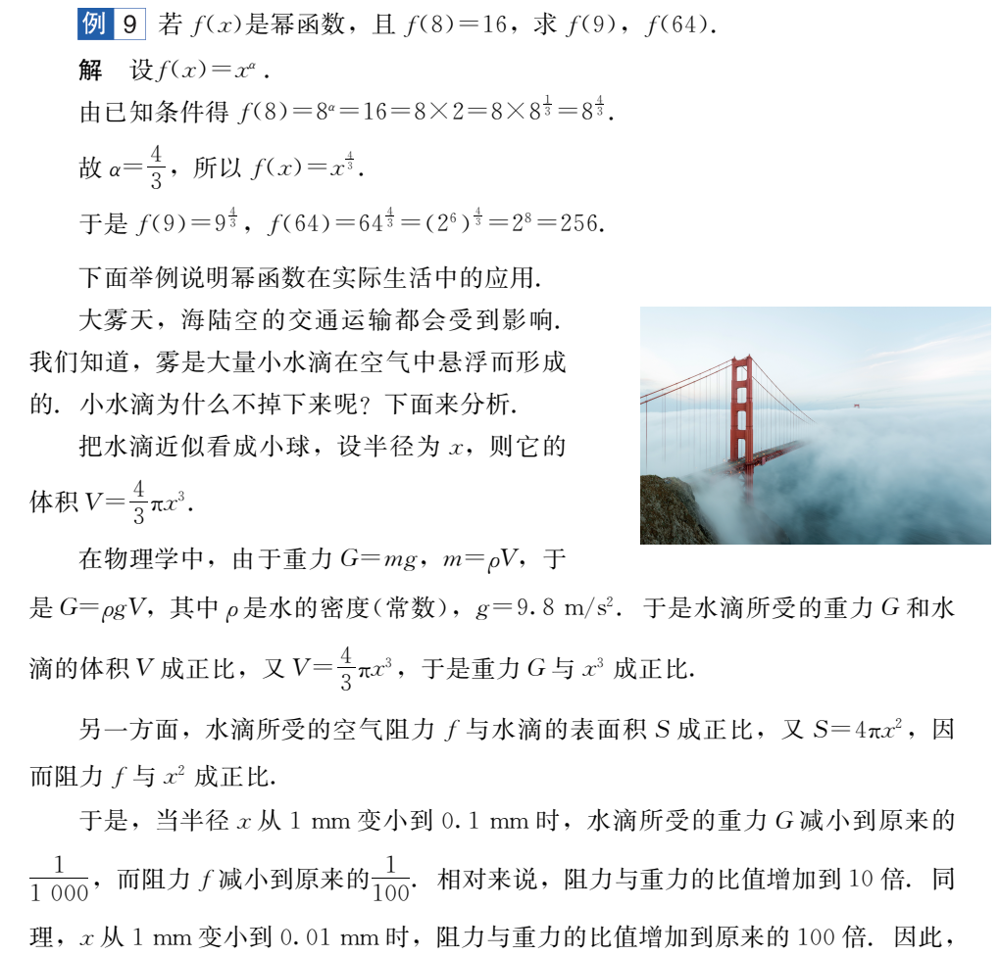
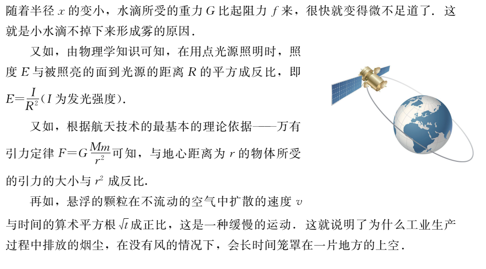

原页上下文：[PDF第109页](../原页上下文/PDF109-教材p102.webp)；[PDF第110页](../原页上下文/PDF110-教材p103.webp)

## XJ-B1-C04-PR-P103-Y0797 p.103 练习 第1题

教材位置：第4章 / 4.1 实数指数幂和幂函数 / 印刷页 p.103 / PDF 第110页。

类型：练习；原题号：第1题。

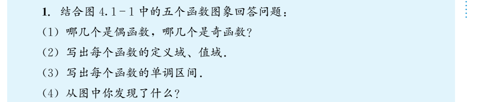

原页上下文：[PDF第110页](../原页上下文/PDF110-教材p103.webp)

## XJ-B1-C04-PR-P103-Y1012 p.103 练习 第2题

教材位置：第4章 / 4.1 实数指数幂和幂函数 / 印刷页 p.103 / PDF 第110页。

类型：练习；原题号：第2题。

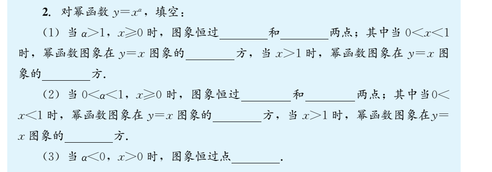

原页上下文：[PDF第110页](../原页上下文/PDF110-教材p103.webp)

## XJ-B1-C04-PR-P103-Y1370 p.103 练习 第3题

教材位置：第4章 / 4.1 实数指数幂和幂函数 / 印刷页 p.103 / PDF 第110页。

类型：练习；原题号：第3题。

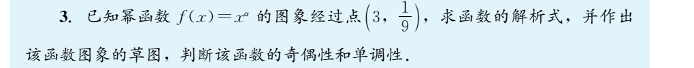

原页上下文：[PDF第110页](../原页上下文/PDF110-教材p103.webp)

## XJ-B1-C04-PR-P103-Y1471 p.103 练习 第4题

教材位置：第4章 / 4.1 实数指数幂和幂函数 / 印刷页 p.103 / PDF 第110页。

类型：练习；原题号：第4题。

原页上下文：[PDF第110页](../原页上下文/PDF110-教材p103.webp)

## XJ-B1-C04-HW-P104-Y0450 习题4.1 第1题

教材位置：第4章 / 4.1 实数指数幂和幂函数 / 印刷页 p.104 / PDF 第111页。

类型：习题；原题号：第1题。

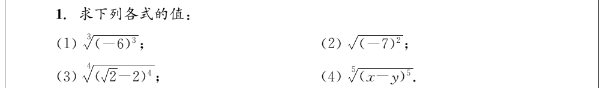

原页上下文：[PDF第111页](../原页上下文/PDF111-教材p104.webp)

## XJ-B1-C04-HW-P104-Y0598 习题4.1 第2题

教材位置：第4章 / 4.1 实数指数幂和幂函数 / 印刷页 p.104 / PDF 第111页。

类型：习题；原题号：第2题。

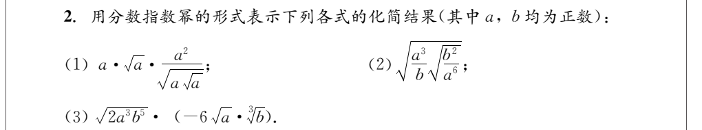

原页上下文：[PDF第111页](../原页上下文/PDF111-教材p104.webp)

## XJ-B1-C04-HW-P104-Y0788 习题4.1 第3题

教材位置：第4章 / 4.1 实数指数幂和幂函数 / 印刷页 p.104 / PDF 第111页。

类型：习题；原题号：第3题。

原页上下文：[PDF第111页](../原页上下文/PDF111-教材p104.webp)

## XJ-B1-C04-HW-P104-Y0874 习题4.1 第4题

教材位置：第4章 / 4.1 实数指数幂和幂函数 / 印刷页 p.104 / PDF 第111页。

类型：习题；原题号：第4题。

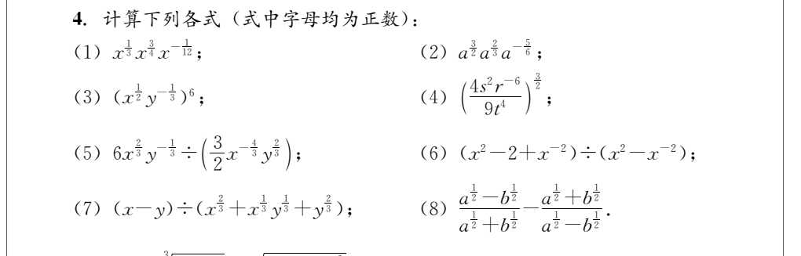

原页上下文：[PDF第111页](../原页上下文/PDF111-教材p104.webp)

## XJ-B1-C04-HW-P104-Y1201 习题4.1 第5题

教材位置：第4章 / 4.1 实数指数幂和幂函数 / 印刷页 p.104 / PDF 第111页。

类型：习题；原题号：第5题。

原页上下文：[PDF第111页](../原页上下文/PDF111-教材p104.webp)

## XJ-B1-C04-HW-P104-Y1259 习题4.1 第6题

教材位置：第4章 / 4.1 实数指数幂和幂函数 / 印刷页 p.104 / PDF 第111页。

类型：习题；原题号：第6题。

原页上下文：[PDF第111页](../原页上下文/PDF111-教材p104.webp)

## XJ-B1-C04-HW-P104-Y1352 习题4.1 第7题

教材位置：第4章 / 4.1 实数指数幂和幂函数 / 印刷页 p.104 / PDF 第111页。

类型：习题；原题号：第7题。

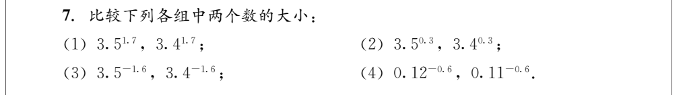

原页上下文：[PDF第111页](../原页上下文/PDF111-教材p104.webp)

## XJ-B1-C04-HW-P104-Y1494 习题4.1 第8题

教材位置：第4章 / 4.1 实数指数幂和幂函数 / 印刷页 p.104、105 / PDF 第111、112页。

类型：习题；原题号：第8题。

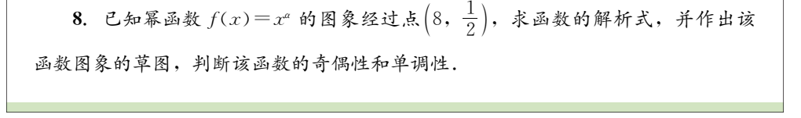

原页上下文：[PDF第111页](../原页上下文/PDF111-教材p104.webp)；[PDF第112页](../原页上下文/PDF112-教材p105.webp)

## XJ-B1-C04-HW-P105-Y0348 习题4.1 第9题

教材位置：第4章 / 4.1 实数指数幂和幂函数 / 印刷页 p.105 / PDF 第112页。

类型：习题；原题号：第9题。

原页上下文：[PDF第112页](../原页上下文/PDF112-教材p105.webp)

## XJ-B1-C04-HW-P105-Y0405 习题4.1 第10题

教材位置：第4章 / 4.1 实数指数幂和幂函数 / 印刷页 p.105 / PDF 第112页。

类型：习题；原题号：第10题。

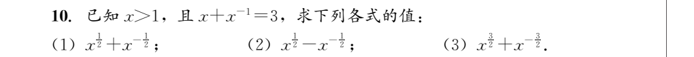

原页上下文：[PDF第112页](../原页上下文/PDF112-教材p105.webp)

## XJ-B1-C04-HW-P105-Y0490 习题4.1 第11题

教材位置：第4章 / 4.1 实数指数幂和幂函数 / 印刷页 p.105 / PDF 第112页。

类型：习题；原题号：第11题。

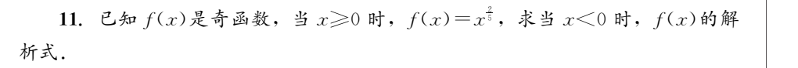

原页上下文：[PDF第112页](../原页上下文/PDF112-教材p105.webp)

## XJ-B1-C04-HW-P105-Y0578 习题4.1 第12题

教材位置：第4章 / 4.1 实数指数幂和幂函数 / 印刷页 p.105 / PDF 第112页。

类型：习题；原题号：第12题。

原页上下文：[PDF第112页](../原页上下文/PDF112-教材p105.webp)

## XJ-B1-C04-HW-P105-Y0620 习题4.1 第13题

教材位置：第4章 / 4.1 实数指数幂和幂函数 / 印刷页 p.105 / PDF 第112页。

类型：习题；原题号：第13题。

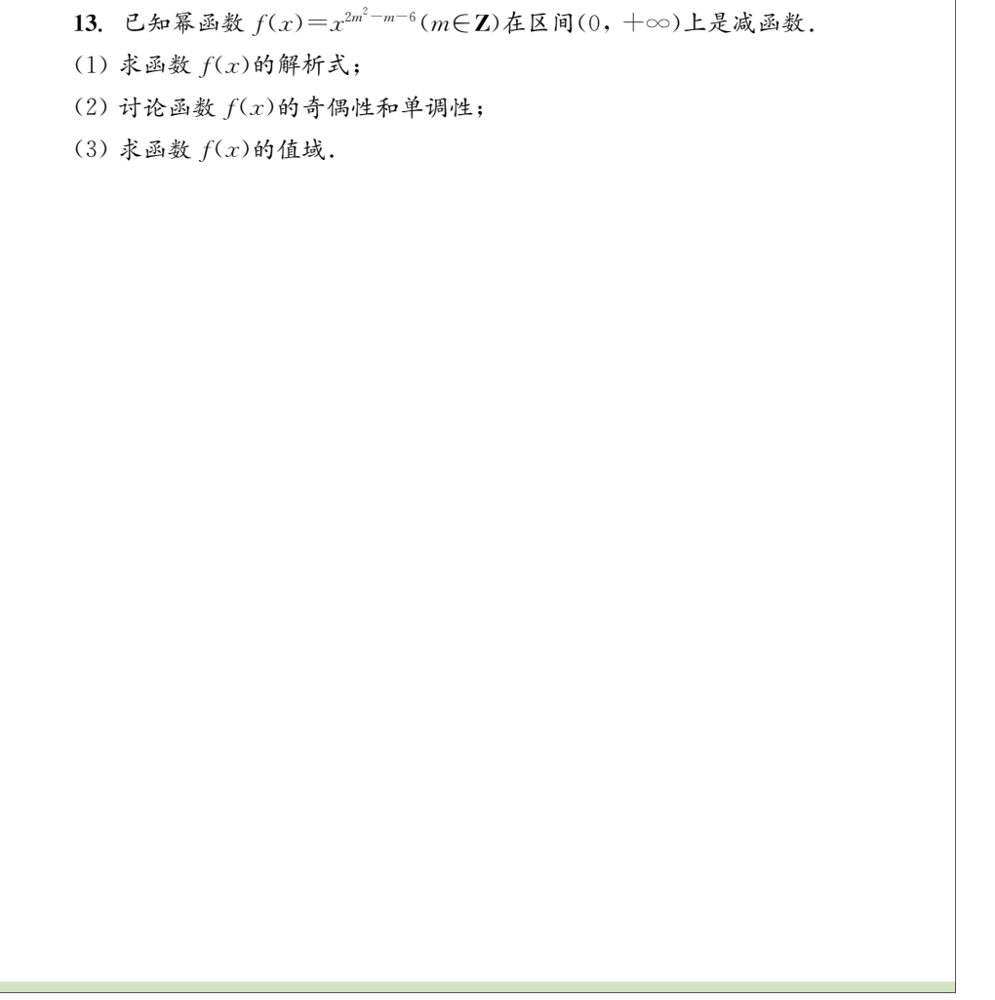

原页上下文：[PDF第112页](../原页上下文/PDF112-教材p105.webp)

## XJ-B1-C04-TH-P106-Y0720 p.106 思考（含紧邻说明）

教材位置：第4章 / 4.2 指数函数 / 印刷页 p.106 / PDF 第113页。

类型：思考；原题号：未编号题组。

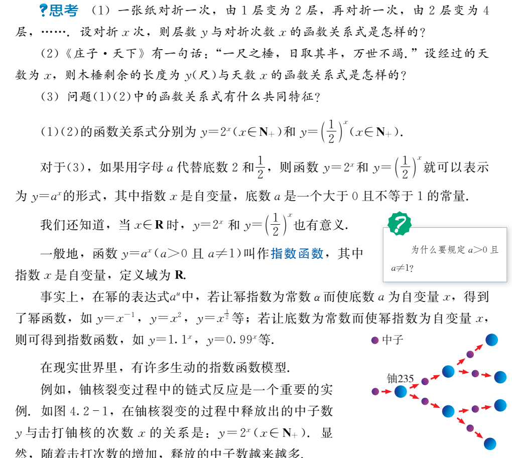

原页上下文：[PDF第113页](../原页上下文/PDF113-教材p106.webp)

## XJ-B1-C04-EX-P108-Y0177 4.2 例题 例题1

教材位置：第4章 / 4.2 指数函数 / 印刷页 p.108 / PDF 第115页。

类型：例题；原题号：例题1。

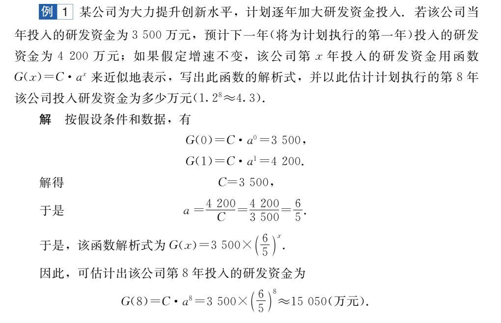

原页上下文：[PDF第115页](../原页上下文/PDF115-教材p108.webp)

## XJ-B1-C04-EX-P108-Y0840 4.2 例题 例题2

教材位置：第4章 / 4.2 指数函数 / 印刷页 p.108 / PDF 第115页。

类型：例题；原题号：例题2。

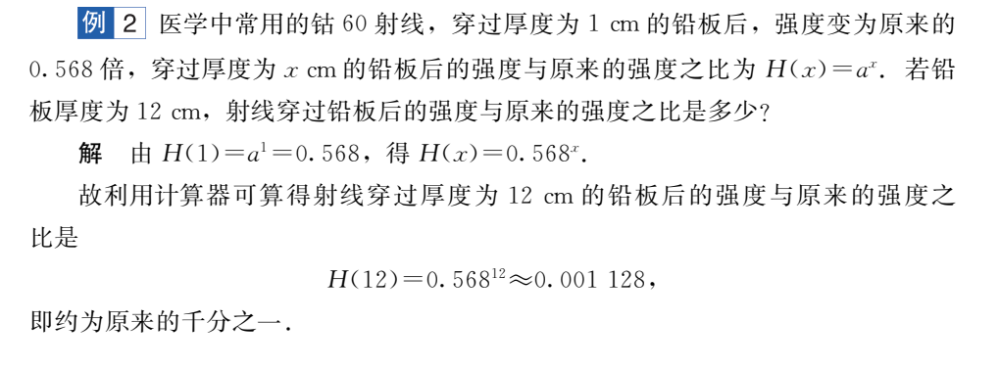

原页上下文：[PDF第115页](../原页上下文/PDF115-教材p108.webp)

## XJ-B1-C04-PR-P108-Y1273 p.108 练习 第1题

教材位置：第4章 / 4.2 指数函数 / 印刷页 p.108 / PDF 第115页。

类型：练习；原题号：第1题。

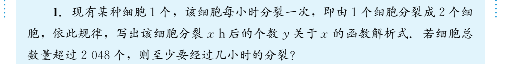

原页上下文：[PDF第115页](../原页上下文/PDF115-教材p108.webp)

## XJ-B1-C04-PR-P108-Y1402 p.108 练习 第2题

教材位置：第4章 / 4.2 指数函数 / 印刷页 p.108 / PDF 第115页。

类型：练习；原题号：第2题。

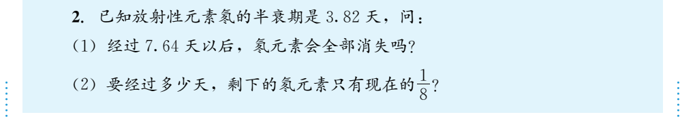

原页上下文：[PDF第115页](../原页上下文/PDF115-教材p108.webp)

## XJ-B1-C04-TH-P109-Y0302 p.109 思考（含紧邻说明）

教材位置：第4章 / 4.2 指数函数 / 印刷页 p.109、110 / PDF 第116、117页。

类型：思考；原题号：未编号题组。

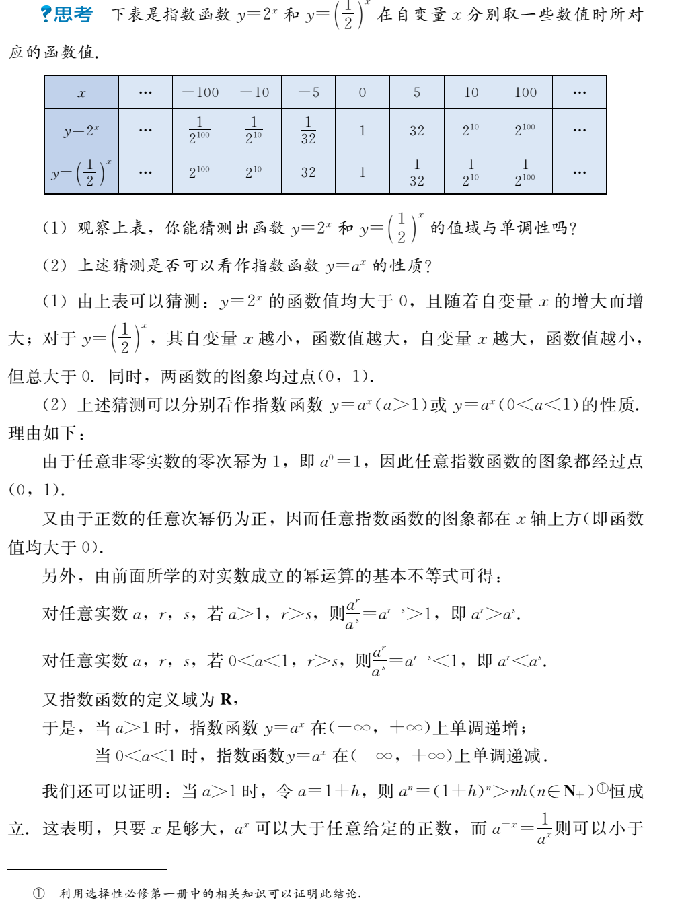

原页上下文：[PDF第116页](../原页上下文/PDF116-教材p109.webp)；[PDF第117页](../原页上下文/PDF117-教材p110.webp)

## XJ-B1-C04-EX-P110-Y0319 4.2 例题 例题3

教材位置：第4章 / 4.2 指数函数 / 印刷页 p.110 / PDF 第117页。

类型：例题；原题号：例题3。

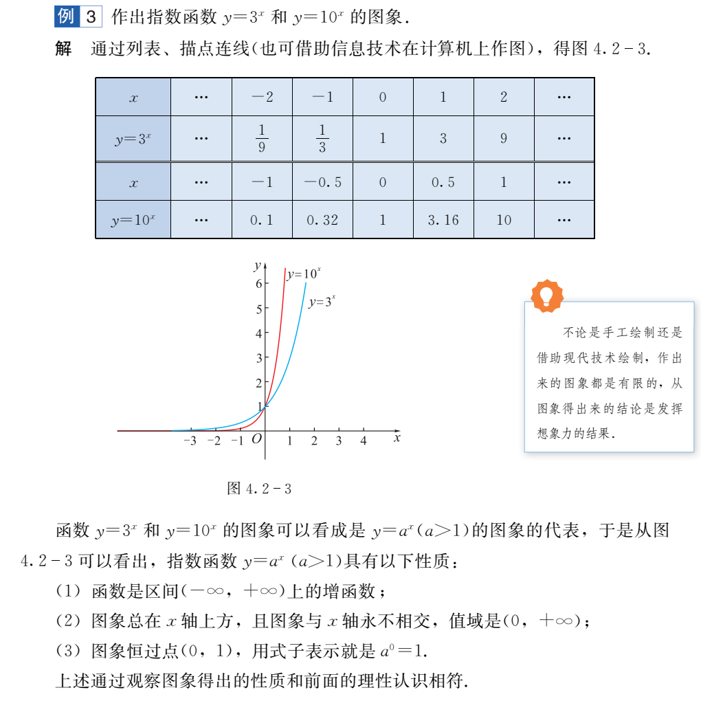

原页上下文：[PDF第117页](../原页上下文/PDF117-教材p110.webp)

## XJ-B1-C04-TH-P110-Y1359 p.110 思考（含紧邻说明）

教材位置：第4章 / 4.2 指数函数 / 印刷页 p.110、111 / PDF 第117、118页。

类型：思考；原题号：未编号题组。

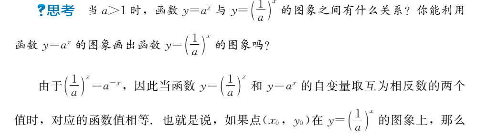
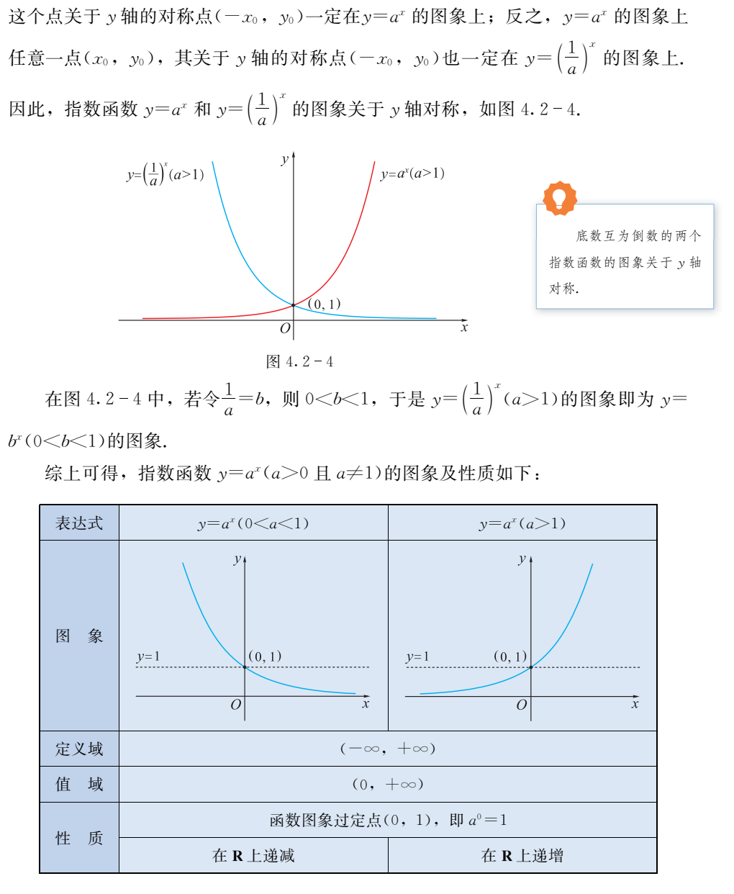

原页上下文：[PDF第117页](../原页上下文/PDF117-教材p110.webp)；[PDF第118页](../原页上下文/PDF118-教材p111.webp)

## XJ-B1-C04-EX-P111-Y1422 4.2 例题 例题4

教材位置：第4章 / 4.2 指数函数 / 印刷页 p.111、112 / PDF 第118、119页。

类型：例题；原题号：例题4。

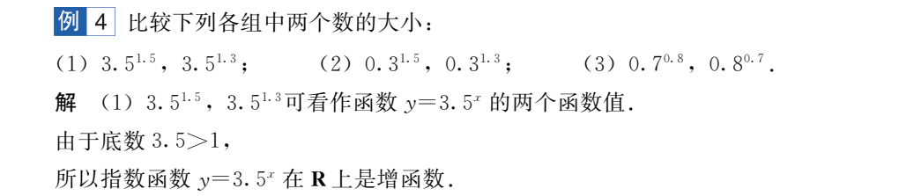
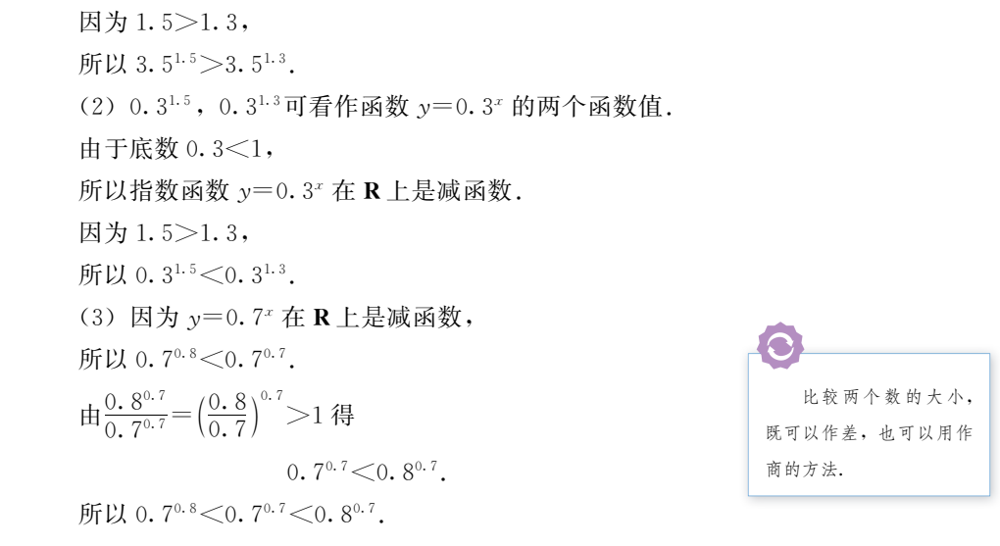

原页上下文：[PDF第118页](../原页上下文/PDF118-教材p111.webp)；[PDF第119页](../原页上下文/PDF119-教材p112.webp)

## XJ-B1-C04-EX-P112-Y0737 4.2 例题 例题5

教材位置：第4章 / 4.2 指数函数 / 印刷页 p.112 / PDF 第119页。

类型：例题；原题号：例题5。

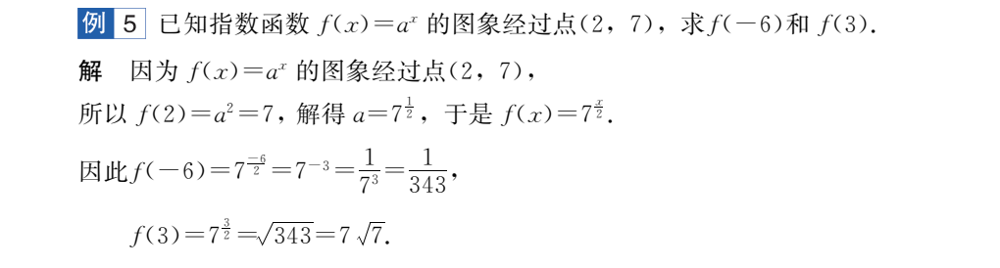

原页上下文：[PDF第119页](../原页上下文/PDF119-教材p112.webp)

## XJ-B1-C04-EX-P112-Y1015 4.2 例题 例题6

教材位置：第4章 / 4.2 指数函数 / 印刷页 p.112 / PDF 第119页。

类型：例题；原题号：例题6。

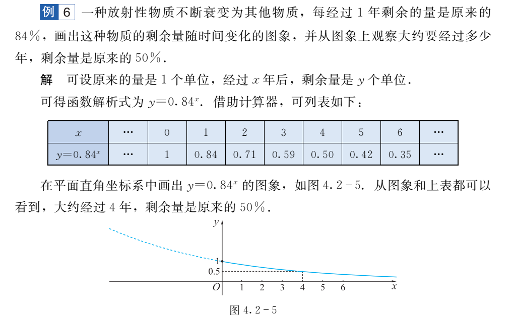

原页上下文：[PDF第119页](../原页上下文/PDF119-教材p112.webp)

## XJ-B1-C04-PR-P113-Y0217 p.113 练习 第1题

教材位置：第4章 / 4.2 指数函数 / 印刷页 p.113 / PDF 第120页。

类型：练习；原题号：第1题。

原页上下文：[PDF第120页](../原页上下文/PDF120-教材p113.webp)

## XJ-B1-C04-PR-P113-Y0303 p.113 练习 第2题

教材位置：第4章 / 4.2 指数函数 / 印刷页 p.113 / PDF 第120页。

类型：练习；原题号：第2题。

原页上下文：[PDF第120页](../原页上下文/PDF120-教材p113.webp)

## XJ-B1-C04-PR-P113-Y0347 p.113 练习 第3题

教材位置：第4章 / 4.2 指数函数 / 印刷页 p.113 / PDF 第120页。

类型：练习；原题号：第3题。

原页上下文：[PDF第120页](../原页上下文/PDF120-教材p113.webp)

## XJ-B1-C04-PR-P113-Y0475 p.113 练习 第4题

教材位置：第4章 / 4.2 指数函数 / 印刷页 p.113 / PDF 第120页。

类型：练习；原题号：第4题。

原页上下文：[PDF第120页](../原页上下文/PDF120-教材p113.webp)

## XJ-B1-C04-HW-P113-Y0886 习题4.2 第1题

教材位置：第4章 / 4.2 指数函数 / 印刷页 p.113 / PDF 第120页。

类型：习题；原题号：第1题。

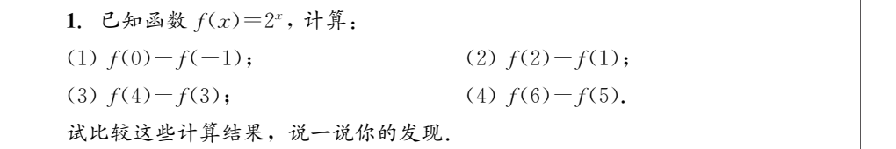

原页上下文：[PDF第120页](../原页上下文/PDF120-教材p113.webp)

## XJ-B1-C04-HW-P113-Y1057 习题4.2 第2题

教材位置：第4章 / 4.2 指数函数 / 印刷页 p.113 / PDF 第120页。

类型：习题；原题号：第2题。

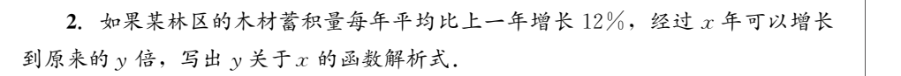

原页上下文：[PDF第120页](../原页上下文/PDF120-教材p113.webp)

## XJ-B1-C04-HW-P113-Y1144 习题4.2 第3题

教材位置：第4章 / 4.2 指数函数 / 印刷页 p.113 / PDF 第120页。

类型：习题；原题号：第3题。

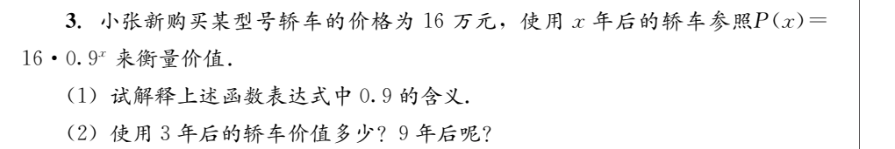

原页上下文：[PDF第120页](../原页上下文/PDF120-教材p113.webp)

## XJ-B1-C04-HW-P113-Y1315 习题4.2 第4题

教材位置：第4章 / 4.2 指数函数 / 印刷页 p.113 / PDF 第120页。

类型：习题；原题号：第4题。

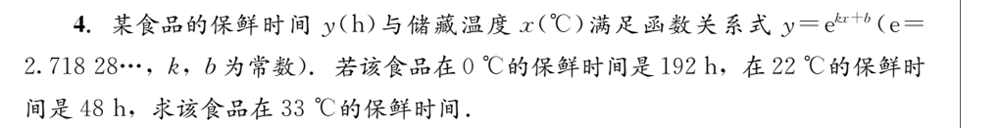

原页上下文：[PDF第120页](../原页上下文/PDF120-教材p113.webp)

## XJ-B1-C04-HW-P113-Y1446 习题4.2 第5题

教材位置：第4章 / 4.2 指数函数 / 印刷页 p.113 / PDF 第120页。

类型：习题；原题号：第5题。

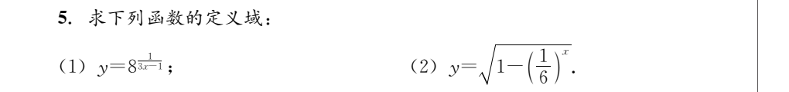

原页上下文：[PDF第120页](../原页上下文/PDF120-教材p113.webp)

## XJ-B1-C04-HW-P113-Y1566 习题4.2 第6题

教材位置：第4章 / 4.2 指数函数 / 印刷页 p.113、114 / PDF 第120、121页。

类型：习题；原题号：第6题。

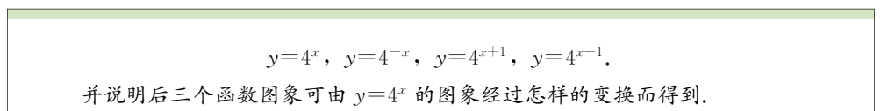

原页上下文：[PDF第120页](../原页上下文/PDF120-教材p113.webp)；[PDF第121页](../原页上下文/PDF121-教材p114.webp)

## XJ-B1-C04-HW-P114-Y0303 习题4.2 第7题

教材位置：第4章 / 4.2 指数函数 / 印刷页 p.114 / PDF 第121页。

类型：习题；原题号：第7题。

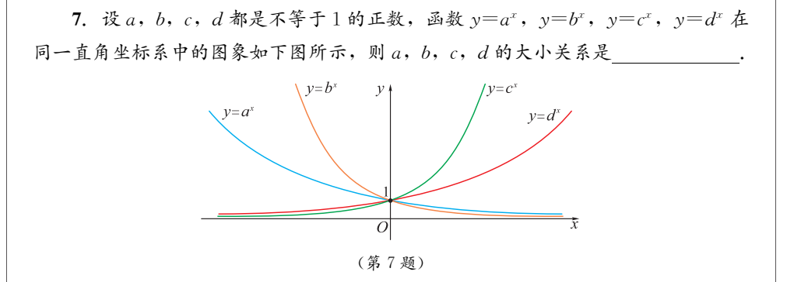

原页上下文：[PDF第121页](../原页上下文/PDF121-教材p114.webp)

## XJ-B1-C04-HW-P114-Y0667 习题4.2 第8题

教材位置：第4章 / 4.2 指数函数 / 印刷页 p.114 / PDF 第121页。

类型：习题；原题号：第8题。

原页上下文：[PDF第121页](../原页上下文/PDF121-教材p114.webp)

## XJ-B1-C04-HW-P114-Y0711 习题4.2 第9题

教材位置：第4章 / 4.2 指数函数 / 印刷页 p.114 / PDF 第121页。

类型：习题；原题号：第9题。

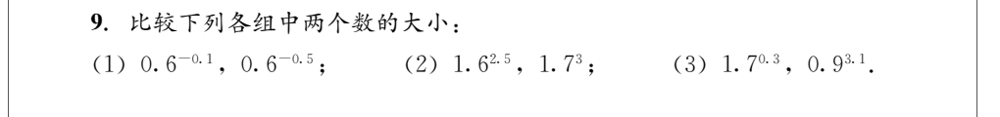

原页上下文：[PDF第121页](../原页上下文/PDF121-教材p114.webp)

## XJ-B1-C04-HW-P114-Y0935 习题4.2 第10题

教材位置：第4章 / 4.2 指数函数 / 印刷页 p.114 / PDF 第121页。

类型：习题；原题号：第10题。

原页上下文：[PDF第121页](../原页上下文/PDF121-教材p114.webp)

## XJ-B1-C04-HW-P114-Y1038 习题4.2 第11题

教材位置：第4章 / 4.2 指数函数 / 印刷页 p.114 / PDF 第121页。

类型：习题；原题号：第11题。

原页上下文：[PDF第121页](../原页上下文/PDF121-教材p114.webp)

## XJ-B1-C04-HW-P114-Y1222 习题4.2 第12题

教材位置：第4章 / 4.2 指数函数 / 印刷页 p.114 / PDF 第121页。

类型：习题；原题号：第12题。

原页上下文：[PDF第121页](../原页上下文/PDF121-教材p114.webp)

## XJ-B1-C04-HW-P114-Y1332 习题4.2 第13题

教材位置：第4章 / 4.2 指数函数 / 印刷页 p.114 / PDF 第121页。

类型：习题；原题号：第13题。

原页上下文：[PDF第121页](../原页上下文/PDF121-教材p114.webp)

## XJ-B1-C04-HW-P114-Y1396 习题4.2 第14题

教材位置：第4章 / 4.2 指数函数 / 印刷页 p.114 / PDF 第121页。

类型：习题；原题号：第14题。

原页上下文：[PDF第121页](../原页上下文/PDF121-教材p114.webp)

## XJ-B1-C04-HW-P114-Y1507 习题4.2 第15题

教材位置：第4章 / 4.2 指数函数 / 印刷页 p.114 / PDF 第121页。

类型：习题；原题号：第15题。

原页上下文：[PDF第121页](../原页上下文/PDF121-教材p114.webp)

## XJ-B1-C04-TH-P115-Y0591 p.115 思考（含紧邻说明）

教材位置：第4章 / 4.3 对数函数 / 印刷页 p.115 / PDF 第122页。

类型：思考；原题号：未编号题组。

原页上下文：[PDF第122页](../原页上下文/PDF122-教材p115.webp)

## XJ-B1-C04-EX-P115-Y1132 4.3 例题 例题1

教材位置：第4章 / 4.3 对数函数 / 印刷页 p.115、116 / PDF 第122、123页。

类型：例题；原题号：例题1。

原页上下文：[PDF第122页](../原页上下文/PDF122-教材p115.webp)；[PDF第123页](../原页上下文/PDF123-教材p116.webp)

## XJ-B1-C04-EX-P116-Y0405 4.3 例题 例题2

教材位置：第4章 / 4.3 对数函数 / 印刷页 p.116 / PDF 第123页。

类型：例题；原题号：例题2。

原页上下文：[PDF第123页](../原页上下文/PDF123-教材p116.webp)

## XJ-B1-C04-PR-P116-Y0981 p.116 练习 第1题

教材位置：第4章 / 4.3 对数函数 / 印刷页 p.116 / PDF 第123页。

类型：练习；原题号：第1题。

原页上下文：[PDF第123页](../原页上下文/PDF123-教材p116.webp)

## XJ-B1-C04-PR-P116-Y1252 p.116 练习 第2题

教材位置：第4章 / 4.3 对数函数 / 印刷页 p.116 / PDF 第123页。

类型：练习；原题号：第2题。

原页上下文：[PDF第123页](../原页上下文/PDF123-教材p116.webp)

## XJ-B1-C04-PR-P116-Y1455 p.116 练习 第3题

教材位置：第4章 / 4.3 对数函数 / 印刷页 p.116 / PDF 第123页。

类型：练习；原题号：第3题。

原页上下文：[PDF第123页](../原页上下文/PDF123-教材p116.webp)

## XJ-B1-C04-EX-P117-Y1349 4.3 例题 例题3

教材位置：第4章 / 4.3 对数函数 / 印刷页 p.117、118 / PDF 第124、125页。

类型：例题；原题号：例题3。

原页上下文：[PDF第124页](../原页上下文/PDF124-教材p117.webp)；[PDF第125页](../原页上下文/PDF125-教材p118.webp)

## XJ-B1-C04-EX-P118-Y0345 4.3 例题 例题4

教材位置：第4章 / 4.3 对数函数 / 印刷页 p.118 / PDF 第125页。

类型：例题；原题号：例题4。

原页上下文：[PDF第125页](../原页上下文/PDF125-教材p118.webp)

## XJ-B1-C04-EX-P118-Y0571 4.3 例题 例题5

教材位置：第4章 / 4.3 对数函数 / 印刷页 p.118 / PDF 第125页。

类型：例题；原题号：例题5。

原页上下文：[PDF第125页](../原页上下文/PDF125-教材p118.webp)

## XJ-B1-C04-PR-P118-Y1113 p.118 练习 第1题

教材位置：第4章 / 4.3 对数函数 / 印刷页 p.118 / PDF 第125页。

类型：练习；原题号：第1题。

原页上下文：[PDF第125页](../原页上下文/PDF125-教材p118.webp)

## XJ-B1-C04-PR-P118-Y1234 p.118 练习 第2题

教材位置：第4章 / 4.3 对数函数 / 印刷页 p.118 / PDF 第125页。

类型：练习；原题号：第2题。

原页上下文：[PDF第125页](../原页上下文/PDF125-教材p118.webp)

## XJ-B1-C04-PR-P118-Y1421 p.118 练习 第3题

教材位置：第4章 / 4.3 对数函数 / 印刷页 p.118 / PDF 第125页。

类型：练习；原题号：第3题。

原页上下文：[PDF第125页](../原页上下文/PDF125-教材p118.webp)

## XJ-B1-C04-TH-P119-Y0670 p.119 思考（含紧邻说明）

教材位置：第4章 / 4.3 对数函数 / 印刷页 p.119 / PDF 第126页。

类型：思考；原题号：未编号题组。

原页上下文：[PDF第126页](../原页上下文/PDF126-教材p119.webp)

## XJ-B1-C04-EX-P119-Y1195 4.3 例题 例题6

教材位置：第4章 / 4.3 对数函数 / 印刷页 p.119 / PDF 第126页。

类型：例题；原题号：例题6。

原页上下文：[PDF第126页](../原页上下文/PDF126-教材p119.webp)

## XJ-B1-C04-EX-P119-Y1481 4.3 例题 例题7

教材位置：第4章 / 4.3 对数函数 / 印刷页 p.119、120 / PDF 第126、127页。

类型：例题；原题号：例题7。

原页上下文：[PDF第126页](../原页上下文/PDF126-教材p119.webp)；[PDF第127页](../原页上下文/PDF127-教材p120.webp)

## XJ-B1-C04-EX-P120-Y0421 4.3 例题 例题8

教材位置：第4章 / 4.3 对数函数 / 印刷页 p.120 / PDF 第127页。

类型：例题；原题号：例题8。

原页上下文：[PDF第127页](../原页上下文/PDF127-教材p120.webp)

## XJ-B1-C04-EX-P120-Y0749 4.3 例题 例题9

教材位置：第4章 / 4.3 对数函数 / 印刷页 p.120 / PDF 第127页。

类型：例题；原题号：例题9。

原页上下文：[PDF第127页](../原页上下文/PDF127-教材p120.webp)

## XJ-B1-C04-PR-P121-Y0218 p.121 练习 第1题

教材位置：第4章 / 4.3 对数函数 / 印刷页 p.121 / PDF 第128页。

类型：练习；原题号：第1题。

原页上下文：[PDF第128页](../原页上下文/PDF128-教材p121.webp)

## XJ-B1-C04-PR-P121-Y0261 p.121 练习 第2题

教材位置：第4章 / 4.3 对数函数 / 印刷页 p.121 / PDF 第128页。

类型：练习；原题号：第2题。

原页上下文：[PDF第128页](../原页上下文/PDF128-教材p121.webp)

## XJ-B1-C04-PR-P121-Y0304 p.121 练习 第3题

教材位置：第4章 / 4.3 对数函数 / 印刷页 p.121 / PDF 第128页。

类型：练习；原题号：第3题。

原页上下文：[PDF第128页](../原页上下文/PDF128-教材p121.webp)

## XJ-B1-C04-PR-P121-Y0344 p.121 练习 第4题

教材位置：第4章 / 4.3 对数函数 / 印刷页 p.121 / PDF 第128页。

类型：练习；原题号：第4题。

原页上下文：[PDF第128页](../原页上下文/PDF128-教材p121.webp)

## XJ-B1-C04-EX-P122-Y1083 4.3 例题 例题10

教材位置：第4章 / 4.3 对数函数 / 印刷页 p.122 / PDF 第129页。

类型：例题；原题号：例题10。

原页上下文：[PDF第129页](../原页上下文/PDF129-教材p122.webp)

## XJ-B1-C04-EX-P122-Y1421 4.3 例题 例题11

教材位置：第4章 / 4.3 对数函数 / 印刷页 p.122、123 / PDF 第129、130页。

类型：例题；原题号：例题11。

原页上下文：[PDF第129页](../原页上下文/PDF129-教材p122.webp)；[PDF第130页](../原页上下文/PDF130-教材p123.webp)

## XJ-B1-C04-EX-P123-Y0664 4.3 例题 例题12

教材位置：第4章 / 4.3 对数函数 / 印刷页 p.123 / PDF 第130页。

类型：例题；原题号：例题12。

原页上下文：[PDF第130页](../原页上下文/PDF130-教材p123.webp)

## XJ-B1-C04-PR-P124-Y0217 p.124 练习 第1题

教材位置：第4章 / 4.3 对数函数 / 印刷页 p.124 / PDF 第131页。

类型：练习；原题号：第1题。

原页上下文：[PDF第131页](../原页上下文/PDF131-教材p124.webp)

## XJ-B1-C04-PR-P124-Y0304 p.124 练习 第2题

教材位置：第4章 / 4.3 对数函数 / 印刷页 p.124 / PDF 第131页。

类型：练习；原题号：第2题。

原页上下文：[PDF第131页](../原页上下文/PDF131-教材p124.webp)

## XJ-B1-C04-PR-P124-Y0490 p.124 练习 第3题

教材位置：第4章 / 4.3 对数函数 / 印刷页 p.124 / PDF 第131页。

类型：练习；原题号：第3题。

原页上下文：[PDF第131页](../原页上下文/PDF131-教材p124.webp)

## XJ-B1-C04-PR-P124-Y0633 p.124 练习 第4题

教材位置：第4章 / 4.3 对数函数 / 印刷页 p.124 / PDF 第131页。

类型：练习；原题号：第4题。

原页上下文：[PDF第131页](../原页上下文/PDF131-教材p124.webp)

## XJ-B1-C04-HW-P124-Y1051 习题4.3 第1题

教材位置：第4章 / 4.3 对数函数 / 印刷页 p.124 / PDF 第131页。

类型：习题；原题号：第1题。

原页上下文：[PDF第131页](../原页上下文/PDF131-教材p124.webp)

## XJ-B1-C04-HW-P124-Y1208 习题4.3 第2题

教材位置：第4章 / 4.3 对数函数 / 印刷页 p.124 / PDF 第131页。

类型：习题；原题号：第2题。

原页上下文：[PDF第131页](../原页上下文/PDF131-教材p124.webp)

## XJ-B1-C04-HW-P124-Y1336 习题4.3 第3题

教材位置：第4章 / 4.3 对数函数 / 印刷页 p.124 / PDF 第131页。

类型：习题；原题号：第3题。

原页上下文：[PDF第131页](../原页上下文/PDF131-教材p124.webp)

## XJ-B1-C04-HW-P124-Y1493 习题4.3 第4题

教材位置：第4章 / 4.3 对数函数 / 印刷页 p.124、125 / PDF 第131、132页。

类型：习题；原题号：第4题。

原页上下文：[PDF第131页](../原页上下文/PDF131-教材p124.webp)；[PDF第132页](../原页上下文/PDF132-教材p125.webp)

## XJ-B1-C04-HW-P125-Y0416 习题4.3 第5题

教材位置：第4章 / 4.3 对数函数 / 印刷页 p.125 / PDF 第132页。

类型：习题；原题号：第5题。

原页上下文：[PDF第132页](../原页上下文/PDF132-教材p125.webp)

## XJ-B1-C04-HW-P125-Y0488 习题4.3 第6题

教材位置：第4章 / 4.3 对数函数 / 印刷页 p.125 / PDF 第132页。

类型：习题；原题号：第6题。

原页上下文：[PDF第132页](../原页上下文/PDF132-教材p125.webp)

## XJ-B1-C04-HW-P125-Y0545 习题4.3 第7题

教材位置：第4章 / 4.3 对数函数 / 印刷页 p.125 / PDF 第132页。

类型：习题；原题号：第7题。

原页上下文：[PDF第132页](../原页上下文/PDF132-教材p125.webp)

## XJ-B1-C04-HW-P125-Y0804 习题4.3 第8题

教材位置：第4章 / 4.3 对数函数 / 印刷页 p.125 / PDF 第132页。

类型：习题；原题号：第8题。

原页上下文：[PDF第132页](../原页上下文/PDF132-教材p125.webp)

## XJ-B1-C04-HW-P125-Y0933 习题4.3 第9题

教材位置：第4章 / 4.3 对数函数 / 印刷页 p.125 / PDF 第132页。

类型：习题；原题号：第9题。

原页上下文：[PDF第132页](../原页上下文/PDF132-教材p125.webp)

## XJ-B1-C04-HW-P125-Y1091 习题4.3 第10题

教材位置：第4章 / 4.3 对数函数 / 印刷页 p.125 / PDF 第132页。

类型：习题；原题号：第10题。

原页上下文：[PDF第132页](../原页上下文/PDF132-教材p125.webp)

## XJ-B1-C04-HW-P125-Y1228 习题4.3 第11题

教材位置：第4章 / 4.3 对数函数 / 印刷页 p.125 / PDF 第132页。

类型：习题；原题号：第11题。

原页上下文：[PDF第132页](../原页上下文/PDF132-教材p125.webp)

## XJ-B1-C04-HW-P125-Y1398 习题4.3 第12题

教材位置：第4章 / 4.3 对数函数 / 印刷页 p.125、126 / PDF 第132、133页。

类型：习题；原题号：第12题。

原页上下文：[PDF第132页](../原页上下文/PDF132-教材p125.webp)；[PDF第133页](../原页上下文/PDF133-教材p126.webp)

## XJ-B1-C04-HW-P126-Y0336 习题4.3 第13题

教材位置：第4章 / 4.3 对数函数 / 印刷页 p.126 / PDF 第133页。

类型：习题；原题号：第13题。

原页上下文：[PDF第133页](../原页上下文/PDF133-教材p126.webp)

## XJ-B1-C04-HW-P126-Y0393 习题4.3 第14题

教材位置：第4章 / 4.3 对数函数 / 印刷页 p.126 / PDF 第133页。

类型：习题；原题号：第14题。

原页上下文：[PDF第133页](../原页上下文/PDF133-教材p126.webp)

## XJ-B1-C04-HW-P126-Y0450 习题4.3 第15题

教材位置：第4章 / 4.3 对数函数 / 印刷页 p.126 / PDF 第133页。

类型：习题；原题号：第15题。

原页上下文：[PDF第133页](../原页上下文/PDF133-教材p126.webp)

## XJ-B1-C04-HW-P126-Y0534 习题4.3 第16题

教材位置：第4章 / 4.3 对数函数 / 印刷页 p.126 / PDF 第133页。

类型：习题；原题号：第16题。

原页上下文：[PDF第133页](../原页上下文/PDF133-教材p126.webp)

## XJ-B1-C04-HW-P126-Y0578 习题4.3 第17题

教材位置：第4章 / 4.3 对数函数 / 印刷页 p.126 / PDF 第133页。

类型：习题；原题号：第17题。

原页上下文：[PDF第133页](../原页上下文/PDF133-教材p126.webp)

## XJ-B1-C04-HW-P126-Y0711 习题4.3 第18题

教材位置：第4章 / 4.3 对数函数 / 印刷页 p.126 / PDF 第133页。

类型：习题；原题号：第18题。

原页上下文：[PDF第133页](../原页上下文/PDF133-教材p126.webp)

## XJ-B1-C04-HW-P126-Y0974 习题4.3 第19题

教材位置：第4章 / 4.3 对数函数 / 印刷页 p.126 / PDF 第133页。

类型：习题；原题号：第19题。

原页上下文：[PDF第133页](../原页上下文/PDF133-教材p126.webp)

## XJ-B1-C04-EX-P130-Y1358 4.4 例题 例题1

教材位置：第4章 / 4.4 函数与方程 / 印刷页 p.130 / PDF 第137页。

类型：例题；原题号：例题1。

原页上下文：[PDF第137页](../原页上下文/PDF137-教材p130.webp)

## XJ-B1-C04-EX-P131-Y0177 4.4 例题 例题2

教材位置：第4章 / 4.4 函数与方程 / 印刷页 p.131 / PDF 第138页。

类型：例题；原题号：例题2。

原页上下文：[PDF第138页](../原页上下文/PDF138-教材p131.webp)

## XJ-B1-C04-EX-P131-Y1058 4.4 例题 例题3

教材位置：第4章 / 4.4 函数与方程 / 印刷页 p.131 / PDF 第138页。

类型：例题；原题号：例题3。

原页上下文：[PDF第138页](../原页上下文/PDF138-教材p131.webp)

## XJ-B1-C04-PR-P132-Y0219 p.132 练习 第1题

教材位置：第4章 / 4.4 函数与方程 / 印刷页 p.132 / PDF 第139页。

类型：练习；原题号：第1题。

原页上下文：[PDF第139页](../原页上下文/PDF139-教材p132.webp)

## XJ-B1-C04-PR-P132-Y0350 p.132 练习 第2题

教材位置：第4章 / 4.4 函数与方程 / 印刷页 p.132 / PDF 第139页。

类型：练习；原题号：第2题。

原页上下文：[PDF第139页](../原页上下文/PDF139-教材p132.webp)

## XJ-B1-C04-TH-P132-Y0715 p.132 思考（含紧邻说明）

教材位置：第4章 / 4.4 函数与方程 / 印刷页 p.132 / PDF 第139页。

类型：思考；原题号：未编号题组。

原页上下文：[PDF第139页](../原页上下文/PDF139-教材p132.webp)

## XJ-B1-C04-EX-P132-Y1265 4.4 例题 例题4

教材位置：第4章 / 4.4 函数与方程 / 印刷页 p.132、133、134 / PDF 第139、140、141页。

类型：例题；原题号：例题4。

原页上下文：[PDF第139页](../原页上下文/PDF139-教材p132.webp)；[PDF第140页](../原页上下文/PDF140-教材p133.webp)；[PDF第141页](../原页上下文/PDF141-教材p134.webp)

## XJ-B1-C04-EX-P134-Y0942 4.4 例题 例题5

教材位置：第4章 / 4.4 函数与方程 / 印刷页 p.134、135 / PDF 第141、142页。

类型：例题；原题号：例题5。

原页上下文：[PDF第141页](../原页上下文/PDF141-教材p134.webp)；[PDF第142页](../原页上下文/PDF142-教材p135.webp)

## XJ-B1-C04-PR-P135-Y0713 p.135 练习 第1题

教材位置：第4章 / 4.4 函数与方程 / 印刷页 p.135 / PDF 第142页。

类型：练习；原题号：第1题。

原页上下文：[PDF第142页](../原页上下文/PDF142-教材p135.webp)

## XJ-B1-C04-PR-P135-Y0800 p.135 练习 第2题

教材位置：第4章 / 4.4 函数与方程 / 印刷页 p.135 / PDF 第142页。

类型：练习；原题号：第2题。

原页上下文：[PDF第142页](../原页上下文/PDF142-教材p135.webp)

## XJ-B1-C04-HW-P136-Y0450 习题4.4 第1题

教材位置：第4章 / 4.4 函数与方程 / 印刷页 p.136 / PDF 第143页。

类型：习题；原题号：第1题。

原页上下文：[PDF第143页](../原页上下文/PDF143-教材p136.webp)

## XJ-B1-C04-HW-P136-Y0563 习题4.4 第2题

教材位置：第4章 / 4.4 函数与方程 / 印刷页 p.136 / PDF 第143页。

类型：习题；原题号：第2题。

原页上下文：[PDF第143页](../原页上下文/PDF143-教材p136.webp)

## XJ-B1-C04-HW-P136-Y0620 习题4.4 第3题

教材位置：第4章 / 4.4 函数与方程 / 印刷页 p.136 / PDF 第143页。

类型：习题；原题号：第3题。

原页上下文：[PDF第143页](../原页上下文/PDF143-教材p136.webp)

## XJ-B1-C04-HW-P136-Y0720 习题4.4 第4题

教材位置：第4章 / 4.4 函数与方程 / 印刷页 p.136 / PDF 第143页。

类型：习题；原题号：第4题。

原页上下文：[PDF第143页](../原页上下文/PDF143-教材p136.webp)

## XJ-B1-C04-HW-P136-Y0953 习题4.4 第5题

教材位置：第4章 / 4.4 函数与方程 / 印刷页 p.136 / PDF 第143页。

类型：习题；原题号：第5题。

原页上下文：[PDF第143页](../原页上下文/PDF143-教材p136.webp)

## XJ-B1-C04-HW-P136-Y1124 习题4.4 第6题

教材位置：第4章 / 4.4 函数与方程 / 印刷页 p.136 / PDF 第143页。

类型：习题；原题号：第6题。

原页上下文：[PDF第143页](../原页上下文/PDF143-教材p136.webp)

## XJ-B1-C04-HW-P136-Y1210 习题4.4 第7题

教材位置：第4章 / 4.4 函数与方程 / 印刷页 p.136 / PDF 第143页。

类型：习题；原题号：第7题。

原页上下文：[PDF第143页](../原页上下文/PDF143-教材p136.webp)

## XJ-B1-C04-LAB-P137-Y0145 用二分法求方程的近似解

教材位置：第4章 / 4.4 函数与方程 / 印刷页 p.137、138 / PDF 第144、145页。

类型：数学实验；原题号：完整实验任务。

原页上下文：[PDF第144页](../原页上下文/PDF144-教材p137.webp)；[PDF第145页](../原页上下文/PDF145-教材p138.webp)

## XJ-B1-C04-EX-P139-Y0872 4.5 例题 例题1

教材位置：第4章 / 4.5 函数模型及其应用 / 印刷页 p.139、140 / PDF 第146、147页。

类型：例题；原题号：例题1。

原页上下文：[PDF第146页](../原页上下文/PDF146-教材p139.webp)；[PDF第147页](../原页上下文/PDF147-教材p140.webp)

## XJ-B1-C04-EX-P140-Y1262 4.5 例题 例题2

教材位置：第4章 / 4.5 函数模型及其应用 / 印刷页 p.140 / PDF 第147页。

类型：例题；原题号：例题2。

原页上下文：[PDF第147页](../原页上下文/PDF147-教材p140.webp)

## XJ-B1-C04-PR-P143-Y0217 p.143 练习 第1题

教材位置：第4章 / 4.5 函数模型及其应用 / 印刷页 p.143 / PDF 第150页。

类型：练习；原题号：第1题。

原页上下文：[PDF第150页](../原页上下文/PDF150-教材p143.webp)

## XJ-B1-C04-PR-P143-Y0308 p.143 练习 第2题

教材位置：第4章 / 4.5 函数模型及其应用 / 印刷页 p.143 / PDF 第150页。

类型：练习；原题号：第2题。

原页上下文：[PDF第150页](../原页上下文/PDF150-教材p143.webp)

## XJ-B1-C04-PR-P143-Y0353 p.143 练习 第3题

教材位置：第4章 / 4.5 函数模型及其应用 / 印刷页 p.143 / PDF 第150页。

类型：练习；原题号：第3题。

原页上下文：[PDF第150页](../原页上下文/PDF150-教材p143.webp)

## XJ-B1-C04-EX-P143-Y1169 4.5 例题 例题3

教材位置：第4章 / 4.5 函数模型及其应用 / 印刷页 p.143 / PDF 第150页。

类型：例题；原题号：例题3。

原页上下文：[PDF第150页](../原页上下文/PDF150-教材p143.webp)

## XJ-B1-C04-PR-P146-Y0993 p.146 练习 第1题

教材位置：第4章 / 4.5 函数模型及其应用 / 印刷页 p.146 / PDF 第153页。

类型：练习；原题号：第1题。

原页上下文：[PDF第153页](../原页上下文/PDF153-教材p146.webp)

## XJ-B1-C04-PR-P146-Y1390 p.146 练习 第2题

教材位置：第4章 / 4.5 函数模型及其应用 / 印刷页 p.146 / PDF 第153页。

类型：练习；原题号：第2题。

原页上下文：[PDF第153页](../原页上下文/PDF153-教材p146.webp)

## XJ-B1-C04-HW-P147-Y0449 习题4.5 第1题

教材位置：第4章 / 4.5 函数模型及其应用 / 印刷页 p.147 / PDF 第154页。

类型：习题；原题号：第1题。

原页上下文：[PDF第154页](../原页上下文/PDF154-教材p147.webp)

## XJ-B1-C04-HW-P147-Y0649 习题4.5 第2题

教材位置：第4章 / 4.5 函数模型及其应用 / 印刷页 p.147 / PDF 第154页。

类型：习题；原题号：第2题。

原页上下文：[PDF第154页](../原页上下文/PDF154-教材p147.webp)

## XJ-B1-C04-HW-P147-Y1062 习题4.5 第3题

教材位置：第4章 / 4.5 函数模型及其应用 / 印刷页 p.147、148 / PDF 第154、155页。

类型：习题；原题号：第3题。

原页上下文：[PDF第154页](../原页上下文/PDF154-教材p147.webp)；[PDF第155页](../原页上下文/PDF155-教材p148.webp)

## XJ-B1-C04-HW-P148-Y0218 习题4.5 第4题

教材位置：第4章 / 4.5 函数模型及其应用 / 印刷页 p.148 / PDF 第155页。

类型：习题；原题号：第4题。

原页上下文：[PDF第155页](../原页上下文/PDF155-教材p148.webp)

## XJ-B1-C04-HW-P148-Y0816 习题4.5 第5题

教材位置：第4章 / 4.5 函数模型及其应用 / 印刷页 p.148 / PDF 第155页。

类型：习题；原题号：第5题。

原页上下文：[PDF第155页](../原页上下文/PDF155-教材p148.webp)

## XJ-B1-C04-HW-P148-Y1232 习题4.5 第6题

教材位置：第4章 / 4.5 函数模型及其应用 / 印刷页 p.148、149 / PDF 第155、156页。

类型：习题；原题号：第6题。

原页上下文：[PDF第155页](../原页上下文/PDF155-教材p148.webp)；[PDF第156页](../原页上下文/PDF156-教材p149.webp)

## XJ-B1-C04-HW-P149-Y0347 习题4.5 第7题

教材位置：第4章 / 4.5 函数模型及其应用 / 印刷页 p.149 / PDF 第156页。

类型：习题；原题号：第7题。

原页上下文：[PDF第156页](../原页上下文/PDF156-教材p149.webp)

## XJ-B1-C04-HW-P149-Y0447 习题4.5 第8题

教材位置：第4章 / 4.5 函数模型及其应用 / 印刷页 p.149 / PDF 第156页。

类型：习题；原题号：第8题。

原页上下文：[PDF第156页](../原页上下文/PDF156-教材p149.webp)

## XJ-B1-C04-SU-P150-Y0796 第4章 小结与复习 第1题

教材位置：第4章 / 小结与复习 小结与复习 / 印刷页 p.150 / PDF 第157页。

类型：小结与复习；原题号：第1题。

原页上下文：[PDF第157页](../原页上下文/PDF157-教材p150.webp)

## XJ-B1-C04-SU-P150-Y0882 第4章 小结与复习 第2题

教材位置：第4章 / 小结与复习 小结与复习 / 印刷页 p.150 / PDF 第157页。

类型：小结与复习；原题号：第2题。

原页上下文：[PDF第157页](../原页上下文/PDF157-教材p150.webp)

## XJ-B1-C04-SU-P150-Y1054 第4章 小结与复习 第3题

教材位置：第4章 / 小结与复习 小结与复习 / 印刷页 p.150 / PDF 第157页。

类型：小结与复习；原题号：第3题。

原页上下文：[PDF第157页](../原页上下文/PDF157-教材p150.webp)

## XJ-B1-C04-SU-P150-Y1140 第4章 小结与复习 第4题

教材位置：第4章 / 小结与复习 小结与复习 / 印刷页 p.150 / PDF 第157页。

类型：小结与复习；原题号：第4题。

原页上下文：[PDF第157页](../原页上下文/PDF157-教材p150.webp)

## XJ-B1-C04-SU-P150-Y1226 第4章 小结与复习 第5题

教材位置：第4章 / 小结与复习 小结与复习 / 印刷页 p.150 / PDF 第157页。

类型：小结与复习；原题号：第5题。

原页上下文：[PDF第157页](../原页上下文/PDF157-教材p150.webp)

## XJ-B1-C04-SU-P150-Y1355 第4章 小结与复习 第6题

教材位置：第4章 / 小结与复习 小结与复习 / 印刷页 p.150 / PDF 第157页。

类型：小结与复习；原题号：第6题。

原页上下文：[PDF第157页](../原页上下文/PDF157-教材p150.webp)

## XJ-B1-C04-SU-P150-Y1441 第4章 小结与复习 第7题

教材位置：第4章 / 小结与复习 小结与复习 / 印刷页 p.150 / PDF 第157页。

类型：小结与复习；原题号：第7题。

原页上下文：[PDF第157页](../原页上下文/PDF157-教材p150.webp)

## XJ-B1-C04-RV-P151-Y0407 复习题四 第1题

教材位置：第4章 / 章末复习 复习题四 / 印刷页 p.151 / PDF 第158页。

类型：复习题；原题号：第1题。

原页上下文：[PDF第158页](../原页上下文/PDF158-教材p151.webp)

## XJ-B1-C04-RV-P151-Y0535 复习题四 第2题

教材位置：第4章 / 章末复习 复习题四 / 印刷页 p.151 / PDF 第158页。

类型：复习题；原题号：第2题。

原页上下文：[PDF第158页](../原页上下文/PDF158-教材p151.webp)

## XJ-B1-C04-RV-P151-Y0883 复习题四 第3题

教材位置：第4章 / 章末复习 复习题四 / 印刷页 p.151 / PDF 第158页。

类型：复习题；原题号：第3题。

原页上下文：[PDF第158页](../原页上下文/PDF158-教材p151.webp)

## XJ-B1-C04-RV-P151-Y0949 复习题四 第4题

教材位置：第4章 / 章末复习 复习题四 / 印刷页 p.151 / PDF 第158页。

类型：复习题；原题号：第4题。

原页上下文：[PDF第158页](../原页上下文/PDF158-教材p151.webp)

## XJ-B1-C04-RV-P151-Y0995 复习题四 第5题

教材位置：第4章 / 章末复习 复习题四 / 印刷页 p.151 / PDF 第158页。

类型：复习题；原题号：第5题。

原页上下文：[PDF第158页](../原页上下文/PDF158-教材p151.webp)

## XJ-B1-C04-RV-P151-Y1201 复习题四 第6题

教材位置：第4章 / 章末复习 复习题四 / 印刷页 p.151 / PDF 第158页。

类型：复习题；原题号：第6题。

原页上下文：[PDF第158页](../原页上下文/PDF158-教材p151.webp)

## XJ-B1-C04-RV-P151-Y1258 复习题四 第7题

教材位置：第4章 / 章末复习 复习题四 / 印刷页 p.151 / PDF 第158页。

类型：复习题；原题号：第7题。

原页上下文：[PDF第158页](../原页上下文/PDF158-教材p151.webp)

## XJ-B1-C04-RV-P151-Y1345 复习题四 第8题

教材位置：第4章 / 章末复习 复习题四 / 印刷页 p.151 / PDF 第158页。

类型：复习题；原题号：第8题。

原页上下文：[PDF第158页](../原页上下文/PDF158-教材p151.webp)

## XJ-B1-C04-RV-P151-Y1430 复习题四 第9题

教材位置：第4章 / 章末复习 复习题四 / 印刷页 p.151、152 / PDF 第158、159页。

类型：复习题；原题号：第9题。

原页上下文：[PDF第158页](../原页上下文/PDF158-教材p151.webp)；[PDF第159页](../原页上下文/PDF159-教材p152.webp)

## XJ-B1-C04-RV-P152-Y0219 复习题四 第10题

教材位置：第4章 / 章末复习 复习题四 / 印刷页 p.152 / PDF 第159页。

类型：复习题；原题号：第10题。

原页上下文：[PDF第159页](../原页上下文/PDF159-教材p152.webp)

## XJ-B1-C04-RV-P152-Y0261 复习题四 第11题

教材位置：第4章 / 章末复习 复习题四 / 印刷页 p.152 / PDF 第159页。

类型：复习题；原题号：第11题。

原页上下文：[PDF第159页](../原页上下文/PDF159-教材p152.webp)

## XJ-B1-C04-RV-P152-Y0465 复习题四 第12题

教材位置：第4章 / 章末复习 复习题四 / 印刷页 p.152 / PDF 第159页。

类型：复习题；原题号：第12题。

原页上下文：[PDF第159页](../原页上下文/PDF159-教材p152.webp)

## XJ-B1-C04-RV-P152-Y0508 复习题四 第13题

教材位置：第4章 / 章末复习 复习题四 / 印刷页 p.152 / PDF 第159页。

类型：复习题；原题号：第13题。

原页上下文：[PDF第159页](../原页上下文/PDF159-教材p152.webp)

## XJ-B1-C04-RV-P152-Y0552 复习题四 第14题

教材位置：第4章 / 章末复习 复习题四 / 印刷页 p.152 / PDF 第159页。

类型：复习题；原题号：第14题。

原页上下文：[PDF第159页](../原页上下文/PDF159-教材p152.webp)

## XJ-B1-C04-RV-P152-Y0638 复习题四 第15题

教材位置：第4章 / 章末复习 复习题四 / 印刷页 p.152 / PDF 第159页。

类型：复习题；原题号：第15题。

原页上下文：[PDF第159页](../原页上下文/PDF159-教材p152.webp)

## XJ-B1-C04-RV-P152-Y0721 复习题四 第16题

教材位置：第4章 / 章末复习 复习题四 / 印刷页 p.152 / PDF 第159页。

类型：复习题；原题号：第16题。

原页上下文：[PDF第159页](../原页上下文/PDF159-教材p152.webp)

## XJ-B1-C04-RV-P152-Y0954 复习题四 第17题

教材位置：第4章 / 章末复习 复习题四 / 印刷页 p.152 / PDF 第159页。

类型：复习题；原题号：第17题。

原页上下文：[PDF第159页](../原页上下文/PDF159-教材p152.webp)

## XJ-B1-C04-RV-P152-Y1473 复习题四 第18题

教材位置：第4章 / 章末复习 复习题四 / 印刷页 p.152、153 / PDF 第159、160页。

类型：复习题；原题号：第18题。

原页上下文：[PDF第159页](../原页上下文/PDF159-教材p152.webp)；[PDF第160页](../原页上下文/PDF160-教材p153.webp)

## XJ-B1-C04-RV-P153-Y0321 复习题四 第19题

教材位置：第4章 / 章末复习 复习题四 / 印刷页 p.153 / PDF 第160页。

类型：复习题；原题号：第19题。

原页上下文：[PDF第160页](../原页上下文/PDF160-教材p153.webp)

## XJ-B1-C04-RV-P153-Y0465 复习题四 第20题

教材位置：第4章 / 章末复习 复习题四 / 印刷页 p.153 / PDF 第160页。

类型：复习题；原题号：第20题。

原页上下文：[PDF第160页](../原页上下文/PDF160-教材p153.webp)

## XJ-B1-C04-RV-P153-Y0579 复习题四 第21题

教材位置：第4章 / 章末复习 复习题四 / 印刷页 p.153 / PDF 第160页。

类型：复习题；原题号：第21题。

原页上下文：[PDF第160页](../原页上下文/PDF160-教材p153.webp)

## XJ-B1-C04-RV-P153-Y0875 复习题四 第22题

教材位置：第4章 / 章末复习 复习题四 / 印刷页 p.153 / PDF 第160页。

类型：复习题；原题号：第22题。

原页上下文：[PDF第160页](../原页上下文/PDF160-教材p153.webp)

## XJ-B1-C04-RV-P153-Y1090 复习题四 第23题

教材位置：第4章 / 章末复习 复习题四 / 印刷页 p.153 / PDF 第160页。

类型：复习题；原题号：第23题。

原页上下文：[PDF第160页](../原页上下文/PDF160-教材p153.webp)

## XJ-B1-C04-RV-P153-Y1172 复习题四 第24题

教材位置：第4章 / 章末复习 复习题四 / 印刷页 p.153 / PDF 第160页。

类型：复习题；原题号：第24题。

原页上下文：[PDF第160页](../原页上下文/PDF160-教材p153.webp)

## XJ-B1-C04-RV-P153-Y1216 复习题四 第25题

教材位置：第4章 / 章末复习 复习题四 / 印刷页 p.153、154 / PDF 第160、161页。

类型：复习题；原题号：第25题。

原页上下文：[PDF第160页](../原页上下文/PDF160-教材p153.webp)；[PDF第161页](../原页上下文/PDF161-教材p154.webp)
