# 第5章 三角函数 教材题库

原图保留题目、公式和图形。OCR文字仅供检索，未经人工逐字校对。例题及思考保留教材原解或紧邻说明。

## XJ-B1-C05-TH-P156-Y0591 p.156 思考（含紧邻说明）

教材位置：第5章 / 5.1 任意角和弧度制 / 印刷页 p.156、157 / PDF 第163、164页。

类型：思考；原题号：未编号题组。

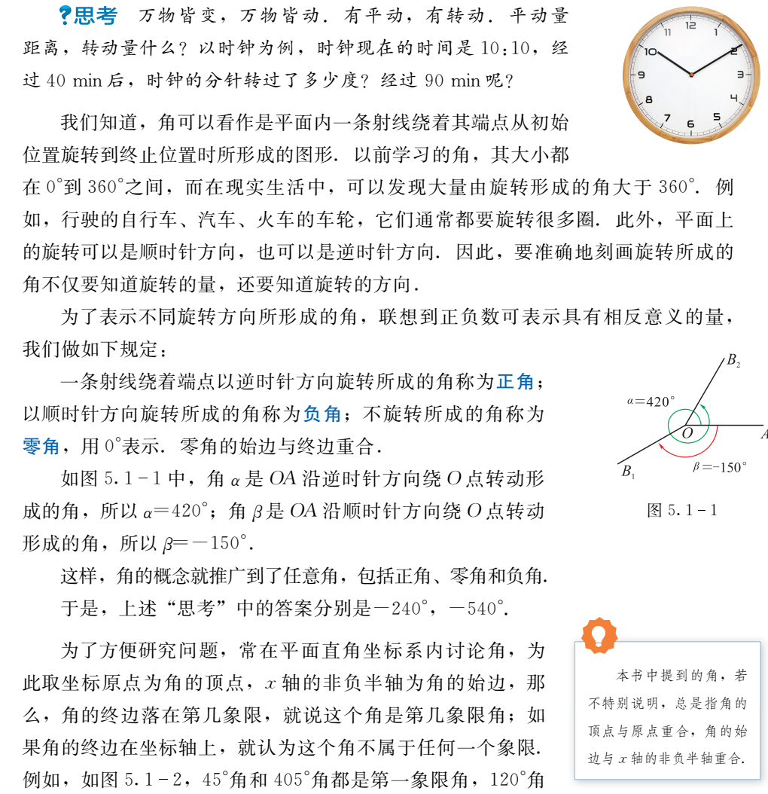
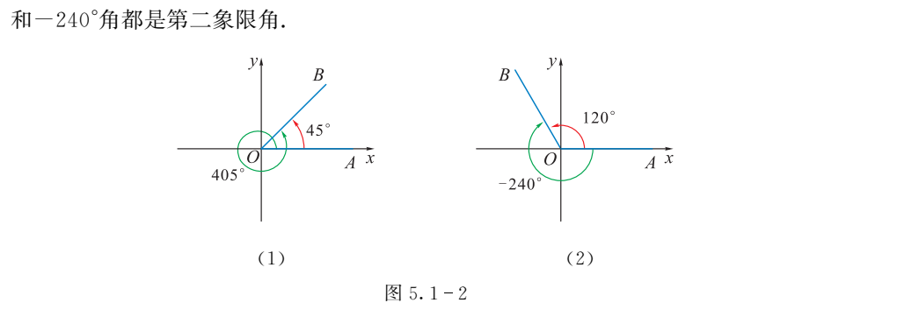

原页上下文：[PDF第163页](../原页上下文/PDF163-教材p156.webp)；[PDF第164页](../原页上下文/PDF164-教材p157.webp)

## XJ-B1-C05-TH-P157-Y0550 p.157 思考（含紧邻说明）

教材位置：第5章 / 5.1 任意角和弧度制 / 印刷页 p.157 / PDF 第164页。

类型：思考；原题号：未编号题组。

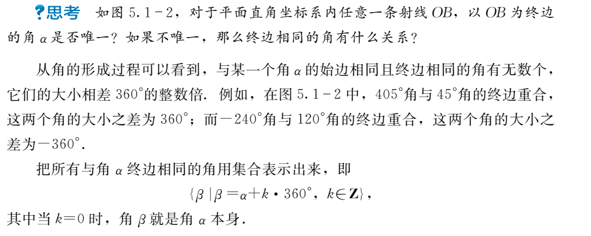

原页上下文：[PDF第164页](../原页上下文/PDF164-教材p157.webp)

## XJ-B1-C05-EX-P157-Y0962 5.1 例题 例题1

教材位置：第5章 / 5.1 任意角和弧度制 / 印刷页 p.157 / PDF 第164页。

类型：例题；原题号：例题1。

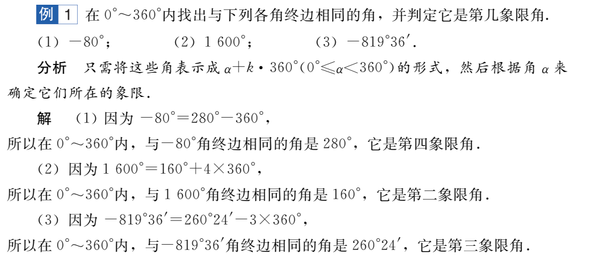

原页上下文：[PDF第164页](../原页上下文/PDF164-教材p157.webp)

## XJ-B1-C05-EX-P157-Y1411 5.1 例题 例题2

教材位置：第5章 / 5.1 任意角和弧度制 / 印刷页 p.157 / PDF 第164页。

类型：例题；原题号：例题2。

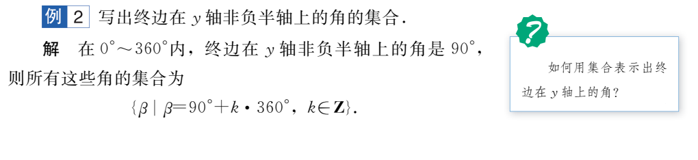

原页上下文：[PDF第164页](../原页上下文/PDF164-教材p157.webp)

## XJ-B1-C05-PR-P158-Y0217 p.158 练习 第1题

教材位置：第5章 / 5.1 任意角和弧度制 / 印刷页 p.158 / PDF 第165页。

类型：练习；原题号：第1题。

原页上下文：[PDF第165页](../原页上下文/PDF165-教材p158.webp)

## XJ-B1-C05-PR-P158-Y0260 p.158 练习 第2题

教材位置：第5章 / 5.1 任意角和弧度制 / 印刷页 p.158 / PDF 第165页。

类型：练习；原题号：第2题。

原页上下文：[PDF第165页](../原页上下文/PDF165-教材p158.webp)

## XJ-B1-C05-PR-P158-Y0346 p.158 练习 第3题

教材位置：第5章 / 5.1 任意角和弧度制 / 印刷页 p.158 / PDF 第165页。

类型：练习；原题号：第3题。

原页上下文：[PDF第165页](../原页上下文/PDF165-教材p158.webp)

## XJ-B1-C05-PR-P158-Y0432 p.158 练习 第4题

教材位置：第5章 / 5.1 任意角和弧度制 / 印刷页 p.158 / PDF 第165页。

类型：练习；原题号：第4题。

原页上下文：[PDF第165页](../原页上下文/PDF165-教材p158.webp)

## XJ-B1-C05-TH-P158-Y1003 p.158 思考（含紧邻说明）

教材位置：第5章 / 5.1 任意角和弧度制 / 印刷页 p.158、159 / PDF 第165、166页。

类型：思考；原题号：未编号题组。

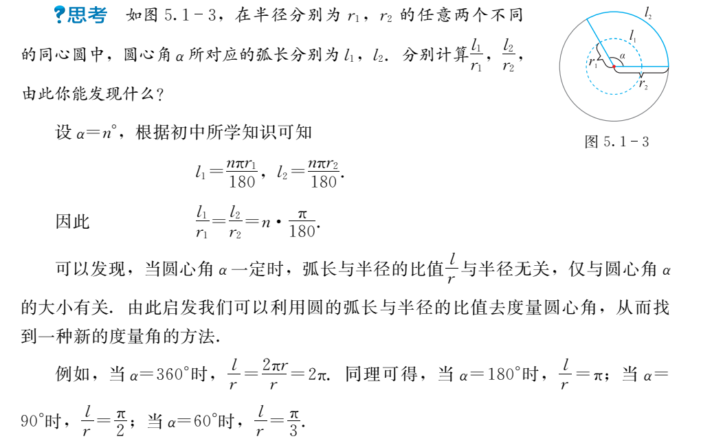
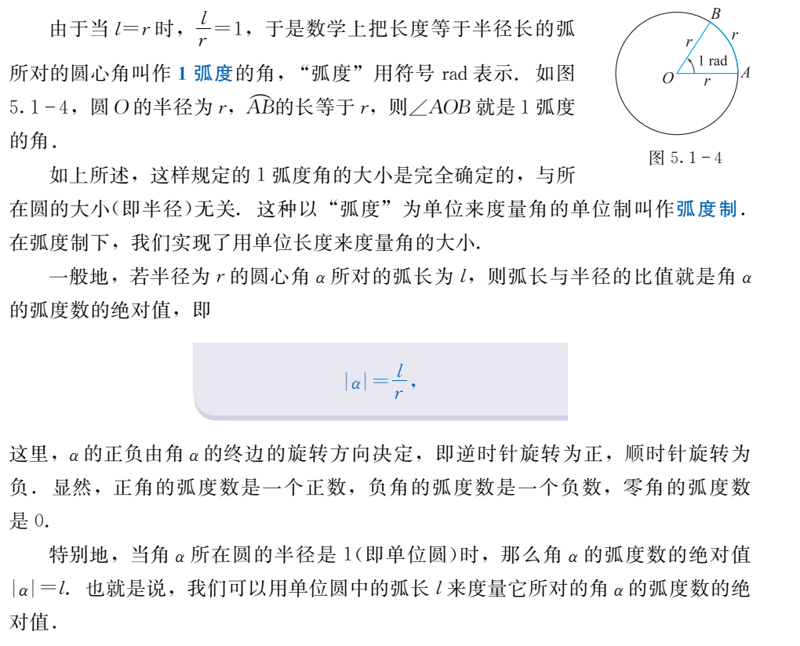

原页上下文：[PDF第165页](../原页上下文/PDF165-教材p158.webp)；[PDF第166页](../原页上下文/PDF166-教材p159.webp)

## XJ-B1-C05-TH-P159-Y1004 p.159 思考（含紧邻说明）

教材位置：第5章 / 5.1 任意角和弧度制 / 印刷页 p.159 / PDF 第166页。

类型：思考；原题号：未编号题组。

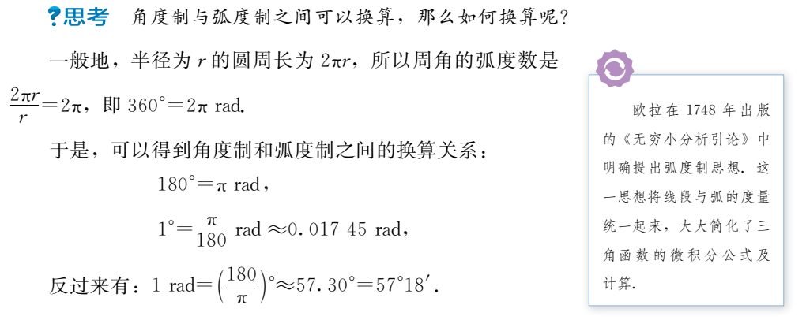

原页上下文：[PDF第166页](../原页上下文/PDF166-教材p159.webp)

## XJ-B1-C05-EX-P159-Y1414 5.1 例题 例题3

教材位置：第5章 / 5.1 任意角和弧度制 / 印刷页 p.159 / PDF 第166页。

类型：例题；原题号：例题3。

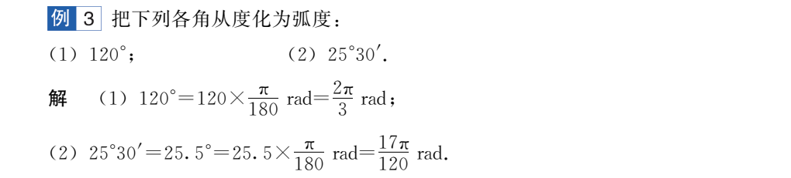

原页上下文：[PDF第166页](../原页上下文/PDF166-教材p159.webp)

## XJ-B1-C05-EX-P160-Y0177 5.1 例题 例题4

教材位置：第5章 / 5.1 任意角和弧度制 / 印刷页 p.160 / PDF 第167页。

类型：例题；原题号：例题4。

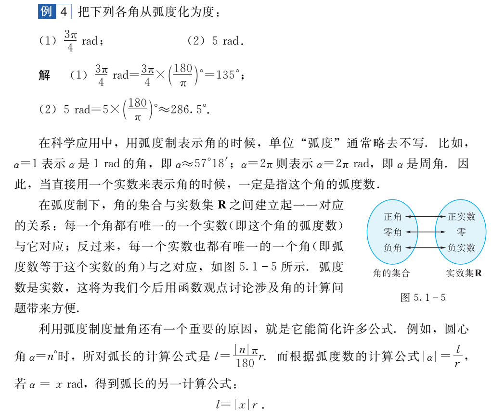

原页上下文：[PDF第167页](../原页上下文/PDF167-教材p160.webp)

## XJ-B1-C05-EX-P160-Y1053 5.1 例题 例题5

教材位置：第5章 / 5.1 任意角和弧度制 / 印刷页 p.160 / PDF 第167页。

类型：例题；原题号：例题5。

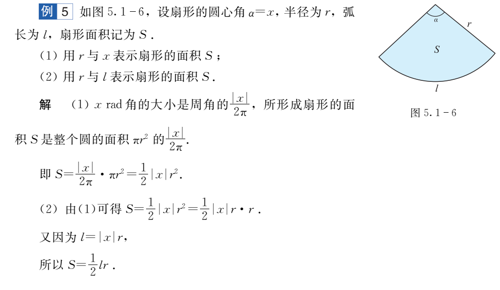

原页上下文：[PDF第167页](../原页上下文/PDF167-教材p160.webp)

## XJ-B1-C05-PR-P161-Y0221 p.161 练习 第1题

教材位置：第5章 / 5.1 任意角和弧度制 / 印刷页 p.161 / PDF 第168页。

类型：练习；原题号：第1题。

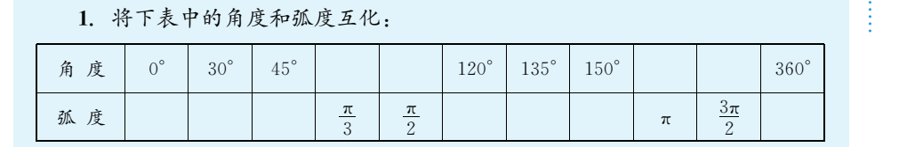

原页上下文：[PDF第168页](../原页上下文/PDF168-教材p161.webp)

## XJ-B1-C05-PR-P161-Y0388 p.161 练习 第2题

教材位置：第5章 / 5.1 任意角和弧度制 / 印刷页 p.161 / PDF 第168页。

类型：练习；原题号：第2题。

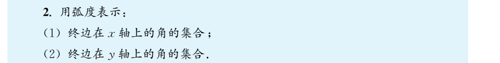

原页上下文：[PDF第168页](../原页上下文/PDF168-教材p161.webp)

## XJ-B1-C05-PR-P161-Y0517 p.161 练习 第3题

教材位置：第5章 / 5.1 任意角和弧度制 / 印刷页 p.161 / PDF 第168页。

类型：练习；原题号：第3题。

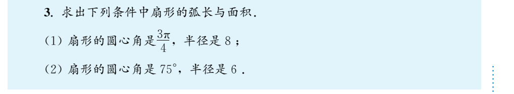

原页上下文：[PDF第168页](../原页上下文/PDF168-教材p161.webp)

## XJ-B1-C05-HW-P161-Y1048 习题5.1 第1题

教材位置：第5章 / 5.1 任意角和弧度制 / 印刷页 p.161 / PDF 第168页。

类型：习题；原题号：第1题。

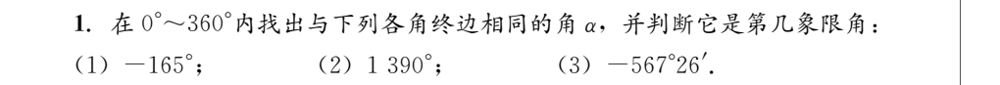

原页上下文：[PDF第168页](../原页上下文/PDF168-教材p161.webp)

## XJ-B1-C05-HW-P161-Y1135 习题5.1 第2题

教材位置：第5章 / 5.1 任意角和弧度制 / 印刷页 p.161 / PDF 第168页。

类型：习题；原题号：第2题。

原页上下文：[PDF第168页](../原页上下文/PDF168-教材p161.webp)

## XJ-B1-C05-HW-P161-Y1177 习题5.1 第3题

教材位置：第5章 / 5.1 任意角和弧度制 / 印刷页 p.161 / PDF 第168页。

类型：习题；原题号：第3题。

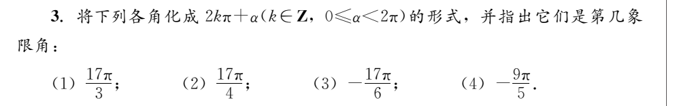

原页上下文：[PDF第168页](../原页上下文/PDF168-教材p161.webp)

## XJ-B1-C05-HW-P161-Y1334 习题5.1 第4题

教材位置：第5章 / 5.1 任意角和弧度制 / 印刷页 p.161 / PDF 第168页。

类型：习题；原题号：第4题。

原页上下文：[PDF第168页](../原页上下文/PDF168-教材p161.webp)

## XJ-B1-C05-HW-P161-Y1378 习题5.1 第5题

教材位置：第5章 / 5.1 任意角和弧度制 / 印刷页 p.161 / PDF 第168页。

类型：习题；原题号：第5题。

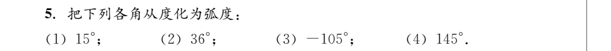

原页上下文：[PDF第168页](../原页上下文/PDF168-教材p161.webp)

## XJ-B1-C05-HW-P161-Y1464 习题5.1 第6题

教材位置：第5章 / 5.1 任意角和弧度制 / 印刷页 p.161、162 / PDF 第168、169页。

类型：习题；原题号：第6题。

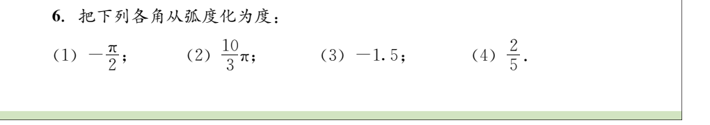

原页上下文：[PDF第168页](../原页上下文/PDF168-教材p161.webp)；[PDF第169页](../原页上下文/PDF169-教材p162.webp)

## XJ-B1-C05-HW-P162-Y0217 习题5.1 第7题

教材位置：第5章 / 5.1 任意角和弧度制 / 印刷页 p.162 / PDF 第169页。

类型：习题；原题号：第7题。

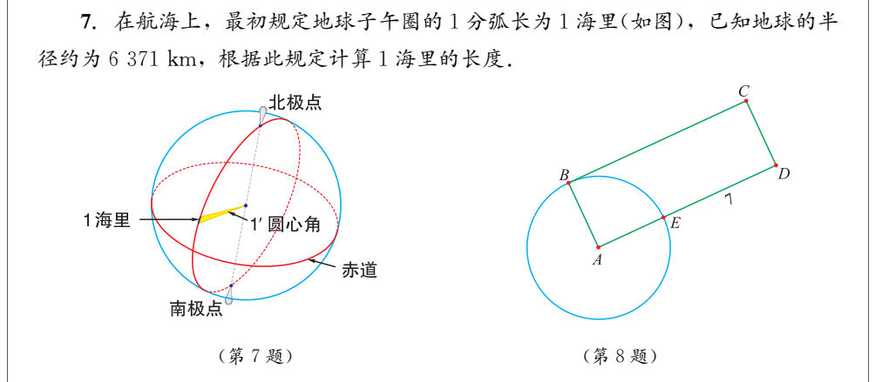

原页上下文：[PDF第169页](../原页上下文/PDF169-教材p162.webp)

## XJ-B1-C05-HW-P162-Y0656 习题5.1 第8题

教材位置：第5章 / 5.1 任意角和弧度制 / 印刷页 p.162 / PDF 第169页。

类型：习题；原题号：第8题。

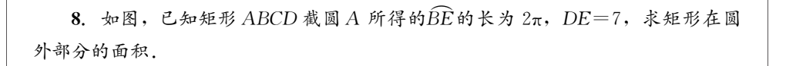

原页上下文：[PDF第169页](../原页上下文/PDF169-教材p162.webp)

## XJ-B1-C05-HW-P162-Y0743 习题5.1 第9题

教材位置：第5章 / 5.1 任意角和弧度制 / 印刷页 p.162 / PDF 第169页。

类型：习题；原题号：第9题。

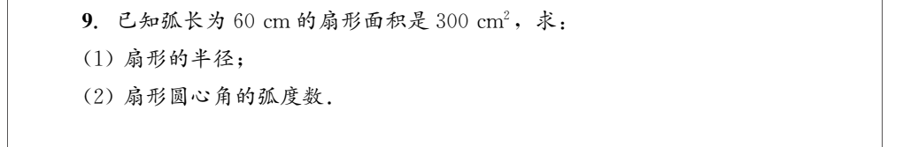

原页上下文：[PDF第169页](../原页上下文/PDF169-教材p162.webp)

## XJ-B1-C05-HW-P162-Y1029 习题5.1 第10题

教材位置：第5章 / 5.1 任意角和弧度制 / 印刷页 p.162 / PDF 第169页。

类型：习题；原题号：第10题。

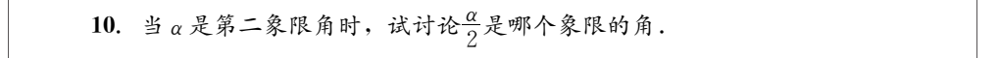

原页上下文：[PDF第169页](../原页上下文/PDF169-教材p162.webp)

## XJ-B1-C05-HW-P162-Y1089 习题5.1 第11题

教材位置：第5章 / 5.1 任意角和弧度制 / 印刷页 p.162 / PDF 第169页。

类型：习题；原题号：第11题。

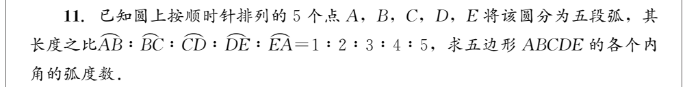

原页上下文：[PDF第169页](../原页上下文/PDF169-教材p162.webp)

## XJ-B1-C05-HW-P162-Y1218 习题5.1 第12题

教材位置：第5章 / 5.1 任意角和弧度制 / 印刷页 p.162 / PDF 第169页。

类型：习题；原题号：第12题。

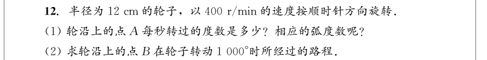

原页上下文：[PDF第169页](../原页上下文/PDF169-教材p162.webp)

## XJ-B1-C05-HW-P162-Y1346 习题5.1 第13题

教材位置：第5章 / 5.1 任意角和弧度制 / 印刷页 p.162 / PDF 第169页。

类型：习题；原题号：第13题。

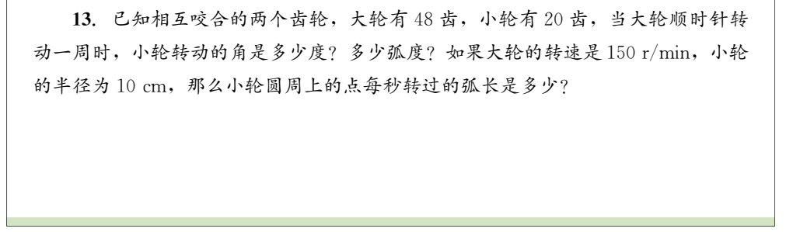

原页上下文：[PDF第169页](../原页上下文/PDF169-教材p162.webp)

## XJ-B1-C05-TH-P163-Y0689 p.163 思考（含紧邻说明）

教材位置：第5章 / 5.2 任意角的三角函数 / 印刷页 p.163、164 / PDF 第170、171页。

类型：思考；原题号：未编号题组。

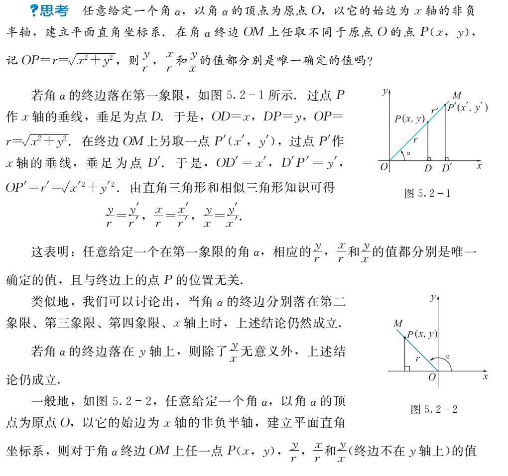
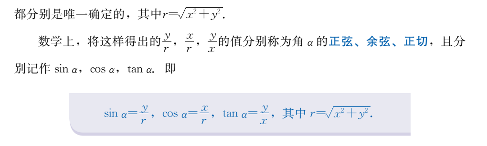

原页上下文：[PDF第170页](../原页上下文/PDF170-教材p163.webp)；[PDF第171页](../原页上下文/PDF171-教材p164.webp)

## XJ-B1-C05-EX-P164-Y0486 5.2 例题 例题1

教材位置：第5章 / 5.2 任意角的三角函数 / 印刷页 p.164 / PDF 第171页。

类型：例题；原题号：例题1。

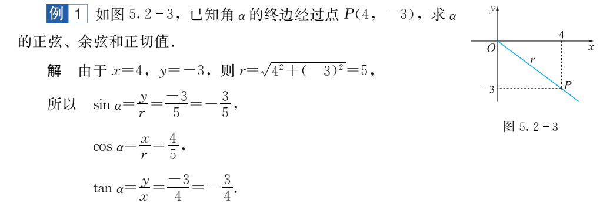

原页上下文：[PDF第171页](../原页上下文/PDF171-教材p164.webp)

## XJ-B1-C05-EX-P164-Y0865 5.2 例题 例题2

教材位置：第5章 / 5.2 任意角的三角函数 / 印刷页 p.164、165 / PDF 第171、172页。

类型：例题；原题号：例题2。

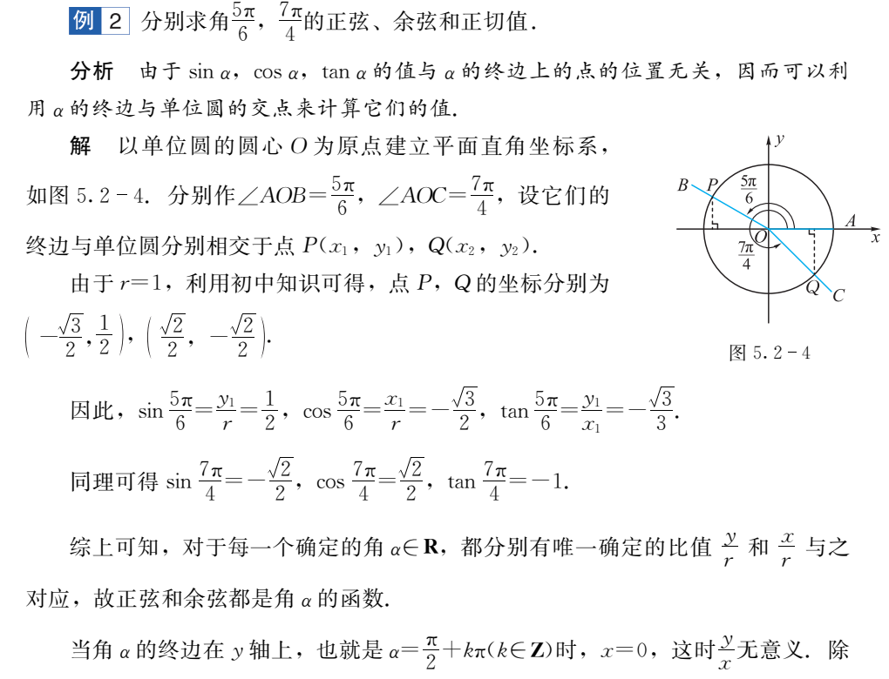
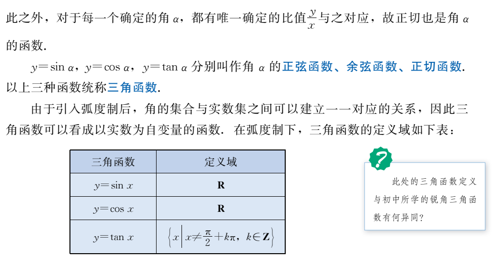

原页上下文：[PDF第171页](../原页上下文/PDF171-教材p164.webp)；[PDF第172页](../原页上下文/PDF172-教材p165.webp)

## XJ-B1-C05-PR-P165-Y0810 p.165 练习 第1题

教材位置：第5章 / 5.2 任意角的三角函数 / 印刷页 p.165 / PDF 第172页。

类型：练习；原题号：第1题。

原页上下文：[PDF第172页](../原页上下文/PDF172-教材p165.webp)

## XJ-B1-C05-PR-P165-Y0853 p.165 练习 第2题

教材位置：第5章 / 5.2 任意角的三角函数 / 印刷页 p.165 / PDF 第172页。

类型：练习；原题号：第2题。

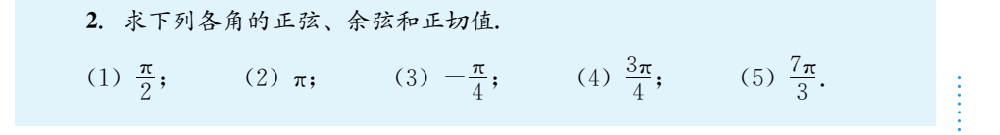

原页上下文：[PDF第172页](../原页上下文/PDF172-教材p165.webp)

## XJ-B1-C05-TH-P165-Y1147 p.165 思考（含紧邻说明）

教材位置：第5章 / 5.2 任意角的三角函数 / 印刷页 p.165、166 / PDF 第172、173页。

类型：思考；原题号：未编号题组。

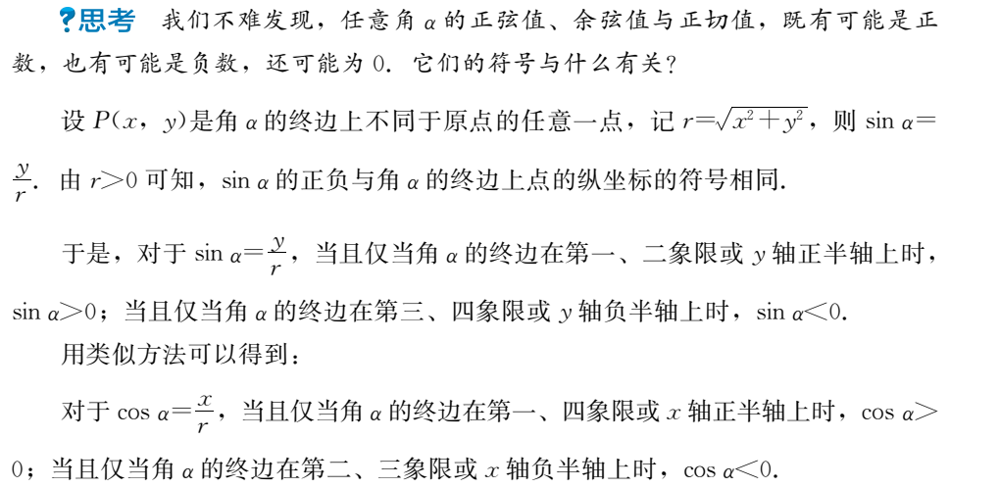
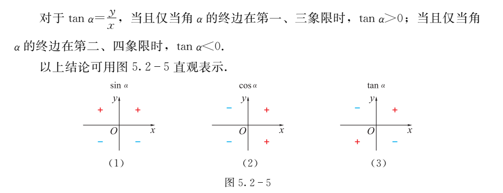

原页上下文：[PDF第172页](../原页上下文/PDF172-教材p165.webp)；[PDF第173页](../原页上下文/PDF173-教材p166.webp)

## XJ-B1-C05-EX-P166-Y0573 5.2 例题 例题3

教材位置：第5章 / 5.2 任意角的三角函数 / 印刷页 p.166 / PDF 第173页。

类型：例题；原题号：例题3。

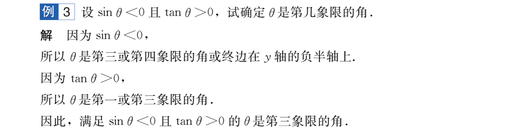

原页上下文：[PDF第173页](../原页上下文/PDF173-教材p166.webp)

## XJ-B1-C05-TH-P166-Y0848 p.166 思考（含紧邻说明）

教材位置：第5章 / 5.2 任意角的三角函数 / 印刷页 p.166、167 / PDF 第173、174页。

类型：思考；原题号：未编号题组。

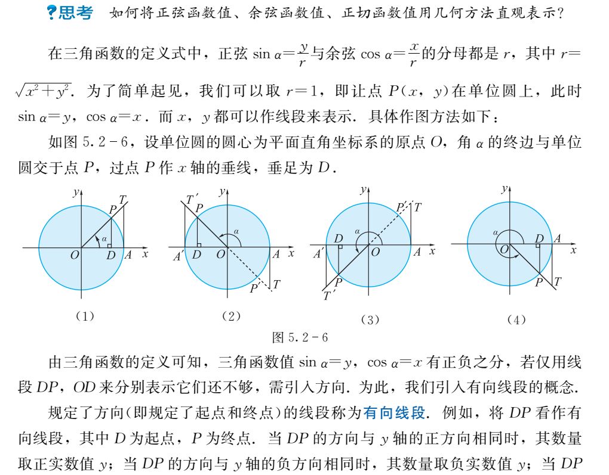
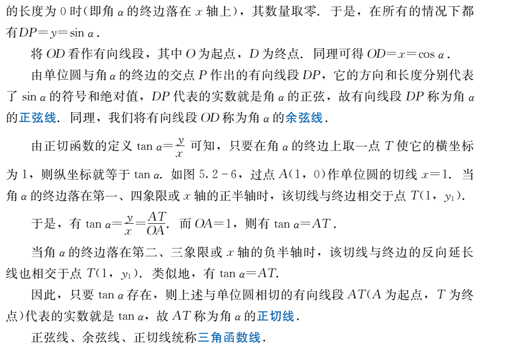

原页上下文：[PDF第173页](../原页上下文/PDF173-教材p166.webp)；[PDF第174页](../原页上下文/PDF174-教材p167.webp)

## XJ-B1-C05-EX-P167-Y0891 5.2 例题 例题4

教材位置：第5章 / 5.2 任意角的三角函数 / 印刷页 p.167 / PDF 第174页。

类型：例题；原题号：例题4。

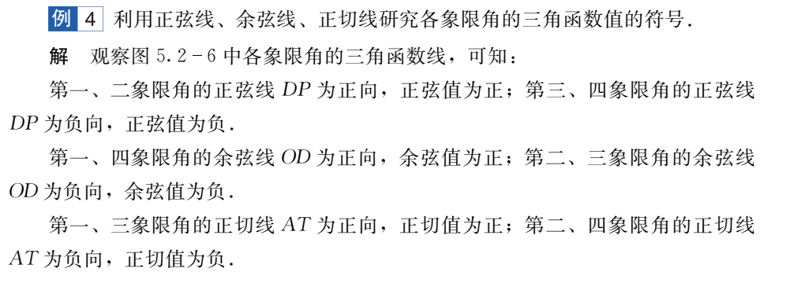

原页上下文：[PDF第174页](../原页上下文/PDF174-教材p167.webp)

## XJ-B1-C05-PR-P167-Y1326 p.167 练习 第1题

教材位置：第5章 / 5.2 任意角的三角函数 / 印刷页 p.167 / PDF 第174页。

类型：练习；原题号：第1题。

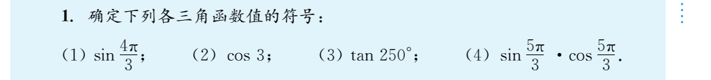

原页上下文：[PDF第174页](../原页上下文/PDF174-教材p167.webp)

## XJ-B1-C05-PR-P167-Y1442 p.167 练习 第2题

教材位置：第5章 / 5.2 任意角的三角函数 / 印刷页 p.167 / PDF 第174页。

类型：练习；原题号：第2题。

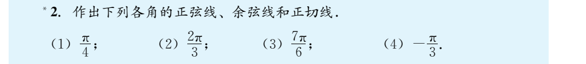

原页上下文：[PDF第174页](../原页上下文/PDF174-教材p167.webp)

## XJ-B1-C05-PR-P167-Y1555 p.167 练习 第3题

教材位置：第5章 / 5.2 任意角的三角函数 / 印刷页 p.167 / PDF 第174页。

类型：练习；原题号：第3题。

原页上下文：[PDF第174页](../原页上下文/PDF174-教材p167.webp)

## XJ-B1-C05-TH-P168-Y0290 p.168 思考（含紧邻说明）

教材位置：第5章 / 5.2 任意角的三角函数 / 印刷页 p.168 / PDF 第175页。

类型：思考；原题号：未编号题组。

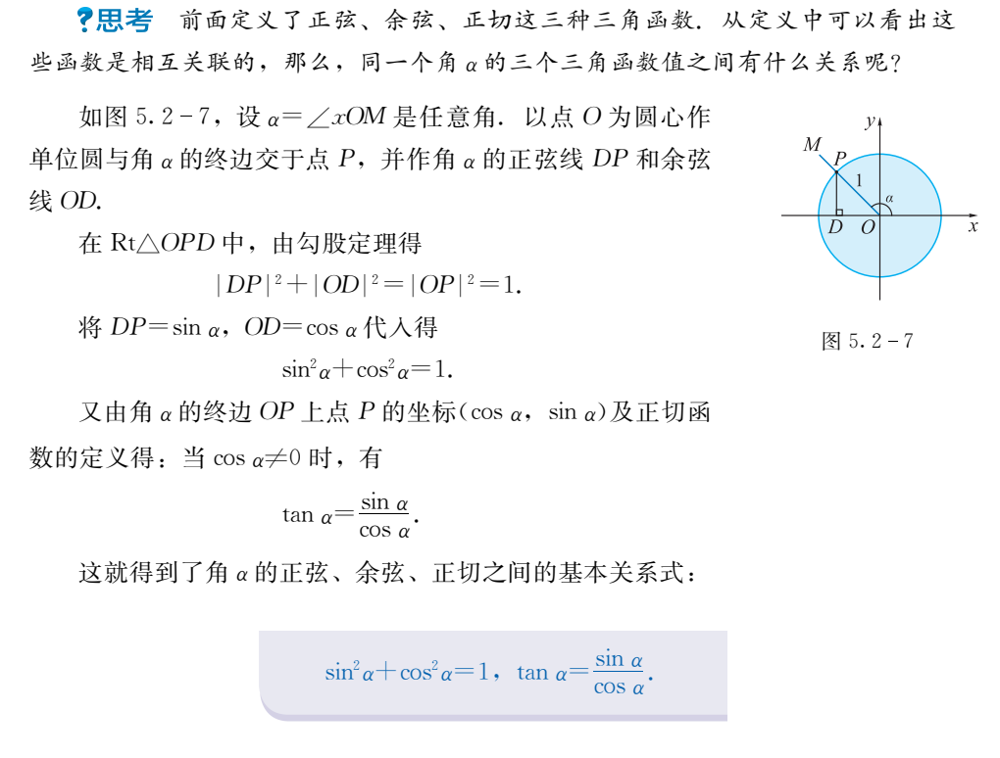

原页上下文：[PDF第175页](../原页上下文/PDF175-教材p168.webp)

## XJ-B1-C05-EX-P168-Y1068 5.2 例题 例题5

教材位置：第5章 / 5.2 任意角的三角函数 / 印刷页 p.168 / PDF 第175页。

类型：例题；原题号：例题5。

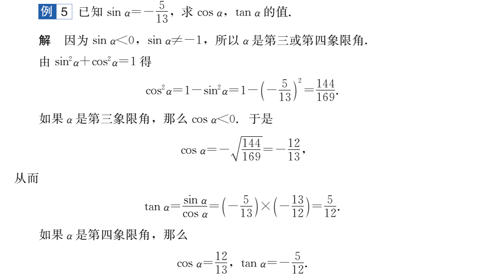

原页上下文：[PDF第175页](../原页上下文/PDF175-教材p168.webp)

## XJ-B1-C05-EX-P169-Y0177 5.2 例题 例题6

教材位置：第5章 / 5.2 任意角的三角函数 / 印刷页 p.169 / PDF 第176页。

类型：例题；原题号：例题6。

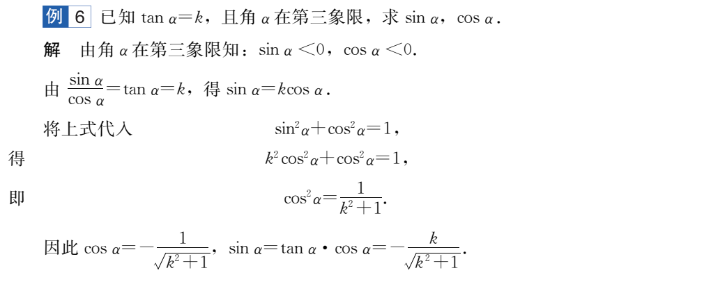

原页上下文：[PDF第176页](../原页上下文/PDF176-教材p169.webp)

## XJ-B1-C05-EX-P169-Y0600 5.2 例题 例题7

教材位置：第5章 / 5.2 任意角的三角函数 / 印刷页 p.169 / PDF 第176页。

类型：例题；原题号：例题7。

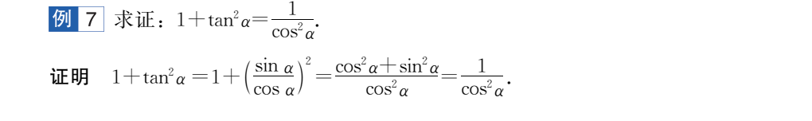

原页上下文：[PDF第176页](../原页上下文/PDF176-教材p169.webp)

## XJ-B1-C05-EX-P169-Y0756 5.2 例题 例题8

教材位置：第5章 / 5.2 任意角的三角函数 / 印刷页 p.169 / PDF 第176页。

类型：例题；原题号：例题8。

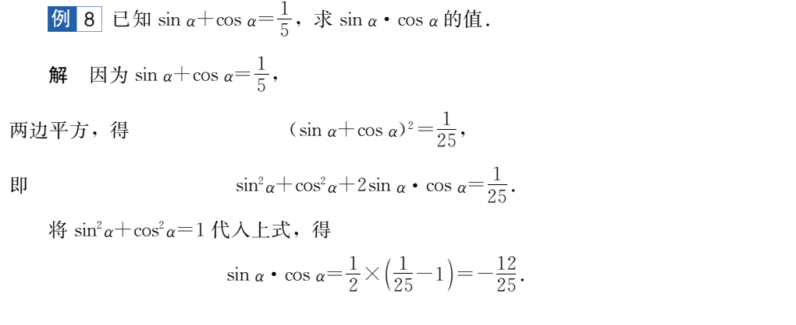

原页上下文：[PDF第176页](../原页上下文/PDF176-教材p169.webp)

## XJ-B1-C05-PR-P169-Y1245 p.169 练习 第1题

教材位置：第5章 / 5.2 任意角的三角函数 / 印刷页 p.169 / PDF 第176页。

类型：练习；原题号：第1题。

原页上下文：[PDF第176页](../原页上下文/PDF176-教材p169.webp)

## XJ-B1-C05-PR-P169-Y1316 p.169 练习 第2题

教材位置：第5章 / 5.2 任意角的三角函数 / 印刷页 p.169 / PDF 第176页。

类型：练习；原题号：第2题。

原页上下文：[PDF第176页](../原页上下文/PDF176-教材p169.webp)

## XJ-B1-C05-PR-P169-Y1372 p.169 练习 第3题

教材位置：第5章 / 5.2 任意角的三角函数 / 印刷页 p.169 / PDF 第176页。

类型：练习；原题号：第3题。

原页上下文：[PDF第176页](../原页上下文/PDF176-教材p169.webp)

## XJ-B1-C05-PR-P169-Y1430 p.169 练习 第4题

教材位置：第5章 / 5.2 任意角的三角函数 / 印刷页 p.169 / PDF 第176页。

类型：练习；原题号：第4题。

原页上下文：[PDF第176页](../原页上下文/PDF176-教材p169.webp)

## XJ-B1-C05-PR-P169-Y1502 p.169 练习 第5题

教材位置：第5章 / 5.2 任意角的三角函数 / 印刷页 p.169 / PDF 第176页。

类型：练习；原题号：第5题。

原页上下文：[PDF第176页](../原页上下文/PDF176-教材p169.webp)

## XJ-B1-C05-EX-P170-Y0796 5.2 例题 例题9

教材位置：第5章 / 5.2 任意角的三角函数 / 印刷页 p.170 / PDF 第177页。

类型：例题；原题号：例题9。

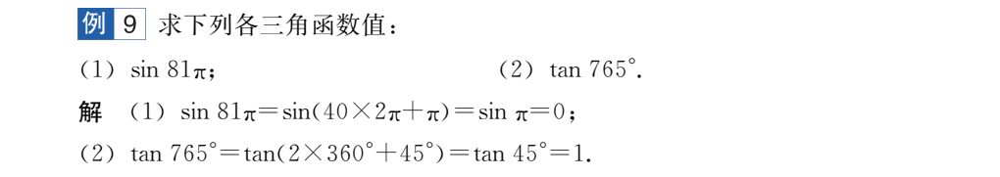

原页上下文：[PDF第177页](../原页上下文/PDF177-教材p170.webp)

## XJ-B1-C05-TH-P170-Y0981 p.170 思考（含紧邻说明）

教材位置：第5章 / 5.2 任意角的三角函数 / 印刷页 p.170 / PDF 第177页。

类型：思考；原题号：未编号题组。

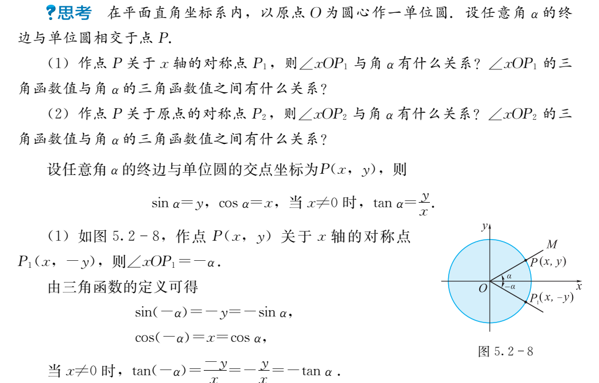

原页上下文：[PDF第177页](../原页上下文/PDF177-教材p170.webp)

## XJ-B1-C05-EX-P172-Y0384 5.2 例题 例题10

教材位置：第5章 / 5.2 任意角的三角函数 / 印刷页 p.172 / PDF 第179页。

类型：例题；原题号：例题10。

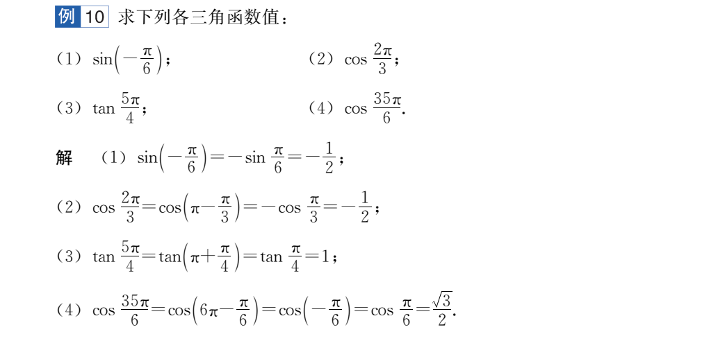

原页上下文：[PDF第179页](../原页上下文/PDF179-教材p172.webp)

## XJ-B1-C05-EX-P172-Y0880 5.2 例题 例题11

教材位置：第5章 / 5.2 任意角的三角函数 / 印刷页 p.172 / PDF 第179页。

类型：例题；原题号：例题11。

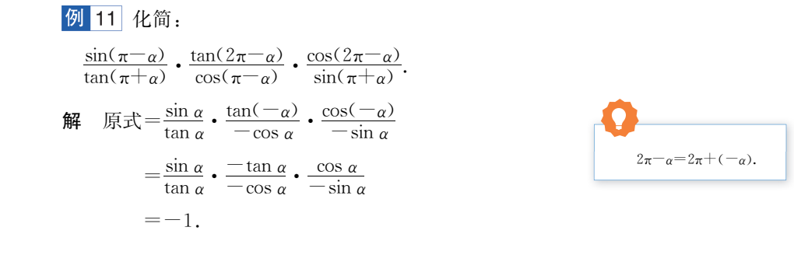

原页上下文：[PDF第179页](../原页上下文/PDF179-教材p172.webp)

## XJ-B1-C05-PR-P172-Y1270 p.172 练习 第1题

教材位置：第5章 / 5.2 任意角的三角函数 / 印刷页 p.172 / PDF 第179页。

类型：练习；原题号：第1题。

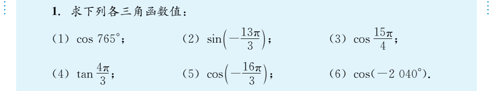

原页上下文：[PDF第179页](../原页上下文/PDF179-教材p172.webp)

## XJ-B1-C05-PR-P172-Y1457 p.172 练习 第2题

教材位置：第5章 / 5.2 任意角的三角函数 / 印刷页 p.172 / PDF 第179页。

类型：练习；原题号：第2题。

原页上下文：[PDF第179页](../原页上下文/PDF179-教材p172.webp)

## XJ-B1-C05-PR-P172-Y1512 p.172 练习 第3题

教材位置：第5章 / 5.2 任意角的三角函数 / 印刷页 p.172 / PDF 第179页。

类型：练习；原题号：第3题。

原页上下文：[PDF第179页](../原页上下文/PDF179-教材p172.webp)

## XJ-B1-C05-TH-P173-Y0178 p.173 思考（含紧邻说明）

教材位置：第5章 / 5.2 任意角的三角函数 / 印刷页 p.173、174 / PDF 第180、181页。

类型：思考；原题号：未编号题组。

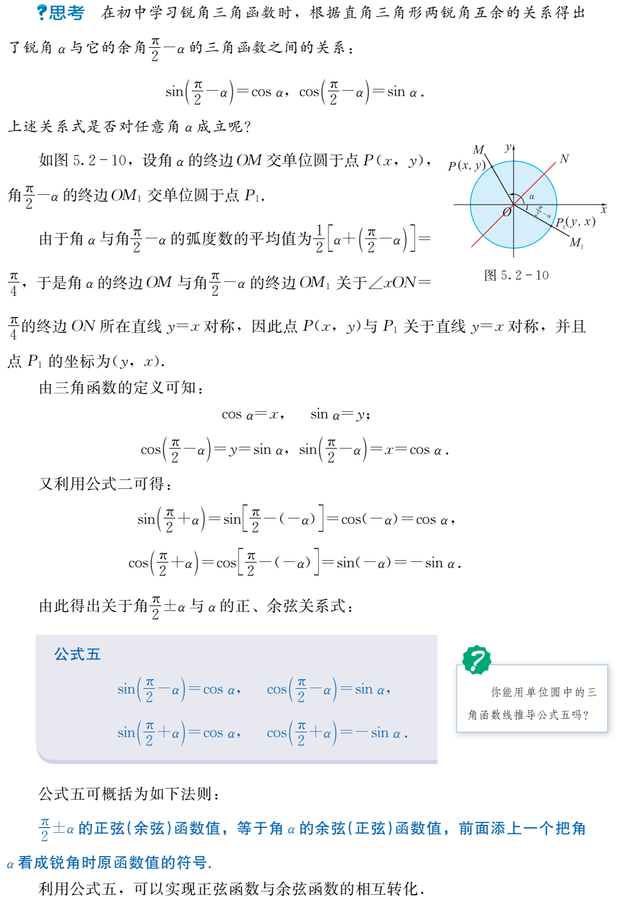

原页上下文：[PDF第180页](../原页上下文/PDF180-教材p173.webp)；[PDF第181页](../原页上下文/PDF181-教材p174.webp)

## XJ-B1-C05-EX-P174-Y0694 5.2 例题 例题12

教材位置：第5章 / 5.2 任意角的三角函数 / 印刷页 p.174 / PDF 第181页。

类型：例题；原题号：例题12。

原页上下文：[PDF第181页](../原页上下文/PDF181-教材p174.webp)

## XJ-B1-C05-EX-P174-Y0981 5.2 例题 例题13

教材位置：第5章 / 5.2 任意角的三角函数 / 印刷页 p.174 / PDF 第181页。

类型：例题；原题号：例题13。

原页上下文：[PDF第181页](../原页上下文/PDF181-教材p174.webp)

## XJ-B1-C05-PR-P174-Y1188 p.174 练习 第1题

教材位置：第5章 / 5.2 任意角的三角函数 / 印刷页 p.174 / PDF 第181页。

类型：练习；原题号：第1题。

原页上下文：[PDF第181页](../原页上下文/PDF181-教材p174.webp)

## XJ-B1-C05-PR-P174-Y1316 p.174 练习 第2题

教材位置：第5章 / 5.2 任意角的三角函数 / 印刷页 p.174 / PDF 第181页。

类型：练习；原题号：第2题。

原页上下文：[PDF第181页](../原页上下文/PDF181-教材p174.webp)

## XJ-B1-C05-PR-P174-Y1444 p.174 练习 第3题

教材位置：第5章 / 5.2 任意角的三角函数 / 印刷页 p.174 / PDF 第181页。

类型：练习；原题号：第3题。

原页上下文：[PDF第181页](../原页上下文/PDF181-教材p174.webp)

## XJ-B1-C05-HW-P175-Y0444 习题5.2 第1题

教材位置：第5章 / 5.2 任意角的三角函数 / 印刷页 p.175 / PDF 第182页。

类型：习题；原题号：第1题。

原页上下文：[PDF第182页](../原页上下文/PDF182-教材p175.webp)

## XJ-B1-C05-HW-P175-Y0530 习题5.2 第2题

教材位置：第5章 / 5.2 任意角的三角函数 / 印刷页 p.175 / PDF 第182页。

类型：习题；原题号：第2题。

原页上下文：[PDF第182页](../原页上下文/PDF182-教材p175.webp)

## XJ-B1-C05-HW-P175-Y0644 习题5.2 第3题

教材位置：第5章 / 5.2 任意角的三角函数 / 印刷页 p.175 / PDF 第182页。

类型：习题；原题号：第3题。

原页上下文：[PDF第182页](../原页上下文/PDF182-教材p175.webp)

## XJ-B1-C05-HW-P175-Y0829 习题5.2 第4题

教材位置：第5章 / 5.2 任意角的三角函数 / 印刷页 p.175 / PDF 第182页。

类型：习题；原题号：第4题。

原页上下文：[PDF第182页](../原页上下文/PDF182-教材p175.webp)

## XJ-B1-C05-HW-P175-Y0958 习题5.2 第5题

教材位置：第5章 / 5.2 任意角的三角函数 / 印刷页 p.175 / PDF 第182页。

类型：习题；原题号：第5题。

原页上下文：[PDF第182页](../原页上下文/PDF182-教材p175.webp)

## XJ-B1-C05-HW-P175-Y1016 习题5.2 第6题

教材位置：第5章 / 5.2 任意角的三角函数 / 印刷页 p.175 / PDF 第182页。

类型：习题；原题号：第6题。

原页上下文：[PDF第182页](../原页上下文/PDF182-教材p175.webp)

## XJ-B1-C05-HW-P175-Y1129 习题5.2 第7题

教材位置：第5章 / 5.2 任意角的三角函数 / 印刷页 p.175 / PDF 第182页。

类型：习题；原题号：第7题。

原页上下文：[PDF第182页](../原页上下文/PDF182-教材p175.webp)

## XJ-B1-C05-HW-P175-Y1318 习题5.2 第8题

教材位置：第5章 / 5.2 任意角的三角函数 / 印刷页 p.175 / PDF 第182页。

类型：习题；原题号：第8题。

原页上下文：[PDF第182页](../原页上下文/PDF182-教材p175.webp)

## XJ-B1-C05-HW-P175-Y1379 习题5.2 第9题

教材位置：第5章 / 5.2 任意角的三角函数 / 印刷页 p.175 / PDF 第182页。

类型：习题；原题号：第9题。

原页上下文：[PDF第182页](../原页上下文/PDF182-教材p175.webp)

## XJ-B1-C05-HW-P175-Y1506 习题5.2 第10题

教材位置：第5章 / 5.2 任意角的三角函数 / 印刷页 p.175、176 / PDF 第182、183页。

类型：习题；原题号：第10题。

原页上下文：[PDF第182页](../原页上下文/PDF182-教材p175.webp)；[PDF第183页](../原页上下文/PDF183-教材p176.webp)

## XJ-B1-C05-HW-P176-Y0350 习题5.2 第11题

教材位置：第5章 / 5.2 任意角的三角函数 / 印刷页 p.176 / PDF 第183页。

类型：习题；原题号：第11题。

原页上下文：[PDF第183页](../原页上下文/PDF183-教材p176.webp)

## XJ-B1-C05-HW-P176-Y0407 习题5.2 第12题

教材位置：第5章 / 5.2 任意角的三角函数 / 印刷页 p.176 / PDF 第183页。

类型：习题；原题号：第12题。

原页上下文：[PDF第183页](../原页上下文/PDF183-教材p176.webp)

## XJ-B1-C05-HW-P176-Y0450 习题5.2 第13题

教材位置：第5章 / 5.2 任意角的三角函数 / 印刷页 p.176 / PDF 第183页。

类型：习题；原题号：第13题。

原页上下文：[PDF第183页](../原页上下文/PDF183-教材p176.webp)

## XJ-B1-C05-HW-P176-Y0577 习题5.2 第14题

教材位置：第5章 / 5.2 任意角的三角函数 / 印刷页 p.176 / PDF 第183页。

类型：习题；原题号：第14题。

原页上下文：[PDF第183页](../原页上下文/PDF183-教材p176.webp)

## XJ-B1-C05-HW-P176-Y0704 习题5.2 第15题

教材位置：第5章 / 5.2 任意角的三角函数 / 印刷页 p.176 / PDF 第183页。

类型：习题；原题号：第15题。

原页上下文：[PDF第183页](../原页上下文/PDF183-教材p176.webp)

## XJ-B1-C05-TH-P177-Y0904 p.177 思考（含紧邻说明）

教材位置：第5章 / 5.3 三角函数的图象与性质 / 印刷页 p.177、178 / PDF 第184、185页。

类型：思考；原题号：未编号题组。

原页上下文：[PDF第184页](../原页上下文/PDF184-教材p177.webp)；[PDF第185页](../原页上下文/PDF185-教材p178.webp)

## XJ-B1-C05-TH-P178-Y1217 p.178 思考（含紧邻说明）

教材位置：第5章 / 5.3 三角函数的图象与性质 / 印刷页 p.178、179 / PDF 第185、186页。

类型：思考；原题号：未编号题组。

原页上下文：[PDF第185页](../原页上下文/PDF185-教材p178.webp)；[PDF第186页](../原页上下文/PDF186-教材p179.webp)

## XJ-B1-C05-EX-P179-Y0233 5.3 例题 例题1

教材位置：第5章 / 5.3 三角函数的图象与性质 / 印刷页 p.179 / PDF 第186页。

类型：例题；原题号：例题1。

原页上下文：[PDF第186页](../原页上下文/PDF186-教材p179.webp)

## XJ-B1-C05-PR-P180-Y0179 p.180 练习 未编号题组

教材位置：第5章 / 5.3 三角函数的图象与性质 / 印刷页 p.180 / PDF 第187页。

类型：练习；原题号：未编号题组。

原页上下文：[PDF第187页](../原页上下文/PDF187-教材p180.webp)

## XJ-B1-C05-TH-P180-Y0494 p.180 思考（含紧邻说明）

教材位置：第5章 / 5.3 三角函数的图象与性质 / 印刷页 p.180 / PDF 第187页。

类型：思考；原题号：未编号题组。

原页上下文：[PDF第187页](../原页上下文/PDF187-教材p180.webp)

## XJ-B1-C05-EX-P182-Y0945 5.3 例题 例题2

教材位置：第5章 / 5.3 三角函数的图象与性质 / 印刷页 p.182 / PDF 第189页。

类型：例题；原题号：例题2。

原页上下文：[PDF第189页](../原页上下文/PDF189-教材p182.webp)

## XJ-B1-C05-EX-P182-Y1522 5.3 例题 例题3

教材位置：第5章 / 5.3 三角函数的图象与性质 / 印刷页 p.182、183 / PDF 第189、190页。

类型：例题；原题号：例题3。

原页上下文：[PDF第189页](../原页上下文/PDF189-教材p182.webp)；[PDF第190页](../原页上下文/PDF190-教材p183.webp)

## XJ-B1-C05-EX-P183-Y0458 5.3 例题 例题4

教材位置：第5章 / 5.3 三角函数的图象与性质 / 印刷页 p.183 / PDF 第190页。

类型：例题；原题号：例题4。

原页上下文：[PDF第190页](../原页上下文/PDF190-教材p183.webp)

## XJ-B1-C05-PR-P183-Y1029 p.183 练习 第1题

教材位置：第5章 / 5.3 三角函数的图象与性质 / 印刷页 p.183 / PDF 第190页。

类型：练习；原题号：第1题。

原页上下文：[PDF第190页](../原页上下文/PDF190-教材p183.webp)

## XJ-B1-C05-PR-P183-Y1185 p.183 练习 第2题

教材位置：第5章 / 5.3 三角函数的图象与性质 / 印刷页 p.183 / PDF 第190页。

类型：练习；原题号：第2题。

原页上下文：[PDF第190页](../原页上下文/PDF190-教材p183.webp)

## XJ-B1-C05-PR-P183-Y1299 p.183 练习 第3题

教材位置：第5章 / 5.3 三角函数的图象与性质 / 印刷页 p.183 / PDF 第190页。

类型：练习；原题号：第3题。

原页上下文：[PDF第190页](../原页上下文/PDF190-教材p183.webp)

## XJ-B1-C05-PR-P183-Y1484 p.183 练习 第4题

教材位置：第5章 / 5.3 三角函数的图象与性质 / 印刷页 p.183 / PDF 第190页。

类型：练习；原题号：第4题。

原页上下文：[PDF第190页](../原页上下文/PDF190-教材p183.webp)

## XJ-B1-C05-TH-P184-Y1253 p.184 思考（含紧邻说明）

教材位置：第5章 / 5.3 三角函数的图象与性质 / 印刷页 p.184、185 / PDF 第191、192页。

类型：思考；原题号：未编号题组。

原页上下文：[PDF第191页](../原页上下文/PDF191-教材p184.webp)；[PDF第192页](../原页上下文/PDF192-教材p185.webp)

## XJ-B1-C05-EX-P185-Y0596 5.3 例题 例题5

教材位置：第5章 / 5.3 三角函数的图象与性质 / 印刷页 p.185 / PDF 第192页。

类型：例题；原题号：例题5。

原页上下文：[PDF第192页](../原页上下文/PDF192-教材p185.webp)

## XJ-B1-C05-EX-P185-Y1160 5.3 例题 例题6

教材位置：第5章 / 5.3 三角函数的图象与性质 / 印刷页 p.185 / PDF 第192页。

类型：例题；原题号：例题6。

原页上下文：[PDF第192页](../原页上下文/PDF192-教材p185.webp)

## XJ-B1-C05-PR-P186-Y0217 p.186 练习 第1题

教材位置：第5章 / 5.3 三角函数的图象与性质 / 印刷页 p.186 / PDF 第193页。

类型：练习；原题号：第1题。

原页上下文：[PDF第193页](../原页上下文/PDF193-教材p186.webp)

## XJ-B1-C05-PR-P186-Y0260 p.186 练习 第2题

教材位置：第5章 / 5.3 三角函数的图象与性质 / 印刷页 p.186 / PDF 第193页。

类型：练习；原题号：第2题。

原页上下文：[PDF第193页](../原页上下文/PDF193-教材p186.webp)

## XJ-B1-C05-PR-P186-Y0375 p.186 练习 第3题

教材位置：第5章 / 5.3 三角函数的图象与性质 / 印刷页 p.186 / PDF 第193页。

类型：练习；原题号：第3题。

原页上下文：[PDF第193页](../原页上下文/PDF193-教材p186.webp)

## XJ-B1-C05-HW-P186-Y0851 习题5.3 第1题

教材位置：第5章 / 5.3 三角函数的图象与性质 / 印刷页 p.186 / PDF 第193页。

类型：习题；原题号：第1题。

原页上下文：[PDF第193页](../原页上下文/PDF193-教材p186.webp)

## XJ-B1-C05-HW-P186-Y0964 习题5.3 第2题

教材位置：第5章 / 5.3 三角函数的图象与性质 / 印刷页 p.186 / PDF 第193页。

类型：习题；原题号：第2题。

原页上下文：[PDF第193页](../原页上下文/PDF193-教材p186.webp)

## XJ-B1-C05-HW-P186-Y1094 习题5.3 第3题

教材位置：第5章 / 5.3 三角函数的图象与性质 / 印刷页 p.186 / PDF 第193页。

类型：习题；原题号：第3题。

原页上下文：[PDF第193页](../原页上下文/PDF193-教材p186.webp)

## XJ-B1-C05-HW-P186-Y1207 习题5.3 第4题

教材位置：第5章 / 5.3 三角函数的图象与性质 / 印刷页 p.186 / PDF 第193页。

类型：习题；原题号：第4题。

原页上下文：[PDF第193页](../原页上下文/PDF193-教材p186.webp)

## XJ-B1-C05-HW-P186-Y1392 习题5.3 第5题

教材位置：第5章 / 5.3 三角函数的图象与性质 / 印刷页 p.186 / PDF 第193页。

类型：习题；原题号：第5题。

原页上下文：[PDF第193页](../原页上下文/PDF193-教材p186.webp)

## XJ-B1-C05-HW-P186-Y1522 习题5.3 第6题

教材位置：第5章 / 5.3 三角函数的图象与性质 / 印刷页 p.186、187 / PDF 第193、194页。

类型：习题；原题号：第6题。

原页上下文：[PDF第193页](../原页上下文/PDF193-教材p186.webp)；[PDF第194页](../原页上下文/PDF194-教材p187.webp)

## XJ-B1-C05-HW-P187-Y0217 习题5.3 第7题

教材位置：第5章 / 5.3 三角函数的图象与性质 / 印刷页 p.187 / PDF 第194页。

类型：习题；原题号：第7题。

原页上下文：[PDF第194页](../原页上下文/PDF194-教材p187.webp)

## XJ-B1-C05-HW-P187-Y0260 习题5.3 第8题

教材位置：第5章 / 5.3 三角函数的图象与性质 / 印刷页 p.187 / PDF 第194页。

类型：习题；原题号：第8题。

原页上下文：[PDF第194页](../原页上下文/PDF194-教材p187.webp)

## XJ-B1-C05-HW-P187-Y0452 习题5.3 第9题

教材位置：第5章 / 5.3 三角函数的图象与性质 / 印刷页 p.187 / PDF 第194页。

类型：习题；原题号：第9题。

原页上下文：[PDF第194页](../原页上下文/PDF194-教材p187.webp)

## XJ-B1-C05-HW-P187-Y0625 习题5.3 第10题

教材位置：第5章 / 5.3 三角函数的图象与性质 / 印刷页 p.187 / PDF 第194页。

类型：习题；原题号：第10题。

原页上下文：[PDF第194页](../原页上下文/PDF194-教材p187.webp)

## XJ-B1-C05-HW-P187-Y0896 习题5.3 第11题

教材位置：第5章 / 5.3 三角函数的图象与性质 / 印刷页 p.187 / PDF 第194页。

类型：习题；原题号：第11题。

原页上下文：[PDF第194页](../原页上下文/PDF194-教材p187.webp)

## XJ-B1-C05-HW-P187-Y0986 习题5.3 第12题

教材位置：第5章 / 5.3 三角函数的图象与性质 / 印刷页 p.187 / PDF 第194页。

类型：习题；原题号：第12题。

原页上下文：[PDF第194页](../原页上下文/PDF194-教材p187.webp)

## XJ-B1-C05-HW-P187-Y1229 习题5.3 第13题

教材位置：第5章 / 5.3 三角函数的图象与性质 / 印刷页 p.187 / PDF 第194页。

类型：习题；原题号：第13题。

原页上下文：[PDF第194页](../原页上下文/PDF194-教材p187.webp)

## XJ-B1-C05-HW-P187-Y1329 习题5.3 第14题

教材位置：第5章 / 5.3 三角函数的图象与性质 / 印刷页 p.187 / PDF 第194页。

类型：习题；原题号：第14题。

原页上下文：[PDF第194页](../原页上下文/PDF194-教材p187.webp)

## XJ-B1-C05-TH-P189-Y0178 p.189 思考（含紧邻说明）

教材位置：第5章 / 5.4 函数 y=A sin(ωx+φ) 的图象与性质 / 印刷页 p.189 / PDF 第196页。

类型：思考；原题号：未编号题组。

原页上下文：[PDF第196页](../原页上下文/PDF196-教材p189.webp)

## XJ-B1-C05-EX-P189-Y0403 5.4 例题 例题1

教材位置：第5章 / 5.4 函数 y=A sin(ωx+φ) 的图象与性质 / 印刷页 p.189、190 / PDF 第196、197页。

类型：例题；原题号：例题1。

原页上下文：[PDF第196页](../原页上下文/PDF196-教材p189.webp)；[PDF第197页](../原页上下文/PDF197-教材p190.webp)

## XJ-B1-C05-EX-P190-Y0361 5.4 例题 例题2

教材位置：第5章 / 5.4 函数 y=A sin(ωx+φ) 的图象与性质 / 印刷页 p.190 / PDF 第197页。

类型：例题；原题号：例题2。

原页上下文：[PDF第197页](../原页上下文/PDF197-教材p190.webp)

## XJ-B1-C05-EX-P190-Y1515 5.4 例题 例题3

教材位置：第5章 / 5.4 函数 y=A sin(ωx+φ) 的图象与性质 / 印刷页 p.190、191 / PDF 第197、198页。

类型：例题；原题号：例题3。

原页上下文：[PDF第197页](../原页上下文/PDF197-教材p190.webp)；[PDF第198页](../原页上下文/PDF198-教材p191.webp)

## XJ-B1-C05-PR-P191-Y1332 p.191 练习 第1题

教材位置：第5章 / 5.4 函数 y=A sin(ωx+φ) 的图象与性质 / 印刷页 p.191 / PDF 第198页。

类型：练习；原题号：第1题。

原页上下文：[PDF第198页](../原页上下文/PDF198-教材p191.webp)

## XJ-B1-C05-PR-P191-Y1518 p.191 练习 第2题

教材位置：第5章 / 5.4 函数 y=A sin(ωx+φ) 的图象与性质 / 印刷页 p.191 / PDF 第198页。

类型：练习；原题号：第2题。

原页上下文：[PDF第198页](../原页上下文/PDF198-教材p191.webp)

## XJ-B1-C05-EX-P192-Y0318 5.4 例题 例题4

教材位置：第5章 / 5.4 函数 y=A sin(ωx+φ) 的图象与性质 / 印刷页 p.192 / PDF 第199页。

类型：例题；原题号：例题4。

原页上下文：[PDF第199页](../原页上下文/PDF199-教材p192.webp)

## XJ-B1-C05-TH-P192-Y1420 p.192 思考（含紧邻说明）

教材位置：第5章 / 5.4 函数 y=A sin(ωx+φ) 的图象与性质 / 印刷页 p.192、193 / PDF 第199、200页。

类型：思考；原题号：未编号题组。

原页上下文：[PDF第199页](../原页上下文/PDF199-教材p192.webp)；[PDF第200页](../原页上下文/PDF200-教材p193.webp)

## XJ-B1-C05-EX-P193-Y0513 5.4 例题 例题5

教材位置：第5章 / 5.4 函数 y=A sin(ωx+φ) 的图象与性质 / 印刷页 p.193、194 / PDF 第200、201页。

类型：例题；原题号：例题5。

原页上下文：[PDF第200页](../原页上下文/PDF200-教材p193.webp)；[PDF第201页](../原页上下文/PDF201-教材p194.webp)

## XJ-B1-C05-EX-P194-Y1243 5.4 例题 例题6

教材位置：第5章 / 5.4 函数 y=A sin(ωx+φ) 的图象与性质 / 印刷页 p.194、195 / PDF 第201、202页。

类型：例题；原题号：例题6。

原页上下文：[PDF第201页](../原页上下文/PDF201-教材p194.webp)；[PDF第202页](../原页上下文/PDF202-教材p195.webp)

## XJ-B1-C05-PR-P195-Y0633 p.195 练习 第1题

教材位置：第5章 / 5.4 函数 y=A sin(ωx+φ) 的图象与性质 / 印刷页 p.195 / PDF 第202页。

类型：练习；原题号：第1题。

原页上下文：[PDF第202页](../原页上下文/PDF202-教材p195.webp)

## XJ-B1-C05-PR-P195-Y0861 p.195 练习 第2题

教材位置：第5章 / 5.4 函数 y=A sin(ωx+φ) 的图象与性质 / 印刷页 p.195 / PDF 第202页。

类型：练习；原题号：第2题。

原页上下文：[PDF第202页](../原页上下文/PDF202-教材p195.webp)

## XJ-B1-C05-PR-P195-Y1290 p.195 练习 第3题

教材位置：第5章 / 5.4 函数 y=A sin(ωx+φ) 的图象与性质 / 印刷页 p.195 / PDF 第202页。

类型：练习；原题号：第3题。

原页上下文：[PDF第202页](../原页上下文/PDF202-教材p195.webp)

## XJ-B1-C05-HW-P196-Y1132 习题5.4 第1题

教材位置：第5章 / 5.4 函数 y=A sin(ωx+φ) 的图象与性质 / 印刷页 p.196 / PDF 第203页。

类型：习题；原题号：第1题。

原页上下文：[PDF第203页](../原页上下文/PDF203-教材p196.webp)

## XJ-B1-C05-HW-P196-Y1319 习题5.4 第2题

教材位置：第5章 / 5.4 函数 y=A sin(ωx+φ) 的图象与性质 / 印刷页 p.196、197 / PDF 第203、204页。

类型：习题；原题号：第2题。

原页上下文：[PDF第203页](../原页上下文/PDF203-教材p196.webp)；[PDF第204页](../原页上下文/PDF204-教材p197.webp)

## XJ-B1-C05-HW-P197-Y0418 习题5.4 第3题

教材位置：第5章 / 5.4 函数 y=A sin(ωx+φ) 的图象与性质 / 印刷页 p.197 / PDF 第204页。

类型：习题；原题号：第3题。

原页上下文：[PDF第204页](../原页上下文/PDF204-教材p197.webp)

## XJ-B1-C05-HW-P197-Y0661 习题5.4 第4题

教材位置：第5章 / 5.4 函数 y=A sin(ωx+φ) 的图象与性质 / 印刷页 p.197 / PDF 第204页。

类型：习题；原题号：第4题。

原页上下文：[PDF第204页](../原页上下文/PDF204-教材p197.webp)

## XJ-B1-C05-HW-P197-Y0889 习题5.4 第5题

教材位置：第5章 / 5.4 函数 y=A sin(ωx+φ) 的图象与性质 / 印刷页 p.197 / PDF 第204页。

类型：习题；原题号：第5题。

原页上下文：[PDF第204页](../原页上下文/PDF204-教材p197.webp)

## XJ-B1-C05-HW-P197-Y1160 习题5.4 第6题

教材位置：第5章 / 5.4 函数 y=A sin(ωx+φ) 的图象与性质 / 印刷页 p.197 / PDF 第204页。

类型：习题；原题号：第6题。

原页上下文：[PDF第204页](../原页上下文/PDF204-教材p197.webp)

## XJ-B1-C05-HW-P197-Y1298 习题5.4 第7题

教材位置：第5章 / 5.4 函数 y=A sin(ωx+φ) 的图象与性质 / 印刷页 p.197 / PDF 第204页。

类型：习题；原题号：第7题。

原页上下文：[PDF第204页](../原页上下文/PDF204-教材p197.webp)

## XJ-B1-C05-HW-P197-Y1405 习题5.4 第8题

教材位置：第5章 / 5.4 函数 y=A sin(ωx+φ) 的图象与性质 / 印刷页 p.197 / PDF 第204页。

类型：习题；原题号：第8题。

原页上下文：[PDF第204页](../原页上下文/PDF204-教材p197.webp)

## XJ-B1-C05-LAB-P198-Y0145 用计算机作三角函数图象

教材位置：第5章 / 5.4 函数 y=A sin(ωx+φ) 的图象与性质 / 印刷页 p.198 / PDF 第205页。

类型：数学实验；原题号：完整实验任务。

原页上下文：[PDF第205页](../原页上下文/PDF205-教材p198.webp)

## XJ-B1-C05-EX-P199-Y0577 5.5 例题 例题1

教材位置：第5章 / 5.5 三角函数模型的简单应用 / 印刷页 p.199 / PDF 第206页。

类型：例题；原题号：例题1。

原页上下文：[PDF第206页](../原页上下文/PDF206-教材p199.webp)

## XJ-B1-C05-EX-P200-Y0177 5.5 例题 例题2

教材位置：第5章 / 5.5 三角函数模型的简单应用 / 印刷页 p.200 / PDF 第207页。

类型：例题；原题号：例题2。

原页上下文：[PDF第207页](../原页上下文/PDF207-教材p200.webp)

## XJ-B1-C05-PR-P201-Y0218 p.201 练习 第1题

教材位置：第5章 / 5.5 三角函数模型的简单应用 / 印刷页 p.201 / PDF 第208页。

类型：练习；原题号：第1题。

原页上下文：[PDF第208页](../原页上下文/PDF208-教材p201.webp)

## XJ-B1-C05-PR-P201-Y0602 p.201 练习 第2题

教材位置：第5章 / 5.5 三角函数模型的简单应用 / 印刷页 p.201 / PDF 第208页。

类型：练习；原题号：第2题。

原页上下文：[PDF第208页](../原页上下文/PDF208-教材p201.webp)

## XJ-B1-C05-HW-P201-Y1132 习题5.5 第1题

教材位置：第5章 / 5.5 三角函数模型的简单应用 / 印刷页 p.201 / PDF 第208页。

类型：习题；原题号：第1题。

原页上下文：[PDF第208页](../原页上下文/PDF208-教材p201.webp)

## XJ-B1-C05-HW-P201-Y1548 习题5.5 第2题

教材位置：第5章 / 5.5 三角函数模型的简单应用 / 印刷页 p.201、202 / PDF 第208、209页。

类型：习题；原题号：第2题。

原页上下文：[PDF第208页](../原页上下文/PDF208-教材p201.webp)；[PDF第209页](../原页上下文/PDF209-教材p202.webp)

## XJ-B1-C05-HW-P202-Y0419 习题5.5 第3题

教材位置：第5章 / 5.5 三角函数模型的简单应用 / 印刷页 p.202 / PDF 第209页。

类型：习题；原题号：第3题。

原页上下文：[PDF第209页](../原页上下文/PDF209-教材p202.webp)

## XJ-B1-C05-HW-P202-Y0822 习题5.5 第4题

教材位置：第5章 / 5.5 三角函数模型的简单应用 / 印刷页 p.202 / PDF 第209页。

类型：习题；原题号：第4题。

原页上下文：[PDF第209页](../原页上下文/PDF209-教材p202.webp)

## XJ-B1-C05-HW-P202-Y0993 习题5.5 第5题

教材位置：第5章 / 5.5 三角函数模型的简单应用 / 印刷页 p.202 / PDF 第209页。

类型：习题；原题号：第5题。

原页上下文：[PDF第209页](../原页上下文/PDF209-教材p202.webp)

## XJ-B1-C05-SU-P205-Y0907 第5章 小结与复习 第1题

教材位置：第5章 / 小结与复习 小结与复习 / 印刷页 p.205 / PDF 第212页。

类型：小结与复习；原题号：第1题。

原页上下文：[PDF第212页](../原页上下文/PDF212-教材p205.webp)

## XJ-B1-C05-SU-P205-Y0993 第5章 小结与复习 第2题

教材位置：第5章 / 小结与复习 小结与复习 / 印刷页 p.205 / PDF 第212页。

类型：小结与复习；原题号：第2题。

原页上下文：[PDF第212页](../原页上下文/PDF212-教材p205.webp)

## XJ-B1-C05-SU-P205-Y1036 第5章 小结与复习 第3题

教材位置：第5章 / 小结与复习 小结与复习 / 印刷页 p.205 / PDF 第212页。

类型：小结与复习；原题号：第3题。

原页上下文：[PDF第212页](../原页上下文/PDF212-教材p205.webp)

## XJ-B1-C05-SU-P205-Y1165 第5章 小结与复习 第4题

教材位置：第5章 / 小结与复习 小结与复习 / 印刷页 p.205 / PDF 第212页。

类型：小结与复习；原题号：第4题。

原页上下文：[PDF第212页](../原页上下文/PDF212-教材p205.webp)

## XJ-B1-C05-SU-P205-Y1294 第5章 小结与复习 第5题

教材位置：第5章 / 小结与复习 小结与复习 / 印刷页 p.205 / PDF 第212页。

类型：小结与复习；原题号：第5题。

原页上下文：[PDF第212页](../原页上下文/PDF212-教材p205.webp)

## XJ-B1-C05-SU-P205-Y1380 第5章 小结与复习 第6题

教材位置：第5章 / 小结与复习 小结与复习 / 印刷页 p.205 / PDF 第212页。

类型：小结与复习；原题号：第6题。

原页上下文：[PDF第212页](../原页上下文/PDF212-教材p205.webp)

## XJ-B1-C05-RV-P206-Y0406 复习题五 第1题

教材位置：第5章 / 章末复习 复习题五 / 印刷页 p.206 / PDF 第213页。

类型：复习题；原题号：第1题。

原页上下文：[PDF第213页](../原页上下文/PDF213-教材p206.webp)

## XJ-B1-C05-RV-P206-Y0564 复习题五 第2题

教材位置：第5章 / 章末复习 复习题五 / 印刷页 p.206 / PDF 第213页。

类型：复习题；原题号：第2题。

原页上下文：[PDF第213页](../原页上下文/PDF213-教材p206.webp)

## XJ-B1-C05-RV-P206-Y0736 复习题五 第3题

教材位置：第5章 / 章末复习 复习题五 / 印刷页 p.206 / PDF 第213页。

类型：复习题；原题号：第3题。

原页上下文：[PDF第213页](../原页上下文/PDF213-教材p206.webp)

## XJ-B1-C05-RV-P206-Y0821 复习题五 第4题

教材位置：第5章 / 章末复习 复习题五 / 印刷页 p.206 / PDF 第213页。

类型：复习题；原题号：第4题。

原页上下文：[PDF第213页](../原页上下文/PDF213-教材p206.webp)

## XJ-B1-C05-RV-P206-Y0923 复习题五 第5题

教材位置：第5章 / 章末复习 复习题五 / 印刷页 p.206 / PDF 第213页。

类型：复习题；原题号：第5题。

原页上下文：[PDF第213页](../原页上下文/PDF213-教材p206.webp)

## XJ-B1-C05-RV-P206-Y0979 复习题五 第6题

教材位置：第5章 / 章末复习 复习题五 / 印刷页 p.206 / PDF 第213页。

类型：复习题；原题号：第6题。

原页上下文：[PDF第213页](../原页上下文/PDF213-教材p206.webp)

## XJ-B1-C05-RV-P206-Y1107 复习题五 第7题

教材位置：第5章 / 章末复习 复习题五 / 印刷页 p.206 / PDF 第213页。

类型：复习题；原题号：第7题。

原页上下文：[PDF第213页](../原页上下文/PDF213-教材p206.webp)

## XJ-B1-C05-RV-P206-Y1435 复习题五 第8题

教材位置：第5章 / 章末复习 复习题五 / 印刷页 p.206 / PDF 第213页。

类型：复习题；原题号：第8题。

原页上下文：[PDF第213页](../原页上下文/PDF213-教材p206.webp)

## XJ-B1-C05-RV-P206-Y1539 复习题五 第9题

教材位置：第5章 / 章末复习 复习题五 / 印刷页 p.206、207 / PDF 第213、214页。

类型：复习题；原题号：第9题。

原页上下文：[PDF第213页](../原页上下文/PDF213-教材p206.webp)；[PDF第214页](../原页上下文/PDF214-教材p207.webp)

## XJ-B1-C05-RV-P207-Y0321 复习题五 第10题

教材位置：第5章 / 章末复习 复习题五 / 印刷页 p.207 / PDF 第214页。

类型：复习题；原题号：第10题。

原页上下文：[PDF第214页](../原页上下文/PDF214-教材p207.webp)

## XJ-B1-C05-RV-P207-Y0378 复习题五 第11题

教材位置：第5章 / 章末复习 复习题五 / 印刷页 p.207 / PDF 第214页。

类型：复习题；原题号：第11题。

原页上下文：[PDF第214页](../原页上下文/PDF214-教材p207.webp)

## XJ-B1-C05-RV-P207-Y0563 复习题五 第12题

教材位置：第5章 / 章末复习 复习题五 / 印刷页 p.207 / PDF 第214页。

类型：复习题；原题号：第12题。

原页上下文：[PDF第214页](../原页上下文/PDF214-教材p207.webp)

## XJ-B1-C05-RV-P207-Y0788 复习题五 第13题

教材位置：第5章 / 章末复习 复习题五 / 印刷页 p.207 / PDF 第214页。

类型：复习题；原题号：第13题。

原页上下文：[PDF第214页](../原页上下文/PDF214-教材p207.webp)

## XJ-B1-C05-RV-P207-Y0960 复习题五 第14题

教材位置：第5章 / 章末复习 复习题五 / 印刷页 p.207 / PDF 第214页。

类型：复习题；原题号：第14题。

原页上下文：[PDF第214页](../原页上下文/PDF214-教材p207.webp)

## XJ-B1-C05-RV-P207-Y1129 复习题五 第15题

教材位置：第5章 / 章末复习 复习题五 / 印刷页 p.207、208 / PDF 第214、215页。

类型：复习题；原题号：第15题。

原页上下文：[PDF第214页](../原页上下文/PDF214-教材p207.webp)；[PDF第215页](../原页上下文/PDF215-教材p208.webp)

## XJ-B1-C05-RV-P208-Y0354 复习题五 第16题

教材位置：第5章 / 章末复习 复习题五 / 印刷页 p.208 / PDF 第215页。

类型：复习题；原题号：第16题。

原页上下文：[PDF第215页](../原页上下文/PDF215-教材p208.webp)

## XJ-B1-C05-RV-P208-Y0426 复习题五 第17题

教材位置：第5章 / 章末复习 复习题五 / 印刷页 p.208 / PDF 第215页。

类型：复习题；原题号：第17题。

原页上下文：[PDF第215页](../原页上下文/PDF215-教材p208.webp)

## XJ-B1-C05-RV-P208-Y0569 复习题五 第18题

教材位置：第5章 / 章末复习 复习题五 / 印刷页 p.208 / PDF 第215页。

类型：复习题；原题号：第18题。

原页上下文：[PDF第215页](../原页上下文/PDF215-教材p208.webp)

## XJ-B1-C05-RV-P208-Y0667 复习题五 第19题

教材位置：第5章 / 章末复习 复习题五 / 印刷页 p.208 / PDF 第215页。

类型：复习题；原题号：第19题。

原页上下文：[PDF第215页](../原页上下文/PDF215-教材p208.webp)

## XJ-B1-C05-RV-P208-Y0802 复习题五 第20题

教材位置：第5章 / 章末复习 复习题五 / 印刷页 p.208 / PDF 第215页。

类型：复习题；原题号：第20题。

原页上下文：[PDF第215页](../原页上下文/PDF215-教材p208.webp)

## XJ-B1-C05-RV-P208-Y0927 复习题五 第21题

教材位置：第5章 / 章末复习 复习题五 / 印刷页 p.208 / PDF 第215页。

类型：复习题；原题号：第21题。

原页上下文：[PDF第215页](../原页上下文/PDF215-教材p208.webp)

## XJ-B1-C05-RV-P208-Y1276 复习题五 第22题

教材位置：第5章 / 章末复习 复习题五 / 印刷页 p.208、209 / PDF 第215、216页。

类型：复习题；原题号：第22题。

原页上下文：[PDF第215页](../原页上下文/PDF215-教材p208.webp)；[PDF第216页](../原页上下文/PDF216-教材p209.webp)

## XJ-B1-C05-RV-P209-Y0333 复习题五 第23题

教材位置：第5章 / 章末复习 复习题五 / 印刷页 p.209 / PDF 第216页。

类型：复习题；原题号：第23题。

原页上下文：[PDF第216页](../原页上下文/PDF216-教材p209.webp)

## XJ-B1-C05-RV-P209-Y1208 复习题五 第24题

教材位置：第5章 / 章末复习 复习题五 / 印刷页 p.209 / PDF 第216页。

类型：复习题；原题号：第24题。

原页上下文：[PDF第216页](../原页上下文/PDF216-教材p209.webp)
