# 第6章 统计学初步 教材题库

原图保留题目、公式和图形。OCR文字仅供检索，未经人工逐字校对。例题及思考保留教材原解或紧邻说明。

## XJ-B1-C06-TH-P211-Y0813 p.211 思考（含紧邻说明）

教材位置：第6章 / 6.1 获取数据的途径与统计的一些基本概念 / 印刷页 p.211 / PDF 第218页。

类型：思考；原题号：未编号题组。

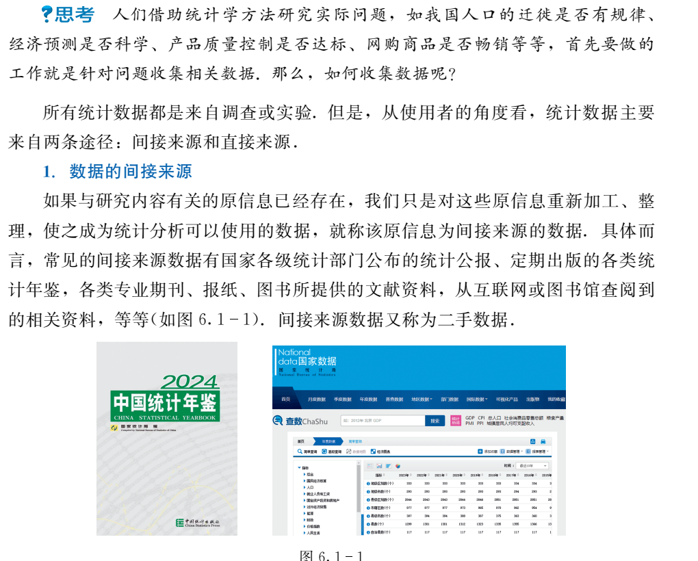

原页上下文：[PDF第218页](../原页上下文/PDF218-教材p211.webp)

## XJ-B1-C06-PR-P213-Y1211 p.213 练习 第1题

教材位置：第6章 / 6.1 获取数据的途径与统计的一些基本概念 / 印刷页 p.213 / PDF 第220页。

类型：练习；原题号：第1题。

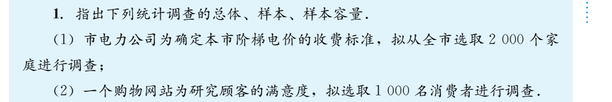

原页上下文：[PDF第220页](../原页上下文/PDF220-教材p213.webp)

## XJ-B1-C06-PR-P213-Y1382 p.213 练习 第2题

教材位置：第6章 / 6.1 获取数据的途径与统计的一些基本概念 / 印刷页 p.213 / PDF 第220页。

类型：练习；原题号：第2题。

原页上下文：[PDF第220页](../原页上下文/PDF220-教材p213.webp)

## XJ-B1-C06-HW-P214-Y0453 习题6.1 第1题

教材位置：第6章 / 6.1 获取数据的途径与统计的一些基本概念 / 印刷页 p.214 / PDF 第221页。

类型：习题；原题号：第1题。

原页上下文：[PDF第221页](../原页上下文/PDF221-教材p214.webp)

## XJ-B1-C06-HW-P214-Y0496 习题6.1 第2题

教材位置：第6章 / 6.1 获取数据的途径与统计的一些基本概念 / 印刷页 p.214 / PDF 第221页。

类型：习题；原题号：第2题。

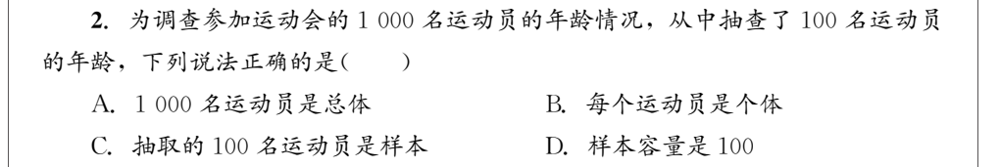

原页上下文：[PDF第221页](../原页上下文/PDF221-教材p214.webp)

## XJ-B1-C06-HW-P214-Y0667 习题6.1 第3题

教材位置：第6章 / 6.1 获取数据的途径与统计的一些基本概念 / 印刷页 p.214 / PDF 第221页。

类型：习题；原题号：第3题。

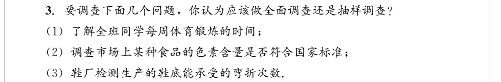

原页上下文：[PDF第221页](../原页上下文/PDF221-教材p214.webp)

## XJ-B1-C06-HW-P214-Y0836 习题6.1 第4题

教材位置：第6章 / 6.1 获取数据的途径与统计的一些基本概念 / 印刷页 p.214 / PDF 第221页。

类型：习题；原题号：第4题。

原页上下文：[PDF第221页](../原页上下文/PDF221-教材p214.webp)

## XJ-B1-C06-HW-P214-Y1026 习题6.1 第5题

教材位置：第6章 / 6.1 获取数据的途径与统计的一些基本概念 / 印刷页 p.214 / PDF 第221页。

类型：习题；原题号：第5题。

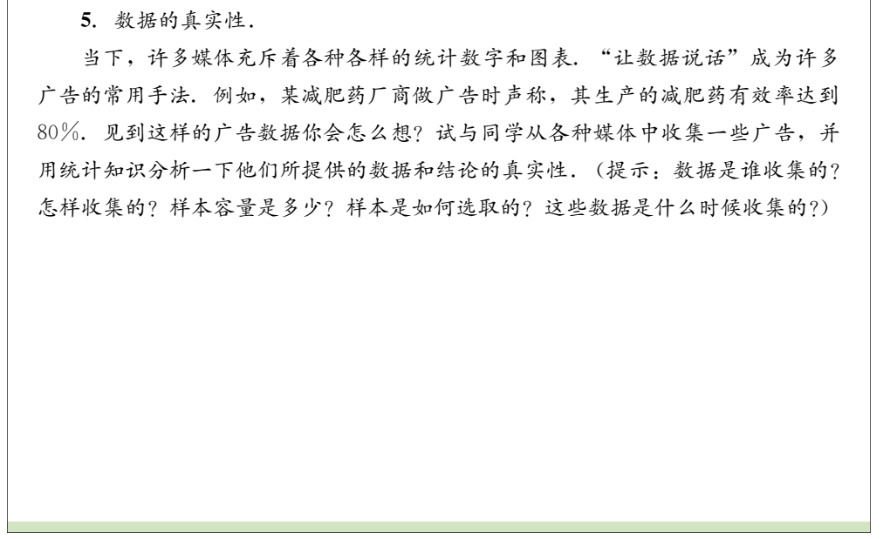

原页上下文：[PDF第221页](../原页上下文/PDF221-教材p214.webp)

## XJ-B1-C06-TH-P215-Y1331 p.215 思考（含紧邻说明）

教材位置：第6章 / 6.2 抽样 / 印刷页 p.215 / PDF 第222页。

类型：思考；原题号：未编号题组。

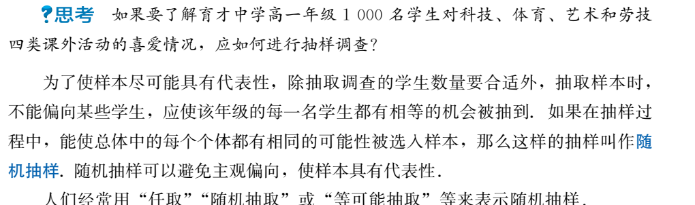

原页上下文：[PDF第222页](../原页上下文/PDF222-教材p215.webp)

## XJ-B1-C06-TH-P217-Y1023 p.217 思考（含紧邻说明）

教材位置：第6章 / 6.2 抽样 / 印刷页 p.217 / PDF 第224页。

类型：思考；原题号：未编号题组。

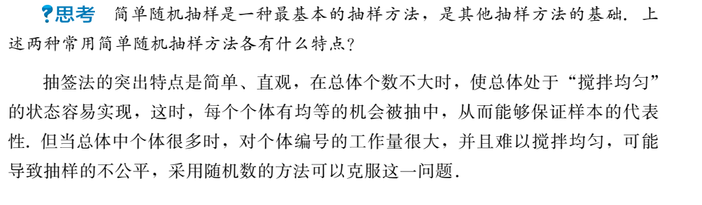

原页上下文：[PDF第224页](../原页上下文/PDF224-教材p217.webp)

## XJ-B1-C06-PR-P217-Y1376 p.217 练习 第1题

教材位置：第6章 / 6.2 抽样 / 印刷页 p.217 / PDF 第224页。

类型：练习；原题号：第1题。

原页上下文：[PDF第224页](../原页上下文/PDF224-教材p217.webp)

## XJ-B1-C06-PR-P217-Y1462 p.217 练习 第2题

教材位置：第6章 / 6.2 抽样 / 印刷页 p.217 / PDF 第224页。

类型：练习；原题号：第2题。

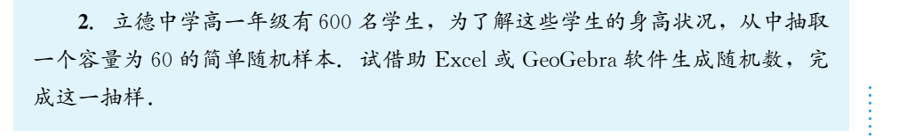

原页上下文：[PDF第224页](../原页上下文/PDF224-教材p217.webp)

## XJ-B1-C06-TH-P218-Y0289 p.218 思考（含紧邻说明）

教材位置：第6章 / 6.2 抽样 / 印刷页 p.218 / PDF 第225页。

类型：思考；原题号：未编号题组。

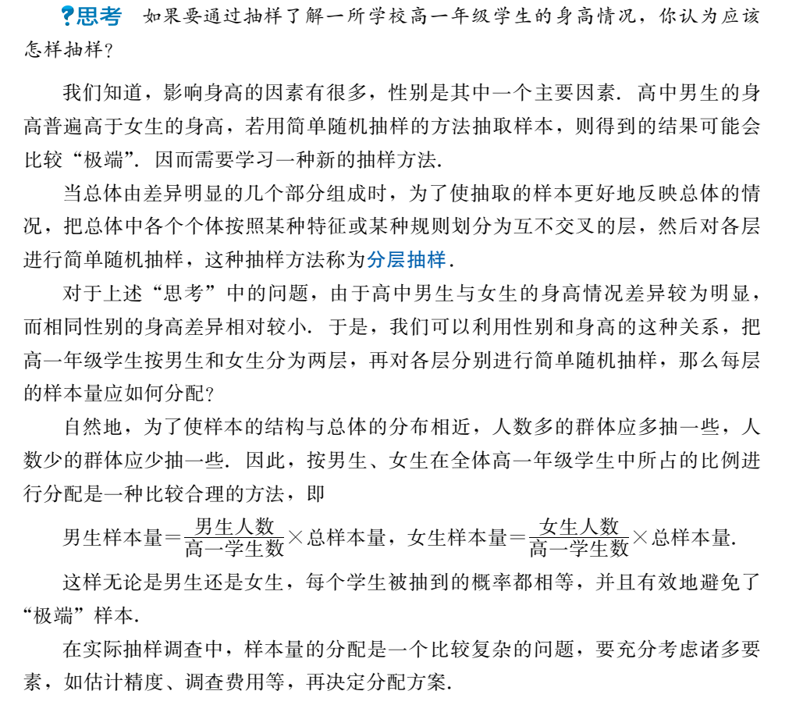

原页上下文：[PDF第225页](../原页上下文/PDF225-教材p218.webp)

## XJ-B1-C06-EX-P218-Y1196 6.2 例题 例题1

教材位置：第6章 / 6.2 抽样 / 印刷页 p.218、219 / PDF 第225、226页。

类型：例题；原题号：例题1。

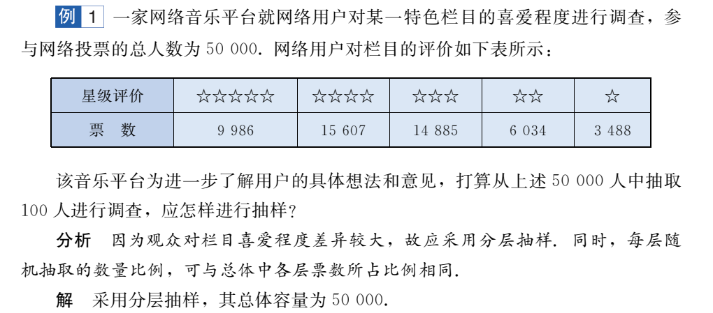
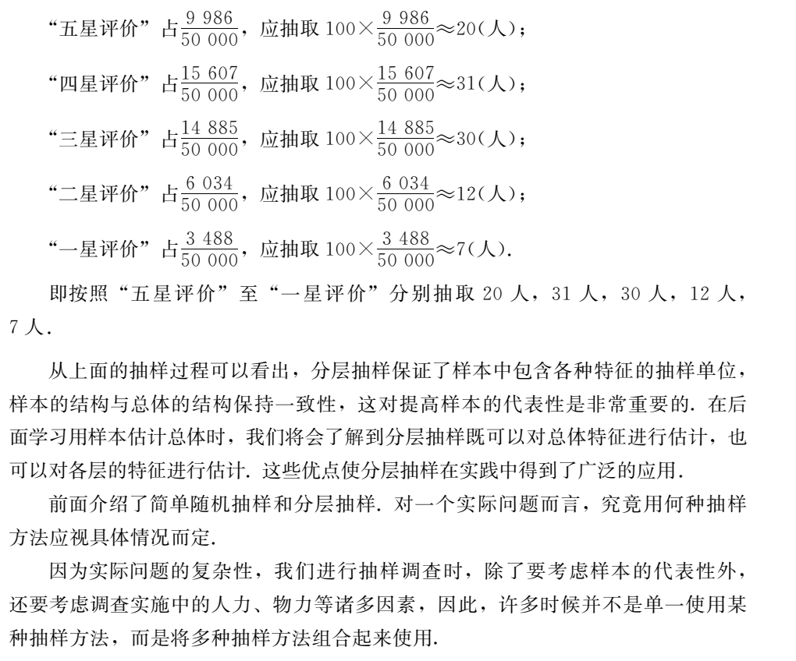

原页上下文：[PDF第225页](../原页上下文/PDF225-教材p218.webp)；[PDF第226页](../原页上下文/PDF226-教材p219.webp)

## XJ-B1-C06-EX-P219-Y1028 6.2 例题 例题2

教材位置：第6章 / 6.2 抽样 / 印刷页 p.219 / PDF 第226页。

类型：例题；原题号：例题2。

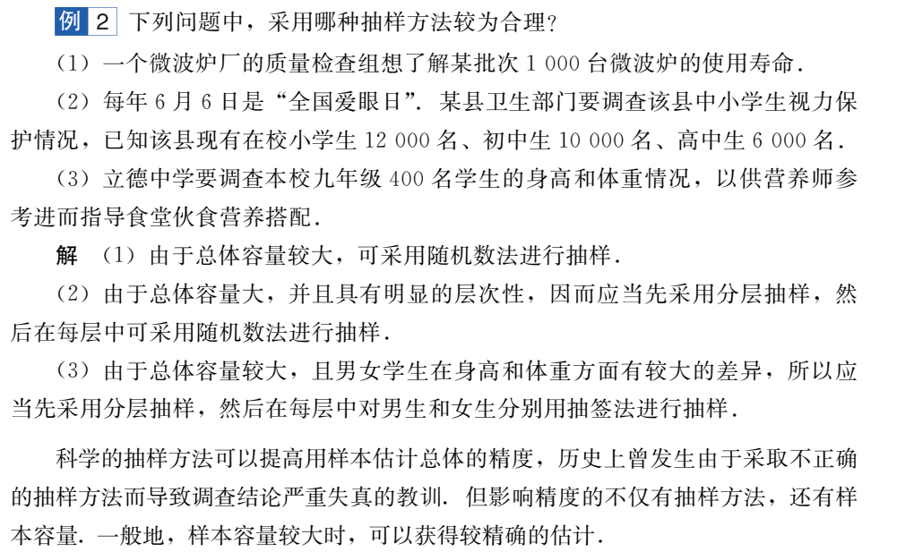

原页上下文：[PDF第226页](../原页上下文/PDF226-教材p219.webp)

## XJ-B1-C06-PR-P220-Y0217 p.220 练习 第1题

教材位置：第6章 / 6.2 抽样 / 印刷页 p.220 / PDF 第227页。

类型：练习；原题号：第1题。

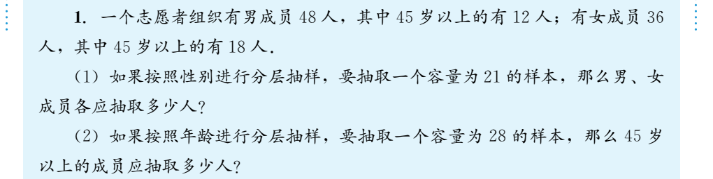

原页上下文：[PDF第227页](../原页上下文/PDF227-教材p220.webp)

## XJ-B1-C06-PR-P220-Y0475 p.220 练习 第2题

教材位置：第6章 / 6.2 抽样 / 印刷页 p.220 / PDF 第227页。

类型：练习；原题号：第2题。

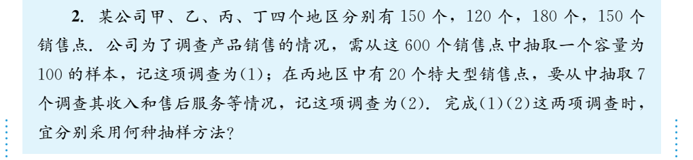

原页上下文：[PDF第227页](../原页上下文/PDF227-教材p220.webp)

## XJ-B1-C06-HW-P221-Y1223 习题6.2 第1题

教材位置：第6章 / 6.2 抽样 / 印刷页 p.221 / PDF 第228页。

类型：习题；原题号：第1题。

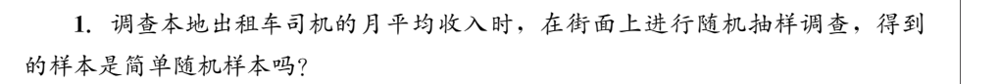

原页上下文：[PDF第228页](../原页上下文/PDF228-教材p221.webp)

## XJ-B1-C06-HW-P221-Y1309 习题6.2 第2题

教材位置：第6章 / 6.2 抽样 / 印刷页 p.221 / PDF 第228页。

类型：习题；原题号：第2题。

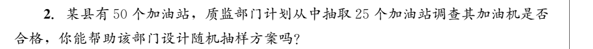

原页上下文：[PDF第228页](../原页上下文/PDF228-教材p221.webp)

## XJ-B1-C06-HW-P221-Y1395 习题6.2 第3题

教材位置：第6章 / 6.2 抽样 / 印刷页 p.221 / PDF 第228页。

类型：习题；原题号：第3题。

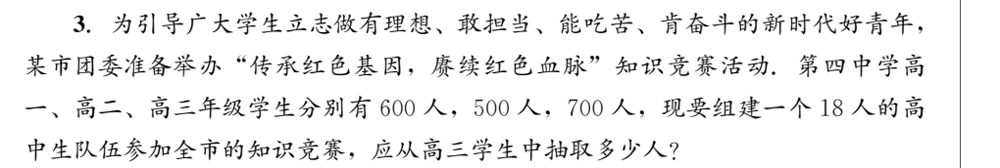

原页上下文：[PDF第228页](../原页上下文/PDF228-教材p221.webp)

## XJ-B1-C06-HW-P221-Y1567 习题6.2 第4题

教材位置：第6章 / 6.2 抽样 / 印刷页 p.221、222 / PDF 第228、229页。

类型：习题；原题号：第4题。

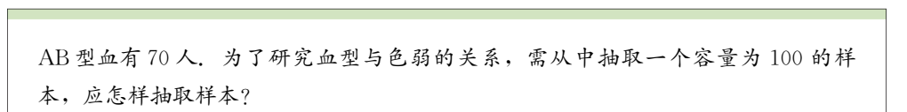

原页上下文：[PDF第228页](../原页上下文/PDF228-教材p221.webp)；[PDF第229页](../原页上下文/PDF229-教材p222.webp)

## XJ-B1-C06-HW-P222-Y0303 习题6.2 第5题

教材位置：第6章 / 6.2 抽样 / 印刷页 p.222 / PDF 第229页。

类型：习题；原题号：第5题。

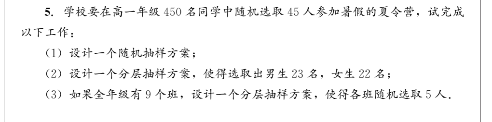

原页上下文：[PDF第229页](../原页上下文/PDF229-教材p222.webp)

## XJ-B1-C06-HW-P222-Y0664 习题6.2 第6题

教材位置：第6章 / 6.2 抽样 / 印刷页 p.222 / PDF 第229页。

类型：习题；原题号：第6题。

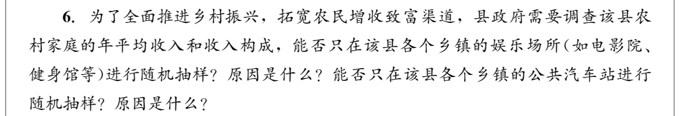

原页上下文：[PDF第229页](../原页上下文/PDF229-教材p222.webp)

## XJ-B1-C06-HW-P222-Y0836 习题6.2 第7题

教材位置：第6章 / 6.2 抽样 / 印刷页 p.222 / PDF 第229页。

类型：习题；原题号：第7题。

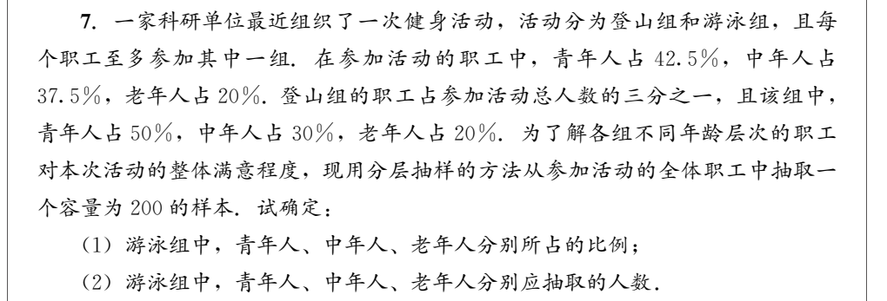

原页上下文：[PDF第229页](../原页上下文/PDF229-教材p222.webp)

## XJ-B1-C06-HW-P222-Y1183 习题6.2 第8题

教材位置：第6章 / 6.2 抽样 / 印刷页 p.222 / PDF 第229页。

类型：习题；原题号：第8题。

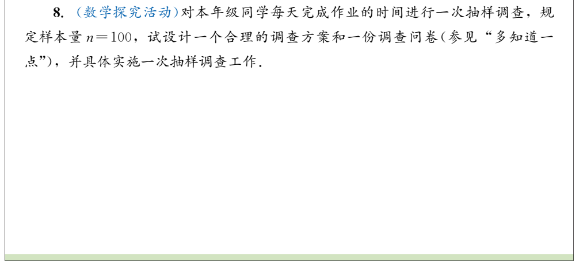

原页上下文：[PDF第229页](../原页上下文/PDF229-教材p222.webp)

## XJ-B1-C06-CA-P224-Y0720 6.3 案例 案例1

教材位置：第6章 / 6.3 统计图表 / 印刷页 p.224、225、226 / PDF 第231、232、233页。

类型：案例；原题号：案例1。

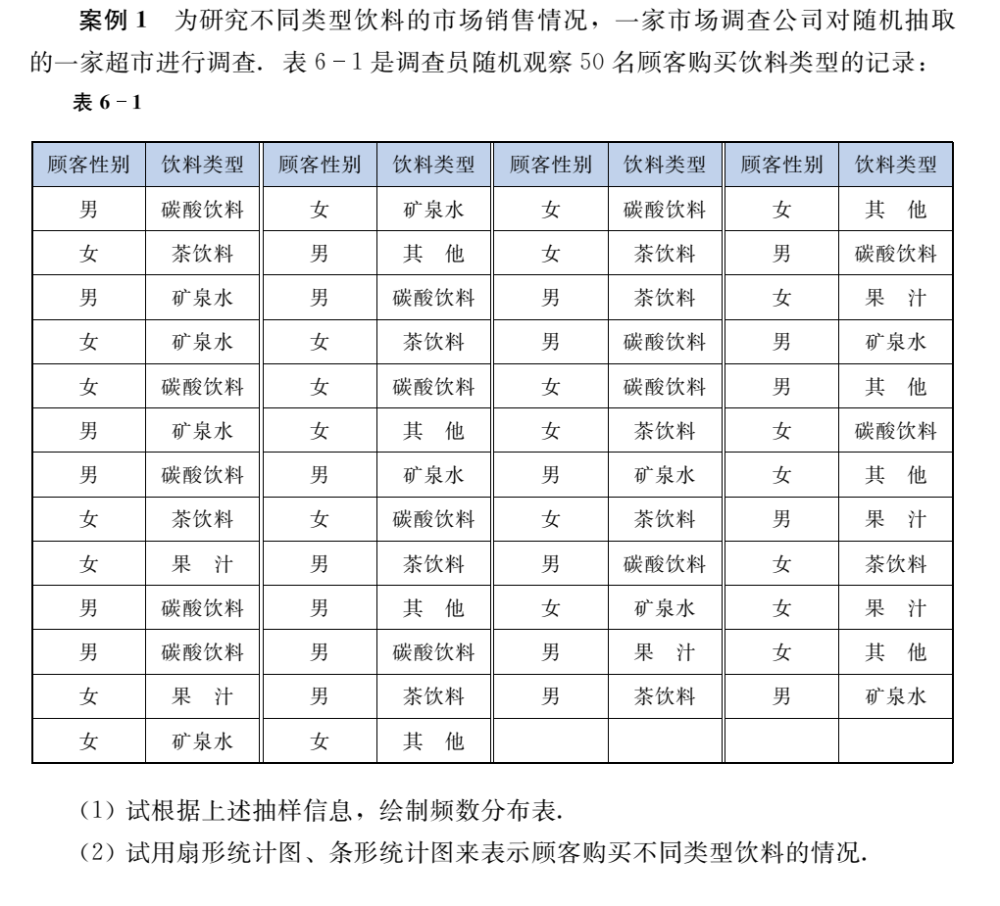
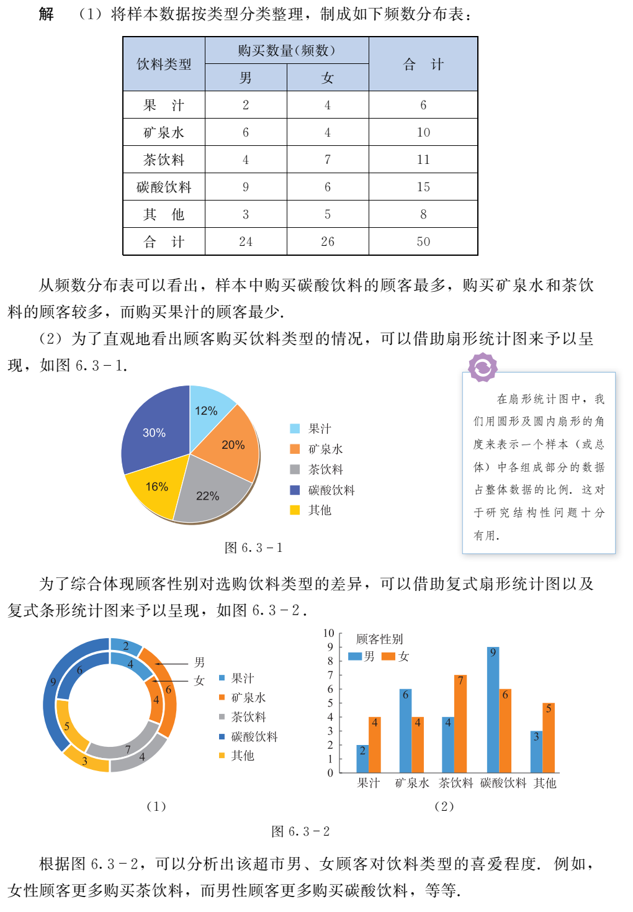

原页上下文：[PDF第231页](../原页上下文/PDF231-教材p224.webp)；[PDF第232页](../原页上下文/PDF232-教材p225.webp)；[PDF第233页](../原页上下文/PDF233-教材p226.webp)

## XJ-B1-C06-CA-P226-Y0277 6.3 案例 案例2

教材位置：第6章 / 6.3 统计图表 / 印刷页 p.226 / PDF 第233页。

类型：案例；原题号：案例2。

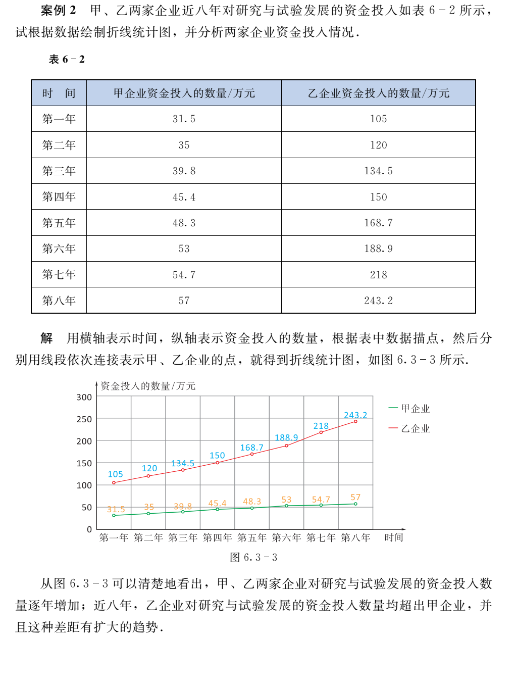

原页上下文：[PDF第233页](../原页上下文/PDF233-教材p226.webp)

## XJ-B1-C06-PR-P227-Y0217 p.227 练习 第1题

教材位置：第6章 / 6.3 统计图表 / 印刷页 p.227 / PDF 第234页。

类型：练习；原题号：第1题。

原页上下文：[PDF第234页](../原页上下文/PDF234-教材p227.webp)

## XJ-B1-C06-PR-P227-Y0307 p.227 练习 第2题

教材位置：第6章 / 6.3 统计图表 / 印刷页 p.227 / PDF 第234页。

类型：练习；原题号：第2题。

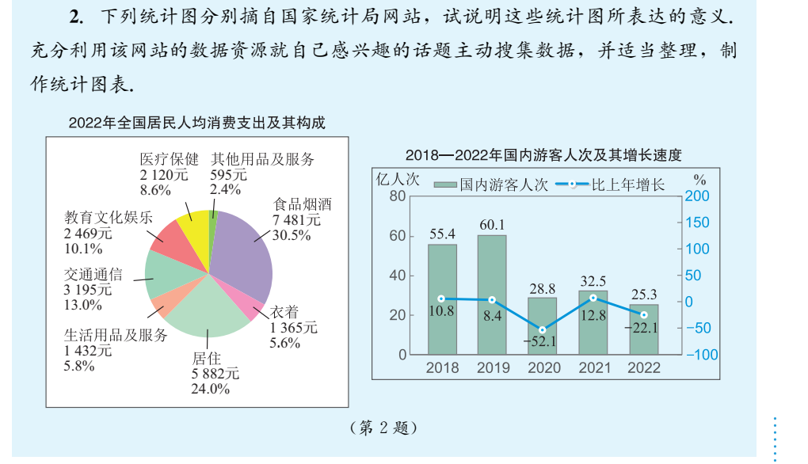

原页上下文：[PDF第234页](../原页上下文/PDF234-教材p227.webp)

## XJ-B1-C06-CA-P227-Y1094 6.3 案例 案例3

教材位置：第6章 / 6.3 统计图表 / 印刷页 p.227、228、229、230 / PDF 第234、235、236、237页。

类型：案例；原题号：案例3。

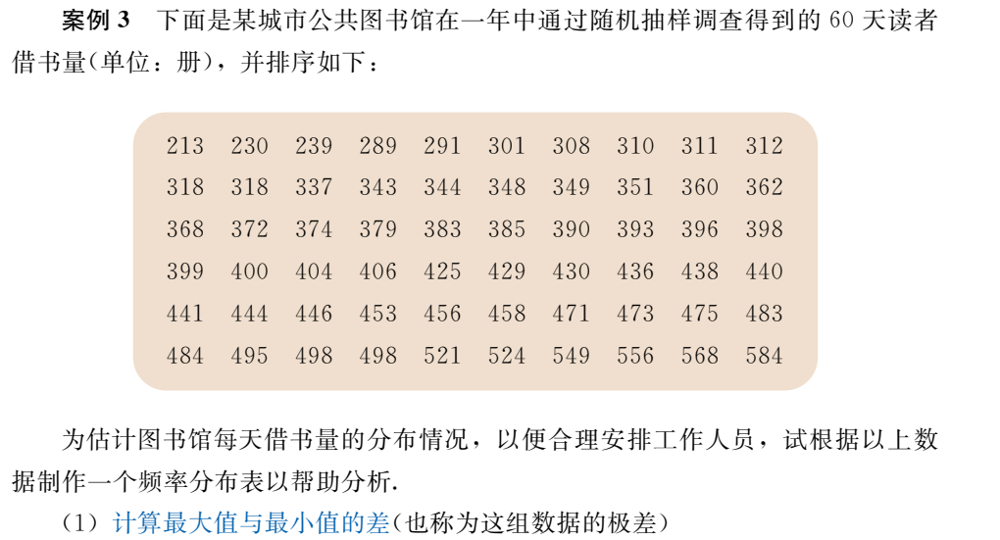
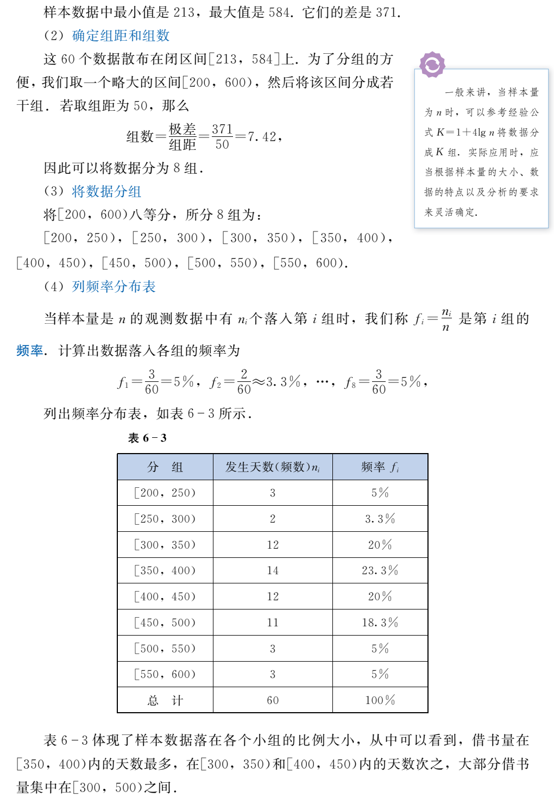
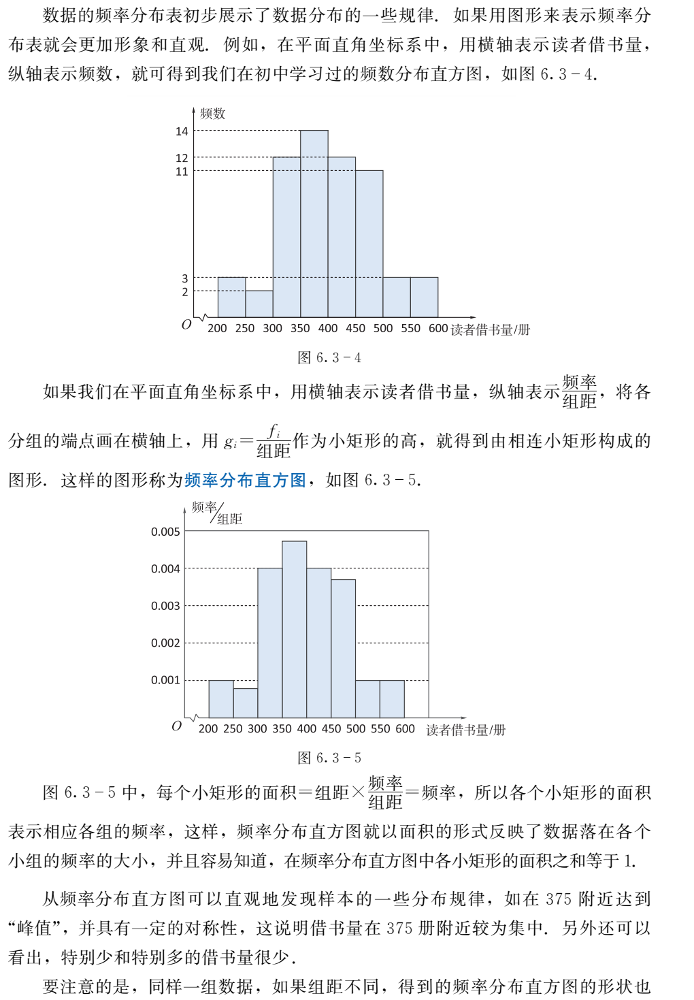
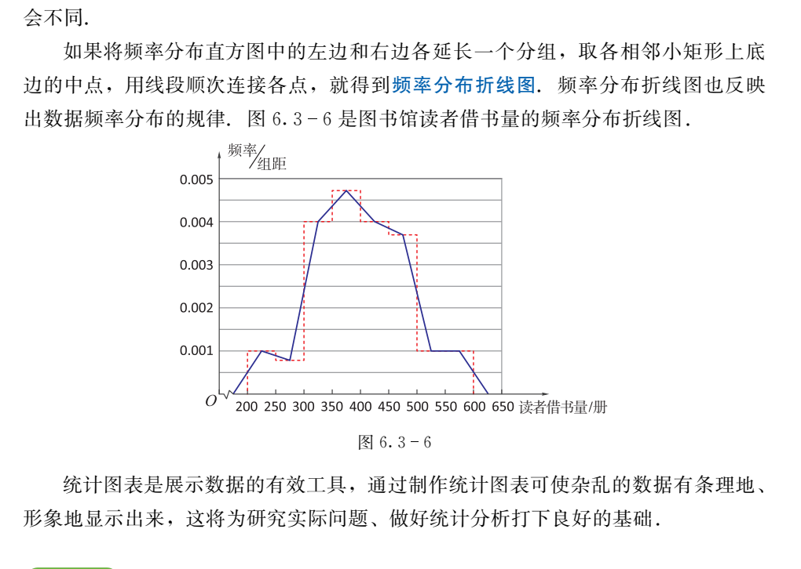

原页上下文：[PDF第234页](../原页上下文/PDF234-教材p227.webp)；[PDF第235页](../原页上下文/PDF235-教材p228.webp)；[PDF第236页](../原页上下文/PDF236-教材p229.webp)；[PDF第237页](../原页上下文/PDF237-教材p230.webp)

## XJ-B1-C06-PR-P230-Y0946 p.230 练习 第1题

教材位置：第6章 / 6.3 统计图表 / 印刷页 p.230 / PDF 第237页。

类型：练习；原题号：第1题。

原页上下文：[PDF第237页](../原页上下文/PDF237-教材p230.webp)

## XJ-B1-C06-PR-P230-Y0988 p.230 练习 第2题

教材位置：第6章 / 6.3 统计图表 / 印刷页 p.230 / PDF 第237页。

类型：练习；原题号：第2题。

原页上下文：[PDF第237页](../原页上下文/PDF237-教材p230.webp)

## XJ-B1-C06-PR-P230-Y1031 p.230 练习 第3题

教材位置：第6章 / 6.3 统计图表 / 印刷页 p.230 / PDF 第237页。

类型：练习；原题号：第3题。

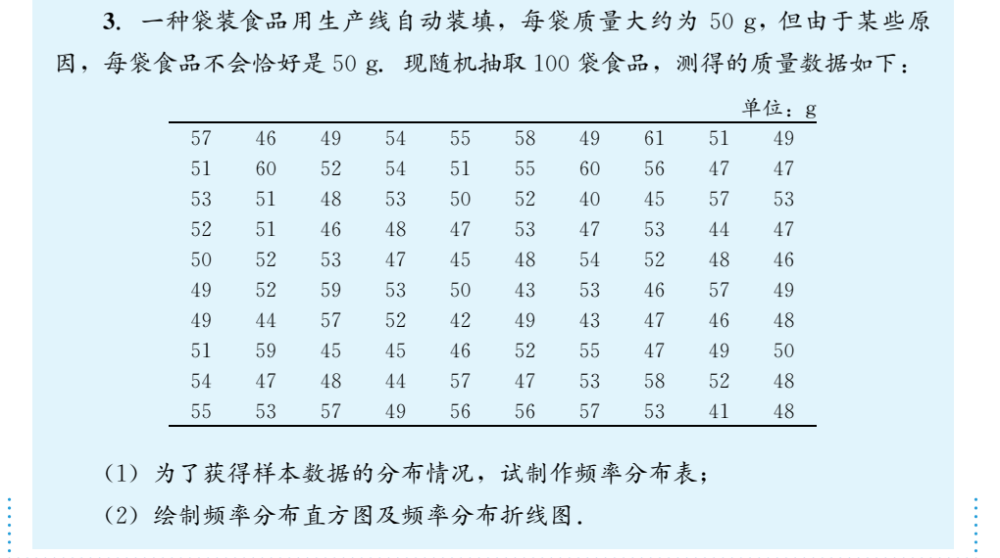

原页上下文：[PDF第237页](../原页上下文/PDF237-教材p230.webp)

## XJ-B1-C06-HW-P231-Y0446 习题6.3 第1题

教材位置：第6章 / 6.3 统计图表 / 印刷页 p.231 / PDF 第238页。

类型：习题；原题号：第1题。

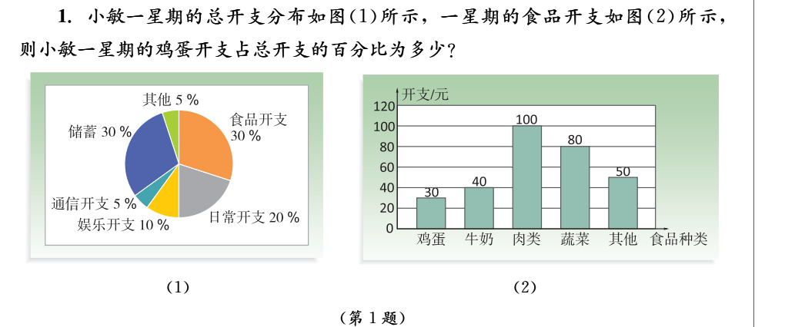

原页上下文：[PDF第238页](../原页上下文/PDF238-教材p231.webp)

## XJ-B1-C06-HW-P231-Y0872 习题6.3 第2题

教材位置：第6章 / 6.3 统计图表 / 印刷页 p.231 / PDF 第238页。

类型：习题；原题号：第2题。

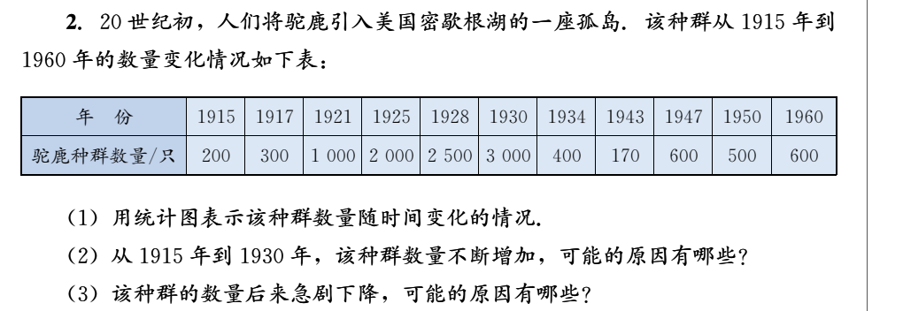

原页上下文：[PDF第238页](../原页上下文/PDF238-教材p231.webp)

## XJ-B1-C06-HW-P231-Y1224 习题6.3 第3题

教材位置：第6章 / 6.3 统计图表 / 印刷页 p.231、232 / PDF 第238、239页。

类型：习题；原题号：第3题。

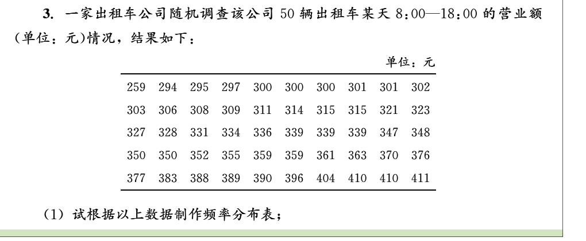

原页上下文：[PDF第238页](../原页上下文/PDF238-教材p231.webp)；[PDF第239页](../原页上下文/PDF239-教材p232.webp)

## XJ-B1-C06-HW-P232-Y0260 习题6.3 第4题

教材位置：第6章 / 6.3 统计图表 / 印刷页 p.232 / PDF 第239页。

类型：习题；原题号：第4题。

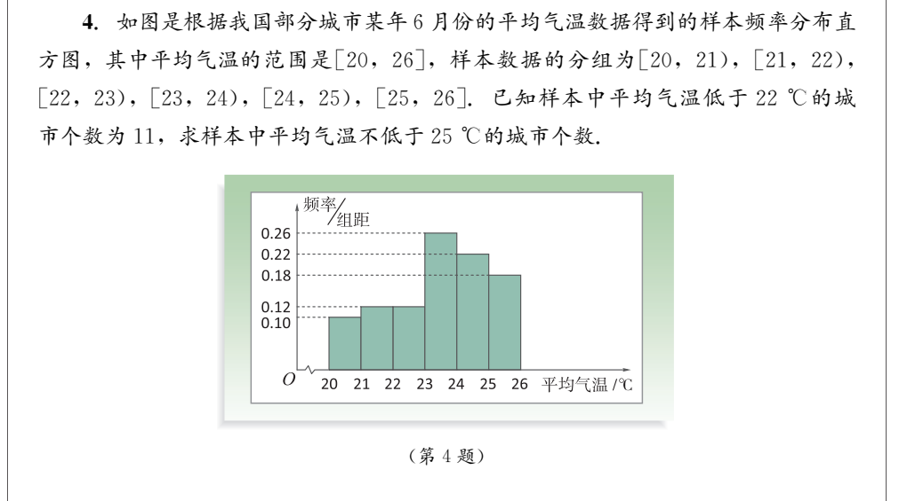

原页上下文：[PDF第239页](../原页上下文/PDF239-教材p232.webp)

## XJ-B1-C06-HW-P232-Y0932 习题6.3 第5题

教材位置：第6章 / 6.3 统计图表 / 印刷页 p.232、233 / PDF 第239、240页。

类型：习题；原题号：第5题。

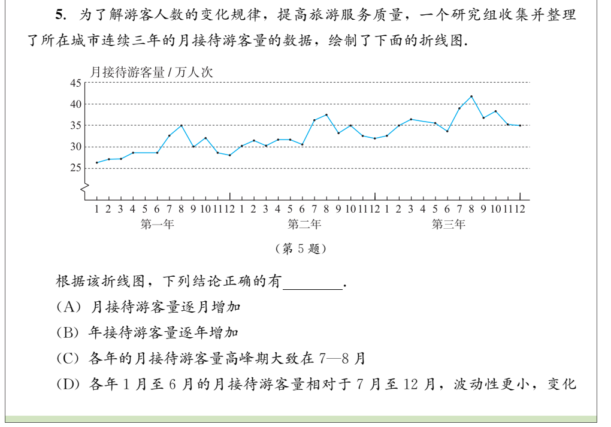

原页上下文：[PDF第239页](../原页上下文/PDF239-教材p232.webp)；[PDF第240页](../原页上下文/PDF240-教材p233.webp)

## XJ-B1-C06-HW-P233-Y0261 习题6.3 第6题

教材位置：第6章 / 6.3 统计图表 / 印刷页 p.233 / PDF 第240页。

类型：习题；原题号：第6题。

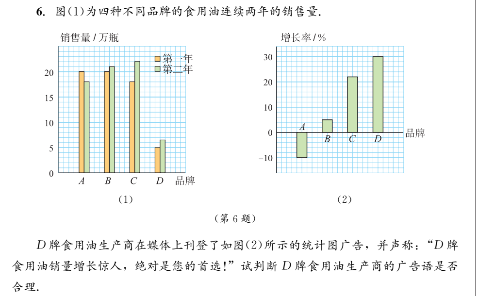

原页上下文：[PDF第240页](../原页上下文/PDF240-教材p233.webp)

## XJ-B1-C06-HW-P233-Y0871 习题6.3 第7题

教材位置：第6章 / 6.3 统计图表 / 印刷页 p.233 / PDF 第240页。

类型：习题；原题号：第7题。

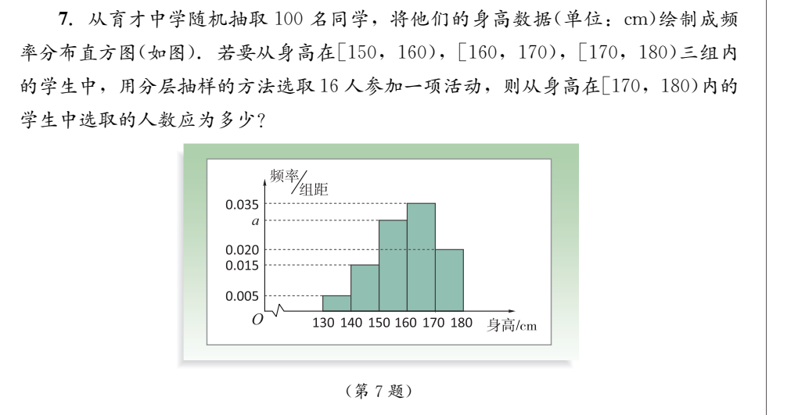

原页上下文：[PDF第240页](../原页上下文/PDF240-教材p233.webp)

## XJ-B1-C06-HW-P233-Y1402 习题6.3 第8题

教材位置：第6章 / 6.3 统计图表 / 印刷页 p.233 / PDF 第240页。

类型：习题；原题号：第8题。

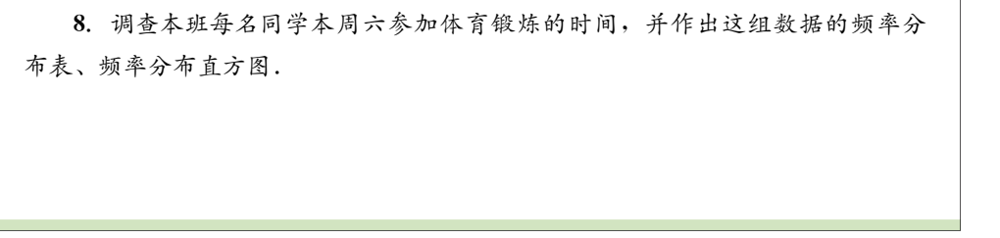

原页上下文：[PDF第240页](../原页上下文/PDF240-教材p233.webp)

## XJ-B1-C06-LAB-P234-Y0145 利用计算机制作统计图表

教材位置：第6章 / 6.3 统计图表 / 印刷页 p.234 / PDF 第241页。

类型：数学实验；原题号：完整实验任务。

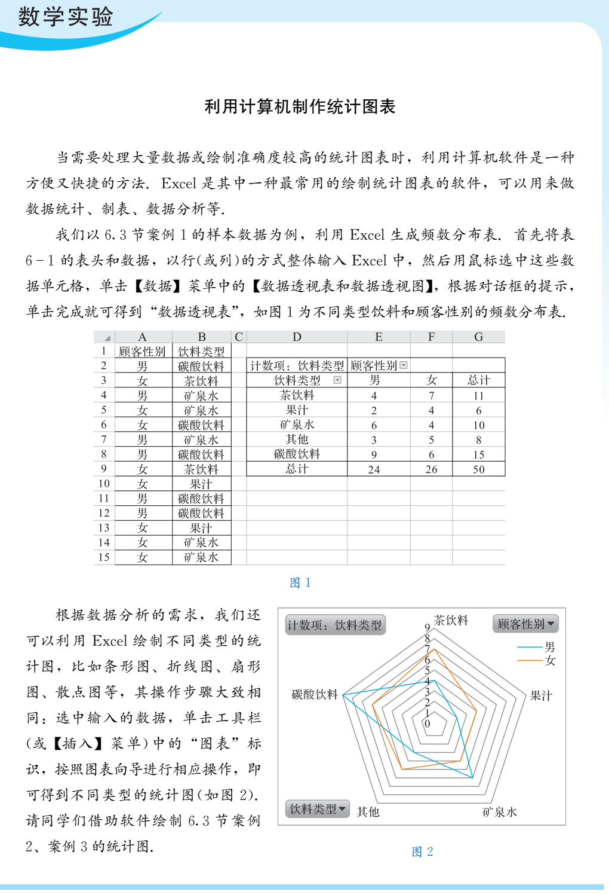

原页上下文：[PDF第241页](../原页上下文/PDF241-教材p234.webp)

## XJ-B1-C06-EX-P236-Y0767 6.4 例题 例题1

教材位置：第6章 / 6.4 用样本估计总体 / 印刷页 p.236 / PDF 第243页。

类型：例题；原题号：例题1。

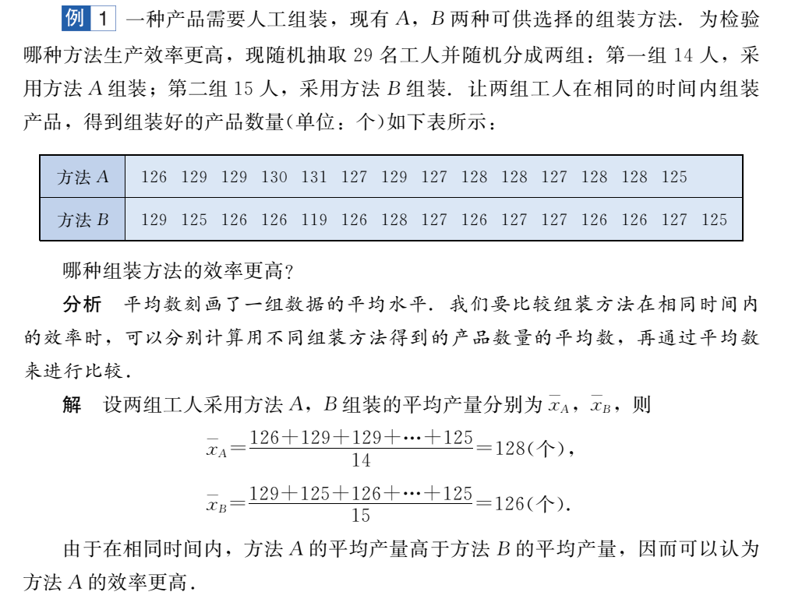

原页上下文：[PDF第243页](../原页上下文/PDF243-教材p236.webp)

## XJ-B1-C06-EX-P236-Y1549 6.4 例题 例题2

教材位置：第6章 / 6.4 用样本估计总体 / 印刷页 p.236、237 / PDF 第243、244页。

类型：例题；原题号：例题2。

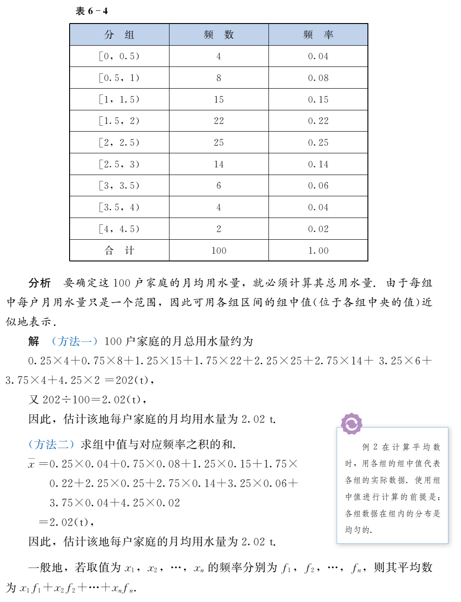

原页上下文：[PDF第243页](../原页上下文/PDF243-教材p236.webp)；[PDF第244页](../原页上下文/PDF244-教材p237.webp)

## XJ-B1-C06-EX-P237-Y1511 6.4 例题 例题3

教材位置：第6章 / 6.4 用样本估计总体 / 印刷页 p.237、238 / PDF 第244、245页。

类型：例题；原题号：例题3。

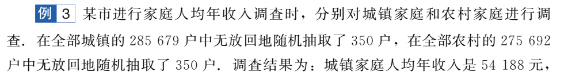
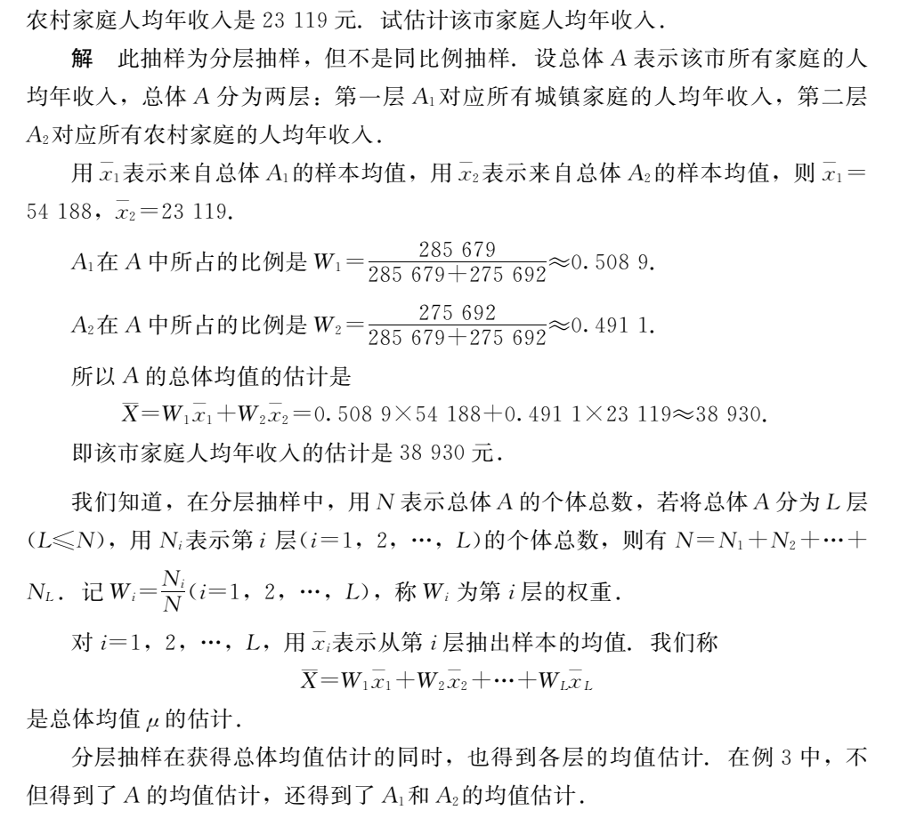

原页上下文：[PDF第244页](../原页上下文/PDF244-教材p237.webp)；[PDF第245页](../原页上下文/PDF245-教材p238.webp)

## XJ-B1-C06-PR-P238-Y1159 p.238 练习 第1题

教材位置：第6章 / 6.4 用样本估计总体 / 印刷页 p.238 / PDF 第245页。

类型：练习；原题号：第1题。

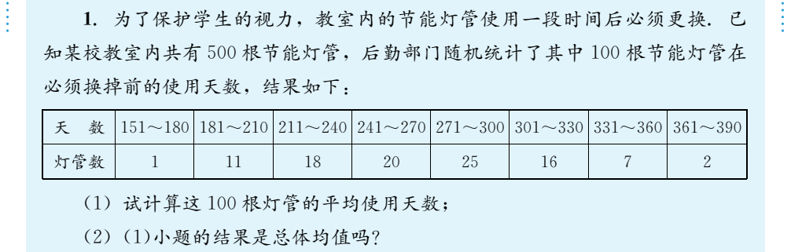

原页上下文：[PDF第245页](../原页上下文/PDF245-教材p238.webp)

## XJ-B1-C06-PR-P238-Y1480 p.238 练习 第2题

教材位置：第6章 / 6.4 用样本估计总体 / 印刷页 p.238 / PDF 第245页。

类型：练习；原题号：第2题。

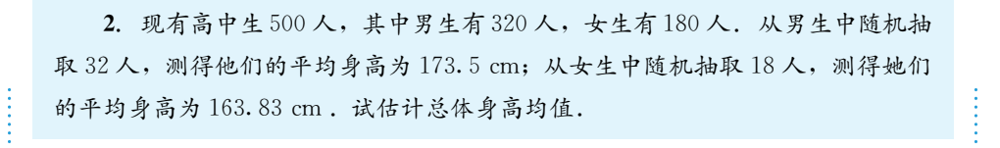

原页上下文：[PDF第245页](../原页上下文/PDF245-教材p238.webp)

## XJ-B1-C06-EX-P239-Y0957 6.4 例题 例题4

教材位置：第6章 / 6.4 用样本估计总体 / 印刷页 p.239、240 / PDF 第246、247页。

类型：例题；原题号：例题4。

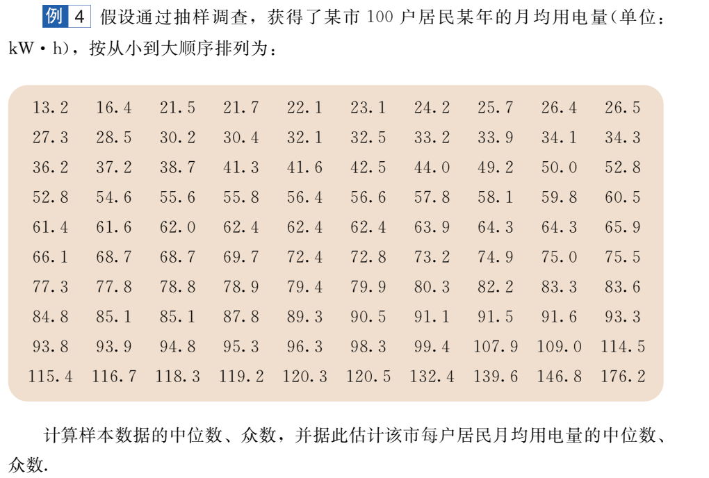
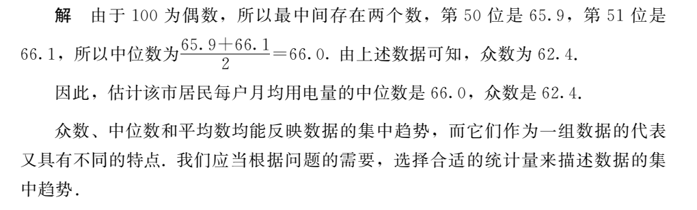

原页上下文：[PDF第246页](../原页上下文/PDF246-教材p239.webp)；[PDF第247页](../原页上下文/PDF247-教材p240.webp)

## XJ-B1-C06-EX-P240-Y0489 6.4 例题 例题5

教材位置：第6章 / 6.4 用样本估计总体 / 印刷页 p.240、241 / PDF 第247、248页。

类型：例题；原题号：例题5。

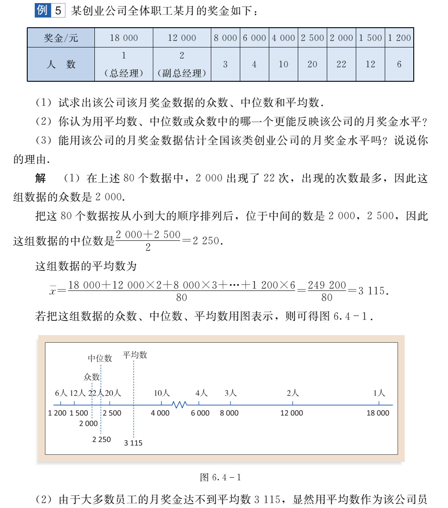
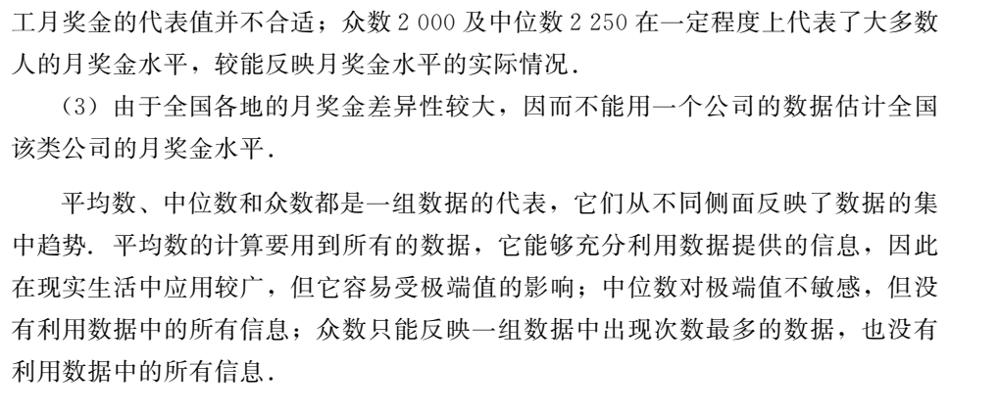

原页上下文：[PDF第247页](../原页上下文/PDF247-教材p240.webp)；[PDF第248页](../原页上下文/PDF248-教材p241.webp)

## XJ-B1-C06-PR-P241-Y0647 p.241 练习 第1题

教材位置：第6章 / 6.4 用样本估计总体 / 印刷页 p.241 / PDF 第248页。

类型：练习；原题号：第1题。

原页上下文：[PDF第248页](../原页上下文/PDF248-教材p241.webp)

## XJ-B1-C06-PR-P241-Y1232 p.241 练习 第2题

教材位置：第6章 / 6.4 用样本估计总体 / 印刷页 p.241 / PDF 第248页。

类型：练习；原题号：第2题。

原页上下文：[PDF第248页](../原页上下文/PDF248-教材p241.webp)

## XJ-B1-C06-TH-P242-Y0889 p.242 思考（含紧邻说明）

教材位置：第6章 / 6.4 用样本估计总体 / 印刷页 p.242、243 / PDF 第249、250页。

类型：思考；原题号：未编号题组。

原页上下文：[PDF第249页](../原页上下文/PDF249-教材p242.webp)；[PDF第250页](../原页上下文/PDF250-教材p243.webp)

## XJ-B1-C06-EX-P243-Y1308 6.4 例题 例题6

教材位置：第6章 / 6.4 用样本估计总体 / 印刷页 p.243、244 / PDF 第250、251页。

类型：例题；原题号：例题6。

原页上下文：[PDF第250页](../原页上下文/PDF250-教材p243.webp)；[PDF第251页](../原页上下文/PDF251-教材p244.webp)

## XJ-B1-C06-EX-P244-Y0613 6.4 例题 例题7

教材位置：第6章 / 6.4 用样本估计总体 / 印刷页 p.244、245、246 / PDF 第251、252、253页。

类型：例题；原题号：例题7。

原页上下文：[PDF第251页](../原页上下文/PDF251-教材p244.webp)；[PDF第252页](../原页上下文/PDF252-教材p245.webp)；[PDF第253页](../原页上下文/PDF253-教材p246.webp)

## XJ-B1-C06-EX-P246-Y0361 6.4 例题 例题8

教材位置：第6章 / 6.4 用样本估计总体 / 印刷页 p.246 / PDF 第253页。

类型：例题；原题号：例题8。

原页上下文：[PDF第253页](../原页上下文/PDF253-教材p246.webp)

## XJ-B1-C06-PR-P247-Y0217 p.247 练习 第1题

教材位置：第6章 / 6.4 用样本估计总体 / 印刷页 p.247 / PDF 第254页。

类型：练习；原题号：第1题。

原页上下文：[PDF第254页](../原页上下文/PDF254-教材p247.webp)

## XJ-B1-C06-PR-P247-Y0570 p.247 练习 第2题

教材位置：第6章 / 6.4 用样本估计总体 / 印刷页 p.247 / PDF 第254页。

类型：练习；原题号：第2题。

原页上下文：[PDF第254页](../原页上下文/PDF254-教材p247.webp)

## XJ-B1-C06-PR-P247-Y0922 p.247 练习 第3题

教材位置：第6章 / 6.4 用样本估计总体 / 印刷页 p.247 / PDF 第254页。

类型：练习；原题号：第3题。

原页上下文：[PDF第254页](../原页上下文/PDF254-教材p247.webp)

## XJ-B1-C06-TH-P248-Y0430 p.248 思考（含紧邻说明）

教材位置：第6章 / 6.4 用样本估计总体 / 印刷页 p.248 / PDF 第255页。

类型：思考；原题号：未编号题组。

原页上下文：[PDF第255页](../原页上下文/PDF255-教材p248.webp)

## XJ-B1-C06-EX-P248-Y0969 6.4 例题 例题9

教材位置：第6章 / 6.4 用样本估计总体 / 印刷页 p.248、249 / PDF 第255、256页。

类型：例题；原题号：例题9。

原页上下文：[PDF第255页](../原页上下文/PDF255-教材p248.webp)；[PDF第256页](../原页上下文/PDF256-教材p249.webp)

## XJ-B1-C06-TH-P249-Y0892 p.249 思考（含紧邻说明）

教材位置：第6章 / 6.4 用样本估计总体 / 印刷页 p.249 / PDF 第256页。

类型：思考；原题号：未编号题组。

原页上下文：[PDF第256页](../原页上下文/PDF256-教材p249.webp)

## XJ-B1-C06-PR-P250-Y0217 p.250 练习 第1题

教材位置：第6章 / 6.4 用样本估计总体 / 印刷页 p.250 / PDF 第257页。

类型：练习；原题号：第1题。

原页上下文：[PDF第257页](../原页上下文/PDF257-教材p250.webp)

## XJ-B1-C06-PR-P250-Y0799 p.250 练习 第2题

教材位置：第6章 / 6.4 用样本估计总体 / 印刷页 p.250 / PDF 第257页。

类型：练习；原题号：第2题。

原页上下文：[PDF第257页](../原页上下文/PDF257-教材p250.webp)

## XJ-B1-C06-TH-P251-Y0637 p.251 思考（含紧邻说明）

教材位置：第6章 / 6.4 用样本估计总体 / 印刷页 p.251 / PDF 第258页。

类型：思考；原题号：未编号题组。

原页上下文：[PDF第258页](../原页上下文/PDF258-教材p251.webp)

## XJ-B1-C06-EX-P251-Y1103 6.4 例题 例题10

教材位置：第6章 / 6.4 用样本估计总体 / 印刷页 p.251、252 / PDF 第258、259页。

类型：例题；原题号：例题10。

原页上下文：[PDF第258页](../原页上下文/PDF258-教材p251.webp)；[PDF第259页](../原页上下文/PDF259-教材p252.webp)

## XJ-B1-C06-EX-P252-Y0348 6.4 例题 例题11

教材位置：第6章 / 6.4 用样本估计总体 / 印刷页 p.252、253 / PDF 第259、260页。

类型：例题；原题号：例题11。

原页上下文：[PDF第259页](../原页上下文/PDF259-教材p252.webp)；[PDF第260页](../原页上下文/PDF260-教材p253.webp)

## XJ-B1-C06-PR-P253-Y0668 p.253 练习 第1题

教材位置：第6章 / 6.4 用样本估计总体 / 印刷页 p.253 / PDF 第260页。

类型：练习；原题号：第1题。

原页上下文：[PDF第260页](../原页上下文/PDF260-教材p253.webp)

## XJ-B1-C06-PR-P253-Y0840 p.253 练习 第2题

教材位置：第6章 / 6.4 用样本估计总体 / 印刷页 p.253 / PDF 第260页。

类型：练习；原题号：第2题。

原页上下文：[PDF第260页](../原页上下文/PDF260-教材p253.webp)

## XJ-B1-C06-HW-P254-Y0444 习题6.4 第1题

教材位置：第6章 / 6.4 用样本估计总体 / 印刷页 p.254 / PDF 第261页。

类型：习题；原题号：第1题。

原页上下文：[PDF第261页](../原页上下文/PDF261-教材p254.webp)

## XJ-B1-C06-HW-P254-Y0953 习题6.4 第2题

教材位置：第6章 / 6.4 用样本估计总体 / 印刷页 p.254 / PDF 第261页。

类型：习题；原题号：第2题。

原页上下文：[PDF第261页](../原页上下文/PDF261-教材p254.webp)

## XJ-B1-C06-HW-P254-Y1370 习题6.4 第3题

教材位置：第6章 / 6.4 用样本估计总体 / 印刷页 p.254、255 / PDF 第261、262页。

类型：习题；原题号：第3题。

原页上下文：[PDF第261页](../原页上下文/PDF261-教材p254.webp)；[PDF第262页](../原页上下文/PDF262-教材p255.webp)

## XJ-B1-C06-HW-P255-Y0260 习题6.4 第4题

教材位置：第6章 / 6.4 用样本估计总体 / 印刷页 p.255 / PDF 第262页。

类型：习题；原题号：第4题。

原页上下文：[PDF第262页](../原页上下文/PDF262-教材p255.webp)

## XJ-B1-C06-HW-P255-Y0519 习题6.4 第5题

教材位置：第6章 / 6.4 用样本估计总体 / 印刷页 p.255 / PDF 第262页。

类型：习题；原题号：第5题。

原页上下文：[PDF第262页](../原页上下文/PDF262-教材p255.webp)

## XJ-B1-C06-HW-P255-Y0772 习题6.4 第6题

教材位置：第6章 / 6.4 用样本估计总体 / 印刷页 p.255 / PDF 第262页。

类型：习题；原题号：第6题。

原页上下文：[PDF第262页](../原页上下文/PDF262-教材p255.webp)

## XJ-B1-C06-HW-P255-Y1208 习题6.4 第7题

教材位置：第6章 / 6.4 用样本估计总体 / 印刷页 p.255 / PDF 第262页。

类型：习题；原题号：第7题。

原页上下文：[PDF第262页](../原页上下文/PDF262-教材p255.webp)

## XJ-B1-C06-HW-P255-Y1508 习题6.4 第8题

教材位置：第6章 / 6.4 用样本估计总体 / 印刷页 p.255、256 / PDF 第262、263页。

类型：习题；原题号：第8题。

原页上下文：[PDF第262页](../原页上下文/PDF262-教材p255.webp)；[PDF第263页](../原页上下文/PDF263-教材p256.webp)

## XJ-B1-C06-HW-P256-Y0260 习题6.4 第9题

教材位置：第6章 / 6.4 用样本估计总体 / 印刷页 p.256 / PDF 第263页。

类型：习题；原题号：第9题。

原页上下文：[PDF第263页](../原页上下文/PDF263-教材p256.webp)

## XJ-B1-C06-HW-P256-Y0708 习题6.4 第10题

教材位置：第6章 / 6.4 用样本估计总体 / 印刷页 p.256 / PDF 第263页。

类型：习题；原题号：第10题。

原页上下文：[PDF第263页](../原页上下文/PDF263-教材p256.webp)

## XJ-B1-C06-HW-P256-Y1125 习题6.4 第11题

教材位置：第6章 / 6.4 用样本估计总体 / 印刷页 p.256、257 / PDF 第263、264页。

类型：习题；原题号：第11题。

原页上下文：[PDF第263页](../原页上下文/PDF263-教材p256.webp)；[PDF第264页](../原页上下文/PDF264-教材p257.webp)

## XJ-B1-C06-HW-P257-Y0217 习题6.4 第12题

教材位置：第6章 / 6.4 用样本估计总体 / 印刷页 p.257 / PDF 第264页。

类型：习题；原题号：第12题。

原页上下文：[PDF第264页](../原页上下文/PDF264-教材p257.webp)

## XJ-B1-C06-HW-P257-Y0449 习题6.4 第13题

教材位置：第6章 / 6.4 用样本估计总体 / 印刷页 p.257 / PDF 第264页。

类型：习题；原题号：第13题。

原页上下文：[PDF第264页](../原页上下文/PDF264-教材p257.webp)

## XJ-B1-C06-HW-P257-Y0885 习题6.4 第14题

教材位置：第6章 / 6.4 用样本估计总体 / 印刷页 p.257 / PDF 第264页。

类型：习题；原题号：第14题。

原页上下文：[PDF第264页](../原页上下文/PDF264-教材p257.webp)

## XJ-B1-C06-SU-P262-Y1160 第6章 小结与复习 第1题

教材位置：第6章 / 小结与复习 小结与复习 / 印刷页 p.262 / PDF 第269页。

类型：小结与复习；原题号：第1题。

原页上下文：[PDF第269页](../原页上下文/PDF269-教材p262.webp)

## XJ-B1-C06-SU-P262-Y1246 第6章 小结与复习 第2题

教材位置：第6章 / 小结与复习 小结与复习 / 印刷页 p.262 / PDF 第269页。

类型：小结与复习；原题号：第2题。

原页上下文：[PDF第269页](../原页上下文/PDF269-教材p262.webp)

## XJ-B1-C06-SU-P262-Y1504 第6章 小结与复习 第3题

教材位置：第6章 / 小结与复习 小结与复习 / 印刷页 p.262、263 / PDF 第269、270页。

类型：小结与复习；原题号：第3题。

原页上下文：[PDF第269页](../原页上下文/PDF269-教材p262.webp)；[PDF第270页](../原页上下文/PDF270-教材p263.webp)

## XJ-B1-C06-SU-P263-Y0217 第6章 小结与复习 第4题

教材位置：第6章 / 小结与复习 小结与复习 / 印刷页 p.263 / PDF 第270页。

类型：小结与复习；原题号：第4题。

原页上下文：[PDF第270页](../原页上下文/PDF270-教材p263.webp)

## XJ-B1-C06-SU-P263-Y0561 第6章 小结与复习 第5题

教材位置：第6章 / 小结与复习 小结与复习 / 印刷页 p.263 / PDF 第270页。

类型：小结与复习；原题号：第5题。

原页上下文：[PDF第270页](../原页上下文/PDF270-教材p263.webp)

## XJ-B1-C06-RV-P264-Y0406 复习题六 第1题

教材位置：第6章 / 章末复习 复习题六 / 印刷页 p.264 / PDF 第271页。

类型：复习题；原题号：第1题。

原页上下文：[PDF第271页](../原页上下文/PDF271-教材p264.webp)

## XJ-B1-C06-RV-P264-Y0707 复习题六 第2题

教材位置：第6章 / 章末复习 复习题六 / 印刷页 p.264 / PDF 第271页。

类型：复习题；原题号：第2题。

原页上下文：[PDF第271页](../原页上下文/PDF271-教材p264.webp)

## XJ-B1-C06-RV-P264-Y0965 复习题六 第3题

教材位置：第6章 / 章末复习 复习题六 / 印刷页 p.264 / PDF 第271页。

类型：复习题；原题号：第3题。

原页上下文：[PDF第271页](../原页上下文/PDF271-教材p264.webp)

## XJ-B1-C06-RV-P264-Y1051 复习题六 第4题

教材位置：第6章 / 章末复习 复习题六 / 印刷页 p.264 / PDF 第271页。

类型：复习题；原题号：第4题。

原页上下文：[PDF第271页](../原页上下文/PDF271-教材p264.webp)

## XJ-B1-C06-RV-P264-Y1266 复习题六 第5题

教材位置：第6章 / 章末复习 复习题六 / 印刷页 p.264、265 / PDF 第271、272页。

类型：复习题；原题号：第5题。

原页上下文：[PDF第271页](../原页上下文/PDF271-教材p264.webp)；[PDF第272页](../原页上下文/PDF272-教材p265.webp)

## XJ-B1-C06-RV-P265-Y0217 复习题六 第6题

教材位置：第6章 / 章末复习 复习题六 / 印刷页 p.265 / PDF 第272页。

类型：复习题；原题号：第6题。

原页上下文：[PDF第272页](../原页上下文/PDF272-教材p265.webp)

## XJ-B1-C06-RV-P265-Y0501 复习题六 第7题

教材位置：第6章 / 章末复习 复习题六 / 印刷页 p.265 / PDF 第272页。

类型：复习题；原题号：第7题。

原页上下文：[PDF第272页](../原页上下文/PDF272-教材p265.webp)

## XJ-B1-C06-RV-P265-Y0964 复习题六 第8题

教材位置：第6章 / 章末复习 复习题六 / 印刷页 p.265 / PDF 第272页。

类型：复习题；原题号：第8题。

原页上下文：[PDF第272页](../原页上下文/PDF272-教材p265.webp)

## XJ-B1-C06-RV-P265-Y1455 复习题六 第9题

教材位置：第6章 / 章末复习 复习题六 / 印刷页 p.265、266 / PDF 第272、273页。

类型：复习题；原题号：第9题。

原页上下文：[PDF第272页](../原页上下文/PDF272-教材p265.webp)；[PDF第273页](../原页上下文/PDF273-教材p266.webp)

## XJ-B1-C06-RV-P266-Y0326 复习题六 第10题

教材位置：第6章 / 章末复习 复习题六 / 印刷页 p.266 / PDF 第273页。

类型：复习题；原题号：第10题。

原页上下文：[PDF第273页](../原页上下文/PDF273-教材p266.webp)

## XJ-B1-C06-RV-P266-Y0893 复习题六 第11题

教材位置：第6章 / 章末复习 复习题六 / 印刷页 p.266 / PDF 第273页。

类型：复习题；原题号：第11题。

原页上下文：[PDF第273页](../原页上下文/PDF273-教材p266.webp)

## XJ-B1-C06-RV-P266-Y1140 复习题六 第12题

教材位置：第6章 / 章末复习 复习题六 / 印刷页 p.266、267 / PDF 第273、274页。

类型：复习题；原题号：第12题。

原页上下文：[PDF第273页](../原页上下文/PDF273-教材p266.webp)；[PDF第274页](../原页上下文/PDF274-教材p267.webp)

## XJ-B1-C06-RV-P267-Y0346 复习题六 第13题

教材位置：第6章 / 章末复习 复习题六 / 印刷页 p.267 / PDF 第274页。

类型：复习题；原题号：第13题。

原页上下文：[PDF第274页](../原页上下文/PDF274-教材p267.webp)

## XJ-B1-C06-RV-P267-Y1120 复习题六 第14题

教材位置：第6章 / 章末复习 复习题六 / 印刷页 p.267、268 / PDF 第274、275页。

类型：复习题；原题号：第14题。

原页上下文：[PDF第274页](../原页上下文/PDF274-教材p267.webp)；[PDF第275页](../原页上下文/PDF275-教材p268.webp)

## XJ-B1-C06-RV-P268-Y0432 复习题六 第15题

教材位置：第6章 / 章末复习 复习题六 / 印刷页 p.268 / PDF 第275页。

类型：复习题；原题号：第15题。

原页上下文：[PDF第275页](../原页上下文/PDF275-教材p268.webp)

## XJ-B1-C06-RV-P268-Y1202 复习题六 第16题

教材位置：第6章 / 章末复习 复习题六 / 印刷页 p.268、269 / PDF 第275、276页。

类型：复习题；原题号：第16题。

原页上下文：[PDF第275页](../原页上下文/PDF275-教材p268.webp)；[PDF第276页](../原页上下文/PDF276-教材p269.webp)

## XJ-B1-C06-RV-P269-Y0453 复习题六 第17题

教材位置：第6章 / 章末复习 复习题六 / 印刷页 p.269 / PDF 第276页。

类型：复习题；原题号：第17题。

原页上下文：[PDF第276页](../原页上下文/PDF276-教材p269.webp)
